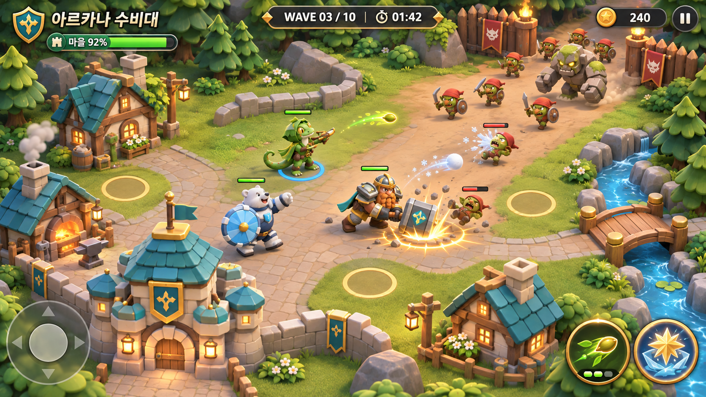
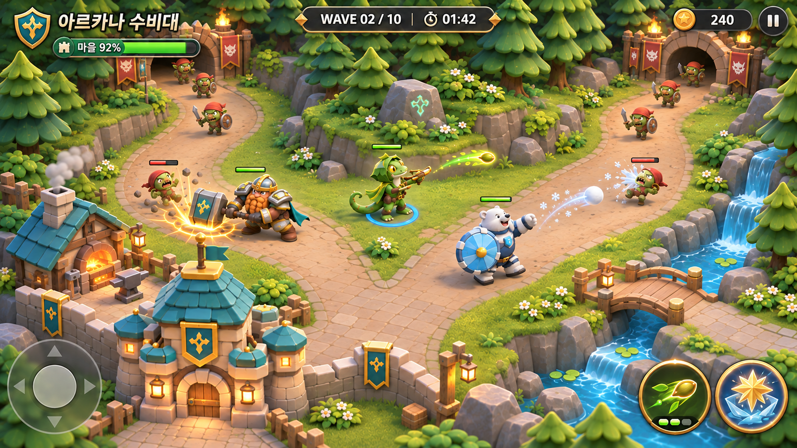
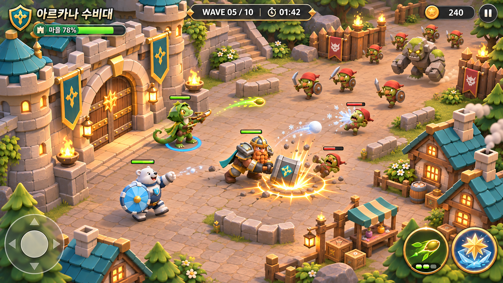
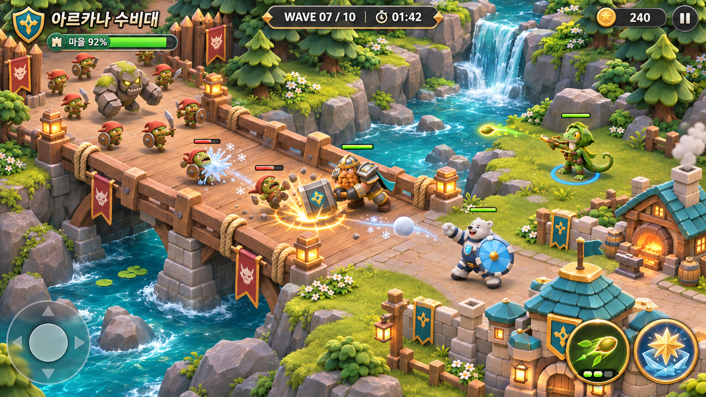
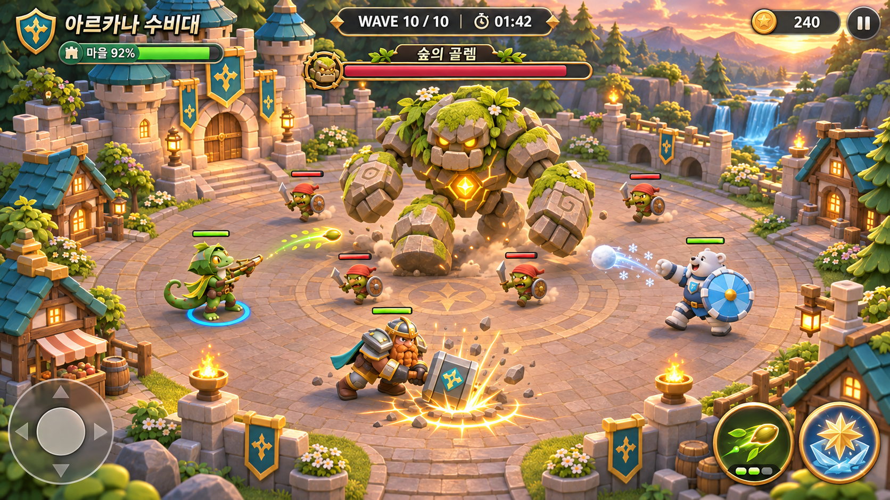
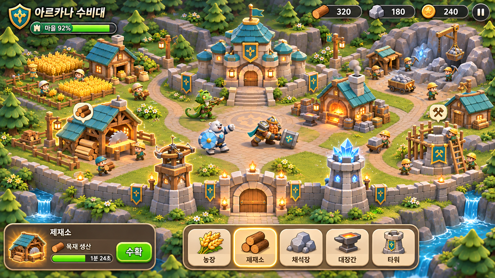
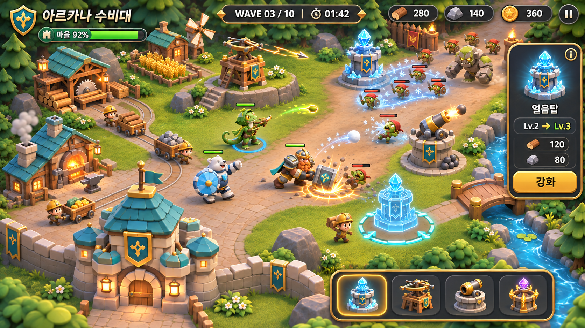

# 승인 게임 화면 원본

2026-11-13 KST 승인. [제작 규칙](../../../../docs/arcana-approved-visual-standard.md). 생성형 게임 화면 콘셉트이며 런타임 스크린샷이 아니다. 원본 PNG는 편집 없이 복사했고 생성 파일명과 해시는 `manifest.json`에 기록했다.

## 최초 스타일 기준

## 전투 모드 4장

## 생산·타워 모드 2장

