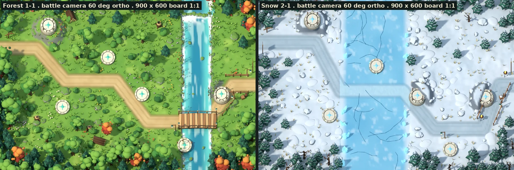
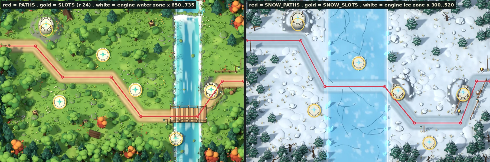
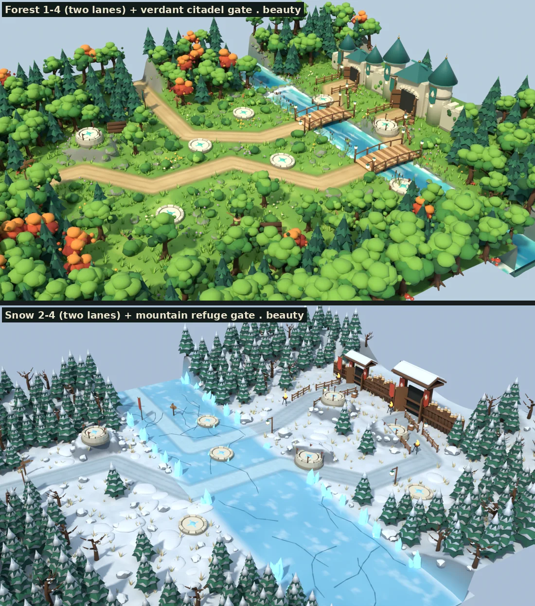
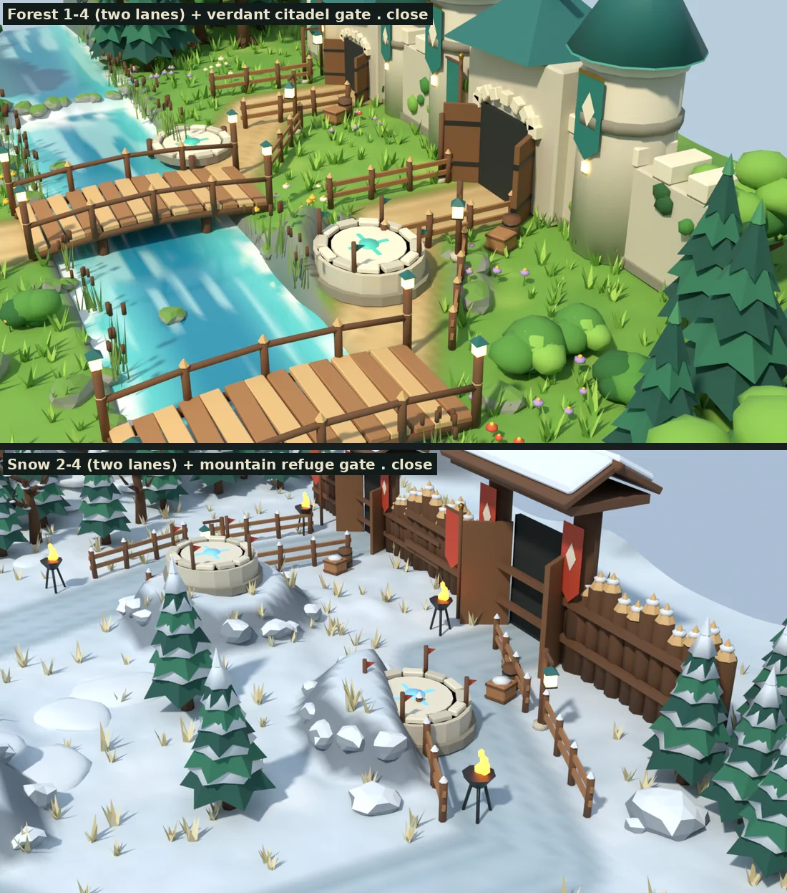
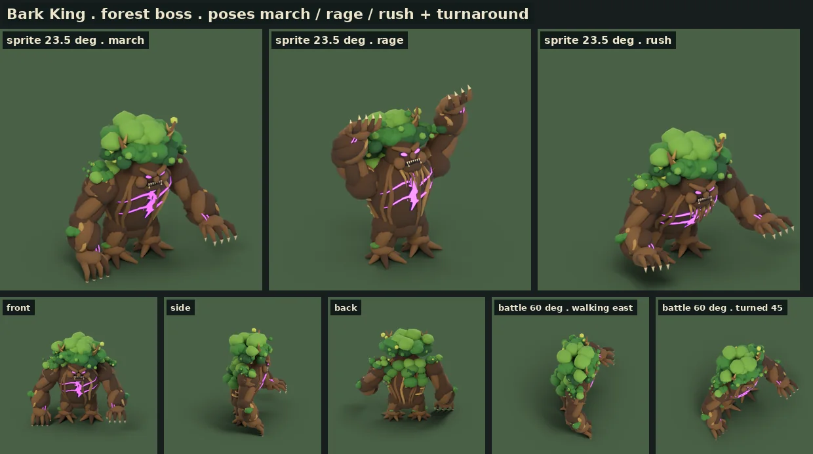
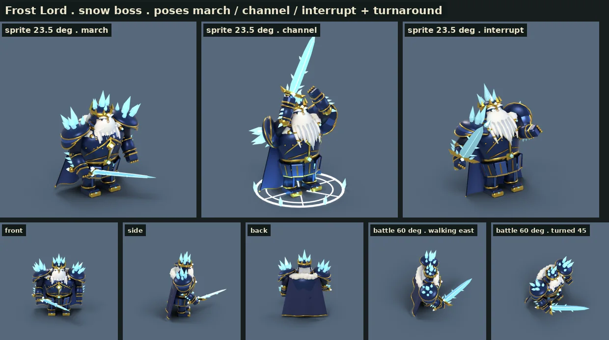
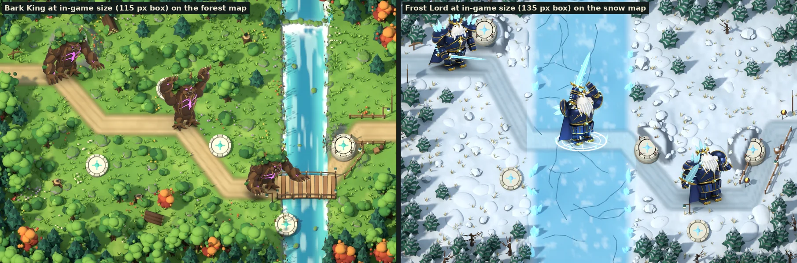
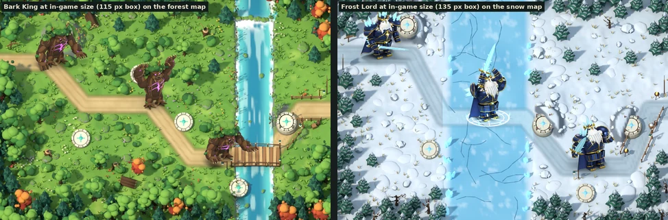

# 아르카나 3D 모델링 — 맵 테마와 대표 캐릭터 (방향 · 각도 · 레퍼런스)

2026-11-10 · 기준 구현 main `b175a9f` · **제작 후보(초안)**: 이 폴더의 모델·렌더는 게임에 연결하지 않았다. 게임 코드·에셋·저장 형식은 바꾸지 않았다.

사용자 요청(2026-11-10 20시대 KST): “3d 모델링 디테일하게, 맵 테마와, 대표 캐릭터들, 원격 다시 방향성과 각도-레퍼런스 잡고 하기”.

이 문서는 ① 원격 최신 작업에서 읽은 방향 ② 각도 계약 ③ 레퍼런스 보드 ④ 만든 것(숲·설산 맵 테마, 지역 보스 둘) ⑤ 게임 크기 확인 ⑥ 한계와 다음 단계를 담는다.

## 1. 원격에서 읽은 방향

| 원격 작업 | 읽은 내용 | 이 작업에 반영한 것 |
| --- | --- | --- |
| main `b175a9f` · PR #104 [적·보스 제작 설계 v1](../arcana-enemy-design/README.md) | 보스 외형 계약과 동작 이름. 고목왕: 두 팔·뿌리 두 다리·잎 수관·보라색 흉부 균열. 서리군주: 흰 수염·금관·남색 망토·금색 장식·얼음 어깨판·대검 한 자루. “보스 판독성: 두 보스의 새 모델/리그”가 납품 2순위 | **대표 캐릭터 = 지역 보스 둘.** 외형 계약과 동작 이름(march·rage·rush / march·channel·interrupt)을 그대로 따랐다 |
| `codex/arcana-3d-world-sync-20261109` (미병합, 11-10 14:47 KST) | 전투 지형을 실시간 3D로 바꾸는 시제품. **60도 정사영 카메라**, 지면 깊이를 1/sin60으로 늘려 900×600 보드와 1:1. 나무는 단순한 덩어리. 다음 순서에 “숲·설산 지형을 고도·재질·지역 기물로 발전” | **맵의 카메라·좌표 규칙을 그대로 채택.** 그 위에 고도·강·빙판·다리·기물·성문을 디테일하게 만들었다 |
| `claude/wizardly-shannon-zqnwg0` 기획 루프 80회차 (11-10 19:51 KST) | 영웅 모델 **여섯 층 디테일 기준**(얼굴·손·머리·옷·소품·재질), 두 크기 확인(초상·전투). 청운 디테일 판 완료, 루나·이안·리엘 예정 | **영웅 넷은 그 루프의 몫이라 다시 만들지 않는다.** 여섯 층과 두 크기 확인을 보스·맵에 맞게 옮겨 썼다(3장) |
| main [모델 제작 과정](../arcana-asset-pipeline.md) | Blender 생성 스크립트 → GLB/PNG → 전투용 WebP. 유닛 공용 카메라(브론): 정사영, 640 프레임, 바닥 기준 (320, 550) | 유닛 각도 세트의 스프라이트 카메라를 같은 계약으로 맞췄다 |
| 사용자 결정(기획 루프 기록) | 모바일은 가로만. 가로 배율 0.505~0.572(844×390에서 지도 약 482×321px) | 게임 크기 확인을 482px 폭으로 했다 |

## 2. 각도 계약

모든 모델은 아래 **정해진 각도 세트**에서 굽고 확인한다. 값은 [`scripts/arcana_bpy.py`](scripts/arcana_bpy.py)의 `battle_camera`·`sprite_camera`·`unit_views`에 있다.

| 이름 | 투영 · 각도 | 쓰는 곳 | 근거 |
| --- | --- | --- | --- |
| **전투 카메라** | 정사영, 수평에서 **60도 위**, 북쪽을 봄. 지면 깊이를 1/sin60(=1.155)배 늘려 렌더가 900×600 보드와 1:1 | 맵(전투 밑그림) | 3d-world-sync의 `terrain3d.ts` |
| **스프라이트 카메라** | 정사영, **고도 23.5도 · 좌우 35도**(카메라 (7,10,7) → 목표 (0,0,1.7), 키 3.4 기준 폭 5.8). 640 프레임, 바닥 점 (320, 550). 유닛은 오른쪽을 본다 | 유닛(영웅·적·보스) | `tools/blender/build_dwarf.py` |
| 턴어라운드 | 스프라이트 고도 그대로 정면·옆·뒤 | 모델 검수 | 이 작업 |
| 전투 60도 · 걷는 방향 / 45도 돌림 | 유닛을 전투 카메라로 본 모습 | 실시간 3D로 갈 때의 판독성 확인 | 이 작업 |
| 맵 보기(3/4 · 근접 · 넓게) | 원근 40~46mm, 남서쪽에서 | 테마 소개 · 디테일 검수 | 이 작업 |

**두 각도는 다르다.** 지형은 60도, 유닛은 23.5도다. 세로로 선 선분은 스프라이트 카메라에서 0.92배, 전투 카메라에서 0.5배 길이로 보인다. 전투 카메라에서는 그만큼 몸의 깊이가 세로로 펼쳐져 정수리와 등이 보인다.

- 지금 게임(2.5D)과 3d-world-sync 시제품은 모두 **60도 지형 위에 23.5도 스프라이트**를 올린다. 이 조합을 유지하는 것을 기준으로 삼는다. 5장의 게임 크기 확인도 이 조합이다.
- 유닛까지 실시간 3D로 바꾸면 적은 길을 따라 옆으로 걷기 때문에 정수리와 옆구리만 보인다. 4장 보스 각도 시트의 ‘전투 60도’ 칸이 그 모습이다. 그 전환을 할 때는 유닛을 카메라 쪽으로 세워 그리는 보정이 따로 필요하다.

## 3. 레퍼런스 보드와 디테일 기준

| 대상 | 저장소 안 레퍼런스 | 가져온 것 | 버린 것 |
| --- | --- | --- | --- |
| 숲 맵 | `public/defense/forest.png`, `art-source/defense/concepts/2026-11-06/verdant-heart.png`, 3d-world-sync `forest-battle.png` | 가장자리 숲 띠, 북쪽 폭포, 청록 강, 흙길의 바퀴 자국, 청록 지붕·깃발의 성문, 주홍 단풍 포인트 | 평평한 채색, 단순 덩어리 나무, 컨셉의 영웅·적 배치 |
| 설산 맵 | `public/defense/snow.png`, `concepts/2026-11-06/silverfrost-pass.png`, 3d-world-sync `snow-battle.png` | 눈 덮인 침엽수, 주홍 깃발, 통나무 목책, 화로, 얼음 결정, 다져진 눈길 | 가운데 연못 모양 빙판(엔진의 빙판은 세로 띠 x 300~520이라 **얼어붙은 강**으로 바꿈) |
| 고목왕 | `public/defense/boss-models.webp`, `docs/arcana-enemy-design/boss-reference.webp`·`boss-motion-storyboard.webp` | 넓은 어깨, 땅에 닿는 굵은 팔, 뿌리 발가락, 잎 수관, 가슴의 보라 균열과 눈, 부러진 뿔 가지 | 쓰러짐(FALL) 포즈는 이번에 만들지 않음 |
| 서리군주 | 같은 세 파일 | 땅딸막한 판금 체형, 얼음 결정이 자란 어깨판, 금관 위 얼음 첨탑, 흰 수염, 남색 망토와 털 깃, 얼음 대검 | 동결 광선(FREEZE)은 효과 쪽 일이라 제외 |

**디테일 기준** — 기획 루프 80회차의 여섯 층을 대상에 맞게 옮겼다.

| 층 | 보스에서 | 맵에서 |
| --- | --- | --- |
| ① 얼굴 | 눈썹·눈구멍·빛나는 눈·코·입·이빨 | 성문 정면(아치 돌·문짝·철띠·창) |
| ② 손 | 손가락 넷 + 엄지 + 발톱 / 건틀릿 마디 | 다리 난간·말뚝·등불 |
| ③ 머리 | 뿔 가지·잎 수관 / 금관 뾰족이·얼음 첨탑·뒷머리 | 나무 수관을 15~19개 잎 덩어리로, 침엽수는 층마다 두 겹 |
| ④ 옷 | 껍질 능선·뿌리 다발 / 판금 겹·금테·망토 주름 | 길의 가장자리 띠·바퀴 자국, 강의 물결 줄·거품, 빙판의 서리·금 |
| ⑤ 소품 | 버섯·덩굴·이끼 / 벨트 버클·사슬·보석 | 건설 지점 룬, 표지판, 깃발, 울타리, 통나무 더미, 도끼 박힌 그루터기, 상자·통 |
| ⑥ 재질 | 같은 색의 세 톤 + 발광 | 정점 색 지면(풀 4톤·흙 2톤·바위 2톤) + 미세 요철 |

두 크기 확인: **크게**(맵 1350px·유닛 640px 프레임)에서 층이 보이고, **게임 크기**(지도 482px 폭)에서 길·건설 지점·보스 실루엣이 읽혀야 한다.

## 4. 만든 것

### 4-1. 맵 테마 — 숲(청록 숲) · 설산(서리산맥)

[`scripts/build_theme_map.py`](scripts/build_theme_map.py)는 게임의 `src/games/defense/data.ts`에서 **길(PATHS)·건설 지점(SLOTS)을 직접 읽어** 지형을 만든다. 엔진의 물길 구간(x 650~735)과 빙판 구간(x 300~520)도 같은 숫자를 쓴다. 스테이지 번호를 주면 그 판에 열린 지점과 진입로 수(1-4·2-4는 두 길)가 따라온다.



위 두 장은 전투 카메라 렌더다. 그대로 900×600 보드에 깔 수 있는 **전투 밑그림 후보**다.



빨간 선은 게임의 길 좌표, 금색 원은 건설 지점(반지름 24), 흰 선은 엔진의 물길·빙판 경계다. 렌더의 길·지점·강·빙판이 그 위에 놓인다.





보드 밖 여백까지 넣은 넓은 보기는 [`renders/maps-wide.webp`](renders/maps-wide.webp), 1350px 밑그림 원본은 [`forest-battle-1350.webp`](renders/forest-battle-1350.webp)·[`snow-battle-1350.webp`](renders/snow-battle-1350.webp)다.

| 요소 | 숲 | 설산 |
| --- | --- | --- |
| 지형 | 5px 격자 높이 지형. 길은 평평하게, 고지대 지점은 +0.26 솟은 바위 단, 보드 밖은 언덕 | 같음 + 바람에 쌓인 눈 둔덕 |
| 길 | 밝은 흙 속, 어두운 가장자리 띠, 바퀴 자국 두 줄 | 다져진 눈길. 빙판 위에서는 긁힌 얼음길 |
| 구간 | 강: 물결 줄·기슭 거품·북쪽 작은 폭포·징검돌·갈대 | 얼어붙은 강: 서리 무늬·금 26줄·기슭의 얼음 결정 |
| 건너는 곳 | 널다리(판자 14장, 아치, 난간, 말뚝, 양 끝 등불) | 빙판 위를 그대로 지남 |
| 건설 지점 | 돌 단 + 테두리 돌 12개 + 룬. 고지대는 2단 + 깃발, 물가는 말뚝·밧줄, 빙판은 결정 | 같음(룬은 하늘색) |
| 나무 | 활엽수 4종(잎 덩어리 15~19개, 뿌리, 가지) · 침엽수 3종 · 주홍 단풍 1종 | 눈 얹은 침엽수 4종 · 앙상한 나무 2종 |
| 작은 것 | 풀 포기 3,200 · 꽃 약 270 · 덤불 · 버섯 · 바위(이끼 윗면) | 마른 풀 700 · 눈 둔덕 · 바위(눈 윗면) |
| 이야기 소품 | 등불 기둥, 표지판, 울타리, 청록 깃발, 상자·통, 통나무 더미, 도끼 박힌 그루터기 | 화로, 등불, 울타리, 주홍 깃발, 상자·통 |
| 성문 세트 | 녹음 성채: 상아 돌벽·총안·청록 원뿔 지붕 탑 둘·열린 문·깃발·담쟁이 | 산맥 피난소: 뾰족 통나무 목책·눈 얹은 맞배지붕·주홍 깃발 |

수치: 숲 1-1 4,272개 물체 · 648,643 삼각형, 숲 1-4(성문 포함) 4,213 · 661,618, 설산 2-1 1,269 · 405,434, 설산 2-4(성문 포함) 1,262 · 389,290. 같은 메시를 여러 번 놓는 방식이라 메시 종류는 37~50개다.

### 4-2. 대표 캐릭터 — 지역 보스

유닛은 **관절마다 물체를 나눈 강체 구조**다(브론과 같은 방식). 물체의 원점이 관절이라, 포즈는 관절 회전값 표로만 정한다. 공용 실행기는 [`scripts/arcana_unit.py`](scripts/arcana_unit.py)다.



**고목왕** — [`scripts/build_boss_barkking.py`](scripts/build_boss_barkking.py) · 17,914 삼각형 · 관절 6(몸통·머리·좌우 어깨·좌우 팔꿈치)

- 몸통: 앞으로 기운 고목 줄기 + 껍질 능선 16줄(가슴은 비움). 가슴 균열은 지그재그 여섯 마디, 그을린 테, 옆으로 번지는 빛줄기.
- 머리: 화난 눈썹, 빛나는 눈, 코 옹이, 뚫린 입과 가시 이빨, 뿌리 수염 11가닥, 부러진 뿔 가지 한 쌍, 잎 수관.
- 팔: 어깨 혹과 세 겹 껍질 견갑, 뿌리 네 가닥이 꼬인 위팔, 다섯 가닥 아래팔, 손가락 넷 + 엄지 + 발톱.
- 다리: 뿌리 다발과 발가락 일곱 가닥(앞쪽이 길다).
- 포즈: `march`(무거운 걸음), `rage`(두 팔 들기, 발광 ×1.9), `rush`(몸을 낮추고 두 팔 앞으로, 발광 ×1.6).



**서리군주** — [`scripts/build_boss_frostlord.py`](scripts/build_boss_frostlord.py) · 15,158 삼각형 · 관절 7(몸통·머리·좌우 어깨·좌우 팔꿈치·대검) + 효과 물체 1(충전 문양)

- 몸통: 남색 흉갑, 치마 판금 10장과 금 단, 금 벨트·버클, 가슴 능선·사선 금띠·리벳, 금 마름모 문장과 얼음 심장, 목 가리개, 주름 잡힌 망토(겉·안감·금 단), 털 깃 18덩이, 걸쇠 사슬.
- 머리: 빛나는 눈, 굵은 눈썹, 콧수염, 수염 덩어리 + 가닥 11개, 금 고리를 낀 옆 땋은 머리, 금관 뾰족이 8개, 관을 뚫고 자란 얼음 첨탑 6개.
- 팔: 세 겹 견갑마다 금테, 어깨에서 자란 얼음 결정 6개, 팔꿈치 금 덮개, 팔뚝 얼음 지느러미, 건틀릿.
- 대검: 남색 손잡이와 금 감개, 금 가드와 얼음 보석, 마름모 단면 얼음 날 + 밝은 심, 날 가장자리 서리 가시.
- 포즈: `march`(검을 낮게 앞으로), `channel`(2.5초 충전: 검을 머리 위로, 바닥 문양, 발광 ×2.4), `interrupt`(차단: 뒤로 젖혀짐, 발광 ×0.35).

## 5. 게임 크기 확인



스프라이트 각도의 보스를 게임이 그리는 크기(고목왕 115px, 서리군주 135px 상자)로 60도 맵 위에 올렸다. 아래는 가로 844×390 화면의 지도 폭(482px)으로 줄인 것이다.



서리군주는 눈 위에서 또렷하다. 고목왕은 몸통과 보라 균열은 읽히지만 잎 수관이 숲의 나무와 섞인다. 수치와 판단은 6장 표에 적었다.

## 6. 측정과 판단

| 항목 | 값 | 기준 | 판단 |
| --- | --- | --- | --- |
| 맵과 보드의 일치 | 길·건설 지점·물길/빙판 경계가 게임 좌표 위에 놓인다(4-1의 겹침 그림) | 900×600 보드와 1:1 | 맞음 |
| 맵 무게 | 숲 64.9만~66.2만 삼각형(물체 약 4,200개), 설산 38.9만~40.5만(약 1,260개) | — | 실시간으로 그대로 쓰기엔 무겁다 → 7장 |
| 전투 밑그림 용량 | 1350×900 WebP: 숲 199 KB, 설산 142 KB | 지금 배경 `forest.png` 3.44 MB, `snow.png` 3.13 MB, `bridge.png` 1.21 MB(1536×1024 PNG) | 형식이 달라 직접 비교는 아니지만, 밑그림 한 장으로 다리까지 포함한다 |
| 보스 모델 | 고목왕 17,914 삼각형 · GLB 374 KB, 서리군주 15,158 · GLB 428 KB | 브론 GLB 1.33 MB, 카르 1.27 MB | 가볍다. [`glb/`](glb/)에 넣었다 |
| 스프라이트 프레임 여유 | 고목왕 19 · 52 · 15px, 서리군주 64 · 32 · 64px (640 프레임, 포즈 순서대로) | 8px 이상(기획 루프 기준) | 맞음. 처음에는 고목왕 `rush`의 팔과 서리군주 `march`의 검 끝이 프레임에 닿아(0px) 포즈를 고쳤다 |
| 게임 크기 키 (지도 폭 482px) | 고목왕 77 · 82 · 65px, 서리군주 75 · 122 · 80px | 영웅 대기 38~41px(기획 루프) | 보스가 영웅의 약 2배로 읽힌다. `channel`은 검을 들어 122px까지 올라간다 |
| 배경과의 밝기 차 | 고목왕 75~89, 서리군주 69~114 | 25 이상(기획 루프) | 수치는 맞음. **다만 고목왕의 잎 수관은 숲의 나무와 색이 같아 윗부분 실루엣이 숲에 묻힌다**(5장 왼쪽 그림). 밝기 평균으로는 잡히지 않는 문제다 |
| 두 각도의 차이 | 보스 실루엣의 세로 범위는 전투 60도에서 스프라이트의 1.02~1.03배로 비슷하다. 하지만 60도에서는 얼굴·가슴 균열·수염이 가려지고 정수리·등·망토가 보인다 | — | 유닛은 스프라이트 각도를 유지한다(2장) |

**고목왕 수관 문제의 후보**: ① 수관 가장자리에 어두운 테(밑면 잎을 더 어둡게) ② 수관 색을 숲보다 노랗게(가을빛) ③ 숲 맵에서 길 주변 나무를 줄여 보스 뒤 배경을 풀밭으로. ①이 가장 싸다. 다음 모델링 때 숲 맵 위에서 다시 잰다.

## 7. 한계와 다음 단계

- **초안이다.** 전부 스크립트로 만든 기본 도형 조합이다. 텍스처는 없고, 색은 재질과 정점 색이다. 렌더는 CPU Cycles + 노이즈 제거라 가장자리가 조금 무르다.
- **맵을 실시간 3D로 그대로 쓰기엔 무겁다.** 한 판이 39만~67만 삼각형이다(풀 포기와 잎 덩어리가 대부분). 권장 순서는 ① 전투 카메라 렌더를 **정적 밑그림**(WebP)으로 쓰는 것, ② 실시간이 필요하면 풀·꽃을 빼고 나무를 낮은 단계로 줄인 GLB를 따로 내보내는 것이다.
- **보스 동작은 포즈뿐이다.** 걷기 프레임·쓰러짐·동결 광선은 없다. 보스 포즈 수를 늘릴 때는 PR #104의 프레임 예산(256/384px 비교)을 먼저 따른다.
- **보라색**: 기획 루프의 결정 대기(보라를 황혼 지역 고유 색으로 둘지)가 남아 있다. 여기서는 main의 PR #104 계약대로 고목왕의 보라 균열을 유지했다. 결정이 바뀌면 재질 하나(`Glow / purple heart`)만 바꾸면 된다.
- 영웅 넷(청운·루나·이안·리엘)은 기획 루프가 진행 중이라 여기서 만들지 않았다.

다음 후보: ① 전투 밑그림 채택 실험(3d-world-sync 지형 대신 렌더 한 장) ② 거점 네 테마의 성문 세트(청강 요새·운령 산성·황혼성) ③ 고목왕 걷기 6프레임·쓰러짐 ④ 서리군주 충전 3구간(0~0.6 / 0.6~2.1 / 2.1~2.5초) 프레임.

## 8. 다시 만드는 법

```bash
python3.13 -m venv bpyenv
```

```bash
bpyenv/bin/pip install bpy==5.2.3 pillow numpy
```

```bash
bpyenv/bin/python docs/arcana-3d-modeling/scripts/build_theme_map.py -- --data src/games/defense/data.ts --stage 4 --gate --views wide,beauty,close --size 1350 --samples 72 --out out/maps
```

```bash
bpyenv/bin/python docs/arcana-3d-modeling/scripts/build_boss_barkking.py -- --out out/units --size 640 --samples 44 --glb
```

```bash
python3 docs/arcana-3d-modeling/scripts/make_sheets.py out/maps out/units src/games/defense/data.ts docs/arcana-3d-modeling/renders
```

- `--stage`는 1~8이다(1~4 숲, 5~8 설산, 4·8은 두 길). `--views`는 `battle`(보드 1:1)·`wide`·`beauty`·`close`다.
- 보스 스크립트의 `--all-views`는 모든 포즈를 모든 각도로 굽는다(기본은 첫 포즈만 턴어라운드). 서리군주는 `build_boss_frostlord.py`로 같은 방식이다.
- 수치는 [`renders/measurements.json`](renders/measurements.json)에 있다(`make_sheets.py`가 만든다).
- 렌더는 4코어 CPU에서 맵 한 장 약 1~3분, 유닛 한 장 약 1분이다. GPU는 쓰지 않는다.
