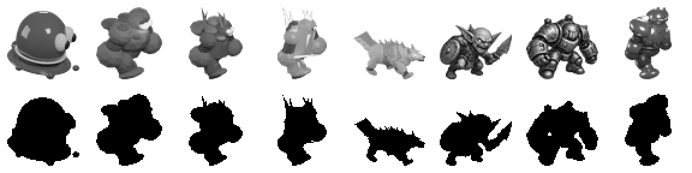
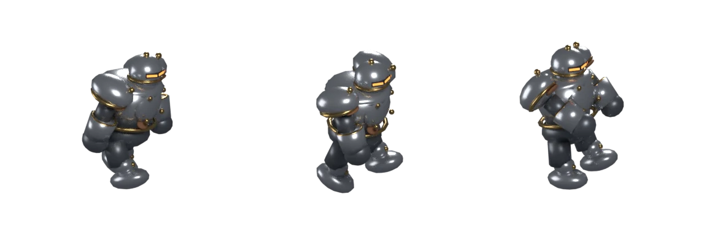

# 30회차 — 모델링 (새 회전 1바퀴)

| 항목 | 값 |
| --- | --- |
| 시각 | 2026-11-05 12시대 KST (사용자 요청 직후 바로 실행. 다음 예약 회차는 15:06 KST) |
| 기준 | main `2931bbc`, 개발 통합 브랜치 `f6b4777` (둘 다 변경 없음), 이 브랜치 `c1f998c` |
| 회차 종류 | **평소 회차**. 사용자 요청이 들어왔다: “모델링과 로직, 게임 운영과 물리효과 루프로”. 이번 회차부터 네 분야가 **모델링·로직·게임 운영·물리효과**로 바뀌었다(README 회전 순서). |
| 주 분야 | 모델링 |
| 범위 | 문서와 `model-drafts/`(초안 스크립트·점검 도구·미리보기)만. 게임 코드·에셋은 바꾸지 않았다. 렌더는 저장소 밖 스크래치 폴더의 개발 브랜치 사본에서만 했다. |

## 1. 네 분야 짧은 점검

| 분야 | 현재 상태 | 발견 |
| --- | --- | --- |
| 모델링 | 몬스터 9종 중 5종, 영웅 6명 중 1명(브론), 타워 6종 모두 Blender 생성 스크립트(`tools/blender/build_*.py`)로 굽는다. 나머지는 회화 시트다(3장 표). | 이번 회차부터 **이 컨테이너에서 Blender를 돌릴 수 있다**(2장). 64px 점검을 처음으로 실제 렌더 값으로 쟀다. 돌 갑옷병·나무 병사가 혼동된다(3장). |
| 로직 | `engine.ts` 변경 없음. 적이 무엇에 맞아 쓰러졌는지 세지 않는다(25회차). 엔진 알림은 화면에 그리지 않는다(18회차). | 다음 로직 회차 후보: 퀘스트 판정·보상 계산·표적 고르기 규칙을 한 표로 정리하고 테스트로 고정할 것을 고른다. |
| 게임 운영 | 결정 묶음 ①~⑥ 미응답. 유물 수치는 3장에서(28회차), 기념물 8개(26·29회차), 행동형 퀘스트 초안(25회차). | 새 입력 없음. |
| 물리효과 | `engine.ts`의 넉백 속도는 `min(180, 힘 ÷ 질량)`, 넉백 재사용 1초, 피격 흔들림 0.16초, 반동 0.22초. 힘은 파쇄포·물폭탄포 110, 브론 150, 카르 190. 질량은 새싹 0.8 ~ 서리군주 8. | 파쇄포가 새싹 도적은 초당 137로 밀고 돌 갑옷병은 34로 민다(4배). 카르는 새싹을 180 상한에 걸리게 민다. 이 차이가 ‘무거운 적은 덜 밀린다’로 보이는지는 다음 물리효과 회차에서 잰다. |

## 2. 모델링 도구 — 이 컨테이너에서 Blender 실행

- 2026-11-02에는 이 컨테이너에 Blender가 없어서 설계까지만 했다(README).
- 이번에 스크래치 폴더의 Python 3.13 가상환경에 **`bpy` 5.2.3**(Blender 5.2 LTS의 Python 모듈)을 설치했다. 약 1 GB이고 저장소 밖에 있다.
- **재현 확인**: 개발 브랜치의 `tools/blender/build_golem.py`를 고치지 않고 사본에서 그대로 돌렸다.
  - 4.4초가 걸렸다(Cycles CPU 24샘플, 384px 3포즈).
  - 커밋된 아틀라스(Blender 4.3.2, 96샘플)와 알파 영역 겹침이 **0.9992**였다.
  - 개발 루프의 생성 스크립트를 이 루프에서 그대로 실행·비교할 수 있다는 뜻이다.
- 그래서 앞으로 모델링 회차는 설계서만 쓰지 않는다. **초안 생성 스크립트 → 렌더 → 64px 점검**까지 하고, 그 결과를 개발 루프에 넘긴다. 게임 에셋을 커밋하는 일은 여전히 개발 루프의 몫이다.

## 3. 모델 현황표 (개발 통합 브랜치 `f6b4777`)

`src/games/defense/art.ts`의 매핑과 `tools/blender/`를 대조했다.

| 대상 | 지금 게임에 보이는 것 | 생성 스크립트 | 다음 일 |
| --- | --- | --- | --- |
| 새싹 도적 | 회화 `atlas.png` 9번째 칸(고블린) | 없음 | 묶음 ② 대기(긴급, 그루터기 새싹) |
| 나무 병사 | Blender 굽기 (PR #46) | `build_wood.py` | 64px에서 돌 갑옷병과 혼동(4장). 12회차 통나무·옹이 눈 안(묶음 ②) |
| 빙결 기사 | Blender (PR #52) | `build_ice.py` | 판금 기사 실루엣안(묶음 ②) |
| 돌 갑옷병 | Blender (PR #41) | `build_golem.py` | 경계석 홈·붉은 줄(09회차, 묶음 ①) |
| **금속 병사** | 회화 `atlas.png` 13번째 칸 | **없음 → 이번 초안**(5장) | 기본형은 결정 불필요(인계 A) |
| 절연 슬라임 | Blender (PR #30) | `build_slime.py` | 보라 제거(인계 먼저 할 다섯 개 5번) |
| 서리늑대 | Blender (PR #58) | `build_wolf.py` | 14회차 설계와 일치 |
| 고목왕·서리군주 | 회화 `boss-models.webp` | 없음 | 고목왕 최소 이식, 서리군주 충실 이식(인계 A) |
| 브론 | Blender 4포즈 640px + GLB | `build_dwarf.py` | — |
| 이안·리엘·청운·카르·루나·늑대 영물 | 회화 `melee-motion.webp`·`ranged-motion.webp` | 없음 | 네 영웅 충실 이식(A), 카르는 충실 이식 금지(B) |
| 타워 6종 + 3단계 | Blender | `build_towers.py` | — |

## 4. 64px 흑백 실루엣 점검 — 처음으로 측정

인계 목록의 몬스터 규격은 “모든 모델은 64px 흑백에서 기존 것과 구분된다”였다(14회차). 지금까지는 눈으로 판단했다. 이번에 도구로 쟀다.

**도구**: [`model-drafts/sil64_check.py`](../model-drafts/sil64_check.py)
- 각 스프라이트를 알파 영역으로 자르고 64×64 칸에 60px로 맞춘다(아래 정렬).
- 쌍마다 세 가지를 잰다.
  - **실루엣 겹침**(알파 마스크 IoU)
  - **평균 회색**(흑백 명도)
  - **회색 퍼짐**(표면 대비. 매끈한 금속의 반사가 크면 값이 크다)
- **잠정 통과 규칙**: 다음 중 하나면 구분된다. 겹침 0.65 미만 / 평균 회색 차이 30 이상 / 회색 퍼짐 차이 12 이상.
- 기준값은 이번에 처음 정한 것이다. 사람 눈 판단과 몇 번 맞춰 본 뒤 고친다.

*위 줄 64px 흑백, 아래 줄 실루엣. 왼쪽부터 절연 슬라임, 돌 갑옷병, 나무 병사, 빙결 기사, 서리늑대, 새싹 도적(회화), 금속 병사(회화), 금속 병사 초안.*

| 쌍 | 겹침 | 회색 차 | 퍼짐 차 | 판정 |
| --- | --- | --- | --- | --- |
| 나무 병사 / 빙결 기사 | **0.80** | 55 | 12 | 구분 (명도로만) |
| 절연 슬라임 / 돌 갑옷병 | 0.73 | 1 | 7 | **혼동** |
| 돌 갑옷병 / 나무 병사 | 0.70 | 4 | 4 | **혼동** (세 기준 모두 실패) |
| 돌 갑옷병 / 금속 병사 초안 | 0.71 | 8 | 13 | 구분 (표면 대비로만) |
| 나무 병사 / 금속 병사 초안 | 0.71 | 4 | 16 | 구분 (표면 대비로만) |
| 서리늑대 / 나머지 | 0.24~0.42 | — | — | 모두 구분 |

**읽은 것**
- 같은 카메라·직교 스케일로 구운 인간형 몬스터들은 **실루엣이 서로 닮는다**(겹침 0.70~0.80). 14회차의 ‘실루엣 수렴’ 판단이 숫자로 확인됐다.
- **돌 갑옷병과 나무 병사는 세 기준 모두에서 구분되지 않는다.** 둘 다 울퉁불퉁한 덩어리이고 흑백 명도가 92·97로 같다. 정체성 기준 1(재료를 읽는 수비대)에서 돌(충격)과 나무(불)는 정반대 대응을 요구하는 쌍이다. 가장 먼저 고칠 쌍이다.
- **명도만 바꿔서는 풀리지 않는다**(사본에서 직접 다시 구워 봄).
  - 나무 병사 껍질을 1.7배 밝게 하면 회색 92 → 113이고, 돌과의 차이는 16이다.
  - 돌을 1.7배 밝게 하면 회색 97 → 120이고, 나무와의 차이는 27이다.
  - 둘 다 기준 30에 못 미친다. 더 밝히면 재질이 바래 보인다.
  - 그래서 **형태를 바꿔야 한다.** 12회차의 ‘곧게 선 통나무 몸·옹이 눈’ 안(묶음 ②)이 이 문제를 푸는 안이다. 이번 측정이 그 근거가 된다.
- 절연 슬라임 / 돌 갑옷병이 혼동으로 나왔지만, 눈으로는 둥근 지붕 모양과 눈알로 구분된다. 둘 다 넓고 낮은 덩어리라 마스크가 겹친 것이다. 이 도구의 한계로 적어 둔다. 인계 5번(슬라임 보라 제거)에서 호박색으로 바꾸면 명도가 올라가 이 쌍도 기준을 넘을 가능성이 크다. 그때 다시 잰다.

## 5. 모델링 설계서 — 금속 병사 기본형 (초안 스크립트 + 렌더 확인)

인계 A의 ‘금속 병사 기본형’(10회차 3-1)을 개발 루프가 그대로 쓸 수 있는 **생성 스크립트 초안**으로 만들고, 실제로 구워서 확인했다.

| 항목 | 내용 |
| --- | --- |
| 대상·목적 | 몸 모델이 없는 두 몬스터 중 결정이 필요 없는 하나(금속 병사 기본형). 1-2의 ‘번개가 금속을 잇는다’를 보여 주는 적이다. |
| 참고 이미지 | 개발 브랜치 `public/defense/atlas.png` 13번째 칸(이번에 열어 봄). 가져온 것: 둥근 판금 어깨, 리벳, 황동 테, 가로 주황 바이저, 가장자리 녹, 땅딸막한 비율. 버린 것: 정면을 보는 자세. 다른 몬스터와 같은 옆 3/4 카메라를 쓴다. `build_golem.py`: 카메라 (5,−10,6.9)·직교 6.6·조명 3개·접지점을 그대로 썼다. 같은 크기 계열이다. |
| 실루엣 (64px) | ① 몸통보다 넓은 어깨 판금(역삼각) ② 투구 앞의 가로 바이저 빛 ③ 매끈한 반사면. 측정상 실루엣 겹침은 돌 0.71로 높다. 구분은 **표면 대비**(퍼짐 43 대 30)로 된다. 숲·설산 변형(묶음 ①·②)에서는 10회차 안대로 위쪽에 톱날·화로를 더해 실루엣으로도 갈라야 한다. |
| 부위·노드 | `metal-soldier`(원점) › `body`, `head`(바이저 3면), `arm-near`·`arm-far`(어깨 판금·황동 테·건틀릿), `leg-near`·`leg-far`. 노드 이름 규칙은 `build_golem.py`와 같다. |
| 재질·팔레트 | 판금 (.55,.58,.63) 금속성 0.75·거칠기 0.28 / 그늘 판금 (.2,.22,.25) / 황동 (.62,.42,.16) 금속성 1 / 녹 (.33,.15,.07) 가장자리만 / 바이저 빛 (1,.3,.05) 발광 1.8 / 바이저 틈 거의 검정. 10회차 팔레트(#7a7f86·#c89b52·#8a5a3a·#f08a3c)를 같은 조명에 맞춘 값이다. |
| 포즈 | 몬스터 계약 walk-a·walk-b·hit. 걸음은 다리 ±22°, 팔 ±18°, 몸이 딛는 다리 쪽으로 ±5° 기운다(무거운 걸음). hit는 몸이 14° 뒤로 젖혀지고 팔이 들린다. |
| 게임 크기 | 384×384 프레임 3개. 세 포즈 공통 띠는 x 78·y 67·폭 204·높이 249다. `art.ts`에는 `metal:{span:194,frames:[[70,64,220,254],[454,64,220,254],[838,64,220,254]],atlas:bakedAtlas('metal-soldier')}`(돌 갑옷병과 같은 화면 크기가 되도록 계산한 제안값. 화면에서 확인한다)을 제안한다. 기존 회화 칸은 대체 표시로 남긴다. |
| 예산 (측정) | 메시 46개, **다각형 3,542**(예산 5k 이하). **아틀라스 24,104 B**(예산 26 KB 이하). |
| 제작 경로 | [`model-drafts/build_metal_draft.py`](../model-drafts/build_metal_draft.py) → `tools/blender/build_metal.py`로 복사 → `blender -b --python tools/blender/build_metal.py` → `public/defense/models/metal-soldier-atlas.webp`, `metal-soldier.json`, `art-source/defense/metal-soldier.blend`. 개발 루프의 다른 스크립트와 인자·출력 형식이 같다. |
| 완료 판단 | ① 96샘플로 구운 아틀라스가 위 예산 안. ② `sil64_check.py`에서 돌 갑옷병·나무 병사와 ‘구분’. ③ 1-2에서 번개 연쇄 판정이 그대로(`engine.ts` 변경 없음). ④ 회화 칸과 같은 인상(둥근 판금·황동·주황 바이저). |

이 초안은 Blender 5.2에서 확인했다. 개발 루프의 커밋 기록은 4.3.2이므로 처음 한 번은 그쪽에서 다시 굽는다.

## 6. 개발 루프로 넘길 것

| 후보 | 완료 판단 | 결정 필요 |
| --- | --- | --- |
| 금속 병사 기본형: 초안 스크립트 그대로 사용 | 5장 완료 판단 4개 | 아니요 (인계 A) |
| 64px 점검 도구를 `tools/`에 두고 새 몬스터마다 실행. 이식 규칙 한 장(먼저 할 다섯 개 1번)의 ‘64px 흑백 구분’ 항목을 이 도구의 판정으로 바꿈 | 새 아틀라스를 커밋하기 전에 ‘혼동’ 쌍이 없음 | 아니요 (인계 A) |
| 돌 갑옷병·나무 병사 혼동: 명도로는 안 풀린다는 측정을 나무 병사 수정안(묶음 ②)의 근거로 추가 | — | 묶음 ② |

## 7. 사용자에게 물을 것

새 질문은 없다. 주제 전환은 이번 요청으로 정해졌다. 결정 묶음 ①~⑥은 그대로 열려 있다. 특히 ⑥(인계 문서를 개발 통합 브랜치로 PR)이 정해져야 이번 초안 스크립트가 개발 루프에 닿는다.

## 다음 회차

31 로직 — 엔진 규칙표(속성 배율·상태 효과·연쇄·표적 고르기·웨이브·퀘스트 판정·보상 계산)를 한 장으로 만들고, 규칙끼리 부딪치는 곳과 테스트로 고정되지 않은 곳을 사본 측정으로 찾는다.
