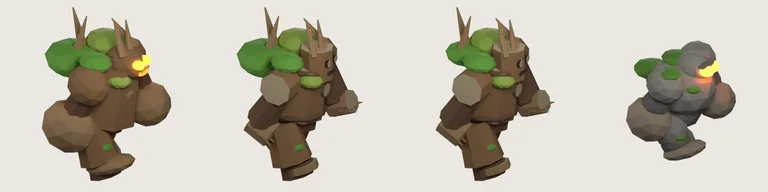

# 34회차 — 모델링 (새 회전 2바퀴, 저입력 회차)

| 항목 | 값 |
| --- | --- |
| 시각 | 2026-11-06 00:07 KST (예약 회차) |
| 기준 | main `2931bbc`, 개발 통합 브랜치 `f6b4777` (둘 다 변경 없음), 이 브랜치 `77eb1e1` |
| 회차 종류 | **저입력 회차**: 사용자 결정 없음, 개발 루프 새 PR 없음(GitHub PR 목록: 마지막 #59). |
| 이번 단위 | 30회차 64px 점검에서 돌 갑옷병과 ‘혼동’으로 나온 나무 병사를 12회차 통나무안대로 **초안 생성 스크립트**로 만들고, 렌더해서 구분되는지 확인 |
| 범위 | 문서와 `model-drafts/`만. 렌더는 저장소 밖 스크래치 폴더의 개발 브랜치 사본에서 Blender 5.2(bpy)로 했다. |

## 1. 점검 (한 줄)

네 분야 모두 새 입력 없음. 30~33회차 초안·제안은 인계를 기다린다(묶음 ⑥).

## 2. 나무 병사 통나무안 — 초안 스크립트와 렌더 확인

*왼쪽부터: 지금 개발 브랜치의 나무 병사(PR #46), 통나무 초안, 통나무 초안 + 등 잎 축소(채택안), 돌 갑옷병. 모두 walk-a 포즈, 같은 카메라.*

| 항목 | 내용 |
| --- | --- |
| 대상·목적 | 30회차 측정에서 돌 갑옷병과 실루엣·명도·표면 대비 세 기준 모두 혼동된 나무 병사. 돌(충격)과 나무(불)는 대응이 정반대인 쌍이라, 64px에서 갈려야 재료 읽기가 성립한다. |
| 참고 이미지 | 개발 브랜치 `public/defense/models/wood-soldier-atlas.webp`(이번에 다시 구워 나란히 봄). 가져온 것: 잎 덩어리, 가지 뿔, 걷는 자세, 세 포즈. 버린 것: 둥근 덩어리 조각, 주황 눈·입 발광. 같은 브랜치 `stone-golem-atlas.webp`: 닮지 않아야 할 기준. |
| 바꾼 것 (12회차 3-1 그대로) | ① 몸통·엉덩이·어깨·주먹·발·머리를 **팔각 통나무 토막**으로. 옆면은 껍질, 끝면은 나이테색 #e3cf9f 계열. ② 허리·목·발목에 **뿌리 고리** 4개. ③ 주황 눈 → **어두운 옹이 구멍**, 입 빛 → 어두운 홈, 이빨 제거. ④ 잎·가지 뿔은 유지. |
| 12회차와 다른 한 가지 | **등 잎 덩어리 반지름 0.95 → 0.6.** 측정상 등 잎이 실루엣을 돌처럼 둥글게 만드는 가장 큰 요소였다(아래 표). |
| 바꾸지 않은 것 | 피벗 구조와 포즈 회전, 카메라, 프레임 384, 접지점, 아틀라스 배치, 출력 파일 이름(`wood-soldier-atlas.webp`, `wood-soldier.json`), `art.ts` 연결. 그래서 `tools/blender/build_wood.py`를 이 초안으로 바꾸고 다시 구우면 끝난다. |
| 예산 (측정) | 다각형 **1,148**(지금 약 1,870보다 적음), 아틀라스 **29,318 B**(지금 31,464 B의 −7%, 12회차 예산 ±15% 안). |
| 제작 경로 | [`model-drafts/build_wood_log_draft.py`](../model-drafts/build_wood_log_draft.py)를 `tools/blender/build_wood.py`로 덮어쓰기 → `blender -b --python tools/blender/build_wood.py` |

### 2-1. 64px 점검 (30회차 도구, 잠정 기준)

| 쌍 | 겹침 | 회색 차 | 퍼짐 차 | 판정 |
| --- | --- | --- | --- | --- |
| 돌 갑옷병 / 지금 나무 병사 | 0.70 | 4 | 4 | 혼동 |
| 돌 갑옷병 / 통나무 초안 | 0.62 | 10 | 6 | 구분 (실루엣으로, 기준 0.65에 가까움) |
| 돌 갑옷병 / 통나무 초안 + 몸통 길게 | 0.63 | 12 | 6 | 구분 (거의 차이 없음) |
| **돌 갑옷병 / 통나무 초안 + 등 잎 축소** | **0.58** | 11 | 5 | **구분** |
| 빙결 기사 / 통나무 초안 | 0.78~0.79 | 61~62 | 14 | 구분 (명도로) |
| 금속 병사 초안 / 통나무 초안 | 0.73 | 2~4 | 18 | 구분 (표면 대비로) |

**읽은 것**
- 몸 조각을 통나무로 바꾸면 돌과의 겹침이 0.70에서 0.62로 내려가 기준을 넘는다. 여유는 작다.
- 몸통을 길게 해도 거의 그대로다(0.63). 점검이 크기를 맞춰서 비교하기 때문이다. 비율보다 **윤곽의 모양**이 중요하다.
- **등 잎 덩어리를 줄이면 0.58로 여유가 생긴다.** 둥근 잎 덩어리가 돌의 둥근 바위처럼 실루엣을 부풀렸다. 그림에서도 나무 병사의 상징은 가지 뿔이고, 잎은 장식이다.
- 명도·표면 대비 차이는 여전히 작다(회색 차 11, 퍼짐 차 5). 이 쌍은 **실루엣으로만** 갈린다. 30회차에서 명도 조정만으로는 안 된다고 쟀으므로 방향은 맞다.
- 눈으로 보면 차이가 더 크다. 통나무 끝면의 밝은 나이테 원판(어깨·주먹)과 옹이 눈이 ‘나무’로 읽힌다. 주황 빛이 사라져 돌 갑옷병(주황 눈)과도 색 신호가 갈린다. 다만 이 점검은 흑백이라 색은 세지 않는다.

## 3. 결정과의 관계

- 나무 병사 수정은 **묶음 ②(외형)** 결정 대기다. 이 초안은 결정이 나면 바로 쓸 수 있게 둔 것이다. 개발 브랜치 에셋은 바꾸지 않았다.
- 30회차의 64px 측정과 이번 렌더 확인이 묶음 ②의 이 항목에 대한 근거다. ‘돌·나무가 64px에서 갈려야 한다’는 정체성 기준 1의 요구를 숫자로 보였다.

## 4. 인계·기록

- [인계 목록](../handoff.md) B의 ‘나무 병사 수정’ 항목에 초안 스크립트와 측정 결과를 붙였다(묶음 ② 대기 그대로). 기준 시각을 갱신했다.
- README 회차 기록과 다음 회차 후보를 갱신했다.
- `model-drafts/`에 초안 스크립트, 구운 아틀라스(29 KB), 비교 그림(9 KB)을 더했다.

## 다음 회차

35 로직 — 입력이 없으면 저입력 회차. 후보 단위: 숲에서 연쇄 가능한 번개 명중의 67%가 이웃이 없어 이어지지 않는 문제(31회차). 번개 탑의 표적 고르기를 ‘젖었거나 금속이고 155 안에 이웃이 있는 적 먼저’로 바꿔 사본에서 잰다.
