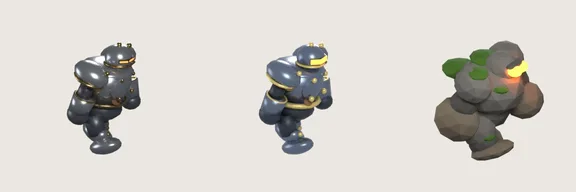
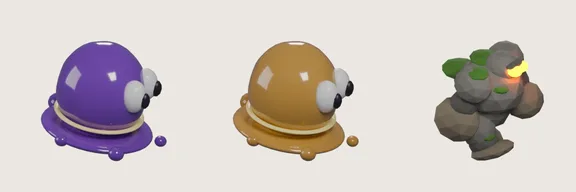

# 38회차 — 모델링 (새 회전 3바퀴)

| 항목 | 값 |
| --- | --- |
| 시각 | 2026-11-06 12:06 KST (예약 회차) |
| 기준 | main **`9a2b5a2`**(PR #60~#62 반영), 옛 개발 통합 브랜치 `f6b4777`(PR #60 이후 변경 없음), 이 브랜치는 main에서 다시 시작(아래 1-2) |
| 회차 종류 | **평소 회차**: 개발 쪽 새 PR 3개(#60·#61·#62)가 main에 병합됐다. |
| 주 분야 | 모델링 |
| 범위 | 문서와 `model-drafts/`(비교 그림 2장)만. 렌더·측정은 저장소 밖 스크래치 폴더의 main 사본에서 Blender 5.2(bpy)로 했다. |

## 1. 이번에 바뀐 것과 점검

### 1-1. 새 PR 세 개 (모두 main으로)

| PR | 내용 | 이 루프와의 관계 |
| --- | --- | --- |
| #60 (11-06 10:14 KST) | 최신 게임·기획 브랜치 통합 및 모바일 앱 전환 기준. 개발 통합 브랜치(PR #59까지)와 **이 루프의 37회차까지**를 main에 함께 반영. `docs/mobile-app-transition.md` 추가. | 이 루프의 문서가 처음으로 main에 들어갔다. 문서에 따르면 이후 개발은 **main을 base로** 한다. 기획 초안은 런타임 에셋으로 자동 채택하지 않는다. |
| #61 (11-06 11:18 KST) | Blender로 구운 금속 병사 walk/hit 아틀라스(어두운 건메탈, 390px 가독) | **30회차 초안 스크립트를 그대로 썼다.** 재질 값만 바꿨다(2장) |
| #62 (11-06 10:40 KST) | 기존 게임 허브의 Android 시험 설치판(Capacitor) | 문서에 사용자 결정이 적혀 있다: “2026-11-06 사용자가 Android 설치판 우선 경로를 선택했다.” |

**함께 바뀐 운영 사실**
- 개발 루프의 지시문(`tools/arcana_loop_prompt.md`)이 이제 매 회차 **이 브랜치의 `handoff.md`를 읽기 전용으로 읽고**, main에 없는 기획 커밋 수를 기록한다.
- 07회차부터 남아 있던 ‘인계가 개발 루프에 닿지 않는다’ 문제(묶음 ⑥의 인계 PR)는 이 경로로 풀렸다. 사용자가 묶음 ⑥에 직접 답한 것은 아니므로, README에는 ‘통합으로 해결’로 적었다.
- 게임의 최신 상태는 이제 **main**에서 읽는다. 옛 개발 통합 브랜치는 `f6b4777`에서 멈췄다.

### 1-2. 이 브랜치

이 브랜치의 커밋(37회차까지)은 모두 main에 들어갔다. 작업 규칙대로 이 브랜치를 최신 main(`9a2b5a2`)에서 같은 이름으로 다시 시작했다. 앞으로 감기만 했으므로 버린 커밋은 없다.

### 1-3. 놓쳤던 기존 규칙 — 정정

개발 루프 지시문에는 원래부터(2931bbc, f6b4777 모두) 다음 규칙이 있었다.

> In the defense campaign, material learning and field-guide reading must never become a gate for winning, rewards or progression.

모바일 전환 문서도 “재료 상성·관찰노트는 최소·선택형 교육으로 유지한다”고 적는다. 이 루프는 이 규칙을 읽지 못했다. 그래서 두 제안이 규칙과 부딪친다.

| 회차 | 제안 | 충돌 | 처리 |
| --- | --- | --- | --- |
| 25 | 행동형 퀘스트(번개 연쇄 20번, 충격으로 돌 갑옷병 5번, 불로 늑대 12마리, 불·충격 약점 10번씩) | 추가 퀘스트 **보상**(80 G·기념물)을 재료 사용에 건다 | **보류**. 재료와 상관없는 행동 조건(완벽 방어, 돌진, 거점 체력 등)으로 40회차(게임 운영)에서 다시 설계 |
| 36 | C안(적 내성을 늘려 재료 읽기가 승패를 가르게) | **승리**를 재료 읽기에 건다 | C안을 ‘승패 조건’이 아니라 ‘효율 차이를 키우는 쪽’으로만 쓴다. 결론은 A안(효율 보상 + 약점 명중 표시)이고, 규칙과 맞는다 |

32회차의 ‘약점 명중 N번’ 표시와 ‘효율 문장’ 재료 힌트는 관문이 아니므로 규칙과 맞는다. README 정체성 기준에 이 규칙을 **확정 제약**으로 적고, 정정 이력에 두 줄을 더했다.

### 1-4. 네 분야 짧은 점검

| 분야 | 상태 |
| --- | --- |
| 모델링 | 금속 병사 모델 완료(PR #61). 몸 모델이 없는 몬스터는 이제 새싹 도적 하나(묶음 ②)다. |
| 로직 | `engine.ts` 변경 없음(#60~#62). 31·35회차 제안(다시 고르기, 연쇄 우선)은 그대로 유효하다. |
| 게임 운영 | 사용자 결정: Android 설치판 우선. 저장·오프라인·생활주기가 새 기준(`mobile-app-transition.md` 2~3단계)이다. 25회차 행동형 퀘스트는 보류(1-3). |
| 물리효과 | 변경 없음. 33·37회차 제안은 그대로 유효하다. 안드로이드 배경 전환 때 전투가 멈추도록 `DefenseGame.tsx`가 바뀌었다(3줄). |

## 2. 모델링 — PR #61 금속 병사 대조



*왼쪽부터: 30회차 초안, PR #61(main), 돌 갑옷병. walk-a 포즈.*

| 항목 | 30회차 초안 | PR #61 |
| --- | --- | --- |
| 메시·노드·포즈·카메라 | — | **같음** (스크립트 구조 그대로) |
| 판금 | (.55,.58,.63) 금속성 .75 | **(.2,.25,.33) 어두운 건메탈** |
| 황동 | (.62,.42,.16) 금속성 1 | (.95,.7,.22) 금속성 .5, 리벳·허리띠 굵게 |
| 바이저 | 발광 1.8, 얇음 | **발광 6, 세 배 가까이 높게** |
| 스튜디오 빛 | 0.15 (돌·나무·빙결·늑대와 같음) | **0.7** |
| 샘플 | 96 | 48 |
| 다각형·용량 | 3,542 · 24,104 B | 3,542 · **24,930 B** (예산 26 KB 안) |

**64px 점검** (30회차 도구, main 사본 자산)

| 쌍 | 겹침 | 회색 차 | 퍼짐 차 | 판정 |
| --- | --- | --- | --- | --- |
| PR #61 / 30회차 초안 | 1.00 | 13 | 3 | (실루엣 동일) |
| 돌 갑옷병 / PR #61 | 0.71 | 5 | **15** | 구분 (표면 대비) |
| 나무 병사 / PR #61 | 0.71 | 10 | **19** | 구분 |
| 빙결 기사 / PR #61 | 0.71 | **45** | 7 | 구분 |

**읽은 것**
- **이 루프의 초안이 처음으로 그대로 제품이 됐다.** 개발 루프는 재질만 바꿨다. 30회차 판정(표면 대비로 돌·나무와 구분)도 그대로 맞다.
- PR #61의 ‘어두운 건메탈’은 흑백에서는 오히려 밝다(회색 89 → 102). 스튜디오 빛을 0.15에서 0.7로 올렸기 때문이다. 색으로 보면 푸른 회색이라, 갈색인 돌·나무와 색상으로도 갈린다. 흑백 점검은 색을 세지 않는다.
- **조명이 다른 몬스터와 다르다.** 다른 다섯 몬스터는 스튜디오 빛 0.15(슬라임만 0.22), 64~96샘플이다(나무 64, 나머지 96). 금속 병사만 0.7, 48샘플이다. 한 전장에서 금속 병사만 더 밝고 거칠게 보일 수 있다. 390px 가독성을 위해 일부러 그랬다면, 같은 기준을 모든 몬스터에 맞추는 편이 일관된다. 다음 모델링 회차(42)에서 0.7로 다시 구운 다른 몬스터와 나란히 재 본다.

## 3. 모델링 — 절연 슬라임 보라 제거(호박색) 렌더 확인

‘먼저 할 다섯 개’ 5번(보라 제거, 결정 불필요)을 main의 `tools/blender/build_slime.py` 사본에서 재질 두 줄만 바꿔 구웠다. 대체 색은 08회차가 제안한 **호박색**이다. 호박(송진 화석)은 실제로 전기가 통하지 않는 물질이라, ‘절연’이라는 재료와도 맞는다.

```
SLIME=material('slime body',(.62,.33,.05),.14,.9);SLIME_DARK=material('slime core',(.3,.13,.02),.3,.4)
```
(지금: `(.2,.03,.46)` / `(.09,.01,.22)` 보라)



| 쌍 | 겹침 | 회색 차 | 판정 |
| --- | --- | --- | --- |
| 돌 갑옷병 / 지금 슬라임(보라) | 0.73 | 1 | **혼동** |
| 돌 갑옷병 / 호박색 슬라임 | 0.73 | **32** | **구분** |
| 나무 병사 / 호박색 슬라임 | 0.62 | 36 | 구분 |
| 빙결 기사 / 호박색 슬라임 | 0.55 | 18 | 구분 |

- 아틀라스는 24,820 B(지금 24,478 B)로 거의 같다. 다각형 3,872개는 그대로다.
- 30회차에 ‘혼동’으로 나온 두 쌍 중 하나(슬라임·돌)가 재질 값 두 줄로 풀린다. 남은 하나(돌·나무)는 34회차 통나무안(묶음 ②)이 푼다.
- 색 의미 규칙(09회차): 주황은 불이다. 호박색은 주황보다 갈색 쪽이다. 불 이펙트(밝은 주황 + 발광)와 섞이지 않는지는 실제 전장 화면에서 확인한다. 이번 렌더에는 발광이 없다.

## 4. 개발 루프로 넘길 것

| 후보 | 완료 판단 | 결정 |
| --- | --- | --- |
| 절연 슬라임 보라 → 호박색 (위 두 줄) | 64px 점검에서 돌과 ‘구분’. 아틀라스 ±5%. 불 효과와 겹쳐 보이지 않음(전장 화면) | 보라 제거는 불필요(먼저 할 다섯 개 5번). 호박색 선택은 묶음 ②의 ‘슬라임 호박색’ |
| 몬스터 조명 기준 통일 | 모든 몬스터가 같은 스튜디오 빛·샘플. 바꾸면 64px 점검을 다시 함 | 불필요 (개발 루프 판단) |
| 25회차 행동형 퀘스트 | **보류**(규칙 충돌) | — |

## 5. 기록

- README:
  - 개발 통합 브랜치 읽기 절을 main 기준으로 바꿨다.
  - 정체성 기준에 확정 제약 한 줄을 적었다.
  - 묶음 ⑥에 ‘통합으로 해결’을 적었다.
  - 사용자 결정(Android 설치판 우선)을 기록했다.
  - 정정 이력, 회차 기록, 다음 회차 후보를 갱신했다.
- 인계 목록:
  - 기준을 main으로 바꿨다.
  - 금속 병사 A 항목은 완료(PR #61)로 표시했다.
  - 슬라임 5번에 호박색 측정을 붙였다.
  - 행동형 퀘스트 B 항목은 보류로 바꿨다.
  - C에 PR #61 대조를 더했다.
- 예약 작업 지시문에서 ‘게임 최신 상태를 읽을 브랜치’를 main으로 바꿨다.

## 다음 회차

39 로직 — 31회차 ‘다시 고르기’와 35회차 ‘연쇄 우선’을 main 사본에서 함께 켜 보고, 포탄 재사용 시간 돌려주기를 잰다. 안드로이드 배경 정지(PR #62)가 전투 상태를 그대로 보존하는지도 엔진 쪽에서 확인한다.
