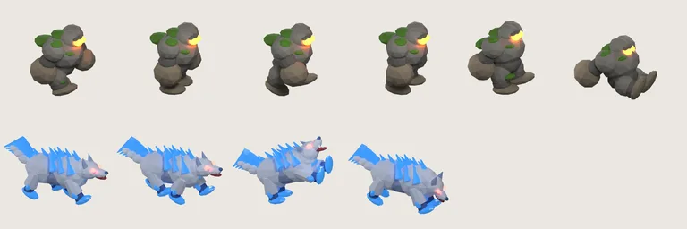

# 41회차 — 물리효과: 애니메이션·타격 (사용자 요청)

| 항목 | 값 |
| --- | --- |
| 시각 | 2026-11-06 19:4x KST (사용자 요청 직후 바로 실행. 다음 예약 회차는 21:06 KST) |
| 기준 | main **`03b6a70`**(PR #70·#71 반영). 이 브랜치는 main을 병합했다(`5822f57`). |
| 회차 종류 | **평소 회차**. 사용자 요청: “애니매이션, 타격류 디벨롭”. 개발 쪽 PR #70·#71도 새로 병합됐다. |
| 주 분야 | 물리효과(회전 순서) + **애니메이션·타격감 집중** |
| 범위 | 문서와 `model-drafts/`(애니메이션 시트 1장)만. 측정·렌더는 저장소 밖 스크래치 폴더의 main 사본에서만 했다(엔진 사본, Blender 5.2). |

## 0. 요청 반영

- 네 분야 회전(모델링 → 로직 → 게임 운영 → 물리효과)은 그대로 둔다. 다음 바퀴부터 각 분야를 **애니메이션·타격감 쪽으로** 먼저 본다(README 회전 순서표에 적음).
  - 모델링 회차: 포즈·프레임(걷기·피격·쓰러짐·공격)
  - 물리효과 회차: 타격감(번쩍임·히트스톱·흔들림·숫자·소리·진동)
  - 로직 회차: 공격 타이밍과 결과가 바뀌지 않게 하는 조건
  - 게임 운영 회차: 손맛이 다음 한 판으로 이어지는지
- 예약 작업 지시문에도 같은 내용을 넣었다.

## 1. 점검

| PR | 내용 | 이 루프와의 관계 |
| --- | --- | --- |
| #70 | 동료 탭에 선택 영웅의 고유 특성 한 줄 | 인계 A ‘영웅 선택 카드에 고유 특성 한 줄’(04회차 3-6) 완료 |
| #71 | 보스 처치 충격파를 가장 큰 고리로, 서리군주 충전 칩 이름 통일 | **37회차 제안 ①** 완료. 18회차 이름 정리(‘눈보라 충전’) 반영 |

## 2. 지금의 애니메이션·타격 (main 코드 기준)

| 항목 | 지금 값 | 화면에서 (390px, 약 0.43배) |
| --- | --- | --- |
| 몬스터 걷기 | Blender 몬스터는 **2프레임**(walk-a·walk-b), 이동 거리로 바꿈. 한 프레임을 유지하는 거리는 돌 28, 늑대 18, 그 밖 22px | 한 프레임 유지 시간 = 거리 ÷ 속도: **돌 갑옷병 1.22초**, 나무 병사 0.79초, 빙결 기사 0.65초, 금속 0.59초, 새싹 0.46초, 슬라임 0.43초, 늑대 0.32초. 무거운 적일수록 걷기가 ‘넘기는 그림’처럼 보인다. 사인 곡선 들썩임(2.3px)이 일부를 메운다 |
| 몬스터 피격 | 0.16초 hit 포즈, 좌우 흔들림 ±3px, 가로 7% 늘림, 밝기 1.22배(`.def-hit`) — **49회차 정정: 밝기는 `defense-board.css` 23번 줄 `filter:none`으로 꺼져 있다** | 흔들림 ±1.3px |
| 쓰러짐 | 모델 몬스터는 **hit 프레임을 그대로** 0.7초 동안 줄이고 흐리게. 쓰러짐 포즈 없음(보스만 넷째 칸) | 맞는 모습과 죽는 모습이 같다 |
| 영웅 공격 | 준비 → 타격(0.12초) → 회복. 위치 이동 −4 → +10px(근접), 기울기 −7° → +9°. 브론만 Blender 4포즈 | — |
| 피해 숫자 | 보통 24, 약점 28, 내성 24(모바일) | 10.4 / 12.1 / 10.4px |
| 소리 | 한 프레임에 하나, 우선순위: 돌파 > 몰려옴 > 돌진 > 필살기·충격파 > 포탄 > 근접 > 명중 > 발사 | — |
| 진동 | 돌파·몰려옴·필살기·동결만. 최소 간격 0.2초. 동작 줄이기에서 끔 | — |
| 히트스톱·화면 흔들림 | **없음** | — |

## 3. 측정 — 타격 사건이 얼마나 자주 일어나나

‘큰 타격’에 멈춤(히트스톱)이나 화면 흔들림을 넣으려면 예산이 필요하다. main 사본에서 72판(8스테이지 × 난이도 3 × basic·auto·active)의 명중·처치·필살기를 시각과 함께 기록했다. 세는 줄을 넣어도 승패·체력은 31회차와 같다(72/72).

| 사건 | 초당 평균 | 1초 동안 최대 (중앙값 / 상위 5%) |
| --- | --- | --- |
| 모든 명중 | 3.58 | 11 / 17 |
| 약점 명중 | 0.91 | 5 / 8 |
| 피해 90 이상 | 0.53 | 5 / 9 |
| 처치 | 0.63 | 4 / 6 |
| 무거운 적(돌·얼음·금속·나무·보스) 처치 | 0.35 | 3 / 4 |
| 필살기 (active 전략) | — | 상위 5%에서 1 |

명중 피해는 중앙값 33, 상위 10% 107, 최대 374다.

**읽은 것**
- 약점 명중마다 50ms 히트스톱을 넣으면, 몰리는 순간 1초에 8번(400ms)이 멈춘다. 손맛이 아니라 끊김이 된다. **처치에 넣어도** 1초에 4~6번이다.
- 그래서 타격감을 **세 단계**로 나누고, 화면 전체를 건드리는 셋째 단계는 사건 종류를 좁히고 재사용 대기를 둬야 한다.

## 4. 애니메이션 — 걷기 4프레임과 쓰러짐 포즈 (Blender 렌더 확인)

main의 `build_golem.py`·`build_wolf.py` 사본에 포즈만 더해서 Blender 5.2로 구웠다. 메시·카메라·재질은 그대로다.

| 모델 | 더한 포즈 | 아틀라스 | 크기 |
| --- | --- | --- | --- |
| 돌 갑옷병 | `pass-a`·`pass-b`(다리 모임, 몸 0.14~0.16 들림), `death`(무릎 꿇고 주저앉음: 다리 −48/−40°, 팔 82/76°, 몸 −24°, 0.78 내려앉음) | 6프레임 2304×384 | 20,832 → **39,742 B** |
| 서리늑대 | `death`(엎드려 머리를 떨굼: 앞다리 −28/−22°, 뒷다리 24/30°, 목 34°, 0.42 내려앉음) | 4프레임 1536×384 | 36,816 → **48,388 B** |

- 새 프레임은 기존 프레임 **뒤에 붙인다.** 기존 칸 번호(0 walk-a, 1 walk-b, 2 hit)가 그대로라 `art.ts`의 기존 좌표가 깨지지 않는다.
- 걷기 4프레임이면 돌 갑옷병의 프레임 유지 시간이 1.22초에서 0.61초로 줄어든다(같은 거리를 반으로 나눔).
- 쓰러짐 포즈는 맞는 모습과 달라서 “쓰러졌다”가 읽힌다. 늑대는 피 없이 **엎드려 머리를 떨군다.** 굶주린 늑대 이야기(21회차)와 어린이 대상에 맞는다.
- 첫 시도는 다시 했다. 돌 갑옷병이 뒤로 넘어가 프레임 밖으로 나갔고, 늑대가 등을 대고 뒤집혀 보였다. 쓰러짐은 **제자리에서 낮아지는** 쪽이 384 프레임과 화면 양쪽에 맞다.

## 5. 제안 — 타격감 3단계 + 애니메이션 (결정 불필요, 인계 A)

| 단계 | 언제 (측정 빈도) | 무엇을 | 예산·조건 |
| --- | --- | --- | --- |
| **1. 모든 명중** | 초당 3.6, 1초 최대 17 | 지금 것 유지(번쩍임 1.22배, 늘림, 흔들림). 번쩍임을 **70ms 흰 테두리(외곽선)**로 바꾸면 밝은 모델(빙결·늑대)에서도 보인다 | 몬스터 자신에게만. 화면 전체는 건드리지 않음 |
| **2. 약점 명중** | 초당 0.9, 1초 최대 8 | 약점 숫자를 **0.12초 튀어 오르게**(크기 1.3 → 1.0). 속성색 파편 2개 추가. 소리는 ‘명중’의 높은 음 변형 | 멈춤 없음. 진동 없음 |
| **3. 큰 순간** | 아래 사건만 | **히트스톱 50ms + 화면 흔들림 3px·120ms + 진동 12ms** | 재사용 대기 0.6초(초당 최대 1.7번). 동작 줄이기에서는 흔들림·멈춤을 끄고 진동만 |
| ↳ 사건 | 필살기 명중, 서리군주 충전 끊기, 영웅 근접 공격의 무거운 적 처치(대기 적용) | | |
| ↳ 보스 처치 | 판마다 1번 | 히트스톱 **90ms** + 흔들림 6px·200ms + 진동 [30,40,60] + PR #71의 큰 고리 | 대기와 상관없이 |

**히트스톱 구현 원칙(로직)**: 엔진은 건드리지 않는다. UI의 60Hz 고정 루프가 그 시간 동안 `stepDefense`를 부르지 않을 뿐이다. 엔진 결과(승패·보상)는 바뀌지 않는다. 테스트 408번 줄(60Hz 루프가 결과를 지킴)은 그대로 통과해야 한다. 늦어지는 것은 실제 시간뿐이다.

**애니메이션**:
1. **쓰러짐 포즈**: 모든 Blender 몬스터에 `death` 프레임을 붙인다. `monsterSpriteAsset(kind,'death')`가 hit 대신 그 칸을 쓴다. 쓰러짐 효과(0.7초)는 포즈를 바꾼 뒤 지금처럼 흐려진다(37회차 제안 ②의 넉백 밀림과 함께).
2. **4프레임 걷기**: 느린 적(돌 갑옷병·나무 병사·빙결 기사)에만 `pass-a`·`pass-b`를 붙인다. 프레임 순서는 a → pass-a → b → pass-b, 프레임 바꾸는 거리는 반으로 줄인다. 빠른 적(늑대·새싹·슬라임)은 2프레임으로 충분하다(유지 0.3~0.46초).
3. 아틀라스는 몬스터당 +12~19 KB 늘어난다. 전부 해도 약 +90 KB다. 15회차에서 잰 첫 전투 불러오기(3.59 MB)에 비하면 작다.

**완료 판단**
- 390px 화면에서 다음 셋이 영상으로 구분된다.
  - 돌 갑옷병의 걷기가 4장으로 이어진다.
  - 쓰러진 적이 맞는 모습과 다르다.
  - 필살기·보스 처치에서 짧은 멈춤과 흔들림이 느껴진다.
- 동작 줄이기 설정에서는 흔들림·멈춤이 없다.
- 엔진 테스트 전부, 특히 408번 줄이 통과한다.
- 3단계 타격은 1초에 2번을 넘지 않는다(대기 0.6초).

## 6. 기록

- [인계 목록](../handoff.md):
  - A에 ‘타격감 3단계’, ‘쓰러짐 포즈’, ‘느린 적 4프레임 걷기’를 더했다.
  - #70(고유 특성)·#71(보스 고리)을 완료로 표시했다.
  - 기준을 main `03b6a70`으로 바꿨다.
- README:
  - 사용자 요청과 분야별 애니메이션·타격 관점을 회전 순서표에 적었다.
  - 회차 기록과 다음 회차 후보를 갱신했다.
- 예약 작업 지시문에 같은 관점을 넣었다.

## 다음 회차

42 모델링(21:06 KST 예약) — 애니메이션 관점. 나머지 Blender 몬스터(나무·빙결·슬라임·금속)의 `death` 포즈와 느린 적의 `pass` 포즈를 같은 방법으로 굽는다. 64px 점검을 쓰러짐 포즈에도 돌려 ‘쓰러졌다’가 작은 크기에서 읽히는지 본다. 여유가 있으면 영웅 Blender 포즈(브론 외)의 범위를 정한다.
