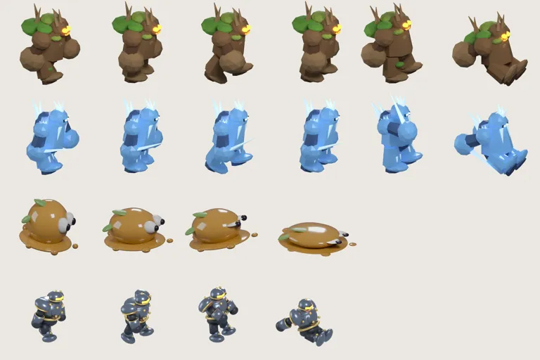

# 42회차 — 모델링: 애니메이션 (새 회전 4바퀴)

| 항목 | 값 |
| --- | --- |
| 시각 | 2026-11-06 21:07 KST (예약 회차) |
| 기준 | main **`40d2289`**(PR #72 반영). 이 브랜치는 main을 병합했다(`4a4712d`). |
| 회차 종류 | 평소 회차(개발 쪽 새 PR #72). 집중 관점: **애니메이션**(41회차 사용자 요청) |
| 주 분야 | 모델링 |
| 범위 | 문서와 `model-drafts/`(포즈 시트 1장)만. 렌더는 저장소 밖 스크래치 폴더의 main 사본에서 Blender 5.2로 했다. |

## 1. 점검

| PR | 내용 | 이 루프와의 관계 |
| --- | --- | --- |
| #72 | 결과 화면에 약점 명중 횟수 한 줄. 엔진 `hit()`에서 배율 > 1 명중만 `weakHits`로 셈. 피해·보상은 그대로이고 학습 관문이 아니다 | **32회차 제안 3번 구현**. 확정 제약과 맞다 |

| 분야 | 상태 |
| --- | --- |
| 모델링 | 이번 회차(2장). 41회차의 돌 갑옷병·서리늑대에 이어 나머지 네 몬스터의 쓰러짐·걷기 포즈를 구웠다. |
| 로직 | 41회차 히트스톱 원칙(UI 루프에서만 멈춤)이 아직 측정되지 않았다. 다음 로직 회차(43)에서 잰다. |
| 게임 운영 | 결과 화면에 약점 명중이 들어갔다(#72). 손맛이 결과로 이어지는 첫 연결이다. |
| 물리효과 | 41회차 타격감 3단계는 인계 대기. |

## 2. 쓰러짐·걷기 포즈 — 나머지 네 몬스터

main의 `build_wood.py`·`build_ice.py`·`build_slime.py`·`build_metal.py` 사본에서 `POSES`에 포즈만 더해 구웠다. 메시·카메라·재질은 그대로다. 새 칸은 기존 칸 **뒤에** 붙였다(기존 번호 유지).



### 2-1. 더한 포즈 값 (그대로 붙여 쓸 수 있음)

```
# build_wood.py, build_ice.py (빙결 기사 pass의 팔은 near 5/4, far -6/6)
'pass-a':{'leg':{'near':-4,'far':6},'arm':{'near':4,'far':-4},'lean':6,'head':-2,'loc':(0,0,.14)},
'pass-b':{'leg':{'near':6,'far':-4},'arm':{'near':-4,'far':4},'lean':6,'head':-2,'loc':(0,0,.16)},
'death':{'leg':{'near':-48,'far':-40},'arm':{'near':82,'far':76},'lean':-16,'head':34,'loc':(.5,0,-.48)}
# build_metal.py (roll 0 추가)
'death':{'leg':{'near':-48,'far':-40},'arm':{'near':82,'far':76},'lean':-24,'roll':0,'head':34,'loc':(.15,0,-.78)}
# build_slime.py (눈을 감고 웅덩이로 퍼짐)
'death':{'scale':(1.24,1.2,.38),'rot':0,'loc':(-.1,0,0),'eye':.08}
# 공통: ffmpeg hstack=inputs=3 → inputs=len(frames)
```

**구운 결과와 시행착오**
- 돌 갑옷병의 쓰러짐 값(41회차)을 나무·빙결에 그대로 쓰면 왼쪽 끝(x=0)에 닿는다. 두 모델이 더 크기 때문이다. 앞으로 옮기고(0.5) 덜 젖히면(−16°) 아래 끝(384)에 닿는다. 내려앉음을 −0.78에서 −0.48로 줄여 프레임 안에 넣었다.
- 슬라임 웅덩이는 처음 가로 1.38배였는데 오른쪽 끝에 닿았다. 1.24배로 줄였다.
- 그래서 **모델마다 쓰러짐 값이 다르다.** 위 값은 각 모델에서 프레임 안(x 8~370, y 48~369)에 들어오는 것을 확인한 값이다.

| 모델 | 아틀라스 | 크기 변화 |
| --- | --- | --- |
| 나무 병사 | 6칸 | 31,464 → 62,428 B (+31.0 KB) |
| 빙결 기사 | 6칸 | 33,918 → 66,286 B (+32.4 KB) |
| 절연 슬라임 | 4칸 | 25,034 → 33,322 B (+8.3 KB) |
| 금속 병사 | 4칸 | 24,930 → 33,668 B (+8.7 KB) |
| (41회차) 돌 갑옷병 | 6칸 | +18.9 KB |
| (41회차) 서리늑대 | 4칸 | +11.6 KB |

전부 하면 **약 +111 KB**다. 41회차의 ‘약 +90 KB’ 추정을 고친다. 걷기 칸 두 장이 큰 모델에서 더 무겁다.

### 2-2. 64px에서 ‘쓰러졌다’가 읽히나

프레임을 크기 맞춤 없이 64px로 줄였다. 같은 카메라에서의 실제 크기 차이를 보기 위해서다. 그다음 쓰러짐 프레임을 맞는 프레임·걷는 프레임과 비교했다.

| 모델 | 높이 (걷기 → 쓰러짐) | 머리 위치 내려감 | 맞는 모습과 실루엣 겹침 |
| --- | --- | --- | --- |
| 돌 갑옷병 | 40 → 36px (90%) | 6px | 0.59 |
| 서리늑대 | 38 → 40px (105%) | 4px | 0.42 |
| 나무 병사 | 57 → 52px (91%) | 6px | 0.52 |
| 빙결 기사 | 53 → 51px (96%) | 3px | 0.45 |
| 절연 슬라임 | 41 → 24px (**59%**) | 17px | 0.52 |
| 금속 병사 | 38 → 34px (89%) | 6px | 0.45 |

**읽은 것**
- 쓰러짐 프레임은 맞는 프레임과 **모양이 분명히 다르다**(겹침 0.42~0.59). 지금처럼 hit 프레임을 다시 쓰는 것보다 낫다.
- 다만 사람형은 **주저앉는** 포즈라 높이가 4~11%만 줄어든다. ‘낮아졌다’는 신호는 약하다. 늑대는 엎드리며 길어져서 오히려 높이가 조금 늘었다.
- 그래서 쓰러짐은 **포즈 하나로 끝내지 않는다.** 지금 쓰러짐 효과(0.7초 동안 76%로 줄고 흐려짐)와 함께 써야 한다.
  - 포즈를 바꾸는 순간 몸이 낮아지고(3 → 8px 가라앉음), 바로 줄고 흐려지기 시작한다.
  - 37회차 제안 ②(넉백 밀림)를 더하면 맞은 방향으로 밀리며 주저앉는다.
- 슬라임은 웅덩이로 퍼지는 것만으로 충분하다(59%).

## 3. 제안 (결정 불필요, 인계 A — 41회차 항목에 덧붙임)

1. **쓰러짐 포즈 6종을 같은 방법으로** 붙인다. 값은 2-1(모델별)과 41회차(돌 갑옷병·늑대)에 있다. 쓰러짐 효과의 가라앉음은 모델 몬스터도 3 → 8px로 한다.
2. **4프레임 걷기는 돌 갑옷병·나무 병사만** 먼저 한다.
   - 한 프레임 유지 시간은 돌 갑옷병 1.22초, 나무 병사 0.79초다.
   - 빙결 기사(0.65초)는 아틀라스가 +16 KB 더 늘어나는 데 비해 얻는 것이 작다. 뒤로 미룬다.
   - 이렇게 하면 전체 증가가 +111 KB에서 약 +95 KB로 준다.
3. **완료 판단**
   - 각 아틀라스의 새 칸이 프레임 안에 있다(가장자리 8px 여유).
   - 64px에서 쓰러짐과 맞는 모습의 겹침이 0.6 이하다.
   - `art.ts`의 기존 칸 번호가 그대로다.
   - 동작 줄이기 설정에서는 쓰러짐 포즈만 쓰고 가라앉음·밀림은 끈다.

나무 병사는 묶음 ②의 통나무안(34회차)이 정해지면 그 몸에 같은 포즈 값을 다시 굽는다. 포즈 노드 이름이 같아 그대로 쓸 수 있다.

## 4. 기록

- [인계 목록](../handoff.md):
  - A ‘몬스터 쓰러짐 포즈’·‘느린 적 4프레임 걷기’에 2장의 값과 측정을 붙였다.
  - ‘결과 화면 약점 명중’을 완료(#72)로 표시했다.
  - 기준을 main `40d2289`로 바꿨다.
- README 회차 기록과 다음 회차 후보를 갱신했다.

## 다음 회차

43 로직 (타이밍) — 41회차 히트스톱 원칙을 main 사본에서 확인한다. UI 루프가 히트스톱 동안 `stepDefense`를 건너뛰어도 엔진 결과(승패·보상·판 시간)가 같은지 본다. 준비·타격 시점과 소리·진동 단서가 같은 프레임에 나오는지도 센다.
