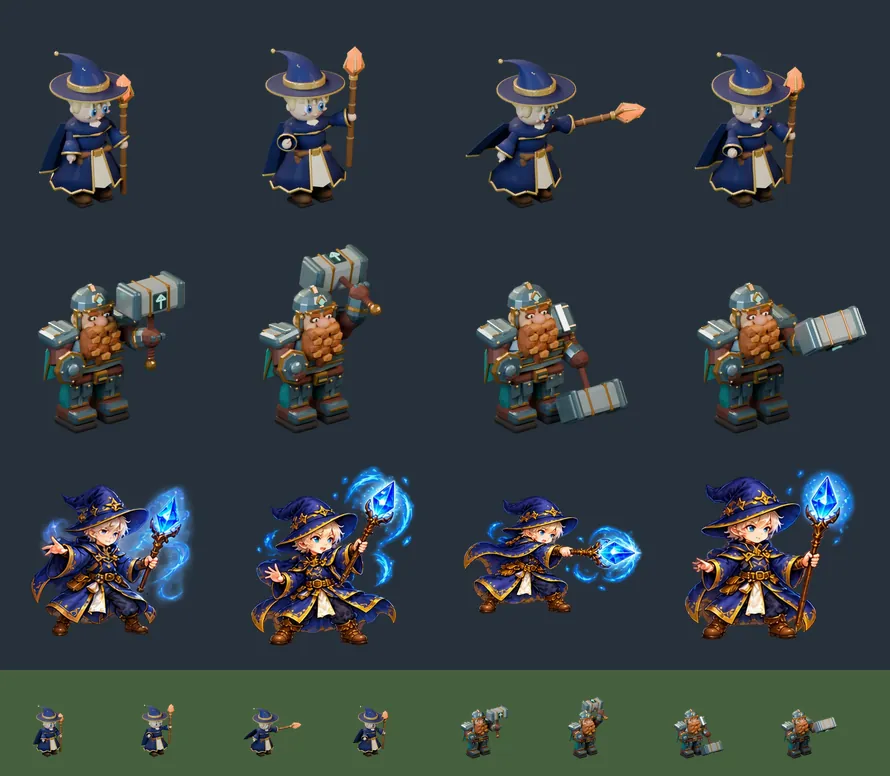

# 46회차 — 모델링: 영웅 공격 포즈 (새 회전 4바퀴)

| 항목 | 값 |
| --- | --- |
| 시각 | 2026-11-07 09:07 KST (예약 회차) |
| 기준 | main **`6f44afa`**(PR #78·#79 반영). 이 브랜치는 main을 병합했다(`b9cfd43`). |
| 회차 종류 | 평소 회차(개발 쪽 새 PR #78·#79). 집중 관점: **애니메이션**(41회차 사용자 요청) |
| 주 분야 | 모델링 |
| 범위 | 문서와 `model-drafts/`(초안 스크립트 1개, 비교 시트 1장)만. 렌더는 저장소 밖 스크래치 폴더에서 Blender 5.2로 했다. |

## 1. 점검

| PR | 내용 | 이 루프와의 관계 |
| --- | --- | --- |
| #78 | 물 명중은 청록, 번개 명중은 노랑-흰. 물 투사체·번개 탄·전조도 같은 색 | **45회차 제안의 색 부분 구현**. `FX_COLORS` 물 `#4fd6c4`·번개 `#fff27a`로 제안 값 그대로다 |
| #79 | 물 포탄 청록, 번개 탑 링·전조와 도사 룬 노랑 | 같은 제안의 남은 파란색 정리 |

- 45회차 항목에서 남은 것은 **몸 반응**(불 물듦·물 철퍽·번개 떨림·충격 찌그러짐)이다.
- #78·#79 뒤로 불 공격 흐름에 남은 파랑은 **회화 이안의 수정 하나**다.
  - 이안이 준비할 때 코드가 그리는 구슬은 주황(`def-fire-core`)이다.
  - 그런데 그 옆의 회화 수정은 파랑이다.
  - 이식 규칙(먼저 할 다섯 개 1번)의 ‘이안 결정은 따뜻한 색’이 이 어긋남을 푼다.

## 2. 첫 영웅 고르기

| 영웅 | 지금 그림 | 이식 규칙 | 처음 보이는 때 | 판단 |
| --- | --- | --- | --- | --- |
| **이안** | 회화 3프레임 + 대기는 `atlas.png` 0칸 | 수정을 따뜻한 색으로 | **1-1 시작 영웅**(모든 플레이어의 첫 판) | **첫째** |
| 리엘 | 회화 3프레임 | 충실 이식 | 1-1 뒤 합류 | 둘째 |
| 청운 | 회화 3프레임 | 충실 이식 | 1-3 뒤 합류 | 셋째 |
| 루나 | 회화 3프레임 | 늑대 목걸이 유지 | 2-3 뒤 합류 | 넷째. 달빛 늑대도 함께 봐야 해서 범위가 크다 |
| 카르 | 회화 3프레임(근접) | **원래 그림대로 옮기지 않음** | — | 묶음 ②를 기다린다 |

이안을 고른 이유는 세 가지다.
- 모든 플레이어가 가장 먼저, 가장 오래 본다.
- 이식 규칙의 색 수정을 같은 작업에서 끝낸다.
- 위의 ‘파란 수정 옆 주황 구슬’ 어긋남이 없어진다.

## 3. 구운 결과



### 3-1. 만든 것

[`model-drafts/build_mage_draft.py`](../model-drafts/build_mage_draft.py)는 `build_dwarf.py`와 같은 계약을 쓴다.
- 640px 프레임, 직교 스케일 5.8, 카메라 (7,10,7)에서 (0,0,1.7)을 봄
- 땅 원점이 (320, 550)에 투영되고, 오른쪽을 본다.
- 조명·AgX 설정도 같다.

회화 이안을 충실히 옮겼다.
- 남색 로브와 금빛 들쭉날쭉한 단, 앞이 트여 보이는 크림색 속옷
- 별 장식이 달린 넓은 챙 모자. 끝이 뒤로 처진다.
- 연한 금발, 파란 눈, 갈색 장화, 허리띠와 주머니, 등 망토
- 집게 지팡이

바꾼 것은 **수정 하나**다. 파랑을 불 주황으로 바꿨다(이식 규칙).

**관절**: `body`·`head`·`hat`·`staff-arm`·`staff`·`free-arm`·`cape`. 다리와 뿌리는 움직이지 않는다(브론과 같음).
- 모자는 몸보다 늦게 따라간다. 준비 때는 끝이 앞으로, 타격 때는 뒤로 간다.
- 망토는 타격 때 뒤로 펄럭인다.

```
# (x, y, z) 오일러 라디안
'idle':   모두 0
'windup': body(.07,0,-.10) head(.06,0,0) hat(-.07,0,0) staff-arm(1.15,0,.45) staff(-1.25,0,0) free-arm(.55,-.70,0) cape(.08,0,0)
'strike': body(-.10,0,.16) head(-.04,0,.14) hat(.14,0,0) staff-arm(.62,0,.85) staff(-1.90,0,0) free-arm(-.55,-.35,0) cape(-.38,0,0)
'recover':body(-.03,0,.06) head(-.02,0,.05) hat(-.04,0,0) staff-arm(.40,0,.35) staff(-.45,0,0) free-arm(.35,-.45,0) cape(-.12,0,0)
```

| 항목 | 이안 초안 | 브론(main) |
| --- | --- | --- |
| 메시 / 삼각형 | 107개 / 20,919 | — |
| WebP q88 네 장 | 19,540 · 21,430 · 20,392 · 20,840 = **82,202 B** | 25,760 · 25,374 · 25,316 · 24,280 = 100,730 B |
| 알파 상자 (대기) | x 200~433, y 189~573 | x 197~556, y 188~585 |
| 타격 포즈 오른쪽 끝 | 606 (여유 34px) | 563 |

- 같은 인코더인지 확인했다. main의 `dwarf-idle.png`를 같은 설정으로 다시 인코딩하면 main 파일과 같은 25,760 B가 나온다.
- 지금 회화 시트 `ranged-motion.webp`(707,842 B)는 네 영웅이 함께 쓴다. 이안 모델이 들어가도 다른 세 명이 남아 있어서 이 시트는 계속 불러온다. 전투 진입 때 **+82 KB**다.

### 3-2. 시행착오

- **첫 지팡이가 게임 크기에서 사라졌다.**
  - 640 프레임은 390px 화면에서 약 43px이다(84 × 1.2 × 0.43). 렌더 15px이 화면 1px이다.
  - 반지름 0.045 지팡이는 화면 0.7px이었다.
  - 브론 망치 자루(0.075)에 맞춰 0.072로 굵혔다. 수정도 키웠다(높이 0.52 → 0.68).
- **타격 포즈에서 수정이 프레임 오른쪽 끝(640)을 넘었다.** 손이 잡는 위치를 수정 쪽으로 0.25 올렸다(지팡이를 짧게 쥠). 그래서 606에서 끝난다.
- **수정 발광을 세게 하면 AgX에서 살구색으로 빠졌다.** 발광 1.4, 바탕 (.95,.16,0)으로 낮추니 주황이 남는다.
- **남색이 회화보다 밝게 나왔다.** 바탕을 (.007,.009,.075)로 낮췄다.

## 4. 측정

### 4-1. 64px 흑백에서 브론과 구분되나 (#73 도구와 같은 판정)

| 포즈 | 겹침 | 회색 (이안/브론) | 퍼짐 (이안/브론) | 판정 |
| --- | --- | --- | --- | --- |
| 대기 | 0.48 | 82 / 85 | 53 / 45 | 구분 |
| 준비 | 0.59 | 88 / 87 | 55 / 44 | 구분 |
| 타격 | 0.44 | 80 / 90 | 52 / 45 | 구분 |
| 회복 | 0.37 | 79 / 90 | 52 / 52 | 구분 |

- 모든 포즈가 **모양으로** 구분된다(겹침 0.65 미만). 높은 모자와 가는 지팡이 대 넓은 어깨와 망치다.
- 회색은 둘 다 어두워서 차이가 1~11로 작다. 남은 세 영웅을 옮길 때도 모양이 구분을 맡아야 한다.

### 4-2. 포즈가 대기와 얼마나 다르게 보이나

같은 프레임을 크기 맞춤 없이 64px로 줄여, 각 포즈와 대기의 실루엣 겹침을 쟀다. 낮을수록 대기와 다르다.

| | 준비 | 타격 | 회복 |
| --- | --- | --- | --- |
| 이안 | 0.77 | **0.72** | 0.82 |
| 브론 | 0.68 | 0.63 | 0.70 |

**읽은 것**
- 이안은 몸이 거의 그대로이고 지팡이 선만 움직인다. 그래서 브론보다 대기와 덜 다르다.
- 타격은 읽힌다. 수정이 대기보다 화면에서 오른쪽 11px, 아래 4px로 뻗는다.
- 준비는 약하다. 수정이 위로 5px 올라갈 뿐이다.
- 준비를 읽히게 하는 것은 이미 코드에 있는 **준비 구슬**이다(`DefenseBoard.tsx`, 발 기준 (24, −48), 반지름 7 → 16).
  - 모델 준비 포즈의 수정은 (17.6, −52.8)이고, 구슬과 화면에서 **3.4px** 떨어져 있다.
  - 회화 수정은 (21, −59)로 4.9px 떨어져 있다.
  - 모델로 바꾸면 주황 구슬이 주황 수정을 감싼다.
- 준비 포즈에서 지팡이를 더 높이 들면 대기와 더 달라진다. 대신 수정이 구슬에서 멀어진다. 이번 초안은 **구슬과 겹치는 쪽**을 골랐다.
- 회화는 다리를 벌리고 웅크린다. 모델은 다리를 고정한다(브론 계약). 대신 코드의 타격 변형(앞으로 4·기울기 9°·가로 1.04/세로 0.97)이 몸 전체에 걸린다.

### 4-3. 불덩이는 어디서 나오나

- 엔진은 투사체를 영웅의 발 위치에서 시작한다. 화면은 그 27 위에 그린다(`ProjectileLayer`). 그래서 시작점은 (0, −27)이다.
- 타격 포즈의 수정은 회화가 (30, −30), 모델이 (38.9, −33.5)다.
- 불덩이는 수정보다 몸 쪽으로 30~39단위(화면 13~17px) 뒤에서 나온다.
- 볼트 속도 460이면 수정 위치까지 0.07~0.08초(4~5프레임) 걸린다. 그동안 **가슴에서 나오는 것처럼** 보인다.
- 지금 회화도 같다. 모델은 지팡이가 더 길게 뻗어서 차이가 조금 더 크다.

## 5. 제안 (결정 불필요, 인계 A)

1. **이안 Blender 이식(4포즈)**
   - [`model-drafts/build_mage_draft.py`](../model-drafts/build_mage_draft.py)를 `tools/blender/build_mage.py`로 옮긴다.
   - `art.ts`에 브론과 같은 형식의 묶음을 둔다: 640, `displayScale` 1.2, `groundY` 550, `nativeFacing` 1.
   - 네 장이 모두 불러와진 뒤에만 바꾼다(브론 규칙).
   - `tools/build-hero-sprites.mjs`는 지금 `dwarf`로 고정돼 있다. 영웅 이름을 받도록 일반화한다. 초안의 `mage-model.json`이 같은 검사(프레임·땅·방향·네 포즈)를 통과하는 형식이다.
   - 초상(256)은 브론처럼 대기 렌더를 viewBox로 잘라 쓴다.
   - **완료 판단**
     - 64px에서 브론과 구분된다(4-1).
     - 모든 포즈가 프레임 가장자리 8px 안으로 들어온다.
     - 네 장이 90 KB 이하다.
     - `art.test.ts`가 통과한다.
2. **준비 구슬과 발사점을 수정에 맞춤 (화면만)**
   - `SpriteAsset`에 `muzzle`(프레임 px)을 더한다. 모델은 매니페스트의 `crystal_center_px`를 쓴다(준비 432,215 / 타격 567,338).
   - 준비 구슬의 중심을 준비 포즈의 muzzle로 옮긴다.
   - 투사체는 처음 0.1초 동안 **그리는 위치만** 타격 포즈의 muzzle에서 엔진 위치로 보간한다.
   - 회화 영웅은 지금 값 (24, −48)·(0, −27)을 그대로 쓴다.
   - **완료 판단**
     - 390px 영상에서 불덩이가 수정에서 나온다.
     - 엔진 테스트가 통과한다(엔진 위치·명중 시각 불변).
3. **다음 영웅 순서**: 리엘 → 청운 → 루나(늑대 목걸이, 달빛 늑대는 따로). 카르는 묶음 ②를 기다린다.
   - 원거리 영웅은 몸이 덜 움직인다(4-2). 그래서 **무기 끝의 이동(10px 이상)**과 **준비 효과의 위치**를 함께 설계한다.
     - 리엘은 활 당기기(`ElfDraw`, (20, −40))
     - 청운은 부적
     - 루나는 덩굴

## 6. 기록

- [인계 목록](../handoff.md):
  - A ‘영웅 네 명 충실 이식’에 이안 초안·측정을 붙였다.
  - A에 ‘준비 구슬과 발사점을 수정에’를 더했다.
  - A ‘이안 수정 색’ 항목에 모델 경로를 적었다.
  - 45회차 항목의 색 부분을 완료(#78·#79)로 표시했다. #78·#79를 C에 더했다.
  - 기준을 main `6f44afa`로 바꿨다.
- README 회차 기록과 다음 회차 후보를 갱신했다.

## 다음 회차

47 로직(타이밍) — 39회차 ②③(연쇄 우선·포탄 재사용)과 히트스톱 시계 함수 초안에 더해, **발사점 보간이 엔진과 어긋나지 않는 조건**을 센다. 영웅 볼트 중 비행 시간이 0.1초보다 짧은 비율을 본다. 그런 볼트는 보간이 끝나기 전에 맞는다. 측정 대상은 적이 수정보다 가까이 있는 경우다.
