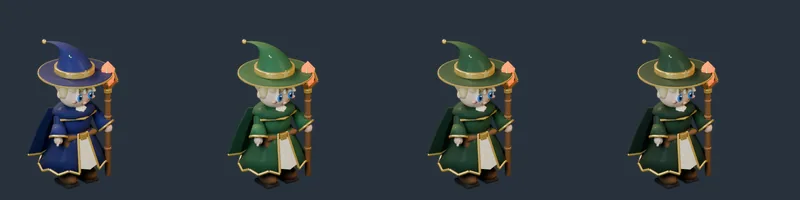

# 54회차 — 모델링: 리엘 망토 밝기 재질 시험 (저입력 회차)

| 항목 | 값 |
| --- | --- |
| 시각 | 2026-11-08 09:06 KST (예약 회차) |
| 기준 | main **`2eabc76`**(48~53회차와 같음) |
| 회차 종류 | **저입력 회차**: 새 병합 PR과 사용자 결정이 없다. 열린 PR #81은 변경 없음. 집중 관점은 **애니메이션**(41회차 사용자 요청) |
| 주 분야 | 모델링 |
| 범위 | 문서와 `model-drafts/`(시험 시트 1장). 렌더는 스크래치 폴더에서 Blender 5.2로 했다. |

## 1. 네 분야 점검

| 분야 | 상태 |
| --- | --- |
| 모델링 | 이번 회차: 50회차 리엘 설계서의 숫자 하나 확인 |
| 로직 | #81 열림(51회차 측정 끝) |
| 게임 운영 | 변화 없음. 정예 기록 필드(52)가 인계 대기 |
| 물리효과 | 변화 없음. 영웅 공격 소리 예외(53)가 인계 대기 |

## 2. 시험 — 망토색별 64px 회색

50회차는 리엘의 망토·두건을 짙은 숲 초록 약 `(.015,.07,.025)`로 하자고 했다. 목표는 64px 회색 90 이하로 루나(상아 치마)와 밝기를 가르는 것이다.

시험 방법
- 리엘 모델은 아직 없다. 그래서 46회차 이안 초안(같은 카메라·조명·AgX)의 로브·망토 재질만 바꿔 대기 포즈를 구웠다.
- 몸에서 로브가 차지하는 면적이 비슷하므로 대신 쓸 수 있다고 봤다.
- 회색은 #73 도구와 같은 방법(60px 맞춤, 불투명 화소 평균)으로 쟀다.

| 망토 바탕색 (선형) | 64px 회색 |
| --- | --- |
| 남색 `(.007,.009,.075)` (이안 초안) | 80 |
| **50회차 제안** `(.015,.07,.025)` | **92 — 목표 넘음** |
| 중간 `(.009,.04,.014)` | 85 |
| **짙은** `(.006,.026,.009)` | **80** |

| 참고: 지금 그림 (같은 방법) | 회색 |
| --- | --- |
| 리엘 준비 / 회복 | 102 / 104 |
| 루나 준비 / 회복 | 117 / 113 |

**읽은 것**
- 50회차 값은 선형 밝기(초록 성분이 큼)가 남색의 약 4배라, 64px에서 92가 나온다. **목표를 넘는다.**
- 짙은 초록 `(.006,.026,.009)`은 이안 남색과 같은 80이다. 그림처럼 초록으로 읽힌다(시트 넷째).
- 리엘은 이안보다 금발 머리가 길고 크다. 그래서 같은 망토로도 몇 단위 더 밝아질 것이다. 그 여유까지 생각해 **짙은 초록**을 쓴다.
- 루나를 그림대로(회색 113~117) 옮기면 회색 차가 30 안팎이 된다. 그래서 루나를 옮길 때는 상아 치마를 어둡게 하지 않는 것이 함께 조건이다.

## 3. 정정과 인계

- **정정**: 50회차 설계서의 망토·두건 바탕 `(.015,.07,.025)`를 **`(.006,.026,.009)`**로 바꾼다(밝은 면 ×1.45, 안감 ×0.8은 이안 초안과 같음).
- 인계 A ‘영웅 네 명 충실 이식’의 리엘 줄에 이 값과 시험 결과를 적었다. 루나를 옮길 때 상아 치마를 유지하는 조건도 적었다.
- README 정정 이력에 50 → 54를 더했다.
- 새 질문은 만들지 않았다(저입력 회차).

## 다음 회차

55 로직 — 포탄 재사용 돌려주기(39회차 ③)를 #81 뒤 main에서 다시 잰다. #81이 아직 열려 있으면 main 기준으로 잰다. 새 PR·결정이 없으면 저입력 회차로 짧게 한다.
