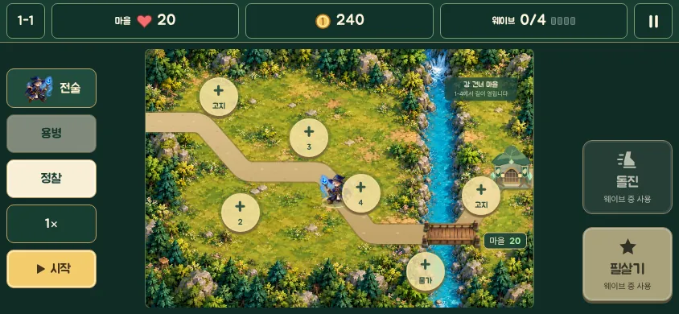

# 60회차 — 게임 운영: 맵 크기·활용과 조작 (사용자 요청)

| 항목 | 값 |
| --- | --- |
| 시각 | 2026-11-09 00시대~01시 KST (사용자 요청 직후 바로 실행. 다음 예약 회차는 03:06 KST) |
| 기준 | main **`2499225`**(PR #82 반영), 정정 때 **`48b067a`**(#81·#83 반영). 이 브랜치는 main을 병합했다. |
| 회차 종류 | **평소 회차**. 사용자 요청: “게임성(환경, 캐릭터, 조작, 타격, 승리, 요소들) 디벨롭, 특히 인게임 맵 크기·활용과 조작”. 개발 쪽 새 PR #82도 병합됐다. 11회 이어진 저입력 회차가 끝났다 |
| 주 분야 | 게임 운영(회전 순서) + **맵 크기·활용·조작 집중** |
| 범위 | 문서만. 측정은 저장소 밖 스크래치 폴더의 main 사본에서만 했다(데미지 출처를 세는 줄만 더한 엔진 사본 포함). |

## 0. 요청 반영

- 네 분야 회전은 그대로 둔다. 60회차부터 각 분야를 **게임성(맵 크기·활용·조작 먼저)** 쪽으로도 본다.
  - 41회차의 애니메이션·타격 관점은 유지한다. 타격은 요청 항목에도 들어 있다.
  - README 회전 순서 아래 ‘집중 관점’에 적었다.
- 예약 작업 지시문에도 같은 내용을 넣었다.

## 1. 점검

| PR | 내용 | 이 루프와의 관계 |
| --- | --- | --- |
| #81·#83 | (문서 작성 중 병합) #81 번개 탑 연쇄 우선 — 35·39·51회차 설계·측정대로, 인계 ‘타워 표적’ 완료. #83 개발 루프의 모델별 역할(Fable·Opus·Astra)과 북극곰 수호자 Blender 시안(`tools/blender/build_polar_bear.py`) | 다음 모델링 회차에서 북극곰 시안을 64px·가로 배율로 점검 |
| #82 | 개별 컨셉 6장: 북극곰 수호자, 열대 도마뱀 궁수, 화산등 거북왕, 극지 몬스터 셋, **극지 해안·열대 군도 전장** (`art-source/defense/concepts/2026-11-09/`, `docs/arcana-world-planning/subject-concepts-2026-11-09.md`) | 그림만이다(게임 데이터·APK 불변). 두 전장 그림 모두 **빈 패드 6곳 + 굽은 길 하나**다. 문서도 “그림의 원판 수가 확정 규칙은 아니다”라고 적었다. 그래서 새 지역을 만들기 전에 아래 3·4장의 맵 활용 문제를 먼저 푸는 것이 좋다 |

## 2. 지금 맵 (main 코드와 측정)

| 항목 | 값 |
| --- | --- |
| 전장 크기 | 900 × 600 (두 지역 같음) |
| 길 | 숲 1번 길 1,093 · 2번 길 754, 설산 1,173 · 722 (2번 길은 1-4·2-4 같은 확장 스테이지만) |
| 건설 지점 | 고정 6곳 + 확장 2곳. 지형: 고지대(사거리 +45), 물가·빙판(설명만), 평지 |
| 타워 사거리 | 185~205(Lv1), +12/단계, 고지대 +45 → 한 곳이 1번 길의 **23~42%**를 덮음, 기본 6곳을 합치면 **100%** |
| 환경 효과 | 숲 다리 구간(x 650~735): 적이 젖고 0.8배 속도. 비 오는 스테이지: 모든 적이 젖음. 설산 빙판(x 300~520): 적 1.25배 속도. 이 밖의 땅은 효과 없음 |
| **길에서 70 넘게 떨어진 땅** | 한 길 스테이지 **72%**(설산 70%), 두 길 스테이지 54% |
| 영웅 | 지도 가운데(440, 355)에서 시작, 속도 230, 돌진 200·대기 5초, 사거리 140(카르)~280(리엘) |

**화면에서 — 사용자 결정 반영(같은 날 추가): 모바일은 가로 모드만, 세로 없음**
- 처음 쓴 판은 세로 폰의 확대 보기(배율 0.74, 전장의 59%만 보임)를 기준으로 했다. 사용자가 “모바일에서는 세로 모드 없음, 가로 모드만”이라고 알려 줘서 **가로 화면에서 다시 쟀다.**
  - main을 스크래치에서 띄우고 Playwright로 1-1 전투에 들어가 `.def-map` 크기를 쟀다. 터치 기기, 배율 1이다.

| 가로 화면(CSS px) | 전장 | 배율 | 640 영웅 프레임(84 × 1.2) |
| --- | --- | --- | --- |
| 844 × 390 | 482 × 321 | **0.535** | 54px |
| 915 × 412 | 514 × 343 | 0.572 | 58px |
| 800 × 360 | 454 × 303 | 0.505 | 51px |
| 740 × 360 | 454 × 303 | 0.505 | 51px |
| 667 × 375 | 477 × 318 | 0.530 | 53px |

- 가로에서는 **전장 전체가 한 화면에 보인다**(밀기 없음). 입구와 마을도 함께 보인다. 왼쪽에 전술·용병·정찰·배속·시작, 오른쪽에 돌진·필살기 버튼이 있다.
- 41~58회차가 쓴 0.43(세로 전체 보기)은 가로 0.505~0.572보다 작다. 그래서 그간의 가독성 판단은 **보수적이었을 뿐 유효**하다(README 정정 이력).
- 세로용 확대 보기·카메라 코드는 모바일에서는 쓰이지 않는다. 다만 지금 Android 매니페스트는 방향을 고정하지 않는다(5장 A4).

**읽은 것 — 맵**
- 맵의 약 3/4은 길에서 멀다. 건설 지점은 고정 6곳이고 그 사거리가 길을 다 덮는다. 그래서 플레이어의 공간 선택은 ‘6곳 중 어디에 무엇을’과 ‘영웅을 어디에’ 둘뿐이다.
- 나머지 땅은 배경이다. 환경 효과도 길 위 두 구간(다리·빙판)에만 있다.
- 건설 지점마다 덮는 길이 23~42%로 다르다. 이 차이가 ‘어디에 지을까’를 의미 있게 만든다. 하지만 설명 칸에는 지형 이름만 있고 **이 지점이 길을 얼마나 덮는지**는 보이지 않는다.

## 3. 지금 조작 (main 코드와 측정)

**입력**
- 한 번 누르기만 쓴다.
  - 건설 지점 주변 48 CSS px 정사각형 → 그 지점 창
  - 그 밖의 땅 → 영웅 이동
  - 끌기 → 취소
- 버튼: 돌진(조준 → 누른 곳으로 200), 필살기, 웨이브 시작, 배속, 일시정지, 시야
- 용병·늑대는 자동이다. 플레이어가 움직이는 것은 영웅 하나뿐이다.

**측정 1 — 영웅을 움직이면 무엇이 달라지나**
- main 사본, 이안(원거리)·카르(근접) × 8스테이지 × 난이도 3 × 타워 ‘전체’(밸런스 도구 배치)·‘적음’(앞 세 동작) × 조작 없음/있음, 192판이다.
- ‘조작 있음’은 밸런스 도구 active와 같다. 2.5초마다 가장 급한 적 앞으로 이동하고, 돌진할 수 있으면 돌진하고, 필살기를 쓴다.

| 영웅 · 타워 | 조작 | 승리 | 마을 체력 중앙값 | 영웅 피해 비중 | **영웅이 할 일 없는 시간** | 분당 입력 | 판 시간 |
| --- | --- | --- | --- | --- | --- | --- | --- |
| 이안 · 전체 | 없음 | 24/24 | 20 | 6.6% | **62%** | 8.5 | 136초 |
| 이안 · 전체 | 있음 | 24/24 | 20 | 43.7% | 10% | 23.1 | 123초 |
| 이안 · 적음 | 없음 | **15/24** | 10 | 17.2% | 44% | 2.8 | 156초 |
| 이안 · 적음 | 있음 | **23/24** | 20 | 62.2% | 9% | 17.2 | 150초 |
| 카르 · 전체 | 없음 | 24/24 | 20 | 16.1% | **82%** | 9.0 | 132초 |
| 카르 · 전체 | 있음 | 24/24 | 20 | **73.9%** | 13% | 19.7 | 101초 |
| 카르 · 적음 | 없음 | 23/24 | 20 | 43.3% | 64% | 3.0 | 147초 |
| 카르 · 적음 | 있음 | 24/24 | 20 | **90.5%** | 11% | 13.3 | 109초 |

- ‘할 일 없는 시간’은 웨이브 동안 영웅 사거리 안에 적이 하나도 없는 시간의 비율이다.
- 피해 비중은 명중 처리 전후 적 체력 합의 차이를 출처(영웅·필살기 / 타워 / 용병·늑대)별로 더한 것이다.

**측정 2 — 길을 눌렀는데 건설 창이 열리는 비율**

| 가로 배율 | 누름 칸(48 CSS px)의 전장 크기 | 길 가운데 누름 칸 안에 든 비율 |
| --- | --- | --- |
| 0.505 (800·740 × 360) | 95 | 숲 15~16%, 설산 10~16% |
| 0.535 (844 × 390) | 90 | 숲 14%, 설산 9~15% |
| 0.572 (915 × 412) | 84 | 숲 12%, 설산 8~13% |

가로 화면에서 길의 약 1/8~1/6은 ‘영웅을 여기로’ 대신 ‘타워 창 열기’가 된다.

**측정 3 — 영웅이 스스로 가까운 적에게 다가가면 (실험, 권하지 않음)**
- 조작이 없을 때 영웅이 기준점에서 120(또는 220) 안쪽으로 가장 가까운 적을 향해 붙게 해 봤다.
- 결과
  - 할 일 없는 시간: 이안 62% → 40%(18%), 카르 82% → 62%(40%)
  - 피해 비중: 이안 6.6% → 11.7%(17.9%)
  - 조작 있음의 값(44%·74%)은 그대로다.
- 그런데 아슬아슬한 판에서 결과가 **양쪽으로** 흔들렸다.
  - 2-4 정예 이안: 이김 체력 2 → 짐
  - 1-4 카르: 체력 12 → 20
  - 두 길 스테이지에서 가운데를 지키던 영웅이 한쪽 길로 끌려가기 때문이다.
- 그래서 자동 접근은 해법으로 권하지 않는다.

**읽은 것 — 조작**
- **조작하지 않은 영웅은 웨이브의 62~82% 동안 서 있기만 한다.** 처음 하는 아이가 영웅을 움직여야 한다는 것을 모르면, 영웅은 대부분 배경이다.
- 조작은 효과가 크다.
  - 영웅 피해 비중이 5~7배가 된다.
  - 타워가 적을 때는 이안의 승리가 15 → 23판으로 바뀐다.
  - 조작이 승패를 바꾸는 것은 **타워가 부족할 때**다. 타워가 다 있으면 조작 없이도 다 이긴다.
- 그런데 **근접 영웅을 잘 움직이면 타워가 조연이 된다.** 카르 조작 판에서 타워 피해는 26%(타워 적음 10%)다.
  - ‘재료를 읽고 타워를 짓는 수비대’라는 정체성(정체성 기준)과 부딪힌다.
  - 원거리 이안은 44%로 균형에 가깝다.
- 길 위 1/8~1/6에서 이동이 건설 창으로 바뀐다. 이것은 조작을 배울수록 짜증이 되는 지점이다.

## 4. 게임성 세 축으로 본 진단

| 축 | 지금 | 막는 것 |
| --- | --- | --- |
| 게임성(선택·조합·실패 후 바꿀 행동) | 6곳 배치 + 영웅 위치. 타워가 다 있으면 조작이 승패와 무관 | 땅의 3/4이 선택지 밖. 지점마다 덮는 길이 달라도 보이지 않음 |
| 오락성(손맛·다음 한 판) | 조작하면 판이 짧아지고(카르 132 → 101초) 영웅 비중이 큼 | 조작을 모르면 영웅이 62~82% 쉼. 길 위 1/8~1/6 누름이 건설 창 |
| 정체성(재료를 읽는 수비대) | 타워가 재료 대응의 주인공 | 근접 영웅을 잘 움직이면 타워 비중 10~26% |

## 5. 제안

### A. 결정 없이 진행해도 되는 것 (인계 A)

1. **누름 판정: 길 쪽이면 이동**
   - 건설 지점 누름 칸 안이라도 **그 지점 중심보다 길(가장 가까운 길 선분)에 더 가까우면 이동**으로 본다.
   - 지점의 그림 원(반지름 21px) 안은 늘 선택이다.
   - 측정
     - 가로 화면 길 위 막힘: 8~16% → **0%**
     - 지점 누름 칸은 평균 78~83%(최소 63~69%)가 남는다. 그림 원은 늘 선택이다.
   - 완료 판단
     - `defenseInput.test.ts`에 길 위 누름 → 이동, 지점 그림 위 누름 → 선택, 두 지점 겹침 → 후보 창(지금 규칙)
     - 가로 800 × 360에서 길 위 이동이 막히지 않는다.
2. **‘영웅이 쉬고 있어요’ 표시**
   - 웨이브 중 영웅 사거리 안에 적이 없는 상태가 2초 넘게 이어지고 적이 있으면, 가장 가까운 적 쪽 길 위에 작은 발자국 표시를 띄운다.
     - 위치는 영웅이 서면 적이 사거리에 드는 곳이다.
     - 누르면 그리로 이동한다.
   - 1-1 첫 웨이브에는 한 줄 안내 “땅을 눌러 영웅을 옮겨요”를 한 번 띄운다.
   - 자동 이동은 하지 않는다(측정 3). 조작의 가치(피해 비중 5~7배)는 그대로 둔다.
   - 완료 판단
     - 표시는 조작이 필요할 때만 뜬다(조작 있음 판에서는 할 일 없는 시간이 10% 안팎이라 드묾).
     - 동작 줄이기에서도 뜬다(움직임 없는 표시).
     - 엔진 불변.
3. **건설 지점 창에 ‘덮는 길’ 한 줄**
   - 지형 이름 옆에 “길의 34%를 지켜요(2번 길 45%)”처럼 그 지점의 Lv1 사거리가 덮는 길 비율을 보인다.
   - 엔진의 `towerRange`와 경로로 계산하는 순수 함수다(이 문서 2장 값과 같음).
   - 완료 판단: 숫자가 이 문서 표와 같다(테스트로 고정). 360px 한 줄.

4. **가로 고정 (사용자 결정 반영)**
   - Android(Capacitor) 매니페스트의 `MainActivity`에 `android:screenOrientation="sensorLandscape"`를 둔다.
   - 웹으로 폰 세로 화면에서 열면 전장 대신 “가로로 돌려 주세요” 안내를 띄운다.
   - 모바일 검증 기준(`docs/arcana-mobile-quality-roadmap.md`)에서 390 × 844 세로 검증을 빼고 가로 3종(844 × 390, 800 × 360, 915 × 412)으로 바꾼다.
   - 완료 판단: 기기를 세로로 들어도 앱은 가로로 남는다. 가로 800 × 360에서 버튼과 전장이 겹치지 않는다.

### B. 사용자 결정이 필요한 것 (새 묶음 ⑦ ‘맵·조작’)

| 질문 | 선택지 | 추천 |
| --- | --- | --- |
| ⑦-1 맵의 남는 땅(72%)을 어떻게 할까 | ㉠ 그대로(배경) ㉡ **영웅 전용 지점**: 길에서 먼 언덕·망루 2~3곳, 영웅이 서 있으면 사거리 +40 또는 필살기 충전 가속. 땅이 선택지가 되고 조작의 이유가 됨 ㉢ 환경 장치: 다리 끊기·눈사태 같은 1회용 누름 장치(타이밍 조작) | **㉡**. 새 지역(#82 극지·열대) 설계에도 그대로 쓸 수 있고 엔진 변경이 작다 |
| ⑦-2 근접 영웅이 타워를 조연으로 만드는 것(74~91%) | ㉠ 그대로 ㉡ 근접 영웅 피해를 낮추고 대신 **타워 곁에서 싸우면 그 타워 공격 속도 +15%** 같은 연계 ㉢ 근접 영웅 피해만 낮춤 | **㉡**. 조작 가치는 남기고 타워 정체성을 지킨다. 수치는 측정 뒤(로직 회차) |
| ⑦-3 승리 조건이 하나(4웨이브 생존)뿐인 것 | ㉠ 그대로 ㉡ 일부 스테이지에 **지점 지키기**(구조 대상이 서 있는 원 안에 영웅이 있어야 구조 막대가 참) — 맵의 땅과 조작이 승리와 이어짐 ㉢ 시간 제한 | **㉡**을 확장 스테이지 하나(1-4)에 먼저. 재료 학습과 무관해 확정 제약과 맞음 |

## 6. 기록

- [인계 목록](../handoff.md): A에 넷(누름 판정, 쉬는 영웅 표시, 덮는 길 한 줄, 가로 고정)을 더했다. ‘타워 표적’을 #81로 완료 표시했다. 사용자 결정 ‘모바일은 가로만’을 머리말에 적었다.
- README
  - 집중 관점(60회차, 사용자 요청), 결정 묶음 ⑦, 정정 이력(화면 배율), 회차 기록, 다음 회차 후보를 갱신했다.
- 예약 작업 지시문에 새 집중 관점을 넣었다.
- 모델 설계는 이번 회차에 없다(운영 회차). ⑦-1 ㉡이 정해지면 망루 모델을 모델링 회차에서 설계한다.

## 다음 회차

61 물리효과 — 조작 반응(누름 → 영웅 첫 움직임까지의 시간, 돌진 조준 표시, 이동 목적지 표시)을 잰다. 41회차 타격감 관점과 함께 ‘누른 손맛’을 본다.
