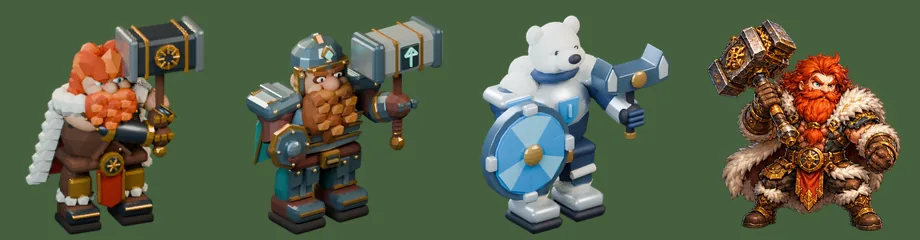

# 64회차 — 게임 운영: 인계 목록 전체 대조, 카르 시안 경고

| 항목 | 값 |
| --- | --- |
| 시각 | 2026-11-09 12:06 KST (예약 회차) |
| 기준 | main **`4472e03`**(PR #92~#98 반영). **이 브랜치는 PR #93으로 main에 모두 들어갔다** → 규칙대로 최신 main에서 이어 간다(앞으로 감기). |
| 회차 종류 | 평소 회차(개발 쪽 새 PR 7개). 집중 관점: 조작·맵(60)과 타격(41) |
| 주 분야 | 게임 운영 |
| 범위 | 문서와 `model-drafts/`(비교 시트 1장). 코드 대조는 main을 읽어서 했다. |

## 1. 점검

| PR | 내용 | 이 루프와의 관계 |
| --- | --- | --- |
| #93 | 모바일 통합 정리. **이 루프 브랜치(62·63회차까지)를 main에 병합**했다. README·인계 목록 머리에 ‘통합 기준’ 주석을 달았다: 회차 제안은 구현 완료가 아님, 화면 방향은 “기록 간 차이로 미확정, 확인 전까지 세로·가로 지원 유지” | 아래 2장 |
| #92 | 영웅·용병도 준비 중 표적이 쓰러지면 남은 적으로 다시 조준. 연쇄 선호는 타워에만 | #66·#85 규칙을 영웅·용병으로 넓힘 |
| #94 | 모델 작업실에 **카르 3D 시안**(`tools/blender/build_barbarian.py`, 붉은 머리·흰 털망토·양손 망치) | 아래 3장 — **브론과 64px 혼동** |
| #95 | 수학 엔진을 저장소 안으로(`src/games/math/`) | 60회차에 스크래치 스텁으로 피해 간 외부 의존이 없어짐 |
| #96 | 모델 작업실에 수호자 피격 미리보기, 전장 크기 피격 가독성 | 시안 작업. 49회차(필터 없는 피격) 방향과 충돌 없음 |
| #97 | 11월 9일 미술 방향 팔로업 문서·갤러리 | 기록 |
| #98 | **히트스톱**: `src/components/battleClock.ts`(63회차 초안 이식) + 루프 연결 + 사건 프레임 즉시 게시 + 동작 줄이기에서 끔 + 다시 시작할 때 간격 초기화 | **41·43·47·63 설계대로.** 단, 필살기 입력 멈춤과 화면 흔들림·진동은 아직(4장) |

## 2. 화면 방향 — 두 기록이 다르다

- 이 루프의 기록: **사용자가 이 세션에 직접 쓴 말**(2026-11-09 01시대 KST): “모바일에서는 세로모드없음, 가로모드만 있음”. 60회차에 사용자 결정으로 적고, 예약 지시문·README·인계 목록에 반영했다.
- 개발 쪽 #93 기록(`docs/arcana-mobile-integration.md`)
  - “화면 방향은 기존 지원과 기획 기록이 다르므로 확정 전까지 기존 세로·가로 지원을 보존한다.”
  - 같은 주석이 이 루프의 README·인계 목록 머리에도 붙어 있다.
- 이 루프는 개발 쪽 주석을 지우지 않는다. 대신 인계 목록의 결정 줄에 **사용자 원문과 시각**을 붙였다.
- 사용자에게 한 번 확인을 청한다(보고에 적음). 확인되면 개발 쪽이 ‘가로 고정’(60회차 A4)을 할 수 있다.

## 3. 카르 3D 시안(#94)은 브론과 같은 사람처럼 보인다

#73 도구 판정(64px)이다.

| 쌍 | 겹침 | 회색 | 퍼짐 | 판정 |
| --- | --- | --- | --- | --- |
| **카르 시안 · 브론** | **0.71** | 95 / 85 | 53 / 45 | **혼동**(세 기준 모두 실패) |
| 카르 시안 · 북극곰 시안 | 0.62 | 95 / 141 | 53 / 59 | 구분 |
| 카르 시안 · 카르 그림 | 0.52 | 95 / 90 | 53 / 50 | 구분(그림과 모양이 다름) |
| 카르 그림 · 브론 | 0.49 | 90 / 85 | 50 / 45 | 구분 |

**읽은 것**
- 지금 그림의 카르는 브론과 구분된다(0.49). 그런데 3D 시안은 붉은 수염·땅딸한 몸·오른손에 든 망치 때문에 **브론과 혼동**이다.
- 18회차 2-3과 이식 규칙 한 장(먼저 할 다섯 개 1번)이 걱정한 바로 그 결과다: “카르를 그대로 옮기면 브론과 같은 사람이 된다.”
- 흰 털망토는 06회차 제안(상아 털 망토가 주 색면)과 맞는다. 하지만 **무기(망치)와 몸 비율**이 브론과 겹친다. 02회차 제안은 도끼와 더 큰 키였다.
- 지금은 작업실 시안일 뿐이고 게임에는 들어가지 않았다. 게임에 넣기 전에 결정 묶음 ②(카르 외형)가 필요하다.

## 4. 인계 목록 A 전체 대조 (56회차 방식)

**완료인데 표시가 없던 것 → 완료로 표시**

| 항목 | 근거 |
| --- | --- |
| 절연 슬라임 재질(보라 → 호박색, 띠 → 잎) | PR #64·#65·#77 |
| 타워는 쏘는 순간 표적을 다시 고른다 | PR #66(+ #85·#92 확장) |
| 번개 탑 연쇄 우선 | PR #81 |

**일부 완료**
- 타격감 3단계 ③: 히트스톱은 #98로 완료다. 남은 것은 셋이다.
  - **필살기 입력 프레임의 멈춤**(63회차: 필살기 효과는 단계가 아닌 입력에서 생겨 `bigImpact`에 안 잡힘. 지금 main은 필살기·충전 끊기에 멈춤이 없음)
  - 화면 흔들림 3px·120ms
  - 진동 12ms(보스 [30,40,60])

**아직 없음(main 코드에서 확인)**
- 결과 화면
  - 보상 내역 한 줄(56): 세 줄이 따로 있음
  - 추가 퀘스트 다시 하기 버튼(44)
- 화면 표시
  - 넉백 무게 신호(33)
  - 쓰러짐 밀림(37 ②)
  - 속성별 몸 반응(45·49)
  - 쓰러짐 포즈(41·42): 모델 몬스터의 ‘death’가 아직 맞는 칸을 씀
  - 4프레임 걷기(41)
- 영웅 표시
  - 준비 구슬·발사점(46·47)
  - 영웅·약점 소리 예외(53·57)
  - displayScale 1.32(62): 브론 1.2 그대로
  - 쉬는 영웅 표시(60)
  - 덮는 길 한 줄(60)
- 저장·모바일
  - 정예 기록 필드(52)
  - 전투 이어하기(39·59)
  - 가로 고정(60): 2장의 확인 대기
- 도구
  - 64px 도구 모든 칸(47): 아직 첫 칸만
  - 밸런스 도구 열 셋(07·12·25)
- 그 밖
  - 고목왕 알림 조사: “고목왕가” 그대로
  - 상태 칩 알림 허용 목록(18)
  - 타워 회화 시트 지연 로드(15): `tower-models.webp` 아직 미리 불러옴

## 5. 제안

1. **(A, 히트스톱 마무리)** 필살기 입력이 받아들여진 프레임에서 그 프레임 단계 뒤 `stopAt`을 건다. 초안 테스트의 `skillUsed` 방식이다(63회차).
   - 완료 판단: 필살기·충전 끊기에서 멈춤이 보인다. 63회차 초안 테스트의 ‘같은 끝 상태’가 통과한다.
2. **(B ②에 추가, 경고)** 카르 3D 시안이 브론과 64px 혼동이다.
   - 묶음 ② ‘카르 도끼·체형’의 추천안을 유지한다. 도끼, 더 큰 키, 상아 털망토가 주 색면이다.
   - 게임에 넣기 전 #73 도구로 브론과 ‘구분’을 받아야 한다.
3. **(사용자 확인)** 화면 방향: 이 세션의 ‘가로만’ 결정을 최종으로 볼지 확인해 달라고 보고에서 청한다(2장).

## 6. 기록

- [인계 목록](../handoff.md)
  - 결정 줄에 사용자 원문을 붙였다.
  - 완료 셋을 표시하고 타격감 3단계의 남은 셋을 적었다.
  - C에 #92~#98을 더했다.
  - B 카르 줄에 64px 혼동 경고를 붙였다.
  - 기준을 main `4472e03`로 바꿨다.
- README: 회차 기록, 다음 회차 후보, 개발 루프와의 관계(#93 병합)를 갱신했다.

## 다음 회차

65 물리효과 — 돌진의 타격감을 본다. 돌진 끝 근접 공격·속도선·소리, 그리고 대기 5초가 조작 리듬과 맞는지(판당 돌진 수)를 잰다. #98 히트스톱이 들어간 뒤의 체감(멈춤 수·간격)도 main으로 다시 잰다.
