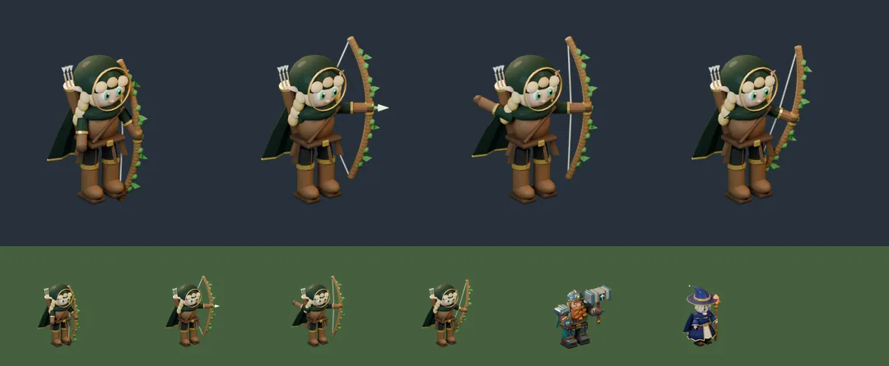

# 66회차 — 모델링: 리엘 초안 굽기

| 항목 | 값 |
| --- | --- |
| 시각 | 2026-11-09 18:07 KST (예약 회차) |
| 기준 | main **`ee396d2`**(PR #101 반영). 이 브랜치는 main을 병합했다. |
| 회차 종류 | 평소 회차(개발 쪽 새 PR #101). 집중 관점: **애니메이션**(41)과 **맵 위 크기**(60·62, 가로 844 × 390) |
| 주 분야 | 모델링 |
| 범위 | 문서와 `model-drafts/`(초안 스크립트 1개, 시트 1장). 렌더는 스크래치 폴더에서 Blender 5.2로 했다. |

## 1. 점검

| PR | 내용 | 이 루프와의 관계 |
| --- | --- | --- |
| #101 | 거점(마을) 화면을 그림 마을과 성장 전용 화면으로 다시 꾸밈(`DefenseCamp.tsx`, `camp-redesign.css`, 기획 문서 `village-growth-ui-2026-11-09.md`) | 운영 화면. 이 루프 인계와 겹치는 항목은 없음. 기념물(B ③)·등불(B ④)이 들어갈 자리가 생긴 것은 기록 |

## 2. 구운 것 — 리엘(엘프 명사수) 초안

[`model-drafts/build_elf_draft.py`](../model-drafts/build_elf_draft.py)는 지금까지의 설계를 모두 넣었다.
- 50회차 설계서
  - 둥근 두건, 키만 한 활 호, 화살통 깃 셋(어깨 너머로 보이게 옮김)
  - 긴 금발(옆머리가 두건 밖으로)
  - 뾰족 귀는 옆으로, 위로는 솟지 않음
  - 준비 = 다 당긴 끝 모습
- 54회차 망토색 `(.006,.026,.009)`
- 58회차 활 규칙
  - 활 팔 반지름 0.07
  - 준비·타격에서 활 면이 쏘는 방향(세계 (−0.82, 0.57, 0))과 위쪽을 품음
- 62회차 영웅 규격 displayScale 1.32
- 화살촉은 `ElfDraw`와 같은 계열 초록으로 빛난다.
- 포즈는 손·시위·화살 위치를 포즈 값으로 매번 새로 만든다. 제품 스크립트는 같은 값을 관절(`body`·`head`·`hair`·`bow-arm`·`bow`·`draw-arm`·`nock`·`arrow`·`cape`)에 키로 넣는다.

**시행착오**
- 두건 테두리로 넣은 금빛 관이 얼굴을 가리는 띠가 됐다. 얼굴 둘레의 얇은 고리로 바꿨다.
- 긴 머리가 망토·두건 뒤에 숨었다. 양옆으로 흘러내리는 옆머리를 더했다.
- 화살통 깃이 머리 뒤에 숨었다. 가까운 어깨(+X) 너머로 옮겼다.
- **키가 작았다.** 같은 카메라 계약·displayScale 1.32에서 대기 31px로 보통 몬스터(34~36px)보다 작았다(엘프 몸이 브론보다 낮음, 프레임 안 317 대 397px). 그래서 몸 전체를 **땅 원점 기준 1.25배**로 했다(`--scale 1.25`).

## 3. 측정

| 항목 | 값 | 기준 |
| --- | --- | --- |
| 보이는 키(가로 844 × 390, 1.32) | 대기 **39.0px**, 준비·타격 43.9px, 회복 41.5px | 62회차 목표 약 39px ✔ |
| 64px 회색 | **83** | 54회차 목표 90 이하 ✔ |
| 전장 배경과 밝기 차 | 숲 34, 설산 74 | 62회차 기준 25 이상 ✔ |
| 프레임 안 | x 163~512, y 131~575 (가장자리 여유 8px 이상) | ✔ |
| WebP q88 네 장 | 23,820 · 27,902 · 29,688 · 26,440 = **107,850 B** | 50회차 예산 90 KB **넘음** |
| 대기와 실루엣 겹침 | 준비 0.74 · 타격 0.69 · 회복 0.78 | 이안 초안(0.77·0.72·0.82)보다 조금 더 다름 |

| 64px 판정 (#73 도구) | 겹침 | 회색 | 판정 |
| --- | --- | --- | --- |
| 리엘 · 브론 | 0.49 | 83 / 85 | 구분 |
| 리엘 · **이안 초안** | **0.64** | 83 / 82 | **구분(겨우: 기준 0.65)** |
| 리엘 · 루나(그림) | 0.47 | 83 / 96 | 구분 |
| 리엘 · 도마뱀 시안 | 0.52 | 83 / 142 | 구분 |
| 리엘 · 카르 시안 | 0.57 | 83 / 95 | 구분 |

**준비 화살촉과 `ElfDraw`**
- 준비 포즈의 화살촉은 발 기준 (32.7, −42.5)이다(1.32, 가로 `unitScale` 1.065).
- `ElfDraw` 구슬은 (43, −40)이다. 약 10단위(화면 약 5px) 어긋난다.
- 46회차 ‘발사점’ 제안대로 `arrowhead_px`(준비 497, 320)를 쓰면 맞는다.

**읽은 것**
- 50·54·58·62회차의 숫자가 한 모델에서 함께 맞는다: 키 39px, 회색 83, 배경 대비, 활 이어짐·휘어짐.
- **리엘과 이안 초안은 64px 대기에서 겨우 갈린다**(0.64).
  - 둘 다 몸 한쪽에 긴 무기를 세우고 서 있고, 밝기도 같다(83 대 82).
  - 준비·타격에서는 활과 지팡이 모양이 달라 문제가 덜하다.
  - 대기 구분을 늘리려면 이안 모자 끝을 더 높이거나 리엘 활을 대기에서 비스듬히 든다.
- 용량은 1.25배와 잎·덩굴 매듭 때문에 예산을 18 KB 넘는다. 덩굴 매듭(9개)·잎(4장)을 줄이거나 WebP 품질을 85로 낮춰 맞출 수 있다.

## 4. 인계 (A ‘영웅 네 명 충실 이식’의 리엘 줄)

- 초안 스크립트: `model-drafts/build_elf_draft.py`를 `tools/blender/build_elf.py`로 옮긴다. 포즈마다 `--pose`로 굽는다.
- **몸 1.25배**(같은 카메라 계약 안에서). 다른 영웅도 옮길 때 가로 화면 키 39px 안팎을 확인한다.
- 매니페스트의 `arrowhead_px`·`nock_px`를 46회차 발사점(`muzzle`)에 쓴다.
- 완료 판단
  - 64px에서 브론·이안·루나와 구분. 이안과는 대기 겹침 0.60 이하로 여유를 둔다.
  - 네 장 ≤ 90 KB(덩굴·잎 줄이기 또는 품질 85).
  - 가로 844 × 390에서 대기 키 38~41px.

## 5. 기록

- [인계 목록](../handoff.md): 리엘 줄에 초안·측정·1.25배를 붙였다. 발사점 줄에 리엘 준비 화살촉 값을 붙였다. 기준을 main `ee396d2`로 바꿨다.
- README 회차 기록과 다음 회차 후보를 갱신했다.

## 다음 회차

67 로직 — 조작·맵 관점으로 스테이지마다 ‘영웅 자리’를 잰다. 영웅이 서면 할 일 없는 시간이 가장 적은 지점이 어디인지 보고, 쉬는 영웅 표시(60 A2) 발자국 위치를 정하는 순수 함수 초안을 만든다.
