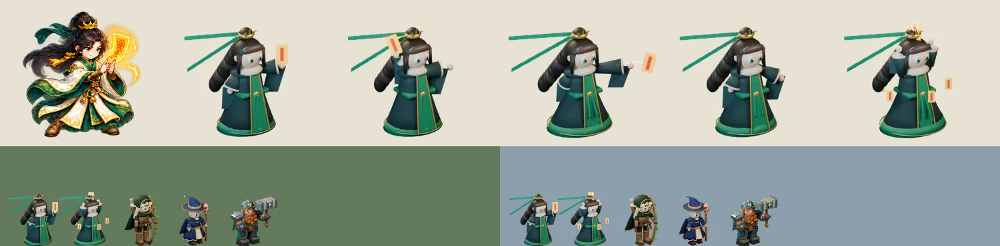

# 68회차 — 모델링: 청운 초안과 첫 시전 포즈

| 항목 | 값 |
| --- | --- |
| 시각 | 2026-11-09 21:10 KST (예약 회차) |
| 기준 | main **`355e573`** — 67회차 뒤 바뀐 것 없음 |
| 회차 종류 | **저입력 회차**(67회차 뒤 새 PR·사용자 결정 없음). 관점: 다른 캐릭터·필살기 시전 포즈(67), 맵 위 크기(60·62) |
| 주 분야 | 모델링 |
| 범위 | 문서와 `model-drafts/`(초안 스크립트 1개, 시트 1장). 렌더는 스크래치 폴더에서 Blender 5.2로 했다. |

## 1. 점검

| 분야 | 상태 |
| --- | --- |
| 로직 · 게임 모드 · 모델링 | 새 PR 없음. 67회차 인계(필살기 표시·단계 그림·시전 포즈)는 아직 구현 전이다 |

## 2. 구운 것 — 청운(동방 도사) 초안

**참고 그림**: `art-source/defense/atlases/ranged-motion.png`의 청운 세 칸을 열어 보았다.
- 높은 상투와 금관, 옥색 머리띠
- 긴 검은 머리, 넓은 소매의 흰 도포(초록 단·금 무늬), 갈색 장화
- 빛나는 노란 부적

[`model-drafts/build_tao_draft.py`](../model-drafts/build_tao_draft.py)는 리엘 초안과 같은 카메라 계약을 쓴다.
- 64px 실루엣 단서 셋
  - ① 상투와 금관이 만드는 머리 위 봉우리
  - ② 종 모양 도포
  - ③ 앞으로 든 부적, 뒤로 흐르는 머리채와 옥색 리본 두 가닥
- 포즈 다섯
  - 대기·준비·타격·회복
  - **시전(뇌운 결계)**: 두 팔을 들고 부적을 머리 위로 올린다. 작은 부적 다섯 장이 허리 둘레를 돈다. 67회차 4-3 ‘시전 포즈’의 첫 시안이다.
- 몸은 땅 원점 기준 1.2배로 굽는다(리엘은 1.25배).

**시행착오**
- 부적·리본·늘어진 소매가 카메라에 옆면으로 서서 선처럼 보였다. 너비 방향을 화면 가로로 바꾸고, 부적은 카메라를 보게 했다.
- 부적 발광 2.4가 AgX 톤 매핑에서 흰색으로 날아갔다. 짙은 노랑에 발광 1.1로 낮췄다.
- **원뿔 도포만으로는 이안 초안과 혼동**이었다(64px 겹침 0.71). 긴 머리채와 리본을 뒤로 흘리고 부적을 앞으로 내밀어 0.54로 낮췄다.
- **그림 그대로의 흰 도포는 숲 배경에 묻혔다.** 64px 회색이 105로, 숲(116)과 11밖에 차이 나지 않았다.
  - 겉옷은 먹청, 앞 판은 옥색으로 바꾸고 상아는 깃·소매 끝에만 남겨 85로 맞췄다.
  - 62회차 ‘새 영웅 전장 대비 기준’을 따른 **작업 가정**이다(아래 3장).
- 1.25배에서는 41.0px로 목표 끝이었다. 1.2배로 내려 39.4px가 됐다.
- 타격·시전에서 리본이 프레임 밖으로 나갔다. 길이를 제한해 가장자리 여유를 41px 이상 남겼다.

## 3. 측정

| 항목 | 값 | 기준 |
| --- | --- | --- |
| 보이는 키(가로 844 × 390, displayScale 1.32) | 대기 **39.4px** · 준비 39.4 · 타격 39.8 · 회복 39.6 · 시전 41.8 | 38~41px ✔ (시전은 0.5초) |
| 64px 회색 | 대기 **85** (시전 93) | 90 이하 ✔ |
| 전장 배경과 밝기 차 | 숲 31 · 설산 71 (시전 23 · 63) | 25 이상 ✔ (시전은 숲에서 2 모자람) |
| 프레임 안 | 가장자리 여유 41px 이상 | ✔ |
| WebP 다섯 장 | q88 122,598 B · **q85 110,578 B** · q80 98,348 B | 네 장 90 KB를 다섯 장으로 환산한 112 KB → q85면 ✔ |

| 64px 판정 (#73 도구 규칙) | 겹침 | 회색 | 판정 |
| --- | --- | --- | --- |
| 청운 · 브론 | 0.38 | 85 / 85 | 구분 |
| 청운 · 이안 초안 | **0.54** | 85 / 80 | 구분 (66회차 목표 0.60 이하 ✔) |
| 청운 · 리엘 초안 | **0.58** | 85 / 81 | 구분 ✔ |
| 청운 · 루나(그림) | 0.50 | 85 / 114 | 구분 |
| 청운 · 카르(그림) | 0.53 | 85 / 97 | 구분 |
| 청운 · 지금 청운 그림 | 0.57 | 85 / 108 | 모양은 다르게 읽힘(그림이 더 넓게 퍼짐) |

| 대기와 실루엣 겹침 | 준비 | 타격 | 회복 | 시전 |
| --- | --- | --- | --- | --- |
| 청운 초안 | **0.85** | 0.40 | **0.81** | 0.65 |
| (비교) 리엘 초안 · 이안 초안 | 0.74 · 0.77 | 0.69 · 0.72 | 0.78 · 0.82 | — |

**부적 위치**: 발 기준 단위(1.32, 가로 `unitScale` 1.065).
- 대기 (23, −51) · 준비 (−13, −57) · 타격 (46, −45) · 시전 (1, −65)
- 지금 도사 볼트는 발 기준 (0, −27)에서 나간다(46회차). 타격 부적과 약 50단위 떨어져 있으니, 46회차 ‘발사점’ 제안대로 `talisman_px`를 쓴다.

**읽은 것**
- **지금 게임의 그림 영웅 셋은 숲 배경과 밝기가 거의 같다.**
  - 청운 108(숲과 차이 8), 루나 114(2), 카르 97(19)이다. 테두리 선으로만 구분된다.
  - 이 루프의 Blender 초안(리엘 81·이안 80·청운 85)과 브론(85)은 기준을 넘는다.
  - 그림을 3D로 옮길 때 **주 면을 어둡게** 하는 것이 대비를 얻는 가장 싼 길이다. 62회차 규칙을 그림 영웅에도 적용한 결과다.
- 청운의 구분 단서는 모양이다. 머리채·리본이 뒤로, 부적이 앞으로 뻗는다. 회색으로는 이안·리엘과 4~5밖에 차이 나지 않는다.
  - 그래서 이식할 때 리본·머리채를 짧게 줄이면 다시 혼동된다. 리본 길이가 완료 판단에 들어간다.
- **준비·회복이 대기와 거의 같다**(0.85·0.81).
  - 마법 준비는 0.15초로 짧고, 그동안 시전 문양 그림(`CastGlyph`)이 함께 보여 급하지는 않다.
  - 다만 손맛(41)을 생각하면, 준비에서 몸을 뒤로 젖히고 부적을 더 높이 드는 편이 낫다.
- 시전 포즈는 대기와 0.65로 갈린다. 팔을 든 V자와 도는 부적 덕분이다. 67회차 4-1의 ‘뇌운 결계’ 모양(먹구름 + 낙뢰)과 이어진다.

## 4. 인계 (A ‘영웅 네 명 충실 이식’의 청운 줄)

- 초안 스크립트 `model-drafts/build_tao_draft.py`를 `tools/blender/build_tao.py`로 옮긴다. `--pose`는 다섯 개(시전 포함)다.
- 크기: **displayScale 1.32 + 몸 1.2배**(같은 카메라 계약 안에서).
- 매니페스트의 `talisman_px`를 도사 공격의 발사점(46회차 `muzzle`)으로 쓴다.
- 시전 포즈는 필살기 0.5초 동안(`skillAge < .5`) 공격 포즈 대신 쓴다(67회차 4-3).
- 겉옷 색은 62회차 대비 기준을 따른 작업 가정이다(먹청·옥색, 상아는 깃·소매 끝).
  - 그림대로 흰 도포를 고르면 숲에서 차이가 8로 떨어진다. 그때는 어두운 겉옷 면이나 테두리 면적을 늘려 25 이상을 맞춘다.
- 완료 판단
  - 64px에서 브론·이안·리엘·루나와 겹침 0.60 이하
  - 가로 844 × 390에서 대기 키 38~41px, 숲·설산 대비 25 이상
  - 다섯 장 ≤ 112 KB(q85)
  - 준비 포즈의 대기 겹침 0.80 이하(몸 젖힘)

## 5. 기록

- [인계 목록](../handoff.md): 청운 줄에 초안·크기·발사점·작업 가정을 붙였다. ‘새 영웅 시안의 전장 대비 기준’ 줄에는 그림 영웅 셋의 숲 대비를 붙였다.
- README 회차 기록과 다음 회차 후보를 갱신했다.

## 다음 회차

69 게임 모드 — PR #102 흐름 위의 모드를 한 장으로 정리한다. 묶음 ⑦-3 ‘1-4 지점 지키기’ 설계서를 쓴다(영웅 자리, 필살기 타이밍, 한 판 길이·보상·저장 필드).
