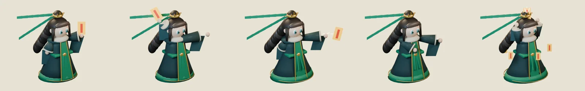

# 71회차 — 모델링: 청운 준비·회복 포즈 정정

| 항목 | 값 |
| --- | --- |
| 시각 | 2026-11-10 03:07 KST (예약 회차) |
| 기준 | main **`b175a9f`** — 69회차 뒤 바뀐 것 없음 |
| 회차 종류 | **저입력 회차**(70회차 뒤 새 PR·사용자 결정 없음). 작은 단위 하나: 68회차 청운 초안에 남은 약점을 정정 |
| 주 분야 | 모델링 |
| 범위 | `model-drafts/build_tao_draft.py`의 포즈 값 두 줄과 시트 1장. 렌더는 스크래치 폴더에서 Blender 5.2로 했다. |

## 1. 점검

| 분야 | 상태 |
| --- | --- |
| 게임 모드 · 로직 · 모델링 | 새 PR 없음. 인계 목록 변화 없음 |

## 2. 정정 — 준비·회복이 대기와 같아 보이던 것

68회차 초안은 64px에서 준비·회복이 대기와 거의 같았다(겹침 0.85·0.81). 리엘 초안 0.74·0.78, 이안 초안 0.77·0.82보다 높았다.

| 포즈 | 바꾼 것 |
| --- | --- |
| 준비 | 부적 든 손을 머리 뒤로 높이 올린다(+0.98). 다른 손은 칼손으로 앞쪽 끝까지 뻗는다. 리본이 더 흩날리고, 소매가 조금 들린다 |
| 회복 | 부적을 던진 팔이 앞쪽 낮은 곳에 남는다(뒤따름). 다른 손은 가슴 앞으로 돌아온다 |

| 측정 | 68회차 | 71회차 | 기준 |
| --- | --- | --- | --- |
| 대기와 겹침: 준비 | 0.85 | **0.66** | 0.80 이하 ✔ |
| 대기와 겹침: 회복 | 0.81 | **0.70** | 0.80 이하 ✔ |
| 준비의 이안·리엘·브론 겹침 | 0.55 · 0.61 · 0.37 | 0.54 · 0.55 · 0.38 | 0.60 이하 ✔ |
| 회복의 이안·리엘·브론 겹침 | 0.53 · 0.57 · 0.36 | 0.53 · 0.53 · 0.37 | ✔ |
| 준비 키 · 회색(숲·설산 대비) | 39.4px · 86 | 41.4px · 87 (29 · 69) | ✔ |
| 다섯 장 WebP | q85 110,578 B | q85 113,592 B · **q84 110,238 B** | ≤ 112 KB → q84 |

- 준비 부적 위치: 발 기준 (−19, −65). 부적이 영웅 뒤에서 앞(타격 (46, −45))으로 날아가는 거리가 길어져, 손맛(41) 쪽으로도 낫다.
- 타격·시전·대기는 그대로다.

## 3. 기록

- [인계 목록](../handoff.md): 청운 줄의 ‘남은 것(준비 몸 젖힘)’을 정정 결과로 바꿨다. 용량 기준은 q84로 고쳤다.
- README 회차 기록과 다음 회차 후보를 갱신했다.

## 다음 회차

72 게임 모드 — 묶음 ⑦-3 갱신안(외곽 습격조)을 사본에서 시험한다. 2번 길 끝 구간을 사거리 밖으로 옮기거나 습격조를 넣었을 때, ‘6·7번도 영웅도 없으면 외곽이 깎이고, 둘 중 하나면 지켜진다’가 성립하는지 본다.
