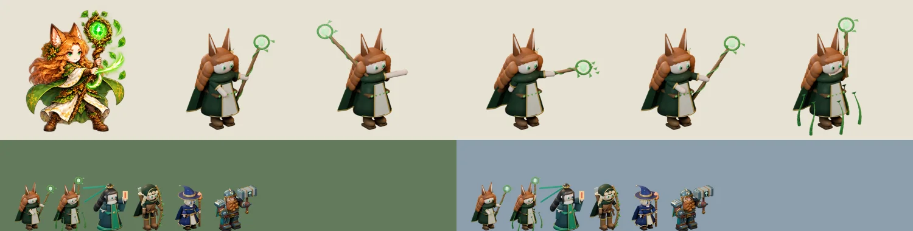

# 74회차 — 모델링: 루나 초안과 시전 포즈 ‘덩굴의 포효’

| 항목 | 값 |
| --- | --- |
| 시각 | 2026-11-10 09:07 KST (예약 회차) |
| 기준 | main **`b175a9f`** — 69회차 뒤 바뀐 것 없음 |
| 회차 종류 | **저입력 회차**(73회차 뒤 새 PR·사용자 결정 없음). 작은 단위 하나: 루나 설계·초안 하나 |
| 주 분야 | 모델링 |
| 범위 | 문서와 `model-drafts/`(초안 스크립트 1개, 시트 1장). 렌더는 스크래치 폴더에서 Blender 5.2로 했다. |

## 1. 점검

| 분야 | 상태 |
| --- | --- |
| 게임 모드 · 로직 · 모델링 | 새 PR 없음. 인계 목록 변화 없음 |

## 2. 구운 것 — 루나(수인 드루이드) 초안

**참고 그림**: `art-source/defense/atlases/ranged-motion.png`의 루나 세 칸을 열어 보았다.
- 위로 솟은 큰 여우·늑대 귀, 풍성한 생강빛 머리
- 초록 망토, 상아 도포(금 무늬), 갈색 장화
- 덩굴 감은 나무 지팡이와 고리 속 빛나는 초록 보석

[`model-drafts/build_druid_draft.py`](../model-drafts/build_druid_draft.py)는 청운·리엘 초안과 같은 카메라 계약을 쓴다.
- 64px 실루엣 단서 셋
  - ① 위로 솟은 두 귀. 리엘은 50회차 설계로 귀가 옆으로 눕는다.
  - ② 옆과 뒤로 넓게 퍼지는 머리 덩어리
  - ③ 앞으로 기운 지팡이 끝의 덩굴 고리와 보석
- 포즈 다섯
  - 대기·준비·타격·회복
  - **시전(덩굴의 포효)**: 지팡이를 높이 들면 발 둘레에서 덩굴 여섯 줄기가 솟는다. 67회차 4-1의 ‘발목 덩굴’ 표시와 같은 말이다.
- 늑대 영물은 지금처럼 따로 움직이는 액터다. 루나 모델에는 넣지 않는다.
- 몸은 땅 원점 기준 1.1배로 굽는다. 귀가 있어 청운(1.2)보다 작게 한다.

**시행착오**
- **상아 치마는 숲에 묻혔다.** 64px 회색이 117로, 숲(116)과 1밖에 차이 나지 않았다. 지금 그림(114)과 같은 문제다.
  - 치마·소매를 이끼색으로 바꾸고 상아는 앞판에만 남겼다. 머리색도 한 단계 낮췄다.
  - 회색은 93 → 90이 됐다(숲 26 · 설산 66). 62·68회차 대비 기준을 따른 작업 가정이다.
- 곧게 세운 지팡이는 이안 초안(지팡이 + 뾰족 모자)과 겹침 0.61~0.62였다. 그림의 대기 칸처럼 지팡이를 앞으로 기울이자 보석이 몸 밖으로 나가 **0.45**가 됐다.
- 귀를 높이자 키가 41.9px로 넘었다. 몸 배율 1.15 → 1.1로 내려 40.0px로 맞췄다.
- 타격에서 지팡이·잎이 프레임 오른쪽 끝을 넘었다. 뻗는 길이를 줄여 여유 25px를 남겼다.
- 시전 키가 52.5px였다. 지팡이 높이를 낮춰 46.6px로 줄였다(0.5초 포즈).

## 3. 측정

| 항목 | 값 | 기준 |
| --- | --- | --- |
| 보이는 키(가로 844 × 390, displayScale 1.32) | 대기 **40.0px** · 준비 43.2 · 타격 40.0 · 회복 40.0 · 시전 46.6 | 대기 38~41px ✔ |
| 64px 회색 | 대기 **90** (준비 93, 나머지 87~89) | 90 이하 ✔ |
| 전장 배경과 밝기 차 | 대기 숲 26 · 설산 66 (준비 23 · 63) | 25 이상 ✔ (준비는 숲에서 2 모자람) |
| 프레임 안 | 가장자리 여유 25px 이상 | ✔ |
| WebP 다섯 장 | **q85 102,044 B** | 112 KB 이하 ✔ |

| 64px 판정 (#73 도구 규칙) | 겹침 | 회색 | 판정 |
| --- | --- | --- | --- |
| 루나 · 브론 | 0.56 | 90 / 85 | 구분 |
| 루나 · 이안 초안 | **0.45** | 90 / 80 | 구분 ✔ (0.60 이하) |
| 루나 · 리엘 초안 | **0.41** | 90 / 81 | 구분 ✔ |
| 루나 · 청운 초안 | 0.30 | 90 / 85 | 구분 |
| 루나 · 카르(그림) | 0.45 | 90 / 97 | 구분 |
| 루나 · 지금 루나 그림 | 0.55 | 90 / 114 | 모양은 가까움 |

| 대기와 실루엣 겹침 | 준비 | 타격 | 회복 | 시전 |
| --- | --- | --- | --- | --- |
| 루나 초안 | 0.30 | 0.53 | 0.60 | 0.44 |

**보석 위치**: 발 기준 단위(1.32, 가로 `unitScale` 1.065).
- 대기 (30, −61) · 준비 (−35, −69) · 타격 (43, −42) · 회복 (40, −60) · 시전 (12, −74)
- 지금 영웅 마법은 발 기준 (0, −27)에서 나간다(46회차). 46회차 ‘발사점’ 제안대로 `gem_px`를 쓴다.

**읽은 것**
- 이 루프의 영웅 초안 넷(리엘·이안·청운·루나)과 브론은 64px에서 **리엘·이안 한 쌍(0.64, 66회차)을 빼고 모두 0.60 이하**로 갈린다. 남은 한 쌍은 66회차 인계대로 이안 모자 끝 높이기나 리엘 대기 활 기울이기로 고친다.
  - 회색은 80~90으로 다섯이 비슷하다. 구분은 전부 모양이 맡는다(귀·지팡이 기울기·머리채·리본·활).
  - 이식할 때 이 단서를 줄이면 다시 혼동된다. 단서마다 완료 판단에 넣는다.
- 그림 영웅 셋(청운 108 · 루나 114 · 카르 97)은 모두 숲 대비 기준 미달이었다. 어두운 주 면으로 옮기면 숲 26~31이 된다(68·74).

## 4. 인계 (A ‘영웅 네 명 충실 이식’의 루나 줄)

- 초안 스크립트: `model-drafts/build_druid_draft.py`를 `tools/blender/build_druid.py`로 옮긴다. `--pose`는 다섯 개(시전 포함)다.
- 크기: displayScale 1.32 + 몸 **1.1배**.
- 매니페스트의 `gem_px`를 루나 마법의 발사점으로 쓴다.
- 시전 포즈는 필살기 0.5초 동안 쓴다(67회차 4-3).
- 이끼색 치마·소매(상아는 앞판만)는 작업 가정이다. 묶음 ②의 ‘루나 유지’는 얼굴·귀·지팡이 같은 모양을 유지한다는 뜻으로 읽었다.
- 완료 판단
  - 64px에서 브론·이안·리엘·청운과 겹침 0.60 이하. 단서 셋(솟은 귀, 넓은 머리, 앞으로 기운 보석 지팡이) 유지
  - 가로 대기 38~41px, 숲·설산 대비 25 이상
  - 다섯 장 ≤ 112 KB

## 5. 기록

- [인계 목록](../handoff.md): 루나 줄에 초안·크기·발사점·작업 가정을 붙였다. 대비 기준 줄에는 루나 초안 값을 붙였다.
- README 회차 기록과 다음 회차 후보를 갱신했다.

## 다음 회차

75 게임 모드 — 3장(운령) 지도 초안을 72회차 새 지도 규칙으로 세운다. 두 길·건설 지점 좌표와 덮임 비율을 숫자로 내고, 외곽 전용 지점이 실제로 의미를 갖는지 본다(묶음 ① ‘3장 운령 먼저’와 함께 결정 대기).
