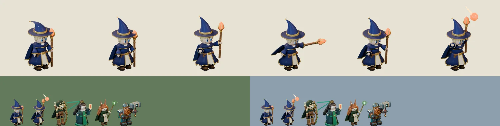

# 77회차 — 모델링: 이안 초안 다시 맞추기와 시전 포즈 ‘유성 낙하’

| 항목 | 값 |
| --- | --- |
| 시각 | 2026-11-10 15:10 KST (예약 회차) |
| 기준 | main **`b175a9f`** — 69회차 뒤 바뀐 것 없음 |
| 회차 종류 | **저입력 회차**(76회차 뒤 새 PR·사용자 결정 없음). 작은 단위 하나: 남은 혼동 한 쌍(리엘·이안 0.64) 풀기 |
| 주 분야 | 모델링 |
| 범위 | `model-drafts/build_mage_draft.py`(46회차 초안) 고침과 시트 1장. 렌더는 스크래치 폴더에서 Blender 5.2로 했다. |

## 1. 점검

| 분야 | 상태 |
| --- | --- |
| 게임 모드 · 로직 · 모델링 | 새 PR 없음. 인계 목록 변화 없음 |

## 2. 고친 것 — 46회차 이안 초안

| 바꾼 것 | 이유 |
| --- | --- |
| **모자 끝을 더 높고 덜 처지게**(원뿔 높이 1.02 → 1.32, 뒤로 처짐 0.62 → 0.40) | 66회차: 리엘(둥근 두건 + 세운 활)과 이안(처진 모자 + 세운 지팡이)이 64px 대기에서 0.64로 겨우 구분됐다. 머리 위 봉우리를 세우면 둥근 두건과 갈린다 |
| **`--scale` 옵션**, 기본 0.95 | 62회차 규격(displayScale 1.32)에 맞추되, 높아진 모자를 넣어 가로 대기 키 38~41px |
| **다섯째 포즈 ‘시전’(유성 낙하)** | 67회차 4-3 ‘시전 포즈’. 지팡이를 머리 위로 곧게 들고, 수정 위로 불덩이와 꼬리가 뜬다(그 프레임에만 보임). 67회차 4-1의 이안 표시(떨어지는 불덩이)와 같은 말 |

포즈는 지금처럼 관절(피벗) 회전 키로 만든다. 시전 키는 지팡이 팔 2.20, 지팡이 −2.20(곧게 세움), 빈손 2.00이다.

## 3. 측정

| 항목 | 46회차 초안 | 77회차 | 기준 |
| --- | --- | --- | --- |
| 64px 겹침: **리엘** | **0.64**(66회차, 같은 렌더로 다시 재면 0.62) | **0.52** | 0.60 이하 ✔ |
| 64px 겹침: 브론 · 청운 · 루나 | 0.47 · 0.54 · 0.45 | 0.39 · 0.48 · 0.44 | ✔ |
| 보이는 키(가로 844 × 390, 1.32) | 37.7px | **40.6px** (준비 41.3 · 타격 39.2 · 회복 40.1 · 시전 48.3) | 38~41px ✔ |
| 64px 회색 · 배경 대비 | 80 | 79 · 숲 37 · 설산 77 | ✔ |
| 대기와 겹침(준비·타격·회복·시전) | 0.77 · 0.72 · 0.82 · — | 0.65 · 0.33 · 0.78 · 0.53 | 0.80 이하 ✔ |
| 다섯 장 WebP | (네 장 q88 약 82 KB) | **q85 92,620 B** | 112 KB 이하 ✔ |
| 프레임 여유 | — | 49px 이상 | ✔ |

- 수정(발사점, 발 기준 단위)
  - 대기 (15, −47) · 준비 (20, −59) · 타격 (43, −37) · 시전 (13, −66)
  - 매니페스트 `crystal_center_px`가 그대로 46회차 ‘발사점’이다.

**읽은 것**
- **이 루프의 영웅 초안 넷(리엘·이안·청운·루나)과 브론이 64px 대기에서 모든 쌍 0.60 이하로 갈린다.**

  | 쌍 | 겹침 |
  | --- | --- |
  | 리엘 · 이안 | 0.52 |
  | 리엘 · 청운 | 0.58 |
  | 리엘 · 루나 | 0.41 |
  | 이안 · 청운 | 0.48 |
  | 이안 · 루나 | 0.44 |
  | 청운 · 루나 | 0.30 |
  | 브론과 각자 | 0.38~0.56 |

  - 66회차 리엘 줄의 완료 판단(“이안과는 대기 겹침 0.60 이하”)도 이 쪽에서 채웠다.
- 다섯 모두 회색이 79~90으로 비슷하다. 구분은 모양이 맡는다(이안 세운 모자 끝, 리엘 활, 청운 리본·부적, 루나 귀·보석 지팡이, 브론 망치).
- 시전 포즈 네 개(청운·루나·이안 + 앞으로 리엘)가 67회차 4-1의 필살기 표시 모양과 짝을 이룬다. 결계 부적, 덩굴, 불덩이.

## 4. 인계

- A ‘영웅 네 명 충실 이식’ 이안 줄
  - `build_mage_draft.py`(77회차판) → `tools/blender/build_mage.py`
  - displayScale 1.32 + 몸 0.95, 다섯 포즈(시전 포함)
- 완료 판단
  - 64px에서 리엘과 0.60 이하(모자 끝 높이 유지)
  - 가로 대기 38~41px
  - 다섯 장 ≤ 112 KB
- 리엘 줄의 ‘이안과 0.64’ 메모를 ‘77회차에 0.52로 해결(이안 쪽 수정)’으로 바꿨다.

## 5. 기록

- [인계 목록](../handoff.md): 이안·리엘 줄을 갱신했다.
- README 회차 기록과 다음 회차 후보를 갱신했다.

## 다음 회차

78 게임 모드 — 75회차 배치안의 외곽 결과가 결과 화면·전투 중 알림에서 어떻게 보이는지(v1 P0 ‘승리·추가 구조 설명 통일’) 확인하고, 첫 코인 배분 선택을 측정한다(본길·외곽 비율별 결과).
