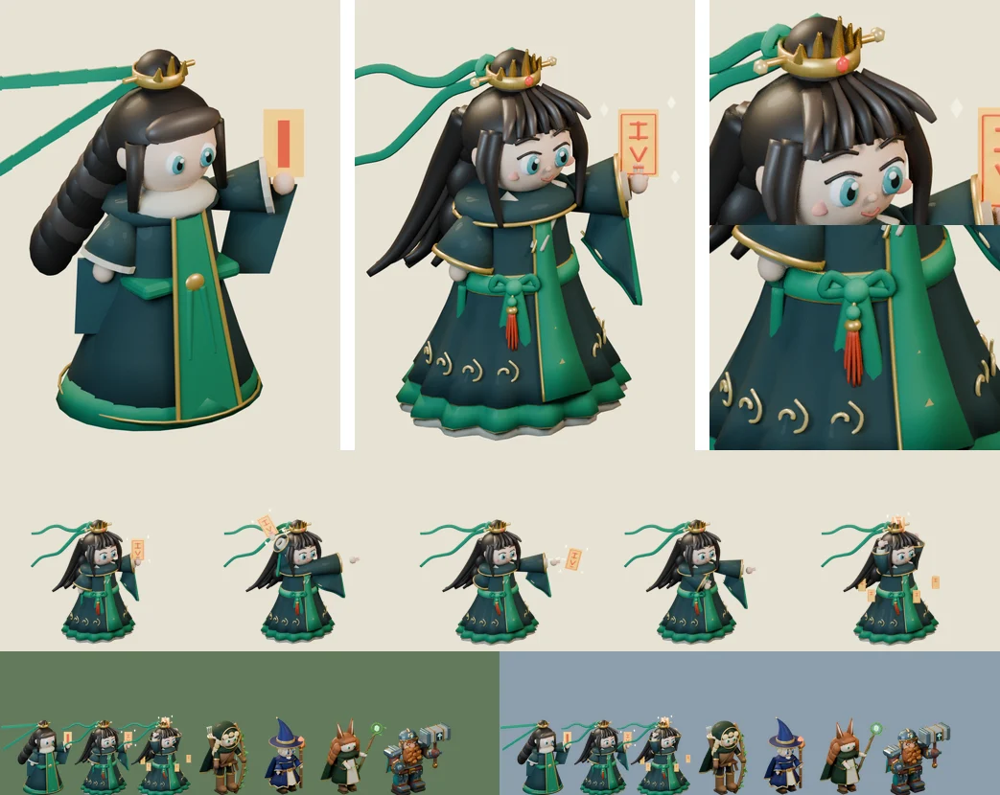

# 80회차 — 모델링: 디테일 기준 세우기 (청운 디테일 판)

| 항목 | 값 |
| --- | --- |
| 시각 | 2026-11-10 19:51 KST (사용자 요청으로 바로 실행) |
| 기준 | main **`b175a9f`** — 69회차 뒤 바뀐 것 없음 |
| 회차 종류 | 사용자 요청 회차: **“모델링 더 디테일하게”** |
| 주 분야 | 모델링 |
| 범위 | 문서와 `model-drafts/`(청운 초안 스크립트 디테일 판, 비교 시트 1장). 렌더는 스크래치 폴더에서 Blender 5.2로 했다. |

## 1. 점검

| 분야 | 상태 |
| --- | --- |
| 게임 모드 · 로직 | 새 PR 없음. 인계 목록 변화 없음 |
| 모델링 | 이 루프의 영웅 초안 넷(리엘·이안·청운·루나)은 64px 구분·크기·대비는 맞췄다. 하지만 모양은 공·원뿔·판 같은 기본 도형 위주였다. 가장 단순했던 청운 초안은 메시 70개, 삼각형 12,442개였다 |

## 2. 디테일 기준 (이번 회차부터 모델링 회차의 규칙)

초안 하나는 아래 **여섯 층**을 모두 갖춘다.

| 층 | 넣을 것 | 청운 디테일 판에서 |
| --- | --- | --- |
| ① 얼굴 | 눈썹, 윗눈꺼풀 선, 코, 입, 볼 | 눈썹·눈꺼풀·코·미소·볼터치·귓속 |
| ② 손 | 손가락(펴고 접은 구분), 엄지 | 세운 두 손가락(검지·중지), 접은 둘, 엄지 |
| ③ 머리 | 공 덩어리가 아닌 **곡선 가닥**, 장식 | 앞머리 7가닥, 옆머리 4가닥, 뒤로 흐르는 9가닥, 상투 감개, 다섯 봉우리 금관 + 붉은 보석, 비녀 구슬, 납작한 비단 리본과 매듭 고리 |
| ④ 옷 | 겹·주름·깃·끝단, 문양 | 주름 잡힌 종 도포, 금 단 띠, 옥색 속치마, 상아 안단(세 겹 단), 교차 깃 + 금 선, 금 구름 무늬 8개, 앞판 금 마름모, 소매 금 띠·상아 속소매·접힌 자락 + 옥색 단 |
| ⑤ 소품 | 매듭·술·각인·글씨 | 허리띠 매듭·늘어진 두 가닥·**붉은 술(노리개)**, 부적 테두리·붓글씨 획·불티 |
| ⑥ 재질 | 같은 색의 밝은 톤, 금실 2단 | 밝은 옥색, 밝은 금실, 붉은 비단·보석 |

**두 크기에서 함께 확인한다.**
- **초상 크기**: 1280px 렌더의 상반신. 동료 카드·합류 대화·모델 작업실에서 쓰는 크기다. 디테일은 여기서 보여야 한다.
- **전투 크기**: 64px·가로 844 × 390. 디테일은 여기서 안 보여도 된다. 다만 실루엣 단서·회색·대비·키는 **나빠지면 안 된다.**

스크립트 도구(다른 영웅에도 그대로 씀)
- `spline`: 점들을 지나는 곡선
- `lock`: 곡선을 따라 굵기가 줄어드는 가닥. 납작하게 하면 리본이 된다.
- `pleated`: 아래로 갈수록 주름이 깊어지는 천

## 3. 구운 것 — 청운 디테일 판

[`model-drafts/build_tao_draft.py`](../model-drafts/build_tao_draft.py)를 디테일 판으로 바꿨다. 카메라 계약·포즈 값·몸 배율(1.2)·발사점은 그대로다.

**시행착오**
- 깃을 굵은 띠로 넣자 가슴에서 막대처럼 튀어나왔다. 납작하고 짧게 해서 몸에 붙였다.
- 뒷머리 가닥이 곧게 퍼져 빗자루살이 됐다. 등을 타고 내려온 뒤 끝에서 흩날리는 곡선으로 바꿨다.
- 리본이 둥근 호스처럼 보였다. 납작한 비단(두께 12%)으로 바꾸고 물결을 키웠다.
- 주름이 앞판을 뚫고 나왔다. 앞판을 띄우고 두께를 줬다.

## 4. 측정

| 항목 | 71회차 초안 | 80회차 디테일 판 | 기준 |
| --- | --- | --- | --- |
| 메시 · 삼각형 | 70 · 12,442 | **153 · 38,976** (시전 196 · 45,268) | — |
| 보이는 키(가로 844 × 390, 1.32) | 39.4px | **40.6px** (준비 44.1 · 타격 41.1 · 회복 40.9 · 시전 43.6) | 대기 38~41px ✔ |
| 64px 회색 · 배경 대비 | 85 · 숲 31 · 설산 71 | **80** · 숲 36 · 설산 76 | 90 이하, 25 이상 ✔ |
| 64px 겹침: 이안 · 리엘 · 루나 · 브론 | 0.48 · 0.58 · 0.30 · 0.38 | 0.52 · **0.59** · 0.35 · 0.41 | 0.60 이하 ✔ (리엘은 여유 0.01) |
| 대기와 겹침(준비·타격·회복·시전) | 0.66 · 0.40 · 0.70 · 0.65 | 0.70 · 0.41 · 0.74 · 0.63 | 0.80 이하 ✔ |
| 프레임 여유 | 41px 이상 | 23px 이상 | 8px ✔ |
| 다섯 장 WebP | q85 113,592 B · q80 101,046 B | **q85 142,048 B · q80 126,312 B** · q75 112,752 B | 112 KB **넘음**(q85) |

**읽은 것**
- 디테일을 여섯 층으로 올려도 전투 크기의 기준(키·회색·대비·구분)은 모두 유지된다. 회색과 대비는 오히려 나아졌다. 어두운 머리 가닥이 늘어서다.
- **값은 용량이다.** 같은 품질에서 +25%(114 → 142 KB)다. 주름·가닥·문양이 압축을 어렵게 한다.
  - 전투에서 영웅은 화면 약 63px(2배 화소 126px)로 그려진다. 640px 프레임의 디테일은 전투에서는 보이지 않고, 초상·카드·합류 대화·작업실에서 보인다.
  - 제안: **영웅당 다섯 장 예산을 112 KB(q85) → 128 KB(q80)로** 바꾼다. 여섯 영웅이면 약 +96 KB다. 50회차에 이 루프가 정한 예산이라 이 루프의 제안으로 고친다. 채택은 개발 쪽 몫이다.
- 리엘과의 겹침이 0.59로 여유가 없다. 머리 가닥이 뒤로 넓어져 리엘의 망토 쪽과 가까워졌다. 리엘을 디테일 판으로 올릴 때 함께 다시 잰다.

## 5. 인계

- A ‘영웅 네 명 충실 이식’ 청운 줄
  - `build_tao_draft.py`(80회차 디테일 판) → `tools/blender/build_tao.py`
  - 여섯 층 디테일, 도구 `spline`·`lock`·`pleated`
- A에 **‘모델 디테일 기준’** 줄을 더했다: 여섯 층, 두 크기 확인, 예산 128 KB(q80).
- 완료 판단
  - 초상 크기(1280px 상반신)에서 여섯 층이 보인다.
  - 전투 크기 기준(64px 겹침 0.60 이하, 대기 38~41px, 대비 25 이상)을 유지한다.
  - 다섯 장 ≤ 128 KB(q80).

## 6. 기록

- [인계 목록](../handoff.md): 위 두 줄을 넣었다.
- README: 사용자 요청과 ‘모델링 디테일 기준’을 넣었다. 회차 기록과 다음 회차 후보(루나·이안·리엘 디테일 판 순서)를 갱신했다.
- 예약 작업 지시문의 모델링 방법에 디테일 기준을 반영했다.

## 다음 회차

81 게임 모드 — 2-4(설산 확장)에도 75회차 배치 규칙을 적용한 배치안을 세운다. 서리군주 충전 차단과 외곽 지키기가 영웅 하나를 두고 겹칠 때의 선택을 본다.
다음 모델링(83회차)은 루나 디테일 판이다(귀 털·머리 가닥·잎 무늬·지팡이 덩굴과 보석 면).
