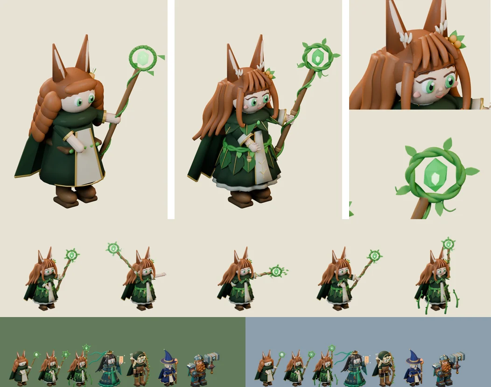

# 83회차 — 모델링: 루나 디테일 판

| 항목 | 값 |
| --- | --- |
| 시각 | 2026-11-11 03:07 KST (예약 회차) |
| 기준 | main **`b175a9f`** — 69회차 뒤 바뀐 것 없음 |
| 회차 종류 | **저입력 회차**(82회차 뒤 새 PR·사용자 결정 없음). 작은 단위 하나: 영웅 하나의 디테일 층 올리기(80회차 기준, 사용자 요청 “모델링 더 디테일하게”) |
| 주 분야 | 모델링 |
| 범위 | `model-drafts/build_druid_draft.py`(디테일 판)와 비교 시트 1장. 렌더는 스크래치 폴더에서 Blender 5.2로 했다. |

## 1. 점검

| 분야 | 상태 |
| --- | --- |
| 게임 모드 · 로직 · 모델링 | 새 PR 없음. 인계 목록 변화 없음 |

## 2. 구운 것 — 루나 디테일 판

카메라 계약·포즈 값·몸 배율(1.1)·발사점은 그대로 두고 여섯 층을 올렸다.

| 층 | 넣은 것 |
| --- | --- |
| ① 얼굴 | 적갈색 눈썹, 윗눈꺼풀 선, 속눈썹, 코, 미소, 볼터치 |
| ② 손 | 지팡이를 쥔 네 손가락과 엄지, 펼친 손의 네 손가락 |
| ③ 머리 | 쓸어 넘긴 앞머리 5가닥, 끝이 말리는 앞 가닥, **물결치는** 옆 6가닥·뒤 11가닥, 꽃(꽃잎 5·잎 3), 귀 속털과 크림색 털 뭉치 |
| ④ 옷 | 주름 치마, 금 단 띠, 상아 안단, 허리에서 내려오는 겹잎 8장(금 잎맥), 상아 앞판의 금 잎맥 자수, 끈으로 묶은 조끼, 어깨 잎 9장, 톱니(잎 끝) 단의 망토, 부푼 소매 + 벌어진 속소매 |
| ⑤ 소품 | 엮은 덩굴 허리띠와 잎·도토리 장식, 가슴 브로치, 팔찌, 마디 있는 지팡이에 한 줄로 감긴 덩굴과 잎, 두 겹으로 엮인 고리, **각진 보석 + 빛나는 심**, 덩굴손 |
| ⑥ 재질 | 잎빛 천, 밝은 금실, 밝은 나무 마디 |

- 도구는 `build_tao_draft.py`의 `spline`·`lock`을 썼다. `leaf`(잎 모양 + 잎맥)와 `wavy`(끝으로 갈수록 물결치는 곡선)를 새로 더했다.

**시행착오**
- 귀 털 뭉치를 길게 넣자 흰 가시처럼 뻗었다. 귀 안쪽에 짧고 도톰하게 줄였다.
- 보석의 발광이 세서 면이 날아가 납작해 보였다. 몸은 어둡게, 빛은 안쪽 심에만 줬다.
- 머리 가닥이 한 높이에서 시작해 정수리가 선반처럼 보였다. 시작점을 정수리 안으로 넣고 높이를 달리했다.
- 타격에서 고리 둘레 잎 때문에 프레임 여유가 7px로 줄었다. 뻗는 길이를 줄여 24px로 맞췄다.

## 3. 측정

| 항목 | 74회차 초안 | 83회차 디테일 판 | 기준 |
| --- | --- | --- | --- |
| 메시 · 삼각형 | 120 · 22,889 | **218 · 40,862** (시전 236 · 43,778) | — |
| 보이는 키(가로 844 × 390, 1.32) | 40.0px | **40.0px** (준비 43.4 · 타격 40.0 · 회복 40.0 · 시전 48.5) | 대기 38~41px ✔ |
| 64px 회색 · 배경 대비 | 90 · 숲 26 · 설산 66 | **86** · 숲 30 · 설산 70 (준비 88) | 90 이하, 25 이상 ✔ |
| 64px 겹침: 이안 · 청운 · 리엘 · 브론 | 0.44 · 0.35 · 0.41 · 0.56 | 0.41 · 0.33 · 0.39 · **0.58** | 0.60 이하 ✔ (브론은 여유 0.02) |
| 대기와 겹침(준비·타격·회복·시전) | 0.30 · 0.53 · 0.60 · 0.44 | 0.27 · 0.54 · 0.63 · 0.42 | 0.80 이하 ✔ |
| 프레임 여유 | 25px 이상 | 24px 이상 | 8px ✔ |
| 다섯 장 WebP | q85 102,044 B · q80 91,080 B | q85 126,674 B · **q80 111,892 B** | 128 KB(q80) ✔ |

- 보석 위치(발사점, 발 기준 단위)
  - 대기 (30, −61) · 준비 (−35, −69) · 타격 (40, −42) · 회복 (41, −60) · 시전 (12, −74)
  - 타격만 3단위 당겨졌다.

**읽은 것**
- 80회차 디테일 기준을 두 번째 영웅에 적용해도 같은 결과다. 전투 크기 기준은 유지되고(회색·대비는 조금 나아짐), 용량은 +23~24%다. 예산 128 KB(q80) 안에는 여유 있게 들어온다(112 KB).
- 브론과의 겹침이 0.58로 여유가 줄었다. 넓어진 머리와 망토가 브론의 넓은 몸과 가까워져서다. 루나의 구분 단서(솟은 귀·기운 보석 지팡이)는 그대로이니, 이식할 때 귀 높이와 지팡이 기울기를 줄이지 않는다.
- 시전 포즈의 덩굴 여섯 줄기를 곡선 가닥으로 바꿨다(끝이 말리고 잎이 달림). 67회차 4-1의 ‘발목 덩굴’ 표시와 같은 모양 말이다.

## 4. 인계

- A ‘영웅 네 명 충실 이식’ 루나 줄
  - `build_druid_draft.py`(83회차 디테일 판) → `tools/blender/build_druid.py`
  - 여섯 층, 도구 `leaf`·`wavy`
- 완료 판단은 80회차 ‘모델 디테일 기준’과 같다.
  - 초상 크기에서 여섯 층이 보인다.
  - 64px 겹침 0.60 이하 · 대기 38~41px · 대비 25 이상
  - 다섯 장 ≤ 128 KB(q80)

## 5. 기록

- [인계 목록](../handoff.md): 루나 줄에 디테일 판 값을 붙였다.
- README 회차 기록과 다음 회차 후보를 갱신했다.

## 다음 회차

84 게임 모드 — 고목왕(1-4) 쪽의 보스 선택을 본다. 체력 절반 가속(×1.55) 전후로 필살기·둔화를 언제 쓰는지가 결과를 바꾸는지(81회차 서리군주와 같은 틀)와, P0 ‘보스 돌파 패배’가 들어왔을 때의 패배율이다.
다음 모델링(86회차)은 이안 디테일 판이다.
