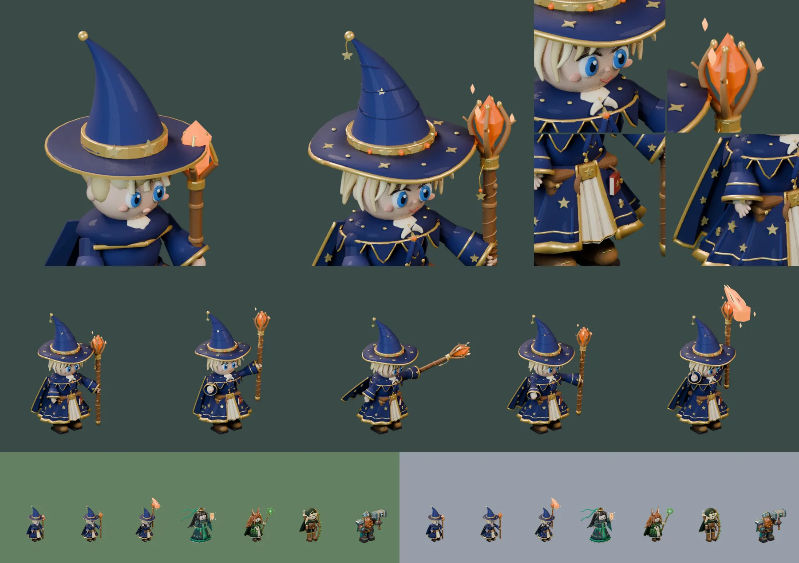

# 86회차 — 모델링: 이안 디테일 판

| 항목 | 값 |
| --- | --- |
| 시각 | 2026-11-11 09:07 KST (예약 회차) |
| 기준 | main **`b175a9f`** — 69회차 뒤 바뀐 것 없음 |
| 회차 종류 | **저입력 회차**(85회차 뒤 새 PR·사용자 결정 없음). 작은 단위 하나: 영웅 하나의 디테일 층 올리기(80회차 기준, 사용자 요청 “모델링 더 디테일하게”) |
| 주 분야 | 모델링 |
| 범위 | `model-drafts/build_mage_draft.py`(디테일 판)와 비교 시트 1장. 렌더는 스크래치 폴더에서 Blender 5.2로 했다. |

## 1. 점검

| 분야 | 상태 |
| --- | --- |
| 게임 모드 · 로직 · 모델링 | 새 PR 없음(최신 #104). 인계 목록 변화 없음 |

## 2. 구운 것 — 이안 디테일 판

카메라 계약·몸 배율(0.95)·관절 이름은 그대로 두고 여섯 층을 올렸다. 참고 그림은 `art-source/defense/atlases/ranged-motion.png`의 이안 칸이다.

| 층 | 넣은 것 |
| --- | --- |
| ① 얼굴 | 굽은 눈썹, 윗눈꺼풀 선, 코, 미소, 볼터치, 귓속 |
| ② 손 | 지팡이를 감은 네 손가락과 엄지, 펼친 손의 네 손가락과 엄지 |
| ③ 머리·모자 | 뾰족한 앞머리 7가닥, 옆 6가닥, 목덜미 9가닥 / 물결치는 챙과 금 테, 챙의 별 자수, 띠의 별 5개와 불씨 보석 4개, 고깔 주름, 끝에 달린 별 장식 |
| ④ 옷 | 주름 치마와 물결 금 단, 금실 줄, 별 자수 10개, 접힌 상아 속옷, 단추와 금 여밈, 톱니 어깨 망토와 금 점, 옷깃, 별 브로치와 리본, 접힌 망토에 톱니 금 단과 별, 종 소매의 금 줄·속소매·별 |
| ⑤ 소품 | 별 새긴 허리띠 버클, 늘어진 띠 끝, 덮개 달린 주머니, **끈에 매단 주문서**, 장화 끈·죔쇠, 지팡이 물미·가죽 손잡이 감개·나뭇결·옹이, 굽은 발톱 네 개와 가시, **각진 수정 + 빛나는 심**, 떠 있는 불씨 조각, 별 장식 |
| ⑥ 재질 | 밝은 남색 주름, 밝은 금실, 밝은 나무 |

- 도구는 `build_tao_draft.py`의 `spline`·`lock`을 썼다. `ring`(타원 둘레), `helix`(자루 감개), `flatstar`(챙 위 별), `shard`(각진 수정)를 새로 더했다.

**고친 것 — 지팡이가 모자 챙을 뚫고 있었다**
- 46회차부터 지팡이 자루가 챙 반지름 안에 서 있었다(자루 0.75, 챙 0.86). 초상 크기에서 발톱이 챙을 뚫고 나온 것이 보였다.
- 손을 바깥으로 옮기고(−0.66, 0.40 → −0.91, 0.55), 자루를 0.25 길게, 발톱을 좁게 했다. 이제 발톱이 챙 위에서 벌어진다. 그림의 이안도 지팡이를 팔 뻗은 거리에 든다.
- 그래서 **발사점이 달라졌다**(아래 3장). 청운·루나 디테일 판과 달리 이 값은 ‘그대로’가 아니다.

**시행착오**
- 길어진 지팡이 때문에 타격에서 프레임 여유가 9px로 줄었다. 타격의 지팡이를 덜 눕혀(−1.90 → −1.58) 28px로 맞췄다.
- 앞머리가 챙 그늘에 가려 이마가 비어 보였다. 끝을 눈썹 아래까지 내리고 가늘게 했다.
- 치마의 별 자수와 금 단이 천 두께에 묻혔다. 바깥으로 띄우고 키웠다. 주름은 더 깊게 하고 마루에 밝은 줄을 넣었다.
- 옷깃 조각이 흰 얼룩처럼 보였다. 납작한 옷깃 두 장으로 바꿨다.
- 시전의 유성이 하얗게 날아 64px 회색이 93(숲 대비 23)이 됐다. 발광을 낮춰 89(27)로 맞췄다.

## 3. 측정

| 항목 | 77회차 초안 | 86회차 디테일 판 | 기준 |
| --- | --- | --- | --- |
| 메시 · 삼각형 | 107 · 20,919 | **263 · 48,946** (시전 275 · 49,970) | — |
| 보이는 키(가로 844 × 390, 1.32) | 40.6px | **40.6px** (준비 42.5 · 타격 39.2 · 회복 40.1 · 시전 50.2) | 대기 38~41px ✔ |
| 64px 회색 · 배경 대비 | 79 · 숲 37 · 설산 77 | **82** · 숲 34 · 설산 74 (준비 86 · 시전 89) | 90 이하, 25 이상 ✔ |
| 64px 겹침: 리엘 · 청운 · 루나 · 브론 | 0.52 · 0.52 · 0.41 · 0.39 | 0.52 · 0.47 · **0.49 · 0.48** | 0.60 이하 ✔ |
| 대기와 겹침(준비·타격·회복·시전) | 0.65 · 0.33 · 0.78 · 0.53 | 0.64 · 0.40 · 0.76 · 0.49 | 0.80 이하 ✔ |
| 프레임 여유 | 48px 이상 | 28px 이상 | 8px ✔ |
| 다섯 장 WebP | q85 92,620 B · q80 82,120 B | q85 128,664 B · **q80 113,996 B** | 128 KB(q80) ✔ |

발사점(수정 가운데, 발 기준 단위 — 83회차와 같은 환산)

| 포즈 | 77회차 | 86회차 |
| --- | --- | --- |
| 대기 | (15, −47) | (20, −52) |
| 준비 | (20, −59) | (23, −67) |
| 타격 | (43, −37) | (47, −48) |
| 회복 | (20, −50) | (24, −57) |
| 시전 | (13, −66) | (15, −74) |

- 다섯 포즈 모두 앞으로 2~5, 위로 5~11 옮겨졌다.

**읽은 것**
- 디테일 기준을 세 번째 영웅에 적용해도 전투 크기 기준은 모두 유지된다. 대기 키는 같고(40.6px), 회색은 3 올랐지만 기준 안이다.
- 용량은 +39%로 셋 중 가장 많이 늘었다(청운 +25%, 루나 +23~24%). 별 자수와 금 줄이 많아서다. 그래도 예산 128 KB(q80) 안이다(114 KB).
- 지팡이를 몸에서 떼자 루나·브론과의 겹침이 0.41·0.39 → 0.49·0.48로 올랐다. 여유는 아직 0.11 이상이다. 이안의 구분 단서(넓은 챙 + 높은 고깔)는 그대로다.
- 유성은 이 렌더 설정에서 살구색으로 뜬다. 색은 게임의 효과 그림이 맡고, 포즈 프레임은 모양만 맡는다(67회차 ‘유성’ 표시).

## 4. 인계

- A ‘영웅 네 명 충실 이식’ 이안 줄
  - `build_mage_draft.py`(86회차 디테일 판) → `tools/blender/build_mage.py`
  - 여섯 층, 도구 `ring`·`helix`·`flatstar`·`shard`
  - 지팡이 손 위치·자루 길이·타격 포즈 값이 바뀌었다. 발사점은 매니페스트의 `crystal_center_px`를 읽는다.
- 완료 판단은 80회차 ‘모델 디테일 기준’과 같다.
  - 초상 크기에서 여섯 층이 보인다. 지팡이가 챙과 겹치지 않는다.
  - 64px 겹침 0.60 이하 · 대기 38~41px · 대비 25 이상
  - 다섯 장 ≤ 128 KB(q80)

## 5. 기록

- [인계 목록](../handoff.md): 이안 줄에 디테일 판 값을 붙였다.
- README 회차 기록과 다음 회차 후보를 갱신했다.

## 다음 회차

87 게임 모드 — 영웅별 보스전. 둔화(루나 5초·청운 4초)와 밀어내기(카르·브론)가 얇은 배치에서 고목왕 통과를 막는지 본다(84회차 물 대포 둔화와 같은 틀).
다음 모델링(89회차)은 리엘 디테일 판이다(시전 포즈 ‘별빛 화살비’ 포함, 청운과의 겹침 0.59 다시 재기).
