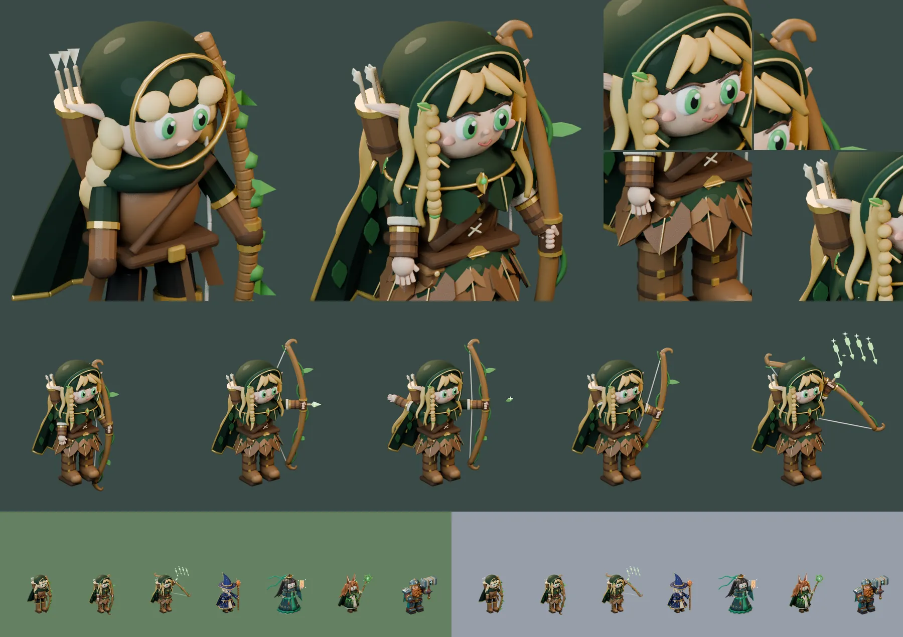

# 89회차 — 모델링: 리엘 디테일 판과 시전 포즈 ‘별빛 화살비’

| 항목 | 값 |
| --- | --- |
| 시각 | 2026-11-11 15:07 KST (예약 회차) |
| 기준 | main **`b175a9f`** — 69회차 뒤 바뀐 것 없음 |
| 회차 종류 | **저입력 회차**(88회차 뒤 새 PR·사용자 결정 없음). 작은 단위 하나: 영웅 하나의 디테일 층 올리기(80회차 기준, 사용자 요청 “모델링 더 디테일하게”) |
| 주 분야 | 모델링 |
| 범위 | `model-drafts/build_elf_draft.py`(디테일 판 + 다섯째 포즈)와 비교 시트 1장. 렌더는 스크래치 폴더에서 Blender 5.2로 했다. |

## 1. 점검

| 분야 | 상태 |
| --- | --- |
| 게임 모드 · 로직 · 모델링 | 새 PR 없음(최신 #104). 인계 목록 변화 없음 |

## 2. 구운 것 — 리엘 디테일 판

카메라 계약·네 공격 포즈 값·몸 배율(1.25)·발사점은 그대로 두고 여섯 층을 올렸다. 참고 그림은 `art-source/defense/atlases/ranged-motion.png`의 리엘 칸이다.

| 층 | 넣은 것 |
| --- | --- |
| ① 얼굴 | 눈썹, 윗눈꺼풀 선과 속눈썹, 코, 미소, 볼터치, 귓속 그늘(옆으로 누운 귀는 그대로) |
| ② 손 | 활을 쥔 네 손가락과 엄지, 시위에 건 세 손가락, 놓은 뒤 펼친 손 |
| ③ 머리·두건 | 옆으로 넘긴 앞머리 4가닥, 물결치는 옆 4가닥·뒤 9가닥, **땋은 머리**와 잎 머리핀 / 접힌 두건 테와 금실 |
| ④ 옷 | 잎 끝 어깨 망토와 금 테, 잎 끝 단의 망토와 잎 무늬, 끈으로 묶은 가죽 조끼, 잎 모양 가죽 치마 두 줄과 초록 속치마, 부푼 소매·상아 소맷단·끈 달린 팔 보호대, 끈과 죔쇠가 달린 긴 장화와 잎 무릎 보호대 |
| ⑤ 소품 | 매끈한 활대에 감긴 덩굴·말린 활 끝·잎, 가죽 손잡이, 띠와 잎 문양이 있는 화살통과 깃 달린 화살, 잎 버클·주머니·멜빵 죔쇠·잎 브로치, **각진 빛나는 화살촉** |
| ⑥ 재질 | 밝은 초록 주름, 밝은 금실, 밝은 가죽 |

- 도구는 `spline`·`lock`·`leaf`·`wavy`를 썼다. `arrowhead`(각진 화살촉)와 `sparkle`(네 갈래 별)을 새로 더했다.
- 66회차 초안의 얼굴 앞 금 고리는 없앴다. 두건 테가 얼굴을 두르게 했다.

**새 포즈 — 시전 ‘별빛 화살비’**
- 활을 높이 겨눠 끝까지 당긴다. 앞쪽 위에서 빛나는 화살 네 대가 떨어진다.
- 활 면은 58회차 규칙대로 쏘는 방향과 위쪽을 품는다.

**시행착오**
- 앞머리가 이빨처럼 뻗었다. 옆으로 넘긴 네 가닥으로 바꿨다.
- 머리가 상아색으로 떠서 색을 금빛 쪽으로 낮췄다.
- 초록 속치마가 밝게 부풀어 가죽 잎을 가렸다. 속치마를 어둡게, 가죽 잎을 넓게 했다.
- 시전에서 화살비가 프레임 오른쪽에 닿았다(여유 5px). 안쪽으로 모아 54px로 맞췄다.
- 두건 자수의 잎맥 하나가 두건 위로 삐져나왔다. 자수를 뺐다.
- **용량이 예산을 넘었다**(다섯 장 q80 134 KB). 부위를 하나씩 숨겨 재서 줄였다(아래 3장).

## 3. 측정

| 항목 | 66회차 초안 | 89회차 디테일 판 | 기준 |
| --- | --- | --- | --- |
| 메시 · 삼각형 | 132 · 22,393 | **207 · 35,268** (시전 238 · 37,104) | — |
| 보이는 키(가로 844 × 390, 1.32) | 38.8px | **40.4px** (준비 45.3 · 타격 45.3 · 회복 42.5 · 시전 47.4) | 대기 38~41px ✔ |
| 64px 회색 · 배경 대비 | 81 · 숲 35 · 설산 75 | **83** · 숲 33 · 설산 73 (시전 86) | 90 이하, 25 이상 ✔ |
| 64px 겹침: 이안 · 청운 · 루나 · 브론 | 0.52 · 0.59 · 0.39 · 0.48 | 0.53 · **0.57** · 0.41 · 0.50 | 0.60 이하 ✔ |
| 대기와 겹침(준비·타격·회복·시전) | 0.51 · 0.55 · 0.57 · — | 0.53 · 0.46 · 0.55 · 0.37 | 0.80 이하 ✔ |
| 프레임 여유 | 65px 이상 | 51px 이상 | 8px ✔ |
| 네 장 WebP(같은 포즈끼리) | q85 101,230 B · q80 90,118 B | q85 112,514 B · q80 99,450 B (+10%) | — |
| 다섯 장 WebP | — | q85 143,876 B · **q80 127,184 B** | 128 KB(q80) ✔ (여유 0.8 KB) |

- 발사점(발 기준 단위)은 네 포즈 모두 66회차와 같다: 대기 (11, −31) · 준비 화살촉 (33, −42) · 타격 (19, −42) · 회복 (15, −39). 시전의 화살촉은 (22, −59)다.

**용량을 어디서 쓰나** (타격 한 장 29.5 KB에서 부위를 숨겨 잰 값)

| 숨긴 부위 | 줄어든 용량 |
| --- | --- |
| 활시위 | 2.2 KB |
| 활 잎 넷 + 놓을 때 날리는 잎 | 2.0 KB |
| 덩굴 감김 | 1.2 KB |
| 금 부속 전부 | 1.1 KB |
| 잎맥(금 줄) 전부 | 1.0 KB |
| 땋은 머리 | 0.3 KB |
| 뒷머리 가닥 · 치마 윗줄 | 0.1~0.2 KB |

- 시위의 색과 굵기를 바꿔도 용량은 그대로였다. 가는 선이 있다는 것 자체가 값이다.
- 그래서 활 잎을 활대마다 하나로, 덩굴 감김을 세 바퀴 아래로, 잎맥을 치마 아랫줄과 어깨 망토 잎 하나 걸러에만 남겼다. 시전의 화살비는 다섯 대에서 네 대로 줄였다.

**읽은 것**
- 디테일 기준을 네 번째 영웅에 적용해도 전투 크기 기준은 모두 유지된다. 청운과의 겹침은 0.59 → 0.57로 조금 나아졌다.
- 리엘은 활·시위·화살 때문에 포즈마다 그림이 넓다. 같은 네 포즈의 증가는 +10%로 넷 중 가장 작았지만, 다섯째 포즈가 붙으면서 예산에 딱 닿았다.
- **예산 128 KB(q80)는 리엘에게 여유가 0.8 KB뿐이다.** 이식할 때 장식을 더하면 넘는다. 넘으면 위 표의 순서로 줄인다.
- 이로써 그림 영웅 넷(청운·루나·이안·리엘)의 디테일 판이 모두 나왔다. 넷 다 시전 포즈가 있다.

| 영웅 | 메시 · 삼각형 | 다섯 장 q80 | 가로 대기 | 64px 회색 |
| --- | --- | --- | --- | --- |
| 청운 (80) | 153 · 38,976 | 126,312 B | 40.6px | 80 |
| 루나 (83) | 218 · 40,862 | 111,892 B | 40.0px | 86 |
| 이안 (86) | 263 · 48,946 | 113,996 B | 40.6px | 82 |
| 리엘 (89) | 207 · 35,268 | 127,184 B | 40.4px | 83 |

## 4. 인계

- A ‘영웅 네 명 충실 이식’ 리엘 줄
  - `build_elf_draft.py`(89회차 디테일 판) → `tools/blender/build_elf.py`
  - 여섯 층, 도구 `arrowhead`·`sparkle`, 다섯째 포즈 `cast`
  - 용량 여유가 0.8 KB라는 것과 줄이는 순서(활 잎 → 덩굴 감김 → 잎맥)
- 완료 판단은 80회차 ‘모델 디테일 기준’과 같다.
  - 초상 크기에서 여섯 층이 보인다.
  - 64px 겹침 0.60 이하 · 대기 38~41px · 대비 25 이상
  - 다섯 장 ≤ 128 KB(q80)

## 5. 기록

- [인계 목록](../handoff.md): 리엘 줄에 디테일 판 값을 붙였다.
- README: 모델링 순서를 ‘넷 완료’로 고치고 회차 기록과 다음 회차 후보를 갱신했다.

## 다음 회차

90 게임 모드 — 2-4 서리군주를 87회차와 같은 틀로 본다(영웅·용병별, 충전 차단과 겹칠 때).
다음 모델링(92회차)은 디테일 판 넷의 초상 규격이다. 동료 카드·합류 대화에 쓸 256px 초상을 같은 카메라에서 어떻게 잘라내는지 정한다.
