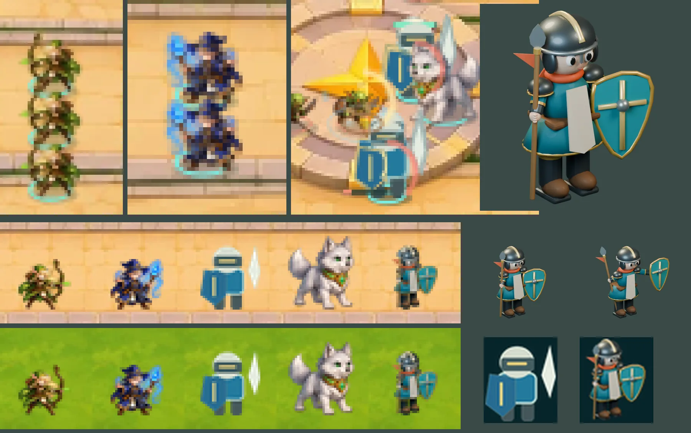

# 92회차 — 모델링: 군단 방어의 유닛 크기와 방패병 초안

| 항목 | 값 |
| --- | --- |
| 시각 | 2026-11-11 21:09 KST (예약 회차) |
| 기준 | main **`7459b61`** — PR #105(군단 방어 모드)가 병합됐다. 이 브랜치에 main을 병합했다(테스트 183개 통과) |
| 회차 종류 | **평소 회차**(새 PR #105). 계획했던 ‘초상 규격’ 대신, 새 모드가 유닛을 그리는 크기에 맞춰 모델링 기준을 본다 |
| 주 분야 | 모델링 |
| 범위 | 문서와 `model-drafts/`(방패병 초안 스크립트, 비교 시트 1장). main의 `LegionBoard.tsx`·`LegionGame.tsx`·`games/legion/data.ts`·`art.ts`와 `docs/arcana-legion/`을 읽었다. 렌더는 스크래치 폴더에서 Blender 5.2로 했다. |

## 1. 점검 — PR #105 군단 방어

| 분야 | 상태 |
| --- | --- |
| 게임 모드 | **새 모드**. 마을 화면의 ‘군단 방어’로 들어간다. 병종 넷(방패병·궁수·마법사·영물)을 골라 배치 구역에 소환하면 이동·공격·스킬은 자동이다. 세 진입로, 4웨이브(48·60·78·96마리), 마을 체력 20, **보스 돌파는 패배**(규칙 v1 P0와 같은 방향). 소환 골드와 기록은 캠페인과 분리돼 있다 |
| 로직 | 병종·적 수치는 `games/legion/data.ts` 한 파일. 문구 대조는 94회차로 미룬다 |
| 모델링 | 궁수는 리엘 그림, 마법사는 이안 그림, 영물은 늑대 그림을 그대로 쓴다. **방패병만 도형(캔버스)으로 그린다.** 병종 카드도 방패병만 따로 그린 SVG다 |
| 인계 목록 | 이 PR이 구현한 항목은 없다. 화면 방향: 군단 문서는 ‘승인된 가로 하이앵글 방향’이라 적고, 세로는 줄인 전체 보기로 남겼다 |

## 2. 군단에서 유닛은 얼마나 작게 그려지나

- 전장은 1600 × 900 단위다. 가로 844 × 390 화면에서 배율은 0.5275다.
- 그림은 **긴 변**이 정해진 크기가 되도록 줄인다(`renderAsset`).

| 대상 | 그리는 크기(전장 단위) | 화면에서 |
| --- | --- | --- |
| 궁수 · 마법사 · 보통 적 | 43 | **22.7px** |
| 새싹 도적 | 38 | 20.0px |
| 돌 갑옷병 | 49 | 25.8px |
| 방패병(도형, 높이) | 53 | 28.0px |
| 영물 | 60 | 31.6px |
| 고목왕 | 84 | 44.3px |

- 캠페인 전투의 영웅은 약 40px이다. 군단에서는 그 절반 남짓이다.
- 같은 병종은 세로로 32단위(16.9px) 간격에 선다. 그림 높이보다 좁아서 서로 겹친다(궁수 23%, 마법사 18%, 방패병 40%).
- 긴 변 기준이라서 **긴 소품이 몸을 줄인다.** 지팡이·창이 위로 솟으면 그만큼 몸이 작아진다.

## 3. 군단 크기에서 재 본 것

**배경이 밝다.** 군단 전장의 회색은 길 모래 171~202, 광장 172, 배치 구역 풀 143~146이다(캠페인은 숲 116, 설산 156).

| 그림 | 회색 | 모래와 차 | 풀과 차 |
| --- | --- | --- | --- |
| 그림 궁수(리엘) | 96 | 94 | 49 |
| 그림 마법사(이안) | 90 | 100 | 55 |
| 도형 방패병 | 136 | 54 | **9** |
| 그림 영물(늑대) | 154 | 36 | **9** |
| 방패병 초안 | 104 | 86 | 41 |

- 도형 방패병과 영물은 배치 구역 풀밭과 평균 밝기가 거의 같다. 시트에서 보듯 안쪽 명암과 테두리 덕분에 읽히기는 하지만 여유가 가장 적다.

**24px 실루엣 겹침**

| 쌍 | 겹침 |
| --- | --- |
| 그림 궁수 – 그림 마법사 | 0.63 |
| 그림 마법사 – 도형 방패병 | **0.71** (회색 차 46이라 색으로는 구분된다) |
| 그림 궁수 – 도형 방패병 | 0.58 |
| 방패병 초안 – 궁수 · 마법사 · 영물 | 0.55 · 0.53 · 0.46 |

**기대와 달랐던 것**
- 3D 초안이 그림보다 또렷할 거라 예상했다. 아니었다.
  - 색을 여섯으로 줄여 덩어리 크기를 쟀다(2배 화소). 도형 방패병은 덩어리 평균 17.4화소, 그림 궁수·마법사는 7.7·7.2화소, 이 루프의 초안들은 4.9~5.7화소다. 초안이 더 잘게 쪼개진다.
  - 흐리게 한 뒤 5~6색으로 줄여 구워도 그대로였다(5.0~5.5화소).
- 80~89회차의 **여섯 층 디테일은 군단 크기에서 보이지 않는다.** 리엘·이안 디테일 판을 그대로 줄이면 어둡고 가는 기둥이 된다. 높은 모자와 지팡이·활이 긴 변을 차지해 몸이 작아져서다.
- 방패병 초안도 처음에는 긴 창 때문에 몸이 15% 작게 그려졌다. 창을 투구 높이로 줄여 2%로 낮췄다.

## 4. 군단 층 규칙 (세 번째 확인 크기)

80회차의 두 크기(초상 1280px, 전투 64px)에 **군단 크기(긴 변 약 23px)**를 더한다. 군단에 쓰는 그림은 이 넷을 지킨다.

1. **몸이 긴 변을 채운다.** 소품이 몸 높이를 10% 넘게 벗어나지 않는다. 벗어나야 하면 그리는 쪽이 몸 높이로 맞춘다(구운 몬스터는 이미 `span`으로 그렇게 한다).
2. **큰 덩어리 하나.** 몸 높이의 30% 이상인 소품이나 면이 있다(방패, 모자, 활).
3. **배경과의 차.** 평균 회색이 풀(145)과 25 이상 다르다. 밝은 그림은 어두운 테두리를 둔다.
4. **디테일은 카드와 초상에.** 여섯 층은 병종 카드·동료 카드·합류 대화에서만 요구한다.

## 5. 구운 것 — 방패병 초안

- [`model-drafts/build_legion_shield_draft.py`](../model-drafts/build_legion_shield_draft.py). 영웅과 같은 카메라 계약(640 프레임, 땅 (320, 550))이라 같은 굽기 경로를 탄다.
- 모양: 어두운 강철 투구와 금 볏, 청록 겉옷과 상아 앞자락, 주홍 목도리, 금 십자의 청록 방패, 짧은 창과 주홍 깃.
- 포즈 둘: 대기, 방패 강타(방패를 앞으로 내민다).

| 항목 | 값 |
| --- | --- |
| 메시 · 삼각형 | 58 · 11,488 |
| 두 장 WebP | q85 30,462 B · q80 27,164 B |
| 군단 크기 회색 | 104 (모래와 86, 풀과 41) |
| 몸이 긴 변에서 차지하는 비율 | 0.98 |

**읽은 것**
- 도형 방패병은 군단 크기에서 충분히 읽힌다. 초안이 나은 점은 셋이다: 다른 병종·몬스터와 같은 그림 방식, 풀밭 위 대비, 카드와 전장이 같은 그림.
- 초안이 못한 점도 있다. 덩어리가 잘다. 이식할 때 재질을 단순하게 굽는 편이 낫다.

## 6. 제안

**A. 결정 불필요 (인계)**
- **유닛도 몸 높이로 맞춰 그린다.** `LegionBoard.tsx`의 유닛 그리기에 몬스터와 같은 `span`을 쓴다. 긴 소품이 있는 병종이 작아지지 않는다.
- **방패병을 구운 그림으로.** 초안 스크립트 → `tools/blender/build_legion_shield.py`. 전장과 병종 카드가 같은 그림을 쓴다.
- **군단 층 규칙**(4장)을 군단용 그림의 완료 판단으로 쓴다.
- 완료 판단
  - 병종 넷의 화면 높이가 몸 기준으로 같다(테스트: 그림 크기 계산에 `span`).
  - 병종 카드와 전장의 방패병이 같은 그림이다.
  - 군단 크기에서 풀과의 회색 차 25 이상, 다른 병종과 24px 겹침 0.65 미만.

**B. 사용자가 정할 것 (기존 항목에 붙임, 새 질문 아님)**
- 궁수·마법사가 리엘·이안의 그림 세 벌·두 벌이다. 이름 없는 병사로 따로 그릴지는 묶음 ②(영웅 겉모습)와 같은 종류의 결정이다. 이 루프는 ‘병사는 영웅과 다른 얼굴’을 **작업 가정**으로 두고, 다음 모델링 회차에 궁수 병사 초안을 낸다.

## 7. 기록

- [인계 목록](../handoff.md): 기준을 main `7459b61`로 올렸다. A에 ‘군단 유닛 그리기’ 줄, C에 PR #105 줄을 더했다.
- README: 집중 관점에 ‘군단 층 규칙’을 넣고, 회차 기록과 다음 회차 후보를 군단 모드에 맞춰 바꿨다.

## 다음 회차

93 게임 모드 — 군단 방어를 사본에서 잰다. 병종 조합별 승패와 골드당 값, 배치 자리(앞·뒤)의 차이, 한 판 길이를 본다.
94 로직은 군단의 병종·적 문구와 수치 대조, 95 모델링은 궁수 병사 초안(군단 층 규칙)과 병종 카드 초상이다.
