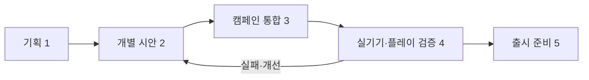

# 아르카나 수비대 분야별 기획과 개발 척도

**2026-11-12 갱신:** 카르·브론·관통 석궁 Lv2·나무 병사의 모델 표현은 현재 작업 트리에서 캠페인 통합(아래 척도 3)에 진입했다. 신규 인간 창방패병은 작업실 시안(2)이다. 해당 자산에 한정한 판정이며 분야 전체나 실기기 검증(4)의 달성을 뜻하지 않는다. [최신 증거와 남은 작업](arcana-battle-models-20261112.md). 아래 분야 표는 11월 11일의 기준선이다.

2026-11-11 · [전체 게임 계획](arcana-full-game-plan-20261111.md) · [시각화](arcana-full-game-plan-20261111.html) · [최근 검증 기록](arcana-production-20261111.md)

기준은 현재 작업 공간의 캠페인과 3D 지형 브랜치다. **기존 캠페인에서 동작하는 것**, **개발 브랜치·작업실의 시안**, **계획 또는 측정 전**을 구분한다. 아래 목표 수치는 팀이 처음 측정해 보기 위한 **잠정 제안**이며 현재 성과·사용자 승인·출시 약속이 아니다. 실제 기기와 플레이 테스트의 기준선에 따라 조정한다.

## 공통 척도: 작업 수가 아니라 통과 증거

| 단계 | 의미 | 다음 단계에 필요한 증거 |
| --- | --- | --- |
| 0 · 정의 전 | 역할·범위·원본이 정해지지 않음 | 대상, 게임에서의 역할, 적용 범위 명시 |
| 1 · 기획 | 목표·참고·규칙·미결정이 기록됨 | 검토 가능한 예시와 측정 방식 |
| 2 · 시안 | 개별 모델·로직·화면 또는 별도 실험이 동작 | 원본·재현법·시안의 제한·검증 결과 |
| 3 · 통합 | 실제 캠페인 경로에 연결됨 | 입력·전투·저장 등 관련 회귀 검증 |
| 4 · 플레이 검증 | 사용자가 실제 대상 기기에서 시험 | 사전 정의한 시나리오·측정치와 결함 조치 |
| 5 · 출시 준비 | 성능·접근성·저장·라이선스까지 통과 | 재현 가능한 증거, 수정 완료 또는 명시된 예외 |

단계는 **대상별**로 기록한다. 캐릭터 모델 한 개가 3단계여도 영웅 분야 전체가 3단계는 아니다. 모든 항목을 100%로 평균 내어 출시 준비도를 주장하지 않는다. 별도 개발 브랜치의 화면은 정식 캠페인 통합으로 세지 않는다.



## 분야별 기획과 판정 기준

| 분야 | 기획할 것 | 현재 상태와 공백 | 척도와 확인 방법 | 다음 통과 기준 |
| --- | --- | --- | --- | --- |
| 게임 중심·모드 | 영웅 이동 + 타워 방어, 모드별 조작·승패·보상 | 캠페인 동작. Frontier 3모드는 별도 실험 | 모드별 목표·금지 조작·승패·저장 경계의 시나리오 표와 실행 결과 | 기존 캠페인과 세 실험의 계약을 섞지 않고 기록; 정식 채택은 별도 결정 |
| 레벨·맵 | 경로·건설점·물·빙판·고지, 위협과 복구 여지 | 숲·설산 8스테이지 구현, 정적 3D 지형은 브랜치 시안 | 단계별 경로/건설점 위치, 방해물·가림, 터치 좌표, 첫 진입→목표 도달 시나리오 | 숲 1스테이지에서 3D 투영·경로·터치와 기존 규칙의 기준 좌표 전수 일치 |
| 카메라·조작 | 시야·캐릭터 크기·가림·터치·세로/가로 | 정사영 60도와 Frontier 투시가 서로 다른 시안 | 대상 기기 화면에서 영웅·진입로·목표 가림 사례, 잘못 선택 횟수, 조작 재현 영상 | 양 화면 방향 지원 유지, HUD/지형 탭·타워 선택·대상 판별을 각각 수행 |
| 영웅·동료 | 6영웅의 문화·장비·역할, 모션과 스킬 | 캠페인은 스프라이트, 작업실 GLB와 카르 망치 시안 존재 | 개별 모델별 실루엣·재질·피벗·8방향 가림, 접지, 클립 목록/시점 | 해금된 저장 또는 개발 장면에서 영웅 1명 실시간 3D 연결, 타격·이동·정지 일치 |
| 타워·무기 | 3기본 타워, 분기별 소재·실루엣·기능 | 건설·강화·분기 구현, 3D 발리스타 별도 시안 | 설치·방향·발사·판매, 타겟 이동/재조준 시 발사체 시작점과 명중 기록 | 기본 타워 1종의 GLB와 실제 엔진 발사·사거리·업그레이드/판매 회귀 일치 |
| 적·보스 | 재료별 약점, 역할·예고·피격·사망 | 일반 적·숲/설산 보스 로직 구현, 일부 모델/클립 시안 | 적 종류별 식별률, 약점 반응과 보스 예고, 경로·피해 결과 기록 | 나무 적 1종의 다수 개체·경로·피격·사망과 기존 엔진 결과 일치 |
| 속성·상호작용 | 불·얼음·충격·물·전기, 젖음·전도·절연 | 엔진에 주요 상성 구현 | 상대/상태별 입력→피해·연소·둔화·연쇄의 명시된 결과표와 자동 테스트 | 3D 표현 전후 결과가 동일; 색 외에 형태·효과·텍스트 중 구별 수단 확보 |
| 애니메이션·전투 연출 | 이동·공격·피격·사망과 판정의 연결 | 엔진 `hitAt` 매핑 어댑터/테스트만 시안, 렌더러 미연결 | GLB 클립의 접촉 프레임을 명시하고 엔진 `elapsed`·`hitAt`과 대조 | 타격/발사 시점, 정지·동결·취소·재조준 영상과 자동 테스트 통과 |
| 마을·성장·경제 | 출전·동료·보상·영구 강화의 선택 가치 | 4개 거점 테마·성장·로컬 저장 구현 | 합법 진행 경로별 골드/가격/해금 표, 의도적 실패 보상과 재도전 가치 | 1~8단계 진행에서 손실·중복 지급 없이 재현; 보스·첫 보상 변경 제안은 별도 결정 |
| UI·접근성 | 조작 대상·체력·재화·웨이브·약점·설정 | 기존 HUD·터치·대체 입력 구현, 실기기 미검증 | 실제 화면에서 클릭·터치 실패, 주요 문구 식별, 색 외 표시·동작 줄이기 검토 | 준비→설치→웨이브→기술→결과를 각 화면 방향에서 방해 없이 완료 |
| 오디오·촉감 | 공격 종류·명중·위험·웨이브·결과의 구분 | 기존 효과음·촉각 일부 구현, 전체 체계 미검증 | 상황별 음원/우선순위·볼륨·중복 재생·무음 전환 테스트 | 효과음 중복·음소거·일시정지·시스템 복귀 시나리오 확인 |
| 세계관·문화·스토리 | 지역 위기, 문화·재질·무기와 동료 정체성 | 4테마·숲/설산, 극지·열대 시안은 후보 | 지역별 색·기후·건축·재료·적의 공통 문서와 불일치 목록 | 사용자 확정 설정과 후보 분리, 고목왕 상충 설정 보류 |
| 성능·플랫폼 | 모바일 프레임·메모리·발열·배터리·복귀 | 웹·모바일 빌드, Chromium 검증. Android 실기기 미측정 | 기기·OS·해상도·모드·장면·적 수·측정시간·P50/P95 프레임 시간·메모리·온도 기록 | 아래 성능 실험 프로토콜을 충족하거나 기준선과 실패 원인을 기록하고 재계획 |
| 저장·안정성 | 중단/재개·진행·성장 보존, 업그레이드 | 브라우저/앱 로컬 저장, 클라우드는 미구현 | 새 설치/기존 저장/중단/데이터 오류/복귀 시나리오와 결과 | 기존 진행·골드·해금이 조용히 변하거나 중복 지급되지 않음 |
| 운영·에셋·AI | 출처·라이선스·키·API 예산·재현·브랜치 | Fable 검토 CLI, 원장·오프라인 테스트. Patch 공개 검색만 확인 | 자산별 원본·해시·라이선스·사용처, 호출별 모델·effort·토큰·결과·계정별 비용 | 출처 미확인 에셋/키 미포함, 유료 요청은 한도와 사용 내역 확인, 실패 시 자동 재시도 없음 |

## 측정의 구체적 정의

### 1. 플레이와 밸런스

- **한 판 길이:** 전투 시작부터 결과 화면까지의 실제 경과 시간과, 일시정지를 제외한 전투 시간은 따로 기록한다. 기존 문서의 초반 1~2분·후반 2~4분은 설계 목표이며 실측 평균이 아니다.
- **플레이 시나리오:** 최초 진행 가능한 영웅·자원만 사용하여 늦은 건설, 타워 분기 변경, 적 일부 돌파 후 회복, 기술을 적게 사용한 경우를 별도 기록한다. 기본 난도에서 서로 다른 타워 구성 최소 2개로 완주 가능 여부를 확인한다. 이는 테스트 조건이지 모든 플레이어의 성공 보장이 아니다.
- **사람 관찰:** 첫 세션에서 목표를 이해하고 타워 설치·웨이브 시작·기술 사용을 설명 없이 완료하는지 기록한다. 초기에 5명 내외의 탐색 테스트를 제안하며 표본이 작아 전체 사용자 성공률로 일반화하지 않는다. 미달 원인은 사용자의 실수가 아니라 UI·규칙을 함께 살펴본다.
- **현 측정 근거:** 고정 정책 위주의 48실행은 47회 본진 무피해·48회 외곽 무피해였으나, 인공지능/사용자 전반의 승률이 아니다. [기존 수치와 한계](arcana-game-rules-v1.md).

### 2. 모델과 모션

- **모델 인계 단위:** 이름·버전·출처·원본 `.blend`·GLB 해시·바닥 원점·전방 축·크기·재질·삼각형·텍스처 크기·클립명과 각 접촉 시각을 기록한다. 삼각형/메시 수는 실제 draw call이나 성능의 대용치가 아니다.
- **3D 가독성:** 실제 전장 카메라와 해상도에서 적·영웅·타워를 각각 확대하지 않은 캡처로 확인한다. 앞/뒤·좌/우, 이동/공격/피격, 지형·HP바·효과 겹침을 표본으로 남긴다. 탐색 기준은 5명 내외에게 대상과 행동을 설명 없이 구분하는지 확인하고 혼동 사례를 수정하는 것이다. 표본 크기와 결과를 함께 적고 확정 통계로 주장하지 않는다.
- **접지·명중:** 발과 손·무기 관통, 지면 부유를 전 방향과 주요 프레임에서 비교한다. 엔진의 `hitAt`과 **클립 접촉 시각**이 같은 화면 프레임에 들어오는지 확인한다. FPS가 바뀌면 프레임 길이가 바뀌므로 동시에 밀리초와 프레임 기준을 적는다. 피해와 투사체는 기존 엔진이 판정한다.
- **카르 시안 제약:** 편집용 개별 메시와 런타임 메시의 변형이 완전히 같지 않다. 최종 채택 전 정렬·재내보내기·모션 관통 검증이 필요하다.

### 3. 성능 실험: 첫 기준을 만드는 방법

1. 최소 1대의 실제 Android 대상 기기에서 모델명·OS·화면 크기·해상도·그래픽 설정을 남긴다. 다른 성능군의 기기 추가 측정은 후속이다.
2. 숲·설산의 정지 준비, 일반 웨이브, 적과 효과가 많은 웨이브를 각각 **60초 이상** 같은 조작으로 측정한다. 워밍업·배터리·온도와 백그라운드 상태를 기록한다.
3. 프레임 시간 P50/P95, 끊김, draw call/삼각형, 앱 메모리, 발열 변화를 함께 기록한다. FPS 평균만으로 통과시키지 않는다.
4. **잠정 탐색 목표:** 각 대표 장면의 프레임 시간 P95 ≤33.3ms(약 30fps 예산). 기기·측정법·표본을 함께 기록한다. 이는 아직 실측되지 않았고 최저 사양이나 최종 출시 기준으로 확정되지 않았다. 실패 시 에셋·해상도·효과별 원인을 분리한다.
5. 백그라운드 전환·복귀, WebGL 컨텍스트 손실/복구, 설정 변경과 저장 보존을 반복한다. 브라우저 소프트웨어 렌더 결과를 실제 기기 통과로 환산하지 않는다.

### 4. Patch·AI·자산 운영

- Patch는 공개 검색에서 에셋·라이선스를 조회한 상태다. 후보마다 파일 원본, 라이선스와 크레딧, 사용 범위, 형식·용량·모바일 실제 비용, 아르카나 화풍 적합성을 표로 보관하고 적용 전 확인한다. MCP 로그인·다운로드·실제 통합은 아직 검증하지 않았다.
- API 지출은 호출 전 계정·예산·모델·effort·이미지 전송 범위·토큰 한도를 정하고, 호출 후 입력/출력/종료 사유/실제 청구액을 적는다. 이전 사용자의 여러 금액은 제공자 및 기간 대응이 확정되지 않아 남은 잔액으로 계산하지 않는다. 타임아웃의 과금 여부는 미확정으로 유지하고 자동 재시도하지 않는다.
- 기존 Fable 5.2 `high` 이미지 검토는 응답을 받았으나, `max`는 여러 요청에서 추론 한도로 종료했다. Fable의 의견은 근거 이미지와 함께 남기고 모델링 완료 또는 실제 모바일 가독성 측정으로 집계하지 않는다.

## 첫 번째 완성 단위의 작업판

숲 1스테이지 + 기존 해금 상태 또는 개발 전용 장면 + 카르 1명·발리스타 1종·나무 적 1종을 **첫 실시간 3D 통합 후보**로 둔다. 카르를 첫 스테이지에서 새로 해금한다는 뜻이 아니다.

| 순서 | 작업 | 통과할 때 남길 증거 |
| --- | --- | --- |
| A | 카르 시안의 저작용/런타임 메시 정렬, 기준 GLB 선택 | 원본 보존, 해시·전후·전방향 관통 기록 |
| B | 카르/발리스타/나무 적의 클립 접촉 시점, 축·피벗 실측 | 클립별 초/프레임·근거 캡처·단위 |
| C | 전장 좌표→3D 위치·방향·카메라와 가림 구현 | 기준점·터치 좌표 자동 검사와 전장 캡처 |
| D | 기존 `sampleAttackAnimation`과 실제 믹서 연결 | `hitAt`·투사체·일시정지·동결·재조준·취소 회귀 |
| E | 개발 장면에서 모델 3종 동시 구동 | 기존 스프라이트와 전환 시 중복/누락 없이 한 웨이브 완료 |
| F | 저장·보상·모바일 브라우저 및 Android 기기 검증 | 관련 테스트, 장면별 성능·발열·터치 결과와 미해결 결함 |

실기기가 준비되지 않은 작업은 **미측정**으로 남긴다. Frontier의 별도 웨이브·성문 체력·모드 보상은 캠페인 검증값으로 사용하지 않는다.

## 진행 기록 양식

작업 한 개마다 아래 항목을 남긴다. 수치가 없으면 공란 대신 `미측정`을 사용한다.

```text
분야 / 대상 / 적용 브랜치와 커밋 / 담당 작업
현재 단계 0~5 / 근거 링크 / 다음 완료 기준
재현 환경(기기·OS·해상도·빌드·설정) / 데이터와 측정 방식
결과: 측정값 또는 미측정 / 실패·제약 / 다음 조치
외부 자산: 원본·해시·라이선스·크레딧 / API: 모델·토큰·실제 금액
```
