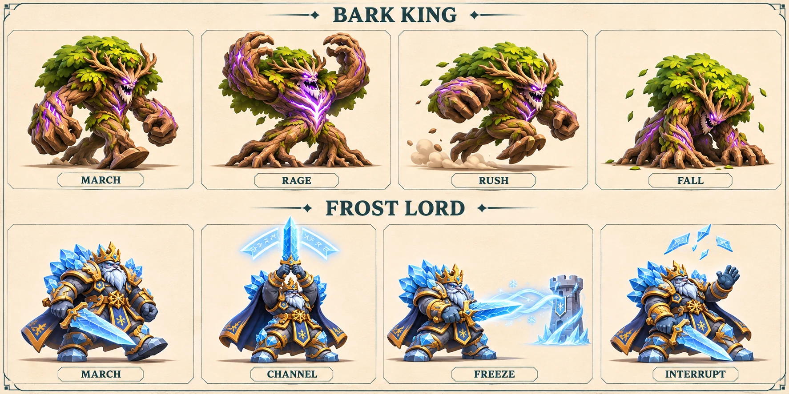
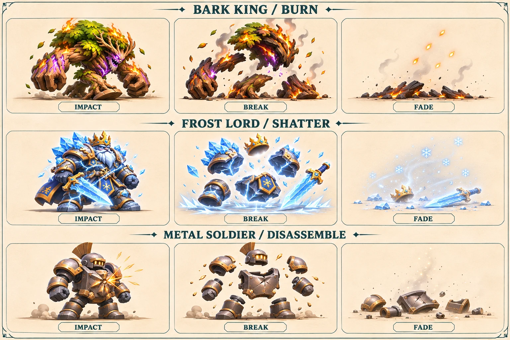

# 아르카나 적·보스 제작 설계 v1

2026-11-09 · 구현 기준 `6569da1` · **설계 확정과 콘셉트 시안. 새 3D 모델·모션의 게임 연결은 후속 작업이다.**

한눈에 종류를 알아보고, 다음 행동을 읽고, 대응했을 때 손맛이 남는 적을 만든다. 교육 설명은 도감의 선택형 한 줄에만 둔다. 마을을 돌파하는 적의 압박과 필살기로 보스를 차단하는 쾌감이 중심이다.

[보스 동작·타이밍 시안 열기](preview.html) · [모델링 인계](modeling.md) · [전투·VFX 계약](combat-vfx.md) · [Claude 검토](review/claude-fable.md)

이미지는 제작 방향을 보여주는 스토리보드다. 게임 스크린샷·연속 애니메이션·스프라이트 아틀라스가 아니다. 서리군주의 동결 칸에 타워 하나를 예시로 그렸지만 실제 능력은 전체 타워에 적용된다.

## 악당의 성격과 지역 역할

- **고목왕 — 길을 빼앗는 숲의 폭군.** 자신의 숲이 넓어지는 것을 힘의 증거로 여긴다. 평소에는 무거운 뿌리 걸음, 약해지면 몸을 낮추고 성문까지 밀어붙인다. 거대한 두 팔·뿌리 두 다리·잎 수관·보라색 흉부 균열이 핵심 외형이다. 대사 후보: “이 길도 내 뿌리 아래다.”
- **서리군주 — 마을을 얼어붙은 요새로 만들려는 왕.** 과시적인 검 들기와 짧은 정적 뒤에 타워를 동결한다. 차단되면 문양이 깨지고 왕의 위엄이 흔들린다. 흰 수염·금관·남색 망토·금색 장식·얼음 어깨판·대검 한 자루를 유지한다. 지팡이로 바꾸지 않는다. 대사 후보: “그 성벽도 곧 멈출 것이다.”

성격·대사는 신규 설정이다. 지역마다 종족을 완전히 분리하지 않고 실제 웨이브 편성을 유지한다. 새 부하 소환, 타워 파괴, 영웅 직접 공격은 이 설계에 포함하지 않는다.

## 일반 몬스터 7종의 제작 결정

모든 공격 자세는 **마을 방어선에 도달하는 돌파 연출**이다. 현재 아군에는 HP가 없으므로 영웅에게 피해 숫자를 띄우지 않는다. 새 모션은 제안이며 기존 모델에 모두 들어 있지는 않다.

| 적 | 실루엣·이동 | 돌파 / 피격 / 처치 연출 | 플레이어가 읽는 특징 |
| --- | --- | --- | --- |
| 새싹 도적 | 큰 쌍잎, 작은 씨앗 몸, 빠른 발 교대 | 어깨 밀기 / 잎 접힘 / 씨앗처럼 작아짐 | 가벼운 전열, 불 약점·물 내성 |
| 나무 병사 | 세로로 긴 통나무, 가지 팔, 뻣뻣한 뿌리 걸음 | 가지 내려치기 / 몸통 비틀림 / 관절 풀려 토막남 | 느린 압박, 불 약점·물 내성 |
| 빙결 기사 | 각진 투구, 삼각검, 좁은 허리 | 짧은 검 내려치기 / 얼음 면 균열 / 큰 덩어리 세 개 | 불·충격 약점; 방패 외형은 별도 방어 판정 없음 |
| 돌 갑옷병 | 낮고 넓은 어깨, 큰 주먹, 늦게 따라오는 발 | 주먹 밀기 / 작은 상체 기울기 / 무릎부터 붕괴 | 높은 체력·질량, 충격 약점·불 내성 |
| 금속 병사 | 직사각 흉갑, 등핀, 일정한 행군 | 팔뚝 밀기 / 판금 떨림 / 판금이 포개짐 | 전기 연쇄 전달; 직접 전기 피해 약점은 아님 |
| 절연 슬라임 | 낮고 둥근 몸, 두꺼운 고무 외곽, 압축·팽창 | 납작해졌다 충돌 / 국소 찌그러짐 / 축소 소멸 | 빠른 돌파, 전기 내성·연쇄 차단; 분열하지 않음 |
| 서리늑대 | 길고 낮은 몸, 네 다리, 얼음 갈기 | 문을 향한 짧은 도약 / 어깨 움찔 / 옆으로 접힘 | 고속 돌파, 불 약점; 빙판 가속은 실제 지형 규칙 |

나무와 빙결 기사의 공격 표현은 이 표를 최종 선택으로 삼는다. 세부 문서에 있는 방패 밀기 등의 어휘는 대안이며 동시 제작하지 않는다. 정예 후보는 **고목 근위병·빙관 추적자** 두 종만 보관한다. 부속 실루엣을 추가하되 별도 스탯·능력·보상은 아직 결정하지 않았다.

## 보스 행동과 판정

| 행동 | 기존 판정 | 새 표현의 기준 |
| --- | --- | --- |
| 고목왕 분노 | HP가 정확히 절반보다 작아지면 즉시 속도 ×1.55 | 0.25초 동안 이동하면서 상체를 낮추고 균열을 밝힌다. 멈춰서 준비하는 시간을 추가하지 않는다 |
| 고목왕 가속 | 기존 경로를 빠르게 이동 | 보폭·발 접지·낮은 자세, 발 뒤의 작은 먼지. 충돌 피해나 새 광역 공격을 암시하지 않는다 |
| 서리군주 충전 | 2.5초 동안 정지 | 0–0.6초 검 올리기 → 0.6–2.1초 응집 → 2.1–2.5초 문양 수축. 남은 시간은 엔진 상태를 읽는다 |
| 충전 성공 | 전체 타워만 2초 동결 | 각 타워의 얼음띠·눈송이·타이머. 영웅·용병·펫·이미 발사된 투사체는 계속 움직인다 |
| 충전 차단 | 충전 중 모든 영웅의 필살기가 거리와 무관하게 취소, 다음 주기 9초 | 문양 파쇄와 짧은 상체 반동. 추가 기절·거리 조건 없음 |
| 처치 | 즉시 논리 제거·보상 확정 | 잎이 떨어지거나 왕관이 내려앉는 별도 사망 잔상. 잔상에는 충돌·추가 보상이 없다 |

현재 일반 적 돌파는 마을 HP−1, 보스는 −8이다. [기본 규칙 문서](../arcana-game-rules-v1.md)의 **보스 도주 즉시 패배** 결정은 아직 엔진에 적용되지 않았다. 현재 동작 시안에 새 패배 판정을 섞지 않는다.

## 모델·모션 제작 계약

- 현재 일반 6종은 Blender에서 구운 384px 3포즈 이미지이며, 새싹은 기본 아틀라스를 쓴다. 보스 둘은 일러스트 4포즈다. 일반 사망은 현재 피격 프레임을 재사용한다.
- 일반형은 뿌리/골반/상체/머리/팔/다리, 늑대는 척추·턱·꼬리·네 다리, 슬라임은 바닥 접점을 유지하는 변형을 중심으로 구성한다. 기존 부모 피벗과 새 본·피벗 제작 비용을 구분한다.
- 같은 유닛은 모든 포즈에서 카메라·원점·발 접점·크롭·스케일을 고정한다. 현재 보행 프레임은 이미 경로 진행 거리 기반이다. 새 모션도 경로 이동을 두 번 더하지 않는다.
- 피해·이동·차단·보상의 시점은 엔진이 결정한다. 피격은 상체 반응으로 겹치고 보스 충전이나 발 접지 위상을 재시작하지 않는다.
- 일반 돌파는 도달 프레임에 피해·제거를 확정하고 0.20–0.35초 잔상만 남기는 표현을 제안한다. 사망은 기존 0.7초 효과 창 안에 핵심 포즈를 넣는다.

## 모바일 그래픽과 납품 순서

1. **대표 나무 병사 1종:** 현재 3포즈 호환본을 보존하고, 256/384px 비교 → 보행 6·피격 1·사망 4의 11포즈 시제품을 제작한다. 11포즈는 새 프레임 포맷과 로더 연결이 필요하다. 일반 공격 5포즈는 후순위다.
2. **보스 판독성:** 현재 4포즈로 충전·차단·가속 표현을 검증하고, 스토리보드를 기준으로 두 보스의 새 모델/리그를 만든다. 25포즈 확장은 검증 후 선택한다.
3. **나머지 일반 적:** 같은 접점·배율 규칙으로 적용한다. 새싹은 신규 모델 제작, 기존 6종은 개별 피벗 보강이 필요하다.
4. **지역 확장:** 정예, 극지 게·바다코끼리, 열대/화산 거북 보스는 후속 후보로 유지한다. 새 능력과 출현 웨이브를 정한 뒤 제작한다.

11포즈×256² RGBA 면적은 약 **2.75MiB/종**, 384²는 약 **6.19MiB/종**이다. 페이지 빈 공간·밉맵·복사본은 별도다. 일반 18포즈와 보스 25포즈를 9종 모두 384px로 늘리면 면적만 약99MiB다. WebP 다운로드 크기는 GPU/디코드 메모리와 다르다. 스테이지별 로딩은 아직 구현하지 않았으며, 페이지 분할만으로 메모리가 줄지는 않는다.

필수 경고·차단·동결·출구 위험을 먼저 보존한다. 먼지·파편·코인 장식부터 줄인다. 색과 함께 모양을 사용한다: 연소=불꽃, 젖음=물방울, 전기=지그재그, 동결=육각 결정, 차단=깨진 문양. 새 전체 화면 플래시는 넣지 않는다. 48/64px 실루엣, 숲/눈 배경, 좌우 반전, 일시정지·2배속·동작 줄이기에서 검증한다. 프레임 시간과 메모리 수치는 실제 Android 측정 전까지 목표로만 취급한다.

## 이번 산출물과 검토 범위

- OpenAI 이미지 생성: 기존 보스 이미지 참조, 8칸 동작 콘셉트. [원본·출처 기록](../../art-source/defense/concepts/2026-11-09/enemy-design/manifest.json).
- Astra: 9종 모델링·피벗·모션 인계 검토. 별도 에이전트: 실제 전투·VFX 계약 확인.
- Claude Fable 5.1: 공식 Anthropic API 문서 검토 성공. [호출 영수증](review/receipt.json). 저장소를 직접 실행한 검토는 아니다. 보행/충전 상태 관련 가설은 이후 소스 확인으로 해소했다.
- [인터랙티브 시안](preview.html): 기존 보스 포즈와 신규 콘셉트 보드로 상태·타이밍을 살펴보는 별도 문서. 게임 저장·전투·APK와 연결되지 않는다.

이번 변경은 문서·이미지·독립 시안이다. 실제 모델·로더·전투 규칙·모바일 패키지 변경을 완료한 것으로 보지 않는다.

## 추가 결정: 강렬한 처치와 패배 연출

금속 병사 외형은 신규 디자인 후보이며 기존 Blender 모델의 렌더가 아니다. 실제 제작에서는 단일 리그·고정 접점으로 프레임 간 형태를 다시 맞춘다.

**한 번의 강한 실루엣 변화 → 큰 잔해 → 빠른 소멸**을 기본 문법으로 삼는다. 작은 입자만 흩뿌려 존재감이 사라지는 표현은 피한다. 피·장기 표현 대신 판타지 재질의 붕괴로 타격감을 만든다. 아래는 신규 제작 설계이며 실제 전투에는 아직 연결하지 않았다.

| 재질 / 대상 | 중심 연출 | 마무리와 조건 |
| --- | --- | --- |
| 식물 / 새싹·나무·고목왕 | 불에 처치되면 외곽이 안쪽으로 타들어가고 큰 잎·껍질이 꺼멓게 말림 | 주황 불씨 3–6개와 재. 일반 타격 처치는 가지·나무토막으로 붕괴; 항상 불타게 하지 않음 |
| 얼음 / 기사·서리군주 | 흉부 균열 한 번 → 몸의 큰 얼음 덩어리 3–5개가 바깥으로 깨짐 | 작은 결정은 뒤따르고 빠르게 희미해짐. 왕관·검은 읽히는 큰 형태로 먼저 떨어짐; 불 처치는 가장자리 수증기 추가 |
| 돌 / 돌 갑옷병 | 충격 지점에서 균열 → 어깨·주먹·몸통이 4–6덩어리로 무너짐 | 낮은 먼지 고리와 짧은 접지 튀김. 돌이 불에 타 없어지는 표현은 사용하지 않음 |
| 금속 / 금속 병사 | 흉갑·어깨판·등핀이 서로 다른 방향으로 분해 | 부품 4–6개와 작은 스파크. 전기로 처치되면 짧은 잔류 지그재그; 추가 폭발 피해 없음 |
| 절연체 / 슬라임 | 몸이 납작하게 눌린 뒤 3개의 둥근 덩어리로 튐 | 덩어리는 쪼그라들며 소멸. 새 적으로 분열하지 않으며 전기 연쇄가 성공한 것처럼 표현하지 않음 |
| 생물 / 서리늑대 | 몸이 옆으로 접히고 얼음 갈기가 부서짐 | 몸 실루엣은 서리 가루로 걷힘. 피·살점 없이 털·눈가루·갈기 파편만 사용 |

**일반 적 시간안:** 0–0.08초 국소 명암 반전·실루엣 압축 → 0.08–0.30초 큰 덩어리 분리 → 0.30–0.70초 잔해 낙하·소멸. 기존 death 효과 0.7초 안에서 끝낸다. 동시 처치 시 모든 적에 작은 핵심 변화는 남기고 큰 파편은 화면 전체 예산을 공유한다. 처치 원인은 마지막 유효 피해/지속 연소 판정에서 전달하는 후속 구현이 필요하며 현재 자동 지원한다고 가정하지 않는다.

**보스 강화안:** 0–0.12초 흉부 균열 → 0.12–0.45초 무릎·상체 붕괴 → 0.45–0.85초 왕관/수관/큰 장갑 낙하 → 0.85–1.20초 잔광 소멸. 이 1.2초는 새 시안의 목표이며 기존 0.7초 효과와 다르다. 구현 시 결과 화면과 잔상 수명을 함께 조정해야 한다. 보상·사망 판정은 지연하지 않으며 사망한 보스의 능력은 계속 발동하지 않는다. 추가 전역 타격 정지는 넣지 않는다.

**플레이어 패배:** 마을 HP 0 판정 → 성문/방어선 균열과 작은 방패 표식 붕괴 → 벽 조각이 아래로 떨어짐 → 주변 채도를 낮추고 결과 창 표시. 전장 전체를 불태우거나 적 처치 효과처럼 영웅을 분해하지 않는다. 아군 HP·사망 기능이 없는 현재 규칙에 맞춘다. 보스 도주 즉시 패배는 규칙 적용 전까지 사용하지 않는다. 다시 도전 버튼은 잔해 장식 때문에 잠기지 않는다.

모바일에서는 큰 파편 3–6개가 잔입자 수십 개보다 우선이다. 보스 충전·동결 경고가 살아 있는 동안 다른 적의 처치 섬광을 낮춘다. 플래시는 화면 전체가 아닌 몸 윤곽 안에서 한 번만 사용한다. 동작 줄이기에서는 정적인 균열/불씨 아이콘과 짧은 페이드로 바꾸고, 카메라 흔들림·회전·날아오는 파편은 제거한다. 소리는 재질별 한 번의 파열음과 짧은 잔향을 제안하며 아직 제작하지 않았다.

[독립 시안](preview.html)의 `처치`·`패배 연출 시안`으로 2D 파편 방향을 비교할 수 있다. 기존 이미지 위에 얹은 절차적 장식이며 메시가 실제로 부서지는 Blender 물리 시뮬레이션은 아니다.

## 이번 시안 검증 기록

Playwright + Chromium에서 390×844·1280×900 화면을 확인했다. 이미지 디코드·가로 넘침 없음, 충전 일시정지/재개, 정지 중 차단 비활성화, 필살기 차단, 2배속 충전→동결→보행, 처치 파편 생성, 패배 표시와 초기화, 동작 줄이기의 파편 제거를 확인했다. 브라우저 예외는 없었다. 이는 독립 문서 시안의 검증이며 실제 Android FPS·메모리·전투 연결 시험은 아니다.
