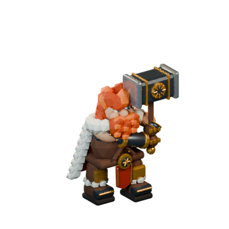
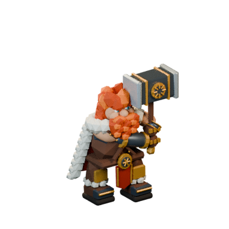
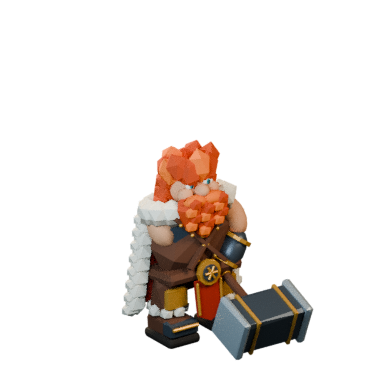

# 변경 전장 카르의 관절별 모델과 재질

2026-11-09 KST, 61회차. 기준 `bc7d2cc`, 소유 브랜치 `codex/arcana-stage-experience-20261106`. main의 배속 저장 수정 `7de64e6`도 `2842c25`로 이어받았다.

컨셉 `art-source/defense/atlases/melee-motion.png`의 붉은 머리·흰 털망토·황동 문양·밝은 망치 타격면을 유지한다. 변경 전장의 직접광에서는 금속이 검게 뭉치고, 작은 영웅 하나에 41개 표면과 20,432개 삼각형이 쓰였다. 원본 실루엣과 접지·타격 시점을 유지하면서 전장 크기에 맞게 실제 메시 구조와 재질을 정리했다.

| 항목 | 이전 | 이번 전장 모델 |
|---|---:|---:|
| 표면 그리기 | 41 | 20 |
| 삼각형 | 20,432 | 9,474 |
| 재질 | 13 | 2 |
| 정상 로딩의 GLB 요청 | 3 | 1 |
| 세 GLB 합계 / 새 GLB | 4,001,552 bytes | 1,189,364 bytes |

원본 208개 편집 파트는 별도 컬렉션에 보존한다. 조밀한 곡면을 단순화하고 13개 관절 표면으로 묶었다. 흰 털, 붉은 머리, 피부, 가죽의 원래 색은 버텍스 컬러로 남겼다. 유기 재질은 roughness 0.83, 금속은 metalness 0.5/roughness 0.4로 전장 조명에서 황동과 밝은 타격면을 읽기 쉽게 조정했다. 발바닥은 단순화에서 제외했다.

`kar-walk`, `kar-slam`, `kar-entry-0..7`의 채널과 키 값은 기존 배포 GLB에서 그대로 가져온다. 뼈대 역할의 rigid node, 손잡이와 타격 소켓 이름을 유지한다. 0.28초 접촉, 고정 방향, 8개 걸음 출발 자세, 돌진 취소 및 피해 규칙은 직전 회차 구현을 사용한다.

`FrontierScene`은 하나의 장면/렌더러에서 새 묶음을 로드한다. 필요한 10개 클립이 없거나 로딩이 실패하면 기존 카르 GLB와 개별 동작으로 복귀한다. 불완전한 묶음은 설치하기 전에 리소스를 해제한다. 모델 작업실의 **카르 · 변경 전장**은 같은 실제 GLB를 회전·와이어프레임·강타 재생으로 확인한다.

## 원본과 재생성

- 편집 파일: `art-source/defense/frontier-kar.blend` — 숨긴 원본 파트, 전장 메시, 보행·강타·8개 진입의 편집 가능한 액션.
- 실제 모델: `public/defense/models/frontier-kar-game.glb`.
- 공통 카메라: `art-source/defense/frontier-kar/{before-walk,walk,stride,prepare,contact}.png`, 384×384, 원본 카메라/지면 기준 유지.
- 베이크: `public/defense/models/frontier-kar-atlas.webp`, 4칸 1536×384, 보행0초/0.2초/진입0의 준비0.19초/접촉0.28초. 이번 캠페인의 2.5D 아틀라스 선택은 변경하지 않는다.
- 작업실 대체 이미지: `frontier-kar-game.png`. GLB를 정지 이미지로 가장하지 않으며, 로딩 실패 때만 이미지로 표시한다.
- 메타데이터/17개 파일 해시: `public/defense/models/frontier-kar.json`.

```sh
npm run models:frontier-kar
npm run models:frontier-kar:check
npm run build
```

Blender 4.3.2와 ffmpeg를 사용한다. 생성기는 원래 walk `.blend`의 형태와 원래 walk/slam/entry GLB의 동작에서 파생한다. 상위 원본의 동작을 수정했다면 먼저 기존 `models:barbarian`, `models:kar-entry` 파이프라인으로 해당 GLB를 다시 생성한다. 생성된 파생 `.blend`를 수동 수정하면 재생성 때 덮어쓰므로 지속할 변경은 생성기/상위 원본에도 반영한다.





## 검증

- 저장한 `.blend`를 다시 열어208개 원본 메시/13개 전장 메시/110개 관절 액션 유지 검사 통과. 17개 해시, 10개 클립의 키 배열 동일, 594개 시점 × 14개 관절의 행렬 오차 0, 양발 바닥 높이 오차 0. 실제 메시 예산 검사 통과.
- 관련 영웅 로직/표현 테스트 12개 통과. 전체 397개 중 396개 통과, 기존 산수 엔진 `(3×7)/5`의 `4` 대 `4.2` 실패 1건은 별도다. TypeScript/Vite 빌드 통과.
- Chromium 실제 UI: PC 1440×900, 터치 844×390/390×844에서 이동, 준비 중 무피해, 접촉 시 25 피해, 일시정지 픽셀 고정, 배속, 동작 줄이기, 돌진 취소/환급, 충격파 통과.
- 새 GLB 차단/불완전한 클립, 기존 진입·강타·보행 파일의 단계별 실패에서도 전투 유지. 작업실 PC/모바일 회전·초기화·와이어·강타·동작 줄이기, GLB→PNG 대체와 둘 다 실패 후 재선택 통과.
- 본체·망치·공격 예고가 실제 3D 벽 뒤에 가려지는 픽셀 검사 통과. 캔버스 1개 유지. 캠페인의 첫 진입 1배속/클리어 재진입 선호 배속과 배속 저장 조작 통과.

같은 고정 카메라/지형/영웅 동작, 844×390 뷰포트(전장 844×242), Chromium SwiftShader에서 1.5초 준비 후 3초씩 측정했다. 다른 브라우저 작업이나 Blender 렌더를 동시에 실행하지 않았다.

| 적 수 | 이전 평균 프레임 | 이번 평균 프레임 |
|---|---:|---:|
| 1 | 86.47 ms | 78.89 ms |
| 10 | 99.91 ms | 88.57 ms |
| 30 | 123.35 ms | 116.93 ms |

장면 draw calls는 공격 예고 유무에 따라 이전74–76/이번53–55, geometry는249→228, texture는3/캔버스는1로 유지됐다. 적30일 때 이번 장면은75,040삼각형(예고 표시 때128개 추가)이다. 짧은 소프트웨어 렌더 측정이므로 모바일 실기기 개선율이나60fps 달성을 뜻하지 않는다. 소프트웨어 환경에서는 여전히 무겁다.

외부 증거 폴더: `/tmp/arcana-hourly-20261109-0534/`의 시작/종료 기록, 원본 대비 공통 카메라 캡처, PC/모바일 전투와 실패 화면, 테스트·성능 로그. 임시 증거가 없는 새 환경에서도 위 명령과 소스/메타데이터로 다시 검증할 수 있다.

## 남은 범위

모바일 가로 화면에서는 넓은 지형에 비해 영웅이 작다. 다음 후보는 모드별 카메라 범위·엄폐물·높낮이 상호작용을 한 단위로 묶는 작업이다. 컨셉의 부드러운 털과 얼굴 표현은 여전히 단순화되어 있다. 모바일 실기기 GPU 성능은 이번 소프트웨어 Chromium 검사로 보증하지 않는다. 캠페인 전체의 실시간 3D 전환이나 전체 모드 개편을 완료한 작업이 아니다.
