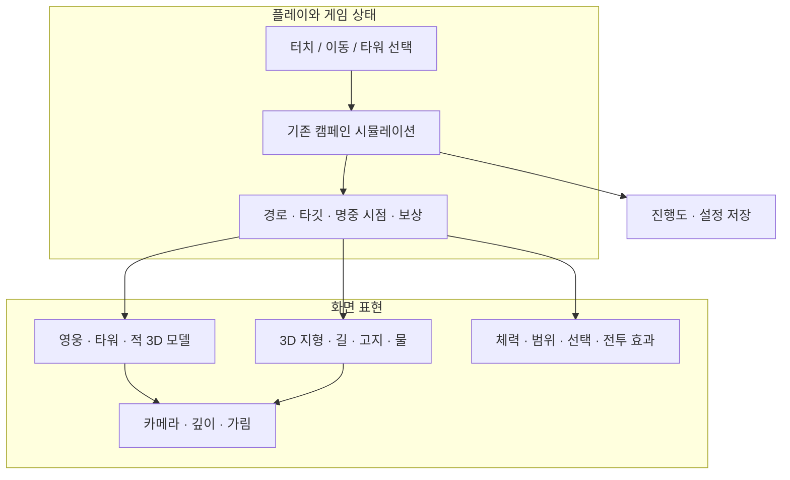
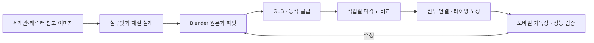

# 아르카나 수비대 전체 구성 계획

**2026-11-12 제작 진척:** 첫 실시간 전투 모델 연결(카르·브론·관통 석궁 Lv2·나무 병사)과 인간 창방패병 작업실 시제품을 만들었다. [현재 구현 범위·검증·다음 순서](arcana-battle-models-20261112.md). 아래 계획과 시각화는 11월 11일의 기준선이다.

2026-11-11 · 현재 작업 공간과 `main` 기준 `b175a9f`, 3D 지형 브랜치 `a6af307` 및 미커밋 작업 기준. 브랜치 현황은 [통합 기준](arcana-project-direction.md), 최근 작업은 [제작 기록](arcana-production-20261111.md)을 따른다. 이 문서는 계획이며 새 규칙이나 콘텐츠의 구현 완료를 뜻하지 않는다. [분야별 기획·개발 척도](arcana-discipline-scorecard-20261111.md) · [시각화 보기](arcana-full-game-plan-20261111.html) · [레이아웃 시안](arcana-full-game-plan-concept-20261111.png). 시안은 AI 생성 예시이며 실제 상태와 내용의 기준은 이 문서와 시각화다.

## 게임의 중심

영웅을 직접 이동하고 타워와 동료의 조합으로 마을을 지키는 모바일 판타지 디펜스. 플레이어는 **어디를 지키고, 무엇을 건설하고, 언제 기술을 쓸지** 고른다. 속성은 전술적 선택을 돕고, 문제 풀이를 진행 조건으로 요구하지 않는다.

## 게임 모드의 관계

현재 제품 중심은 영웅을 지휘하는 기존 **캠페인**이다. 다음 세 가지는 별도 Frontier 프로토타입의 모드이므로 정식 서비스 구성이나 밸런스 확정으로 취급하지 않는다.

| 모드 | 플레이 | 프로토타입 목표 | 제품화할 때 필요한 판단 |
| --- | --- | --- | --- |
| 성문 방어 | 고정 지점에 타워를 건설·강화 | 성문을 지키며 3웨이브 | 캠페인의 영웅 조작과 어떤 관계인지, 난이도와 보상을 분리할지 |
| 변경 지휘 | 영웅과 지원병 3명을 이동하고 타워 건설 | 봉화 점령과 3웨이브 방어 | 분대 조작·체력·경로와 기존 용병 규칙의 관계 |
| 수정 원정 | 영웅 이동·공격·돌진·상호작용 | 적 6처치·수정 3개·출구 | 액션 조작·생존·성장과 기존 캠페인 저장의 관계 |

세 모드의 수치는 **실험 구현값**이다. 세로 지원, 결과와 보상, 해금 조건, 공용 자산과 모드 전환을 별도 검증한 뒤 채택한다. 사용자 선택 전 캠페인 규칙에 혼합하지 않는다.

## 필요한 구성 요소

상태: **구현** = 현재 캠페인에서 동작, **시안** = 브랜치·작업실의 별도 구현, **계획** = 아직 만들거나 결정해야 하는 것.

| 영역 | 현재 자산과 상태 | 게임에 필요한 다음 구성 |
| --- | --- | --- |
| 핵심 루프 | 숲·설산 8스테이지, 거점·편성·전투·보상·성장 **구현** | 진행과 보상이 끊기지 않는 한 판 완성도, 초보/재도전 밸런스 검증 |
| 3D 전장 | 숲·설산 정적 3D 지형 **시안**, 전투 유닛은 스프라이트 | 3D 높낮이·경로·기물·가림과 터치, 지역별 광원·색면·맵 가독성 |
| 영웅 | 6영웅 캠페인 **구현**, 일부 GLB·동작은 작업실/Frontier **시안** | 실시간 모델·재질·무기·리그, 이동·공격·피격·필살기·방향과 발 접지 |
| 타워 | 기본 3종·속성 분기·강화 **구현**, 일부 3D 모델 **시안** | 석궁·마법·포격의 3D 구조, 조준·발사·반동, 단계별 형태와 속성 시인성 |
| 적과 보스 | 일반 적과 숲·설산 보스 **구현**, 일부 3D 모델 **시안** | 종류별 실루엣·재료·이동·공격·피격·사망·보스 예고와 모바일 크기 구분 |
| 전투 엔진 | 이동·웨이브·피해·속성·타깃·투사체·일시정지 **구현**, 애니메이션 시각 매핑 **시안** | 3D 클립의 접촉 시각과 기존 `hitAt` 연결, 3D 가림·충돌을 게임 규칙과 일치 |
| 성장·저장 | 캠페인·영웅·보상·테마 로컬 저장 **구현** | 모드별 보상 경계·마이그레이션·장애 복구 검증. 클라우드 저장은 계획/미구현 |
| UX·오디오 | 전투 HUD·터치·대체 경로·기존 효과음 **구현** | 휴대폰 글자·버튼·가림 검토, 스킬·속성·보스 예고별 음향 체계 |
| 세계관·미술 | 4가지 거점 테마와 숲·설산, 극지·열대 등 참조 시안 | 지역 문화·소재·기후와 무기 언어를 통일. 신규 지역·보스 설정은 **후보** |
| 모바일 운영 | 웹·모바일 빌드와 자동 테스트 **구현** | 실제 Android 기기 성능·발열·복귀·저장·접근성. iOS 지원은 별도 확인 |
| 제작 도구 | Blender·GLB 작업실, Fable 이미지 검토 도구 **구현/시안** | 참조·라이선스·원본·버전·비용·승인 기록과 재생성 절차 |

## 3D 전장의 구성

게임 엔진이 피해와 명중의 기준이다. 애니메이션은 엔진의 시간과 사건을 따라간다. 현재 60도 **부감 정사영**과 Frontier의 시야각 42도 **투시**는 서로 다른 종류의 수치다. 가림, 적 식별, 터치, 방향 전환을 비교하기 전 최종 카메라로 확정하지 않는다.

## 이미지와 자산 제작 흐름

- 캐릭터 고유의 얼굴·의상·문화·무기는 직접 관리한다. 카르 망치 시안의 편집용 메시와 런타임 메시 차이는 채택 전 정렬한다.
- Fable 5.2 `high`는 실제 렌더 한 장에 대해 좁은 디테일 검토를 돕는다. 답변은 시각적 제안이며 실제 모델을 제작하거나 모바일 성능을 검증하지 않는다. 비용·사용량은 계정에서 확인한다.
- Patch.gg는 **선택적 외부 후보**다. 공개 API에서 모델 검색과 라이선스 정보를 확인했지만 다운로드·적용은 미검증이다. 나무·바위·성벽 등 후보를 하나씩 검토하고 출처·라이선스·크기·삼각형·재질·화풍·실기기 성능을 기록한다. 기존 캐릭터·포탑의 정체성을 자동 교체하지 않는다. Patch MCP는 현재 미연결이며 외부 제작 서비스가 게임 구동의 필수 의존성이 되지 않게 한다.

## 작업 순서와 완료 기준

숫자는 **우선순위**이며 일정 약속이 아니다. 한 단계의 최소 기준이 충족되면 다음 범위로 확장한다.

| 단계 | 산출물 | 다음 단계로 넘어갈 기준 |
| --- | --- | --- |
| 1. 기준 고정 | 기존 브랜치·로컬 원본 보존, 제품과 실험 경계·규칙 차이 정리 | 자산 출처 확인, 저장·승패와 기존 2D 맵 폐기 방향이 모순 없이 기록됨 |
| 2. 한 판의 3D 검증 | 숲 1스테이지, 영웅 1명·타워 1종·적 1종의 실시간 3D 연결 | 동일 엔진 입력·명중·사거리·웨이브·일시정지·보상 유지, 클립 접촉·발 접지·가림 확인, 실제 화면에서 판별 가능 |
| 3. 캠페인 확장 | 영웅·타워 분기·적·보스와 숲·설산 지형의 순차 연결 | 8스테이지 해금과 저장 유지, 속성·보스·결과 회귀 검증, 개체 수와 성능 측정 |
| 4. 제품 완성도 | HUD·사운드·튜토리얼·거점·옵션·복구 보완 | 모바일 조작·실수 복구·난이도 실사용 검증, 배터리·발열·FPS·메모리 기록 |
| 5. 모드 확장 | 성문 방어·변경 지휘·수정 원정의 선택된 제품화 | 각 모드 목적·조작·보상·저장 경계 결정, 캠페인과 분리 회귀 테스트. 채택 여부 미확정 |

단계 2의 권장 첫 조합은 카르·발리스타·나무 병사다. 이들은 소스가 이미 있지만 각 모델이 기존 캠페인에서 자동으로 해금되는 것은 아니다. 재현 테스트는 해금된 저장 상태 또는 개발 전용 실험 장면으로 진행하며 정상 플레이의 해금 규칙을 바꾸지 않는다.

## 병렬 작업과 합류 지점

| 작업 묶음 | 병렬 작업 | 합류에 필요한 근거 |
| --- | --- | --- |
| 아트 | 영웅·타워·적 모델 정리, 지역별 재질 시안 | 모델명/버전, 피벗, 크기, 클립명, 재생성 방법, 전후 이미지 |
| 전장·카메라 | 경로·고도·가림과 화면 각도 실험 | 좌표 변환·터치·사거리·카메라별 캡처 |
| 전투·저장 | 기존 엔진/애니메이션 계약, 정지·상태 전환 및 진행 보존 | 명중·동결·취소·보상·저장 테스트 |
| UX·모바일 | 터치·폰트·HUD·기기 성능, 폴백 | 작은 화면 시연과 실기기 측정 기록 |
| 운영 | API 호출 원장·비용, Patch 에셋/라이선스, 원본 백업 | 호출 결과와 사용량, 자산별 출처·라이선스·저장 위치 |

## 결정이 필요한 항목

- 화면 방향은 양쪽 지원을 유지 중이나 과거 문서에 가로 전용 요청도 기록되어 있다. 기기 테스트와 사용자 선택 전 기능을 제거하지 않는다.
- 고목왕의 보라 균열·수호자/폭군 해석은 자료 사이에 충돌하므로 확정하지 않는다.
- Frontier 세 모드의 정식 채택, 캠페인과의 해금·보상·저장 연동은 미정이다.
- 보스 돌파 즉시 패배 및 첫 클리어 보상 통일은 [규칙 문서](arcana-game-rules-v1.md)의 변경 제안이며 현재 엔진 구현으로 표시하지 않는다.
