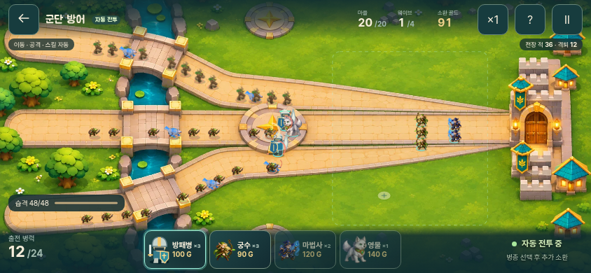

# 군단 방어 · 플레이 가능한 첫 모드

2026-11-11. 마을 상단의 **군단 방어** 버튼으로 입장한다. 배치·소환만 입력하며 아군 이동·대상 선택·공격·스킬과 적의 반격은 자동으로 처리한다. 클래식 원정은 기존 진입과 규칙을 유지한다.

위 화면은 통합 전 `main`의 기록이다. 통합 브랜치에서는 사용자가 요청한 전투 UI와 가로 화면 기준을 적용하고, [서리늑대 보행을 기존 모델에 연결](wolf-gait-integration.md)했다.

[군단 서리늑대의 방향 보행](wolf-directional-path.md)은 기존 3D 보행·피격 베이크를 실제 세 경로의 방향과 거리로 연결한다.

[방패병 정면 방어와 혼합 편성 시험](shield-guard-balance.md)은 자동 전투의 전열 역할을 개선하고 남은 궁수 집중 문제를 기록한다.

[방패병 접지 보행](shield-walk.md)은 기존 강타 피해 시점을 유지하며 실제 이동 거리와 여덟 자세를 연결한다.

[군단 방패병](shield-model.md)은 별도 3D 원본을 제작하고 같은 카메라에서 베이크한 대기·강타·복귀를 카드와 전투에 연결했다.

## 구현한 플레이 규칙

- 소환 골드600, 병력 상한24로 시작한다. 병종을 고르고 청록색 구역을 누르면 부대가 소환된다. 준비·정비 중에는 부대를 눌러 개별 회수할 수 있다. 회수 금액은 병종 비용/인원 수의 내림값이다.
- 방패병100G/3명, 궁수90G/3명, 마법사120G/2명, 영물140G/1체. 병력 상한과 골드는 엔진에서 확인하며 이동 중 부대의 원래 배치 자리도 예약한다.
- 방패병은 가까운 적과 교전하며 자신이 바라보는 정면의 공격 피해 70%를 차단하고 방패 강타, 궁수는 자동 연속 사격, 마법사는 화염 범위 공격, 영물은 충격·둔화를 사용한다. 영물은 기존 늑대 이미지를 우선 사용한다.
- 세 진입로에서 48·60·78·96마리의 적이 들어온다. 동시 적 상한80에 닿으면 남은 출현을 대기시킨다. 예약된 적을 생략하지 않는다.
- 아군도 체력과 사망 판정이 있다. 적 처치 시 소환 골드를 얻는다. 웨이브 사이 생존 병력 체력35% 회복·120G 보급 후 원래 위치로 복귀한다. 재편성 뒤 다음 습격을 시작한다.
- 마을HP20, 일반 적 돌파 시1 감소. 보스 돌파 또는 마을HP0이면 패배. 네 번째 웨이브의 보스를 포함해 모든 적을 처리하면 승리한다.
- 재도전·마을 복귀·최고 격퇴 기록 저장을 지원한다. 기록 키는 `arcana.legion.best.v1`이다. 진행 중 전투 이어하기는 아직 없으며, 군단의 소환 골드는 클래식 성장 골드와 분리된다. 군단 전투로 클래식 스테이지·동료가 해금되지는 않는다.

## 전장과 모바일 화면

승인된 가로 하이앵글 방향을 적용했다. 새 배경은 실제 세 진입로·다리·성문 좌표를 안내 이미지로 제공해 생성했으며, UI·유닛·투사체가 없는 지형 자산이다. 부대·몬스터·체력·투사체·파쇄·연소·분해는 Canvas2D가 실제 상태로 그린다. 실시간 3D 엔진으로 전환한 것은 아니다.

- 가로 모바일: 화면 전체에 전장을 두고 조작 버튼과 소환 카드를 가장자리에 배치한다. 상시 체력·웨이브·골드·개체 체력 막대는 숨긴다. 넓은 화면에서는 장식 여백만 잘라 세 경로를 보존한다.
- 세로 회전 시 전투를 일시정지하고 가로 회전 안내를 표시한다. 가로로 돌아온 뒤 직접 재개한다. 키보드는 전장에 포커스 후 방향키·Enter로 배치한다.
- 배경 로드 실패 시 절차적 지형, 아틀라스 실패 시 단순 유닛 형태로 대체한다. 지형·이미지 캐시, DPR 최대2, 전투 상태30Hz 게시, 효과 최대96개를 사용한다.
- pause·도움말·브라우저 숨김·앱 백그라운드·화면 회전 시 전투를 멈춘다. 자동 복귀 재생 대신 계속하기로 재개한다. 동작 줄이기 설정에서는 흔들림과 장식 파편을 줄인다.

[배치 화면](screenshots/deployment-844.png) · [세로 정비 화면](screenshots/intermission-390.png) · [지형 원본 출처](../../art-source/defense/legion/manifest.json)

## 검증

- 전체 자동 테스트183개 통과, 그중 군단 엔진13개. 경계·비정상 좌표·병력 상한·회수·중복 보상·복귀 자리 예약·출현 대기·승패·효과 종료·4웨이브 완주·약한 편성 패배 포함.
- 결정적 시뮬레이션: 혼합12인 출발과 웨이브 사이 보충으로 182.10초, HP20,282처치,생존16,최대 동시 적70. 이는 해당 편성의 엔진 측정이며 실제 폰 FPS 결과가 아니다.
- Chromium844×390: 실제 병종 선택·좌표 배치, 대규모 출현, pause·백그라운드·도움말 정지,2배속,첫 웨이브48처치,재도전,마을 복귀,기존 캠페인 저장 불변 확인.390×844 가로 넘침 없음과 동작 줄이기 확인.
- 배포용 모바일 빌드에서도 실제 카드·전장 클릭만으로 4웨이브 승리·282처치·최고 기록 저장·재도전 초기화·새로고침 후 기록 유지를 확인했다. PNG/WebP49개 요청을 차단한 새 페이지에서도 대체 지형·유닛으로 배치와 자동 전투가 진행되고 브라우저 예외가 없었다. [실제 결과 화면](screenshots/result-production.png).
- Web/모바일 TypeScript·Vite 빌드, Android `assembleDebug`·`lintDebug` 통과. APK 내부에 군단 코드와 전장 이미지를 포함하며 개발 서버 없이 실행하는 패키지다. Android 실기기 발열·배터리·최저사양 성능은 아직 측정하지 않았다.
- Claude Fable 공식 API 검토에서 배치 실패 안내·복귀 자리 중첩·마지막 효과 게시 문제를 발견하고 수정했다. [완결 후속 검토](review/claude-followup.md)와 [영수증](review/receipt.json). 초기 긴 검토는 출력 제한으로 잘렸으며 후속 검토는 `end_turn`으로 완료했다. Claude는 제공 코드 검토만 수행했고 실행 검증은 별도다.

## 후속 확장 경계

현재 맵1개·병종4개·4웨이브를 실제 플레이할 수 있다. 별도 병영 건설·자동 생산 건물, 영웅별 전직, 군단 전용 영구 성장, 테마 맵 추가는 후속 범위다. 조작형 원정 콘셉트는 이번 군단 모드와 별개이며 아직 추가하지 않았다.
