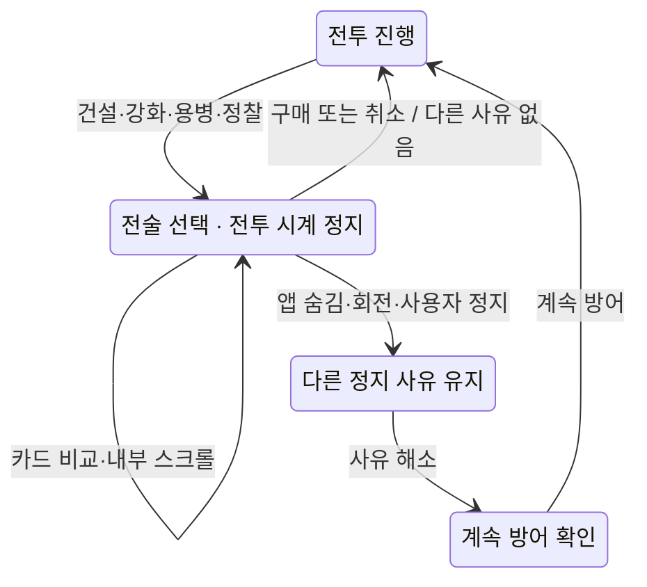

# 아르카나 수비대 모바일 레이아웃·사용 방식 심화 기획

2026-10-29 (KST) · 모바일 기획 및 P0 구현 현황. 카메라·실기기 평가 등 미완료 항목은 아래 구현 상태와 구분한다.

## 현재 구현 상태 · KR2/KRVIDEO 후속 작업

사용자가 KR2와 KRVIDEO 사용으로 전환한 뒤, 두 바인딩으로 Claude Opus 4.6의 사전 검토와 구현 후 검토를 받았다. KR2는 코드·게임 흐름, KRVIDEO는 실제 스크린샷·조작 배치를 검토했다. 키는 클라이언트에 포함하지 않았다.

- **구현:** 전투 전용 화면, 거점 하단 고정 출전, 두 마을 HUD, 세로 두 줄 조작부, 짧은 가로의 전술 메뉴, 선택할 때만 열리는 건설·강화·고용·정찰 패널.
- **구현:** 독립적인 정지 사유, 앱 중단·회전 뒤 복귀 확인, 정지 중 원자적 구매, 판매 확인, 코인 부족 표시, 강화 중복 탭 차단.
- **구현:** 48px 건설 지점 판정·겹침 후보 선택, 돌진 우선 입력, 드래그·pointercancel·좌표 변경 취소. 모달에서 배경은 inert로 차단한다.
- **구현:** 글꼴 확대 시 보조 설명을 접는 배치. 200% 글꼴에서 320×568 지도304×202.7, 568×320 지도328×218.7을 유지했다. 이 값은 Chromium CSS px 측정이며 실제 폰 평가가 아니다.
- **검증:** 90개 자동 테스트, 5개 뷰포트 화면·건설 스모크, 21개 통합 조작 확인, 보드 입력 13개 브라우저 시나리오. 상세 기록은 아래 검증 자료를 참조한다.
- **남은 범위:** 실제 iOS/Android의 엄지 도달·발열·safe-area 평가, 확대/패닝/미니맵, 이벤트 기반 첫 원정 안내, 중간 전투 저장. 브라우저의 이전 페이지 이동은 별도 게임 내 뒤로 동작으로 바꾸지 않았다.

원본 그림과 3:2 지도를 유지했다. 생성한 레이아웃 참고 이미지에서 변형된 지형·경로·크기 비율은 실제 게임 규칙을 우선해 사용하지 않았다. HUD의 실제 높이는44px 버튼과 여백을 포함해 기본 가로53px, 세로49px이며 아래 설계 예산의44/48px과 구분한다. 세로 액션 사이 간격은12px, 가로 시트는최대300px로 실제 글자·비용을 수용했다.

KR2가 제안한 돌진 조준 정지와 KRVIDEO의320px 버튼 열 수 해석은 채택하지 않았다. 돌진 조준은 의도대로 전투를 계속하며, 전술 패널을 열면 조준이 취소된다. 최종 코드 검토에서 `active=false` 모달 처리가 미사용이라는 답변도 실제 시스템 복귀 경로와 브라우저 증거로 배제했다. 두 모델의 평가는 독립적인 인간 사용성 시험을 대신하지 않는다.

[검증 요약·시연 자료](../../.cloud-setup/evidence/arcana-mobile-prototype/qa-summary.md) · [조작 검증](../../.cloud-setup/evidence/arcana-mobile-prototype/interaction-qa.json)

## 1. 결정

**거점은 세로 중심, 전투는 가로 권장, 세로에서도 같은 규칙으로 완주할 수 있게 만든다.** 전투에 들어가면 허브 내비게이션과 긴 설명을 걷어내고, 전장·두 마을 상태·필살기·돌진·건설 판단만 남긴다.

- **거점: 한 손으로 준비.** 다음 구조 요청 확인 → 영웅 선택 → 난이도 선택 → 원정 준비. 출발 버튼은 화면 하단에 고정한다.
- **전투: 두 손 사용을 권장.** 양쪽 엄지로 명령 버튼을 누르고, 전장의 목적지를 탭한다. 자동 공격은 유지하며 조이스틱을 의무화하지 않는다.
- **판단할 때 정지, 실행할 때 액션.** 건설·강화·용병·정찰 패널은 전술 정지. 이동·돌진·필살기는 진행 중인 전투에서 사용한다.
- **강제 회전 없음.** 첫 출전에서 가로 권장 안내를 한 번 보여주되, 세로로 계속하기를 같은 화면에서 제공한다. 거점도 가로 상태로 이용할 수 있다.
- **1차는 전체 지도를 유지한다.** 확대 카메라·패닝·미니맵은 별도 2차 작업이다. 캐릭터를 크게 보여주기 위해 진입로나 마을을 몰래 잘라내지 않는다.

게임성·오락성 → 그래픽 → 최소한의 교육이라는 우선순위를 유지한다. 속성 아이콘과 약점 안내는 전투 판단을 돕는 선택 정보이며 퀴즈 화면을 추가하지 않는다.

## 2. 이번 검토의 근거와 한계

현재 빌드를 새로 열어 390×844, 844×390, 320×740의 실제 화면을 캡처했다. 7개 스테이지를 클리어한 저장 fixture로 숲 1-4 재도전을 선택했고, 건설·전투·정찰·용병은 정상 UI 명령으로 조작했다. 실제 폰의 엄지 가림·발열·회전 동작을 측정한 결과는 아니다.

| 단계 | 현재 화면의 상태 | 기획에 반영할 변경 |
|---|---|---|
| 1. 거점 첫 화면 | 분위기와 성장 표현은 좋다. 출발 버튼 y=916으로 844px 화면 밖에 있다. | 마을 그림은 유지하고 출전 요약·버튼을 하단 고정 |
| 2. 원정 선택 | 출발·지역·대장간·영웅이 긴 페이지에 나뉜다. 문서 높이 1,794px. | 지역 → 영웅 → 난이도 → 출발 순서로 정리 |
| 3. 전투 준비 | 지도 350×233px. 높이 기준 화면의 약 28%. 허브·제목이 상단을 차지한다. | 전투 전용 화면, 짧은 HUD, 전장 주변 장식·설명 축소 |
| 4. 건설 지점 선택 | 건설 패널 184px가 선택 전부터 상시 노출된다. | 지점 선택 시에만 건설 패널 표시 |
| 5. 전투 중 정찰 | 펼친 내용이 강화·시작 영역을 덮고 전투는 계속된다. | 전술 정지 상태의 정찰 시트로 통합 |
| 6. 용병 선택 | 전투를 멈추는 구조는 적절하다. 코인 부족 행의 대비가 약하다. | 정지 복원 규칙 유지, 부족한 금액·상태를 명확히 표시 |
| 7. 가로 전환 | 지도 y=201, 높이296으로 아래가 잘린다. 시작 버튼 y=595. 액션은 사이드바 아래로 밀린다. | 폭 기준 데스크톱 분기와 분리한 모바일 가로 전용 배치 |
| 8. 320px 전투 | 지도 290×193. 분기 설명이 작고 시작 버튼 하단이 769px로 740px 밖이다. | 고정 조작 영역, 48px 목표 터치 크기, 시트 내부 스크롤 |

7번은 '조작 버튼이 완전히 없다'는 뜻이 아니다. 현재 사이드바를 스크롤하면 접근할 수 있지만, 전투를 보며 즉시 사용하기 어렵다는 문제다. 이전 검증에서 준비 단계 버튼이 화면에 들어왔더라도, 분기 선택 상태에서는 높이가 달라진다는 점도 확인했다.

증거: [이번 캡처와 측정값](../../.cloud-setup/evidence/arcana-mobile-planning/audit-capture.json).

### 검토에 사용한 실제 화면

| 거점 · 단계1 | 준비 · 단계3 |
|---|---|
|  |  |


## 3. 화면 구성

### 거점: 출전 준비를 한 흐름으로

```text
┌──────────────────────┐
│ 뒤로   아르카나   성장 G │  간결한 상단
│                      │
│   살아 있는 거점 그림   │  방문자·시설 성장 표현
│                      │
│ 다음 구조 요청 / 지역   │  이야기 1줄 + 펼치기
│ 출전 영웅 / 장비 상태   │  상세는 선택 시 열기
│ 원정 난이도            │  세 옵션 + 차이 1줄
│ …시설·동료 목록…       │  이 영역만 스크롤
├──────────────────────┤
│ 영웅 · 지역 · 난이도    │  선택 요약
│       원정 준비        │  고정 버튼 56px
└──────────────────────┘
```

거점 그림 자체를 작은 버튼으로 가득 채우지 않는다. 건물을 누르는 방식과 별도로 `동료`·`장비`·`지역` 목록에서도 같은 기능에 접근한다. 성장 골드는 거점과 결과 화면에, 전투 코인은 전투 HUD에 보여준다.

하단 고정 영역은 safe-area를 포함하고, 마지막 콘텐츠가 버튼 아래에 숨지 않도록 같은 높이의 여백을 둔다. 스크롤 도중에도 선택 영웅·지역·난이도를 확인하고 출발할 수 있어야 한다. 구매나 강화를 출발의 필수 절차로 만들지 않는다.

### 가로 전투: 전장과 엄지 조작 영역 분리

```text
┌───────────────────────────────────────────┐
│ 마을20  외곽12  전투코인  웨이브3/4    일시정지 │
├───────┬───────────────────────────┬───────┤
│ 영웅   │                           │ 돌진   │
│ 용병   │  전체 전장 · 두 진입로      │       │
│ 정찰   │  건설 지점 · 영웅 · 보스     │ 필살기 │
│ 배속   │                           │       │
│ 다음 W │                           │       │
└───────┴───────────────────────────┴───────┘
```

목표 배치는 **왼쪽: 준비·상황 판단, 오른쪽: 즉시 액션**이다. 오른쪽 하단에 필살기 72px, 그 위에 돌진 56px. 용병·정찰·일시정지·배속은 최소44px, 가능하면48px로 만든다. 양손잡이 배치 선택은 2차 편의 기능으로 둔다.

844×390 예시에서 좌우 safe-area를24px씩, 하단16px, 상단0으로 **가정**하면:

| 영역 | CSS px 예산 |
|---|---:|
| 실제 UI 폭 | 796 |
| 상단 HUD | 높이44 |
| 본문 높이 | 330 |
| 왼쪽 조작 / 간격 / 중앙 / 간격 / 오른쪽 조작 | 112 / 8 / 556 / 8 / 112 |
| 900×600 지도의 실제 표시 크기 | **495×330** |
| 영웅84 / 일반 적68의 화면 크기 기준 | 약46.2 / 37.4 |

safe-area 값은 기기별 실측값을 사용한다. 화면에 표시한 CSS px를 물리적인 mm로 단정하지 않는다. 캐릭터 수치는 기본 스프라이트 크기에 따른 명목값이며 실제 외형은 포즈·프레임 비율·추가 배율에 따라 달라진다. 본문 중앙에 남는 가로 공간은 여백이며, 지도를 억지로 늘리지 않는다.

### 세로 전투: 동일 규칙의 대체 조작

```text
┌──────────────────────┐
│ 마을·외곽·코인·웨이브 ⏸ │
│                      │
│   전체 지도 / 선택 표시 │  1차: 전체 지도 유지
│                      │
│ 위협 알림 / 선택 요약   │  필요할 때만 노출
│                      │
├──────────────────────┤
│ 용병  정찰  배속 / 다음W │
│       필살기      돌진  │  하단 고정 엄지 영역
└──────────────────────┘
```

HUD48px, 하단 조작112px를 기본으로 한다. 하단은 `위 여백4 + 보조 버튼48 + 행 간격8 + 액션 버튼48 + 아래 여백4`이고, safe-area는 별도로 더한다. 이전88px 제안은 두 줄의48px 버튼을 담지 못하므로 수정했다. 390폭에서는 좌우8px 여백의 지도374×249.3, 영웅 약34.9px, 일반 적 약28.3px다. 320폭의 지도304×202.7에서는 영웅 약28.4px, 일반 적 약23px다. 전투 버튼과 건설 지점의 터치 판정은 그림 크기와 별도로 최소44px, 목표48px를 확보한다.

세로 첫 줄은 `용병 / 정찰 / 배속 / 다음 웨이브` 네 칸, 둘째 줄은 `필살기 / 돌진` 두 칸으로 한다. 320폭의 내부304px에서8px 간격을 빼면 각각70px,148px 폭이다. 잠긴 기능이나 전투 중 사용할 수 없는 다음 웨이브는 자리 이동 없이 상태를 표시한다. 세로 필살기 버튼은48px 높이의 넓은 버튼이며, 가로의72px 원형 배치와 구분한다.

**전장 영역의 높이를 늘려도 3:2 지도 전체를 넣는 한 캐릭터가 커지지는 않는다.** 남는 공간은 선택 정보·위협 알림과 손가락 여백으로 사용한다. '화면의70%를 전장으로 바꾸면 해결된다'는 목표는 사용하지 않는다. 1차 세로 모드는 조작성 개선이 중심이고, 그래픽 확대에는 아래의 카메라 작업이 필요하다.

HUD에는 마을·외곽 **두 개의 수치**를 표시한다. 20+12개의 하트 아이콘을 배치하지 않는다. 320폭에서는 `마을20 / 외곽12 / 코인 / 3/4 / 일시정지`를 짧게 표시하고 배속은 하단으로 옮긴다. 확대 글꼴에서 한 줄로 수용되지 않으면 HUD가 두 줄로 확장되고 나머지 영역이 재배치되게 한다.

### 작은 화면에서의 축약 순서

320×568에서 기본 높이 합계는 `HUD48 + 지도 위아래 간격16 + 지도202.7 + 조작112 = 378.7px`이다. 남는189.3px은 안전영역을 아직 빼지 않은 계산값이다. 이를 모두 장식이나 큰 캐릭터 그림으로 채우지 않는다.

- 우선 실제 `safe-area-inset-*`와 현재 가시 뷰포트를 적용한다. 안전영역에 임의의 최대50px 같은 상한을 두지 않는다.
- 기본 글꼴의 위협·선택 요약은 각각32px까지, 합계64px를 배정한다. 남은 공간은 빈 여백으로 둔다. 긴 설명은 정찰·선택 시트에서 읽는다.
- 글꼴 확대에서는 실제 HUD·버튼 높이를 다시 측정한다. 정보 공간이 부족하면 선택 요약을 먼저 시트로 옮기고, 위험은 HUD의 아이콘·짧은 상태로 유지한다. 글자를 잘라 읽을 수 없게 만들지 않는다.
- 그래도 맞지 않으면 지도는 남은 영역에 contain으로 축소하고 전술 메뉴 안의 정보만 스크롤한다. 버튼을44px 미만으로 줄이거나 필살기를 페이지 아래로 밀지 않는다. 이 조건에서 유닛 식별이 어려우면 접근성 검증 실패로 기록하고 확대 카메라의 우선순위를 올린다.

가로568×320처럼 짧거나 본문 높이280px 미만이면 **간소화 배치**를 쓴다. 일반 가로 왼쪽의5행은 `5×48 + 4×8 + 상하8 = 280px`이 필요하다. 간소화 배치에서는 양쪽 레일을64px로 바꾸고, 왼쪽은 `전술 / 배속 / 다음 웨이브`만 둔다. 영웅 상세·용병·정찰은 전술 메뉴로 옮긴다. 건설·강화는 여전히 지도 지점을 직접 눌러 연다. 오른쪽 필살기64px·돌진56px, HUD 일시정지는 바로 접근할 수 있게 유지한다.

568×320에서 좌우 안전영역24px씩·하단16px·HUD44px를 가정하면 본문260px, 중앙376px, 지도376×250.7px다. 이는 산술 예시이며 실기기 측정값이 아니다. 넓어도 높이가 부족하면 간소화하고, 폭이 좁아도 높이가 충분하면 실제 콘텐츠 폭을 함께 검사한다. 글꼴 확대로 메뉴가 높아지면 메뉴 내부만 스크롤한다.

산술 근거: [화면 예산과 건설 지점 겹침 계산](../../.cloud-setup/evidence/arcana-mobile-planning/layout-budget-check.json).

## 4. 확대 카메라의 범위

| 단계 | 동작 | 이유 |
|---|---|---|
| 1차 | 전체 지도를 항상 보이는 contain 배치. 지점 선택 시 큰 타워 미리보기와 정보 카드 | 두 진입로·마을 시야와 기존 조작을 보존 |
| 2차 | 사용자가 `확대`를 선택하면 전체 보기 대비1.5~1.8배. 한 손가락 드래그로 화면 이동. `전체 보기` 한 번으로 복귀 | 세로에서 캐릭터를 더 크게 보기 |
| 2차 필수 동반 | 전체 지도 표시, 화면 밖 위협의 방향·종류·개수, 두 마을 HP 상시 표시 | 확대 때문에 사라진 정보를 보완 |
| 이후 검토 | 핀치줌·사용자 지정 버튼 배치 | 입력 충돌을 먼저 해결한 뒤 추가 |

390폭의1.5배 확대에서는 가로 약600월드 단위, 1.8배에서는 약500월드 단위만 보인다. 원래900 중 일부가 화면 밖으로 나가므로 시야가 같다고 설명하면 안 된다. 영웅 자동 추적·보스 등장 시 강제 카메라 점프는 사용하지 않는다. 탭하려던 좌표가 움직이는 것을 피한다.

맵을 가로/세로에 맞춰 늘이기, 일부 진입로를 기본 crop으로 숨기기, 세로에서만 조이스틱을 강제하기, 새 세로 전용 맵을 즉시 병행 제작하기는 1차 범위에서 제외한다.

## 5. 건설·강화·용병·정찰 패널

| 상황 | 열리는 내용 | 크기·처리 |
|---|---|---|
| 빈 지점 탭 | 타워3종, 비용, 역할 한 줄 | 세로 하단 시트 최대280px. 작은 화면은 가용 높이의50% 이하, 내용 내부 스크롤 |
| 기존 타워 탭 | 현재 타워·레벨·사거리, 분기2종 또는 최종 강화 | 큰 분기 미리보기, 짧은 차이 설명. 선택 카드에 실제 비용 표시 |
| 용병 버튼 | 영웅 목록, 가격, 역할, 보유 코인 | 긴 명단은 시트 안에서만 스크롤. 부족 시 `63코인 부족`처럼 구체적으로 안내 |
| 정찰 버튼 | 이번/다음 웨이브 적 수, 보스, 약점 | 펼친 패널이 전투를 진행시키면서 버튼을 덮지 않게 전술 정지 |
| 판매 | 반환액, 선택된 타워 확인 | 별도 작은 확인 영역. 강화 카드 옆에 동일한 크기의 판매 버튼을 두지 않음 |

세로 시트는 평소 조작 영역을 대체하며 버튼 위에 중첩하지 않는다. 320폭에서도 타워3개 카드는 각각 약88px 폭을 확보할 수 있다. 제목과 비용은 읽히게 두고 긴 설명은 상세로 옮긴다.

가로 시트는 폭272px 내외의 측면 패널이다. 선택 지점의 반대쪽에 열어 지점을 최대한 남긴다. 그래도 가려지면 패널의 선택 카드에 지점 번호·지형·외형·현재 강화를 보여준다. 자동 카메라 이동은 하지 않는다.

패널에서 가격이 쓰인 건설·강화 카드를 누르면 한 번만 지출하고 패널을 닫는다. 실수 방지는 적절한 간격과 명확한 대상 표시로 해결하며, 모든 건설에 별도 확인 대화상자를 붙이지 않는다. 취소는 비용을 쓰지 않는다.

## 6. 입력 규칙

| 상태·입력 | 처리 |
|---|---|
| 일반 상태에서 땅·도로·적 그림 탭 | 해당 위치로 영웅 이동. 적을 직접 지정해 공격하는 기능은 추가하지 않음 |
| 일반 상태에서 건설 지점·타워 탭 | 해당 지점의 전술 패널 열기. 이동 명령은 발생하지 않음 |
| 필살기 버튼 | 기존처럼 즉시 전체 적 피해·해당 보스 시전 차단. 새 조준 단계 없음 |
| 돌진 버튼 | 조준 상태 진입. 버튼을 `취소`로 바꾸고 최대 거리와 목표 안내 표시 |
| 돌진 조준 상태에서 전장 탭 | 타워/몬스터 정보보다 목적지 선택 우선. 유효한 목표를 확정한 뒤에만 재사용 시간 소비 |
| 돌진 취소 | 같은 버튼·명시적 취소·뒤로가기·화면 회전·pointercancel. 이동·재사용 시간 소비 없음 |
| 조준 상태에서 오랫동안 기다림 | 자동 취소 타이머 없음. 전투는 계속됨을 상태 문구로 표시 |
| 전술 패널 내부 드래그 | 패널 스크롤만. 배경 전장에 이동·돌진 명령을 전달하지 않음 |
| 회전·앱 이탈·프로필 열림 | 전투 정지, 진행 중 입력 취소. 돌아온 뒤 명시적으로 재개 |
| 2차 확대 상태에서 한 손가락 드래그 | 약8CSS px 이동을 넘으면 카메라 패닝. 손을 떼도 이동 탭이 뒤따라 발생하지 않음 |
| 추후 두 손가락 입력 | 기존 한 손가락 명령 취소 후 줌으로 분리. 손가락 하나가 남았다고 탭으로 해석하지 않음 |

8px 경계는 초기 가설이며 실제 터치 테스트로 조정한다. 유닛 정보는 정찰에서 볼 수 있고, 모바일 전장 탭을 정보 팝업이 계속 가로채지 않게 한다. 조준 상태에서 긴 누르기 등 숨은 예외 입력을 추가하지 않는다. 공격은 계속 자동이며 영웅 체력·사망 규칙도 새로 넣지 않는다.

### 터치 영역이 겹칠 때

현재 좌표에 중심48×48px 사각 터치 영역을 대입하면, 지도 폭304px에서 숲의3·4번 지점은 약7.47×4.09px, 설원의3·7번 지점은 약32.8×2.4px 겹친다. 여기의 지점 번호는 UI 표기이며 코드 ID보다1 크다. 실제 기존 CSS를 측정한 값이 아니라 **신규 터치 영역을 적용했을 때의 계산**이다. 지점별 DOM 순서로 어느 하나를 임의 선택하면 안 된다.

입력 우선순위는 `복귀·전직·결과 대화상자 → HUD·시트 → 돌진 조준의 전장 탭 → 건설 지점 → 일반 이동`이다. 그림에 대한 터치와 UI 버튼에 대한 터치를 분리한다. 일반 상태의 탭 좌표가 두 개 이상의 지점 영역에 들어오면 전술 정지 후 해당 후보만48px 이상 행으로 보여준다. 지점 번호·지형·타워 종류를 함께 표시하고 후보 선택 자체에는 코인을 쓰지 않는다. 지점 영역 바깥의 땅 탭은 그대로 이동이다.

돌진 조준에서는 후보 선택창을 열지 않는다. 대신 버튼을 `돌진 취소`로 바꾸고 목표 링·최대 거리·`전장을 탭하면 돌진` 문구를 유지한다. 이 상태에서 타워를 탭하면 돌진한다는 규칙을 시각적으로 알려준다. 음영은 약하게 쓰고 두 마을·적·보스 예고를 가리지 않는다. 회전·뷰포트 크기 변경 시 기존 포인터 좌표는 폐기하고, 새 좌표 변환이 준비된 다음의 새 pointerdown부터 받는다.

## 7. 전술 정지와 보상 공정성

건설·강화·용병·정찰을 열면 **모든 난이도에서 전투 시계가 멈춘다.** 이미 수동 일시정지가 가능한 게임이므로, 모바일에서 글을 읽거나 작은 메뉴를 고르는 것에 추가 불이익을 주지 않는다. 정예 난이도는 적 편성·속도·자원 압박으로 구분한다.

- 정지 중에는 적 이동, 공격 준비, 투사체, 보스 시전, 스킬·돌진 재사용 시간이 모두 멈춘다.
- 허용된 구매·강화만 상태를 한 번 변경한다. 코인 부족·이미 완료된 명령·빠른 중복 탭은 다시 지급하거나 이중 결제하지 않는다.
- 새 타워는 설치 즉시 등록되지만, 실제 발사는 재개 후 기존 공격 준비 시간을 거친다. 시트에서 시뮬레이션을 돌려 즉시 피해를 주지 않는다. 건설 반짝임 때문에 별도의 게임상 대기시간을 추가하지 않는다.
- 정지 이유를 `사용자 정지 / 전술 패널 / 앱 숨김 / 회전 / 기타 대화상자`로 관리한다. 패널을 닫아도 다른 이유가 남아 있으면 재개하지 않는다.
- 원래 전투 중이었고 다른 정지 이유가 없을 때만 패널 닫기 후 원래1×/2×로 돌아간다. 앱 복귀·회전 뒤에는 `계속 방어`를 누른다.
- 장시간 정지를 재사용 시간 충전이나 보상 생성에 이용할 수 없게 한다. 난이도와 원정 ID는 기존처럼 원정 시작에 고정한다.

### 앱 복귀와 시트가 겹친 경우

시트를 연 상태로 앱을 벗어나거나 회전하면 선택 지점·목록 스크롤은 보존하고, 구매를 잠근 뒤 복귀 확인을 최상단에 둔다. `돌아오기`는 시스템 중단 사유만 해제한다. 아래 시트가 열린 동안 전투는 계속 정지하며, 시트 닫기는 전술 정지 사유만 해제한다. 수동 정지도 남아 있으면 별도의 `계속 방어`가 필요하다. 어떤 순서로 닫아도 다른 사유를 지우지 않는다.

모바일 주소창이 접히며 높이만 바뀌는 경우는 회전과 구분한다. 좌표·레이아웃을 재측정하고 진행 중 터치는 취소하되 매번 복귀 확인을 띄우지 않는다. 앱이 실제로 숨겨졌거나 회전한 경우에는 확인을 요구한다. 브라우저가 페이지를 종료한 뒤 다시 연 경우에는 현재 캠페인 기록만 복원되며, 진행 중 전투까지 이어진다고 안내하지 않는다.

### 구현할 명령 계약

현재 `actDefense`는 `paused`이면 일반 명령을 거절한다. 따라서 시트 UI만 얹으면 건설·강화가 작동하지 않는다. 전술 구매용 명령 경로를 명시적으로 만들고, 모든 명령에서 정지를 무시하도록 변경하지 않는다.

| 검증 | 통과할 때만 실행 |
|---|---|
| 현재 원정·화면 | 원정 ID와 패널 세션이 현재 값. 종료·전직·다른 화면에서 온 오래된 명령은 거절 |
| 구매 권한 | 전술 패널이 열려 있고 앱 복귀 잠금·다른 차단 모달이 없음. 수동 정지 중에도 의도적으로 연 전술 패널에서 구매 가능하며 수동 정지 사유는 보존 |
| 구매 대상 | 선택 지점·기대 타워 종류/단계가 최신 상태와 일치. 용병은 방문·해금 상태와 이미 고용했는지 재검사 |
| 비용 | 최신 코인으로 계산. 부족하면 이유를 표시하고 시트 유지 |
| 중복 | 성공한 패널 세션의 동일 명령은 한 번만 처리. 업그레이드 연타가 다음 단계까지 자동 구매하지 않음 |
| 상태 변경 | 건설·강화·고용·확인된 판매만 원자적으로 적용. 게임 시간·효과 수명·공격·투사체·쿨다운은 그대로 |

기존 용병 창의 `paused:false` 복사본으로 구매한 뒤 복원하는 처리를 전체 전술 UI에 복제하지 않는다. 구매의 유효성 검사와 상태 변경을 별도 공통 경로로 정리한다. 현재 게임은 로컬 상태 기반이므로 서버 응답 지연을 전제로 하지 않는다. 빠른 입력, 늦게 전달된 UI 콜백, 화면 전환 뒤 남은 명령을 검증 대상으로 삼는다.



## 8. 속도감·경고·가독성

타격과 입력의 반응이 먼저이고, 화면을 가리는 연출은 절제한다. 아래 시간은 시각 효과의 목표값이며 실제 피해·쿨다운 규칙을 바꾸지 않는다.

| 이벤트 | 제안 연출 | 가릴 수 없는 정보 |
|---|---|---|
| 이동 목표 | 입력 직후 링 표시, 약150ms 안에 명확한 반응 | 마을·진입로 |
| 돌진 | 실제 이동 최대약267ms에 맞춘 짧은 잔상, 착지 먼지100~150ms | 목표점·재사용 상태 |
| 필살기 | 피해·차단은 즉시. 약120ms의 버튼 눌림, 기존 약850ms 전투 효과 | 보스 시전·타워 선택·두 마을 HP |
| 건설·강화 | 선택 결과 즉시 표시, 기존650/800ms 시각 효과를 정리 | 비용 차감과 실제 타워 종류 |
| 코인 획득 | 근처 처치를 짧게 합산해 표시, HUD 숫자 약150ms 강조 | 전투 코인 총액 |
| 보스 시전 | 남은 시간·보스 아이콘·차단 가능한 필살기 상태를 연결 | 공격 직전 예고, 음소거에서도 식별 |
| 외곽 마을 위기 | 해당 HP 강조와 방향 표시. 빨강만으로 구분하지 않음 | 본마을과 외곽을 동시에 표시 |

전역 화면 흔들림·중앙을 덮는 캐릭터 컷인·반복 플래시는 기본에서 제외한다. 모션 줄이기에서는 흔들림·잔상을 줄이고 입력 결과·피해·차단 안내는 유지한다. 재질 상성은 아이콘 형태와 짧은 문구를 함께 쓴다. 진동은 선택 기능이며 웹브라우저에서 지원되지 않아도 진행에 영향이 없어야 한다.

저사양 모드는 추가 파편·복잡한 그림자·중복 피해 숫자부터 줄인다. 적·투사체 본체·마을 상태·보스 예고는 제거하지 않는다. 기존60Hz 시뮬레이션과 렌더 주기를 구분하며, 실기기 측정 전60FPS를 보장하지 않는다.

## 9. 첫 네 원정의 사용법 학습

1. **1-1:** 한 지점을 강조 → 사용자가 탑 건설 → 웨이브 시작 → 첫 처치 확인 → 땅 탭 이동. 모든 타워 선택은 유지하며 안내는 건너뛸 수 있다.
2. **1-2:** 물과 번개 상성을 정찰 카드 한 줄과 실제 연쇄 효과로 보여준다. 정답을 고르는 화면은 넣지 않는다.
3. **1-3:** 분기 강화의 외형·역할 차이를 비교하도록 한다. 필살기와 돌진이 별개 버튼임을 행동 결과로 확인한다.
4. **1-4:** 두 진입로와 외곽 HP를 짧게 소개한다. 다른 길목으로 이동·돌진하며 수비대를 보완하는 상황을 만든다.

8~12초 분량의 소개 연출은 제작할 수 있지만, **실제 온보딩은 사용자의 탭·건설·첫 처치에 맞춰 진행**한다. 10초 안에 누르지 않았다고 안내가 사라지거나 실패하지 않는다. 가로 회전은 한 번 제안하고 거절 의사를 기억한다.

## 10. 구현 순서와 완료 기준

| 순서 | 작업 | 완료 기준 |
|---|---|---|
| P0-1 | 전투 전용 레이아웃·거점 고정 출전 버튼 | 전투에서 허브 헤더 제거. 320폭과844×390에서 주요 조작을 페이지 스크롤 없이 사용 |
| P0-2 | 모바일 HUD·액션 영역·터치 판정 | 두 마을 수치·코인·웨이브·필살기·돌진을 항상 확인. 목표 터치48px, 최소44px |
| P0-3 | 전술 시트와 정지 이유 관리 | 구매·취소·부족금·중복탭·앱이탈·회전 조합에서 임의 재개/시간 진행/중복 지출0건 |
| P0-4 | 입력 상태와 안내 | 조준 중 잘못된 정보창 없음. 취소 시 쿨다운 미소비. 화면 밖 목적지·오래된 좌표 입력 차단 |
| P0-5 | 실제 폰 평가·온보딩 | 동일 원정을 세로/가로로 수행하고 오조작·정보 인지·피로도 비교 |
| P1 | 확대·패닝·미니맵·양손잡이 설정 | 전장 밖 위협과 입력 좌표 문제를 먼저 통과한 뒤 추가 |
| 별도 | PWA 설치·중간 전투 이어하기 | 현재 캠페인 저장과 다른 범위. 세이브 스냅샷·재개 검증을 별도 설계 |

기존 코드에서는 `DefenseGame`의 화면/전술 명령, `DefenseBoard`의 입력·카메라 변환, `DefenseCamp`의 출전 순서, 전용 CSS를 분리해 작업할 수 있다. 공통 입력·정지 계약을 먼저 고정하고, 난이도·보상 엔진은 시야와 입력 변경 때문에 달라지지 않게 회귀 검증한다. 신규 API 키를 앱 번들·클라이언트 코드에 넣지 않는다.

실기기 검증 대상은 iOS Safari의 작은 화면·노치 기기, Android Chrome의 중급 기기, 세로/가로 및 주소창 크기 변경이다. 320×568·320×740·390×844·844×390은 레이아웃 스트레스 조건으로 사용한다. 개발 환경의 뷰포트 테스트를 실기기 검증으로 부르지 않는다.

초기 사용자 평가 목표는 가설로 잡는다: 6~8명의 초보/숙련 사용자에게 지점 건설·분기 강화·돌진 취소·용병 고용·외곽 위기 대응을 수행하게 한다. 도움 없이 완료되는지, 의도하지 않은 이동·지출이 얼마나 발생하는지, 위험 경고를 알아차리는지 기록한다. 시간 비교는 전술 정지 시간을 분리하고, 같은 단계·장비로 순서를 바꿔 실시한다. 유닛 식별이나 외곽 인지가 반복해서 실패하면 P1 카메라 작업을 필수 범위로 승격한다.

전술 정지가 재미를 끊는지도 별도로 기록한다. 평가 세션에서 전술 패널을 연 횟수, 전술 선택에 쓴 실제 시간, 선택 사이에 이어진 전투 시간을 잰다. 비율은 `전술 선택 시간 / (전술 선택 시간 + 전투 진행 실제 시간)`으로 정의하고 앱 이탈·수동 휴식·웨이브 사이 준비는 제외한다. 앱 이탈과 전술 선택이 겹치는 시간도 제외해 중복 집계하지 않는다. 1×/2×, 스테이지, 장비, 화면 방향을 같이 기록한다. 이 값만으로 불만족이라고 단정하거나 정예 모드의 정지를 제거하지 않는다. 관찰과 함께 카드 설명 길이·중복 메뉴 진입을 먼저 줄인다. 실제 사용자 측정은 아직 수행하지 않았다.

구현 후 필수 시나리오는 아래와 같다. 문서 계산 검증과 향후 자동·실기기 검증을 구분한다.

1. 320×568·568×320 및 글꼴 확대에서 마을 HP·필살기·돌진·정지 접근, 지도 종횡비, safe-area, 문서 가로 넘침을 DOM으로 측정한다. 이후 실제 폰 양손 조작에서 가림·도달성을 확인한다.
2. 숲3·4번과 설원3·7번 터치 영역의 겹침 탭은 후보 선택만 열고, 돌진 모드에서는 같은 탭이 목적지 선택만 수행하는지 확인한다.
3. 시트 → 앱 숨김 → 복귀 확인 → 시트 닫기, 수동 정지 → 시트 → 회전 → 시트 닫기처럼 사유의 해제 순서를 바꿔도 임의 재개가 없는지 확인한다.
4. 강화 버튼 연타, 이전 원정의 콜백, 오래된 타워 단계, 부족 코인, 이미 고용한 용병은 중복 지출 없이 처리한다. 정지 중 엔진 시간·공격·쿨다운이 보존되는지 비교한다.
5. 준비·전투·보스 예고·전직·승패 각각에서 회전, 주소창 접힘, pointercancel을 넣는다. 오래된 탭·돌진·보상 중복과 예기치 않은 재개가 없어야 한다.

## 11. Claude 검토 사용 내역과 통합 판단

- 사용자는 KR1 잔액이 충분하며 **Anthropic 공식 API**를 직접 사용한다고 확인했다. 호출 주소는 `https://api.anthropic.com/v1/messages`로 일치한다. 현재 환경의 `ANTHROPIC_API_KEY_KR1`로 재확인한 Opus 4.6과 Sonnet 4.6 요청 모두 HTTP400 `invalid_request_error`와 `Your credit balance is too low to access the Anthropic API` 문구를 반환했다. 이는 **해당 연결의 실제 응답 기록**이며 사용자의 계정 전체 잔액을 확인한 결과가 아니다. 이전의 잔액 부족 단정은 정정한다. 키가 의도한 조직·워크스페이스에 연결돼 있는지는 이 환경에서 확인하지 못했고, KR1의 심화 답변은 아직 받지 못했다.
- 요청한 `KRVIDEO` 바인딩으로 Claude Opus 4.6에 실제 화면6장과 현재 규칙을 보내 검토했고, 수치·규칙 오류를 정리한 뒤 2차 반박 검토를 받았다. 영상 전체를 Claude에 보내 평가한 것은 아니다.
- 첫 긴 답변은 출력 제한에서 끝났으며, 이어진 2차 검토는 정상 종료됐다. 그 외 짧은 API 확인 응답과 텍스트를 받지 못한 시도는 기획 근거와 구분했다.
- 이번 후속 검토는 KRVIDEO Opus 4.6에 화면 예산·입력·정지 계약을 텍스트로 보내 정상 응답을 받았다. 세로 조작부112px, 짧은 가로의 간소화 기준, 겹침 입력 우선순위, 전술 정지의 체감 비용 측정을 구체화했다. 후속 요청에 새로운 화면이나 영상은 첨부하지 않았다.
- 채택: 전투 전용 화면, 맥락에 맞는 건설 패널, 두 마을 정보 상시 표시, 명확한 조준·취소, 정지 사유 관리, 실기기 검증.
- 수정·제외: 지도 높이만 키우면 확대된다는 계산, 캐릭터40단위 가정, 전체 지도에서5%만 자르면 된다는 주장,800ms 조준 자동취소, 강제 조이스틱·회전, 영웅 피격·사망 가정, HP20+12를32개 항목으로 해석한 제안, 확인되지 않은 다른 게임의 관행.
- 후속 검토에서도 안전영역의 임의 상한, 한 손 전투를 필수로 삼는 조건, 로컬 게임 구매를 네트워크 지연으로 검증하라는 제안은 그대로 채택하지 않았다. 실제 안전영역·권장 양손 조작·지연된 로컬 입력에 맞춰 수정했다.

이 문서는 Claude 결과를 그대로 복사한 것이 아니라 실제 코드·화면 측정과 대조해 통합한 기획안이다. 키 값은 저장하거나 노출하지 않았다.

검토 원문: [1차 화면 검토](../../.cloud-setup/evidence/arcana-mobile-planning/claude-krvideo.md) · [2차 반박 검토](../../.cloud-setup/evidence/arcana-mobile-planning/claude-crosscheck.md) · [후속 구현 조건 검토](../../.cloud-setup/evidence/arcana-mobile-planning/claude-mobile-followup.md). 실제 요청 결과는 같은 폴더의 `api-krvideo.json`, `api-crosscheck.json`, `api-mobile-followup.json`, `api-kr1-error.json`, `api-kr1-recheck.json`, `api-kr1-model-check.json`에 있다. 키 값은 요청 헤더 외에 사용하지 않았다.
