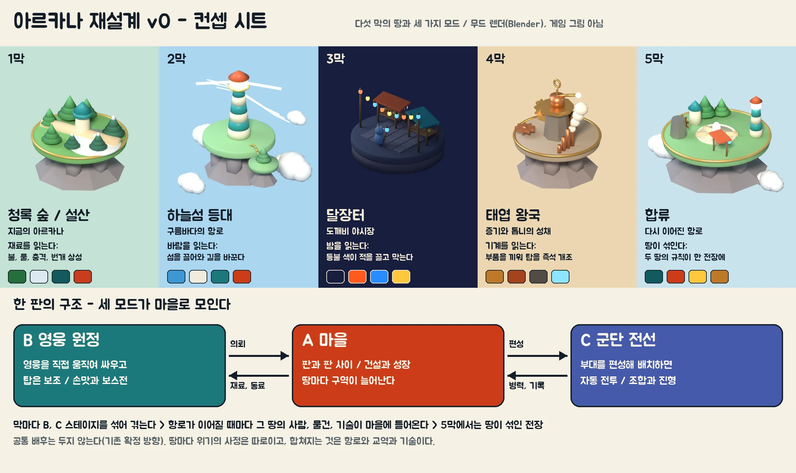

# 아르카나 재설계 기획서 v0

2026-11-11. 기획서와 컨셉 시트만 담았다. 게임 코드는 아직 바꾸지 않았다.

## 0. 사용자 결정 (이번 요청)

| 항목 | 결정 |
| --- | --- |
| 범위 | 아르카나 **전체**를 재설계한다 |
| 설정·테마 | **네 테마를 모두** 넣는다: 지금의 판타지, 하늘섬 등대, 요괴 야시장, 태엽 왕국. 이야기를 따라 하나씩 겪고, 확장되면서 **합쳐진다** |
| 구조 | 세 가지를 **모드별로** 둔다: 킹샷식 마을 + 웨이브, 영웅 직접 조작 액션 디펜스, 군단 배치 전략 |
| 첫 결과물 | 기획서 + 컨셉 시트 먼저 |

그대로 지키는 앞선 결정: 독립 모바일 판타지 게임(#102), Android 설치판 우선, 모바일은 가로 모드만, **사건을 단일 공통 배후로 미리 묶지 않는다**(세계관 기획의 확정 방향).

이 문서의 나머지는 **제안**이다. 이름은 모두 가칭이다.

## 1. 한 줄 요약

> 끊긴 항로를 하나씩 다시 밝히며 서로 다른 다섯 땅을 지키는 수비대. 땅마다 **읽는 것**이 다르고(재료 → 바람 → 밤 → 기계), 항로가 이어질수록 사람·물건·기술이 마을로 모여 섞인다.

## 2. 지금 게임에서 고칠 것 (측정 근거)

기획 루프 84~93회차에서 잰 문제다. 새 구조는 이것부터 푼다.

| 문제 | 측정 | 출처 | 새 설계에서 |
| --- | --- | --- | --- |
| 군단에 정답 하나 | 궁수 다섯 부대(450골드)면 무손실 승리, 전열을 섞을수록 짐 | [93](../arcana-direction-loop/cycles/93-mode.md) | 뒤 열을 노리는 적, 무게 상한 (4-C) |
| 전직은 거의 늘 강화형 | 504쌍 중 강화형만 이김 40, 제어형만 4 | [91](../arcana-direction-loop/cycles/91-logic.md) | 길마다 다른 **역할** (4-B) |
| 마지막 보스가 더 쉬움 | 얇은 배치의 보스 통과: 1-4 23%, 2-4 1.9% | [90](../arcana-direction-loop/cycles/90-mode.md) | 막마다 보스 공식이 다름 (5장) |
| 필살기 안내를 따르면 손해 | 충전 차단에만 아끼면 정예 본진 9.2, 보스에 쓰면 17.4 | [81](../arcana-direction-loop/cycles/81-mode.md)·[90](../arcana-direction-loop/cycles/90-mode.md) | 차단 보상(재사용 단축) |
| 코인이 남음 | 캠페인 타워 셋 판에 1,500~1,800, 군단 궁수만 판에 66% | [90](../arcana-direction-loop/cycles/90-mode.md)·[93](../arcana-direction-loop/cycles/93-mode.md) | 남는 자원의 쓰임(전장 개조·마을) |
| 디테일이 군단 크기에서 안 보임 | 유닛 긴 변 22.7px, 3D 초안은 덩어리가 잘다 | [92](../arcana-direction-loop/cycles/92-model.md) | 세 크기 기준 (6장) |

## 3. 세계: 다섯 막

**큰 틀.** 아르카나는 **등대 항로**로 이어진 여러 땅이다. 항로의 불이 꺼져 땅들이 서로 고립됐다. 수비대는 마을(거점)에서 출발해 항로를 하나씩 다시 밝힌다.

- 땅마다 위기의 사정은 따로다. 공통 악당은 두지 않는다.
- **합쳐지는 것은 항로·교역·기술이다.** 땅을 구할 때마다 그 땅의 주민·상인·장인이 마을로 들어오고, 그 땅의 규칙이 다른 땅의 전장에도 나타나기 시작한다.
- 각 땅은 기존 기획의 다섯 요소(평소의 삶 / 눈앞의 위기 / 감춰진 사정 / 전투 규칙 / 해결 이후 변화)로 설계한다.

| 막 | 땅 | 평소의 삶 | 눈앞의 위기 | 감춰진 사정(후보) | 전투 규칙: 무엇을 읽나 | 해결 이후 |
| --- | --- | --- | --- | --- | --- | --- |
| 1 | **청록 숲 · 설산** (지금의 아르카나) | 숲 마을, 제재소, 설산 구조대 | 짐승 습격, 방벽 동결 | 숲과의 옛 약속, 열원의 사용권 다툼 | **재료** — 불·물·충격·번개 상성(지금 엔진 그대로) | 마을이 수비대 거점이 됨. 첫 등대 |
| 2 | **하늘섬 등대** | 구름바다를 오가는 섬 사람, 항로지기 | 섬들이 떠내려가 길이 끊김 | 등대지기들이 서로 다른 별자리 지도를 믿음 | **바람** — 바람이 불면 섬이 움직여 적의 길이 바뀐다. 섬을 끌어오는 사슬 탑으로 길을 직접 잇고 끊는다 | 마을에 비행선 부두. 다른 땅 전장에도 돌풍 |
| 3 | **달장터** (도깨비 야시장, 운령의 한 구역) | 사람과 도깨비가 밤에 거래 | 손님이 약속을 잊고, 장터가 밤마다 습격당함 | 물건값으로 맡긴 기억과 장부가 어긋남 | **밤** — 등불 색(빨강·파랑·노랑)이 적을 끌거나 막는다. 계약: 이득과 대가를 먼저 보여 주는 선택 | 마을에 야시장. 등불이 다른 땅에도 걸림 |
| 4 | **태엽 왕국** | 증기와 톱니로 굴러가는 성채 도시 | 경비 기계가 주민을 적으로 인식 | 서로 다른 시대의 방어 명령이 충돌(묵성 기획과 이어짐) | **기계** — 부품을 끼워 탑을 즉석 개조, 태엽을 감아 충전, 과열 | 마을에 공방. 부품 개조가 모든 탑에 열림 |
| 5 | **합류** | 다시 이어진 항로 | 땅이 겹쳐 생긴 낯선 전장(하늘섬 위에 열린 야시장 등) | 막마다 따로 | **두 땅의 규칙이 동시에** — 바람 + 등불, 재료 + 기계 | 무한 항로(반복 콘텐츠) |

**동료.** 지금 여섯(이안·리엘·브론·청운·카르·루나)은 1막의 동료로 남는다. 2~4막에 땅마다 두 명씩 새 동료가 합류한다(예: 2막 항로지기 궁수, 3막 도깨비 상인, 4막 태엽 기술자). 이름·성격은 사용자 결정 대기 항목 그대로다.

**순서.** 1막은 지금 콘텐츠를 다듬어 그대로 쓴다. 2·3·4막의 순서는 바꿀 수 있다. 제안 순서는 규칙이 쉬운 것부터다(바람 → 밤 → 기계).

## 4. 모드 세 가지

세 모드는 따로 놀지 않는다. **A 마을이 가운데**에 있고, B·C에서 얻은 것이 마을로 들어가며, 마을에서 다음 원정을 고른다.

### A. 마을 (킹샷식 마을 + 웨이브)

| 항목 | 설계 |
| --- | --- |
| 역할 | 판과 판 사이의 메타. 건설·강화·주민 |
| 구역 | 막마다 구역이 하나씩 열린다(부두·야시장·공방). 구역마다 그 땅의 시설과 주민 |
| 자원 | 골드(공통), 땅마다 재료 하나(바람석·등불기름·톱니). B·C에서 얻는다 |
| 웨이브 | 가끔 **마을 습격**: 마을 지도 위에서 짧은 방어(3~4분). 지은 건물이 곧 방어선 |
| 한 판 | 마을 화면은 판이 아니다. 습격만 짧은 판 |
| 남는 자원 | 전투에서 남은 코인이 마을 자원으로 일부 바뀐다(지금은 버려짐) |

- 러시 브랜치의 킹샷식 마을과 같은 자리다. 아래 9장에서 관계를 정한다.

### B. 영웅 원정 (영웅 직접 조작 액션 디펜스)

지금 캠페인의 발전형이다. **영웅이 주인공, 탑은 보조**.

| 항목 | 설계 |
| --- | --- |
| 조작 | 누르면 이동, 끌면 돌진, 필살기 버튼 하나. 가로 화면 한 장 |
| 탑 | 지점 4~6개, 강화는 Lv3까지. 탑은 영웅이 못 가는 길을 맡는다 |
| 한 판 | 4~5분, 웨이브 4 + 보스 |
| 전직 | 두 길을 **수치 차이가 아니라 역할**로: 강화형 = 직접 처치, 제어형 = 범위 장악(장판·끌어당김·보호막). 87·91의 ‘사거리 +65’를 대체 |
| 필살기 | 영웅마다 모양이 다른 전장 효과(67회차). 보스 기믹을 끊으면 재사용이 짧아진다(81회차 후보) |
| 고칠 것 | 시작 영웅 이안이 가장 약함(87) → 시작 영웅의 기본 공격 보강 |

### C. 군단 전선 (군단 배치 전략)

지금 군단 방어(#105)의 발전형이다. **편성과 진형**이 판단이다.

| 항목 | 설계 |
| --- | --- |
| 조작 | 병종 고르기 → 배치 → 자동 전투. 웨이브 사이 보충·회수 |
| 정답 하나 깨기 | ① 적의 일부가 **뒤 열을 노린다**(돌격대·비행체) → 전열이 가로막아야 함 ② 상한을 머릿수가 아닌 **무게**로(궁수 무겁게) ③ 전열은 자리를 지키고 곁의 아군을 덜 맞게 ④ 막마다 상성: 2막 비행 적은 궁수가, 4막 장갑 기계는 방패·충격이 |
| 한 판 | 2~3분, 웨이브 4 |
| 땅 규칙 | 바람에 화살이 휘고, 등불 아래 적이 몰리고, 기계 병종은 과열 |
| 목표 | 한 병종만으로는 무손실 승리 없음, 같은 골드에서 전열+후열 ≥ 원거리 일색, 남는 골드 절반 이하(93회차 목표 후보) |

### 막과 모드의 엮음

| 막 | 이야기 흐름 | 모드 |
| --- | --- | --- |
| 1 | 숲 구출 → 제재소 → 설산 구조 → 보스 | B 위주, 마지막 전에 C 한 판(군단 소개) |
| 2 | 떠내려간 섬 찾기 → 사슬 탑 → 끊긴 항로 → 보스 | B·C 번갈아, 마을에 부두 |
| 3 | 장터 지키기(밤) → 계약 → 장부의 비밀 → 보스 | C 위주(진형 + 등불), B 보스전 |
| 4 | 공방 탈환 → 개조 → 명령 충돌 → 보스 | B 위주(부품 개조), C 공성전 |
| 5 | 합쳐진 전장 | B·C 자유 선택, 무한 항로 |

막마다 마을 습격(A) 한 번.

## 5. 재미 설계 원칙

1. **매 판 새 판단 하나.** 막마다 읽을 것이 하나씩 더해진다. 앞 막 규칙은 사라지지 않고 쌓인다.
2. **정답이 둘 이상.** 모든 스테이지에서 서로 다른 두 조합 이상이 이긴다. 감사 도구로 잰다(캠페인 `audit-defense-rules.ts`, 군단 `audit-legion.ts`).
3. **보스는 막의 규칙을 시험한다.** 1막 고목왕: 돌진엔 둔화(84). 2막: 바람으로 섬을 밀어내는 보스 — 사슬 탑을 지켜야 함. 3막: 등불을 끄는 보스 — 다시 켜는 위치 선택. 4막: 탑을 해킹하는 보스 — 개조를 바꿔 끼움. 뒤 막 보스가 앞 막보다 쉽지 않다(90회차 문제).
4. **패배하면 바꿀 행동이 보인다.** 결과 화면에 돌파한 길·놓친 보스 기믹을 보여 준다.
5. **학습은 관문이 아니다.** 땅 규칙 설명(전술 힌트)은 선택형이다. 확정 제약 유지.

## 6. 퀄리티

| 항목 | 기준 |
| --- | --- |
| 땅별 팔레트 | 시트의 네 색. 공통 바탕은 청록·먹청·상아·주홍, 땅마다 주색 하나(하늘 파랑, 밤 남색 + 등불 셋, 놋쇠) |
| 그림 | Blender로 굽는 3D(지금 파이프라인). 렌더 톤(툰 외곽선을 쓸지)은 9장에서 정함 |
| 세 크기 확인 | 초상 1280px(카드·대화) / 전투 64px(B) / 군단 23px(C). 군단은 92회차의 ‘군단 층 규칙’ |
| 이펙트 | 단계 0~2(67회차), 영웅별 필살기 모양, 맞는 적마다 표시 |
| 손맛 | 맞을 때 멈칫(히트스톱), 밀림, 소리·진동. 지금 구현을 유지·확장 |
| 화면 | 가로 844 × 390 기준, HUD는 가장자리 |
| 용량 | 영웅 다섯 장 ≤ 128 KB(q80) |

## 7. 지금 있는 것 재사용

| 지금 | 새 구조에서 |
| --- | --- |
| 캠페인 엔진·8스테이지·영웅 6·타워·상성 | **1막 + B 모드의 뼈대** |
| 군단 방어(#105) | **C 모드의 뼈대**(규칙 보강 후) |
| 마을 화면·공용 장비(대장간) | A 모드의 시작점 |
| 러시(다른 브랜치, 킹샷식 마을) | A 모드 후보 — 9장 |
| Blender 영웅 초안 넷(디테일 판)·방패병 초안 | 1막 영웅·C 병사 |
| 기획 루프의 인계 목록 | 대부분 1막 다듬기로 그대로 유효 |

## 8. 단계

| 단계 | 내용 | 끝났다는 기준 |
| --- | --- | --- |
| M0 | 이 기획서 확정(9장 결정) | 결정 다섯 개에 답 |
| M1 | 마을 허브에 세 모드 입구, 1막을 B로 다듬기, C 규칙 보강 | 1막 끝까지 플레이, 감사 도구에서 정답 둘 이상 |
| M2 | **2막 하늘섬 첫 장**: 바람·사슬 탑, 새 적 셋, 보스 하나, 마을 부두 | B·C 각 한 스테이지씩 플레이 |
| M3 | 3막 달장터 | 등불 규칙, 계약 |
| M4 | 4막 태엽 왕국 | 부품 개조 |
| M5 | 합류, 무한 항로 | 두 규칙 동시 전장 |

## 9. 정하실 것

| # | 질문 | 제안 |
| --- | --- | --- |
| 1 | 러시(킹샷식 마을, 브롤스타즈풍 그림, 1시간 루프 진행 중)를 A 마을 모드로 합칠까, 따로 둘까 | **합친다.** 같은 자리의 기능이 둘로 갈라지는 것을 막는다 |
| 2 | 렌더 톤: 지금 아르카나(그림 + 부드러운 3D) / 러시의 툰 외곽선 / 땅마다 다르게 | **공통 툰 외곽선 + 땅별 팔레트.** 세 크기에서 가장 잘 읽힌다(92회차) |
| 3 | 2~4막 순서 | 하늘섬 → 달장터 → 태엽 |
| 4 | 1막 콘텐츠(지금 8스테이지)를 그대로 쓸까, 줄일까 | 그대로 쓰고 다듬는다 |
| 5 | 다음에 받을 것 | M2의 첫 장(하늘섬)을 **플레이 가능한 시제품**으로 |

## 10. 파일

- [컨셉 시트](concept/concept-sheet-v0.webp), 땅별 무드 렌더 다섯 장(`concept/realm-*.webp`)
- [디오라마 스크립트](concept/build_realm_dioramas.py): `python build_realm_dioramas.py -- --scene sky|forest|market|clock|merge --out DIR` (bpy 5.2). 무드용이며 게임 에셋이 아니다.
