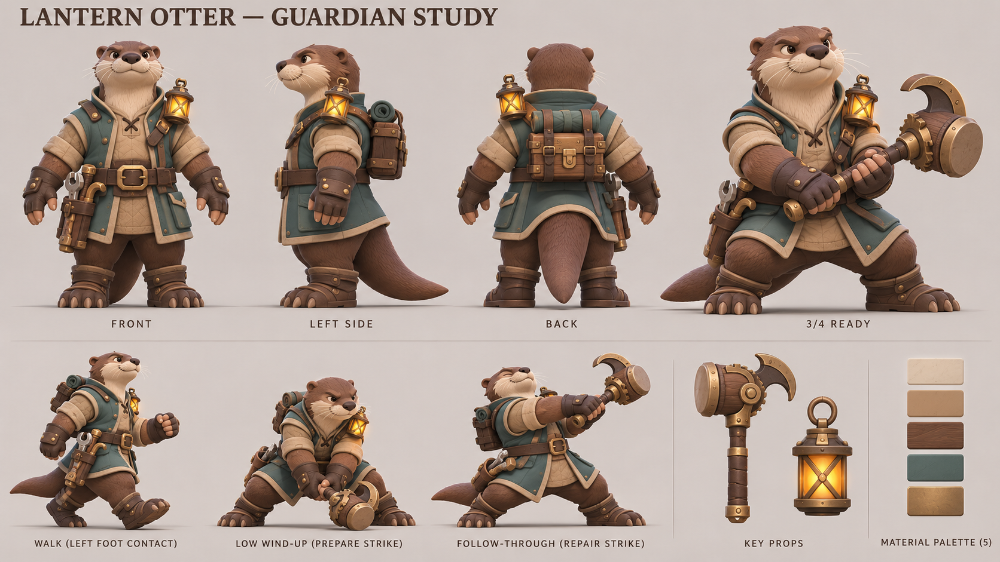
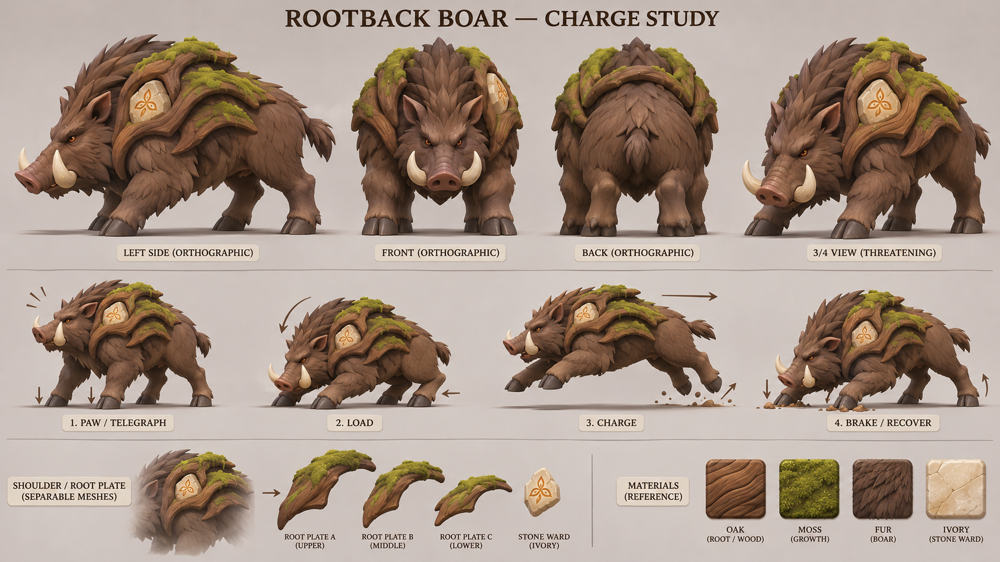
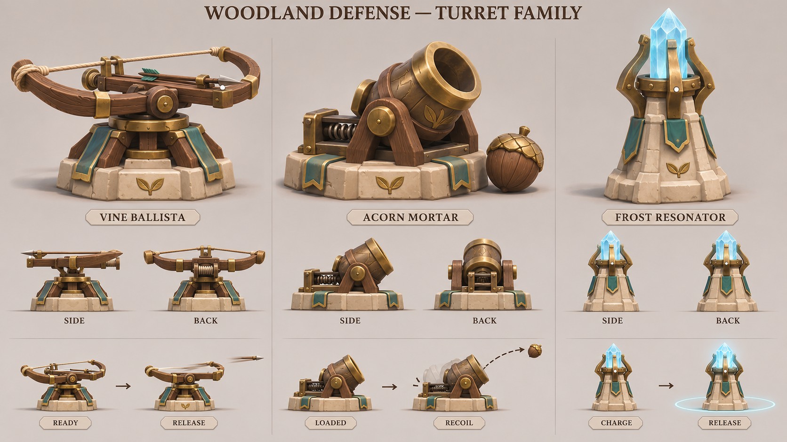

# 캐릭터·적·포탑 제작 참고 시트

2026-11-12 KST. 연결된 OpenAI 이미지 생성 도구를 실제로 3회 호출해 가로 시트 3장을 만들었다. 기존 녹음의 심장과 포탑 모듈 원본을 보고 청록 천·목재·밝은 석재·절제된 황동을 이어 갔다. 명칭과 역할은 제작 후보이며 기존 영웅·포탑을 교체하지 않았다.

## 등불 수달 공병

낮고 넓은 몸·굵은 꼬리·어깨 등불·짧은 래칫 망치로 기존 브론과 궁수의 실루엣을 구분한다. 정면·측면·후면·준비 자세, 보행/공격 참고와 분리 소품·재질색을 제공한다. 실제 모델에서는 몸·꼬리·등불·손잡이의 피벗을 먼저 정한다. 하단 후속 자세는 위로 휘두르는 그림이므로, 수리 내려치기의 타격 시점과 일치하는 검증된 클립으로 사용하면 안 된다.

## 뿌리갑 멧돼지 돌격병

앞쪽에 집중된 어깨·낮은 주둥이·엄니·분리 가능한 세 뿌리 갑판으로 빠른 늑대와 구분한다. 네 방향과 예고→압축→돌진→제동 참고를 제공한다. 네 발 접지와 몸통 관성을 실제 모델/시뮬레이션에서 설계해야 한다. 돌진 패널의 화살표가 몸이 보는 방향과 반대이므로 그림의 화살표를 이동 방향 데이터로 사용하지 않는다.

## 녹음 포탑 세 종류

| 후보 | 외곽 형태 | 이후 제작할 구조·공격 |
| --- | --- | --- |
| 덩굴 노포 | 넓고 수평적인 활대 | 상부 회전축, 시위·노리쇠, 화살 발사점 |
| 도토리 박격포 | 낮고 넓은 받침과 짧은 포신 | 포신 고각축·후퇴 레일·복귀 스프링, 포물선 투사체 |
| 서리 공명탑 | 좁고 높은 수정/석재 기둥 | 고정 고리·수정 충전, 제한된 지면 파동 |

3/4·측면·후면과 준비/발사 참고를 함께 제공한다. 작은 시점별 받침 구조는 일부 단순화돼 있으므로 실제 Blender 메시 하나에서 회전축·발사 방향·후퇴 거리를 확정한다. 그림의 발광이나 반동이 실제 물리·피해 판정 구현을 뜻하지 않는다.

## 저장과 검수

원본 PNG·[생성 프롬프트](../../art-source/defense/concepts/2026-11-12/generation-prompts.json)·[크기/해시/검수 메타데이터](../../art-source/defense/concepts/2026-11-12/manifest.json)를 art-source에 보관했다. 생성 원본은 `/workspace/generated_images/`에도 유지한다. 이미지 세 장을 직접 보고 PNG 무결성·가로 비율·SHA-256을 확인했다. API 도구는 모델 버전과 실제 청구액을 제공하지 않아 임의로 기입하지 않았다. 재시도는 없었다.

이번 산출물은 **3D 모델링용 컨셉 이미지**다. 편집 가능한 .blend·GLB·리그·전투 애니메이션은 아직 만들지 않았고 게임 배포 자산에도 추가하지 않았다. 따라서 이번 이미지 추가에 게임 테스트·빌드를 다시 실행하지 않았다. 다음 실제 제작 후보는 구조와 발사 방향을 쉽게 비교할 수 있는 도토리 박격포 한 단위다.
