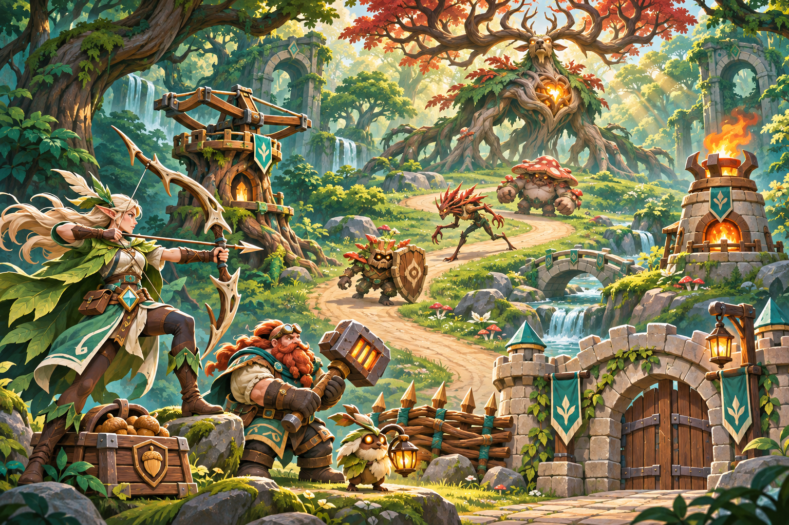
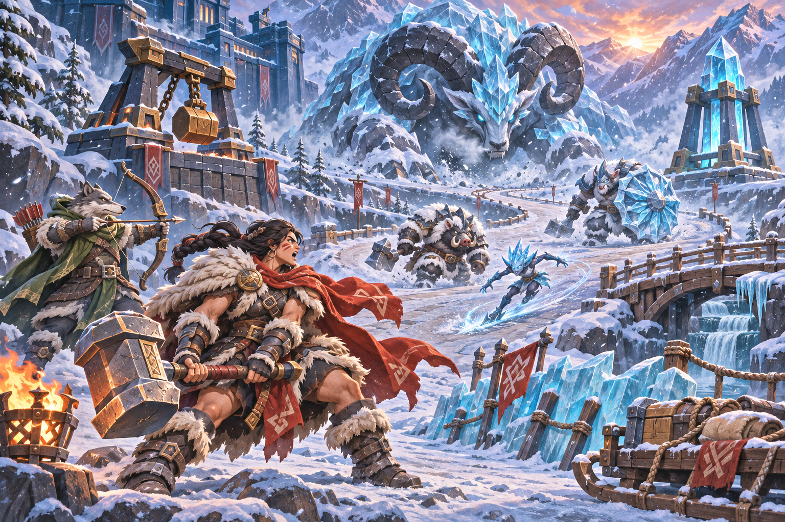
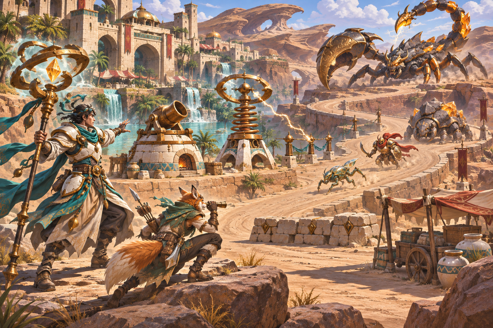
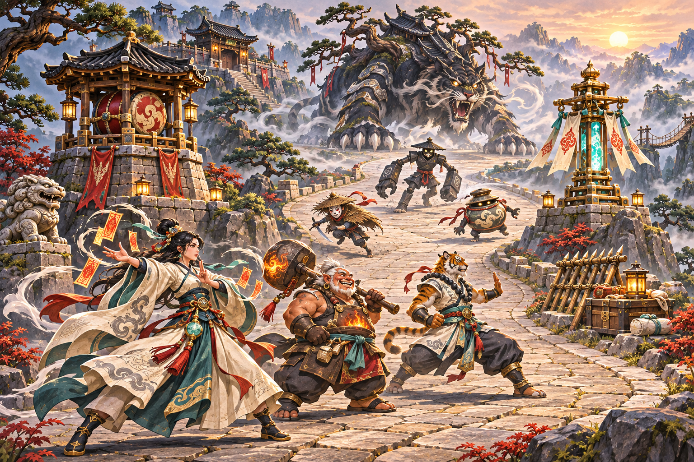

# 아르카나 수비대 — 지역별 전투 컨셉 확장

2026-11-06 (Asia/Seoul). 기존 영웅·용병 캠페인의 반실사 판타지 방향을 이어가는 신규 장면 시안 4종이다. 명칭·역할·속성 반응은 제작 제안이며 기존 게임 데이터나 스테이지 해금을 변경하지 않는다.

[기획 색인](README.md) · [기존 시안](concept-gallery.md) · [원본·해시 목록](../../art-source/defense/concepts/2026-11-06/manifest.json)

## 지역별 차이

| 지역 | 영웅·동료 | 타워 | 일반 적 | 보스 | 기물·지형 |
| --- | --- | --- | --- | --- | --- |
| 녹음의 심장 | 엘프 궁수, 드워프 공병, 등불 펫 | 목재 노포, 석조 화염탑 | 나무 방패병, 가시 돌격병, 버섯 괴력병 | 고목왕 | 도토리 보급상자, 목책, 돌다리, 성문 |
| 은서리 고개 | 여성 망치 전사, 늑대 수인 궁수 | 현수 망치탑, 빙정탑 | 스케이팅 얼음 악동, 무장 멧돼지, 얼음 방패 거한 | 빙각군주 | 화로, 보급 썰매, 다리, 얼음 방책 |
| 황동 사막 | 폭풍마법사, 여우 수인 정찰병 | 화덕 포탑, 코일 타워 | 유리 풍뎅이, 청동 약탈자, 바위 딱정벌레 | 뇌침 전갈왕 | 보급 수레, 도자기, 석조 방벽, 협곡 |
| 운령 산성 | 부적술사, 불씨 도깨비 장인, 범 수인 무투가 | 전고탑, 부적 봉화탑 | 삿갓 질주병, 먹돌 병사, 항아리 도깨비 | 먹안개 산군 | 석상, 대나무 방책, 보급함, 산악 교량 |

## 녹음의 심장 — 고목왕의 습격

수평 노포와 수직 화염탑, 작은 방패병과 긴 다리 돌격병, 둥근 버섯 괴력병으로 실루엣을 나눈다. 엘프는 긴 곡선, 드워프는 낮고 넓은 형태다. 작은 게임 모델에서는 고목왕의 가지를 큰 덩어리로 묶고, 활시위·화살 결합과 잎 장식을 정리해야 한다.

## 은서리 고개 — 빙각군주의 돌진

서리의 청색과 화로의 주황을 대비하고, 충격용 현수 망치와 날카로운 빙정으로 타워의 공격 방식을 암시한다. 보스 하체는 눈보라에 가려져 있어 별도 전신 설계가 필요하다. 영웅이 크게 보이는 전경 연출은 게임 내 실제 크기 비율로 사용하지 않는다.

## 황동 사막 — 뇌침 전갈왕

원형 코일과 낮은 포구, 여우의 꼬리와 전갈의 집게·꼬리로 역할을 구분한다. 황동·석재·도자기의 재질 차이를 먼저 읽히게 한다. 전갈의 다리 접합, 코일과 전도 기둥의 연결 구조는 모델 제작에서 정리해야 한다. 금속 장식과 문양은 소형 화면용으로 줄인다.

## 운령 산성 — 먹안개 산군

기존 운령 산성 이미지를 참조해 기와·석축·소나무·안개를 이어간다. 큰 전고, 부적 깃발, 둥근 항아리 등 생활 기물의 형태를 전투 역할에 연결한다. 종이 장식은 작은 모델에서 굵은 띠로 단순화한다. 불씨 장인은 현재 드워프에 가까운 인상이므로, 도깨비 고유의 표정·생활 기물 모티프를 후속 개별 시안에서 보강해야 한다.

## 모델링·게임 적용 인계

- 이번 결과는 배경 포함 장면 컨셉아트다. 분리된 투명 스프라이트·리깅된 3D 모델·실제 플레이 화면은 아니다. 원근과 크기는 장면 연출용이며 충돌체·사거리·경로로 사용할 수 없다.
- 다음 모델 제작 순서는 타워의 큰 구조 → 일반 적의 체형 → 영웅 무기와 자세 → 보스 전신이다. 정면·측면·후면과 무기 결합을 먼저 정하고 대기·공격 준비·타격·피격 모션으로 이어간다.
- 실제 카메라에서 48/64/96px 크기를 비교해 머리·무기·속성 표시가 분리되는지 확인한다. 이 문서에서 모바일 가독성이나 프레임 성능이 검증됐다고 주장하지 않는다.
- 적의 공격 예고는 색뿐 아니라 자세·바닥 모양·소리로 구분한다. 보스의 큰 실루엣이 길과 건설 지점을 가리지 않게 화면 점유율을 따로 설계한다.
- 교육은 플레이를 멈추는 퀴즈 대신 선택형 관찰 노트로 제한한다. 나무·얼음·금속 등 재료를 보고 타워를 바꾸는 게임적 반응을 우선하며, 게임의 상성 수치를 현실 물리 법칙으로 단정하지 않는다.
- 원본 PNG는 `art-source`에만 보존한다. 앱 배포용 이미지 선정·용량 최적화·준비 화면 연결은 후속 단계다. 이번 추가로 APK 배포 자산을 늘리지 않는다.

## 검수 범위

원본 존재, PNG 무결성, 해상도, SHA-256, 문서 링크와 장면의 역할 구성을 확인한다. 게임 로직·저장 형식·밸런스는 수정하지 않는다.
