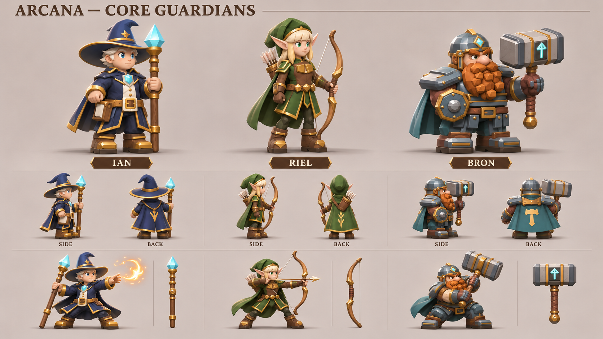
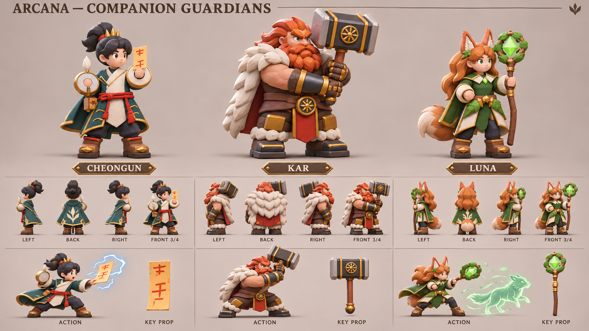
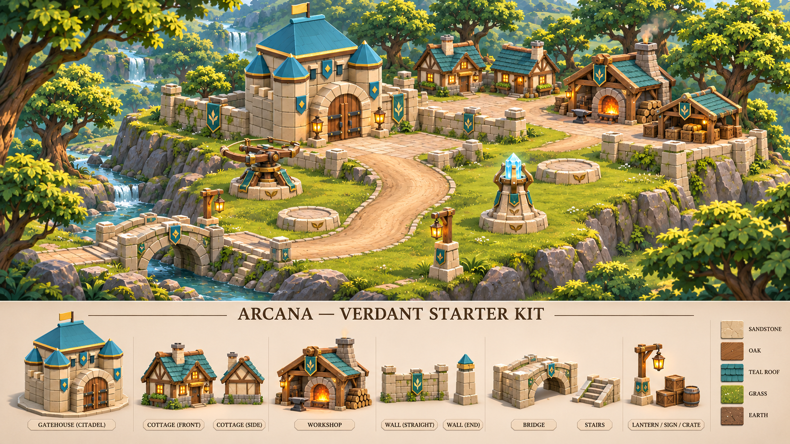

# 기존 이미지 기반 기본 영웅·녹음 테마 시트

2026-11-12. 기존 게임 모델 렌더와 컨셉 이미지를 연결된 OpenAI 이미지 생성 도구에 **직접 참조 이미지로 전달**해 새 가로 시트 3장을 만들었다. 기준은 `6c31be7f6f74c4e343354923fa5ed1c36de1337c`이며, 기존 영웅 이름·역할·색·장비와 녹음 마을의 건축 언어를 이어 간다.

## 기본 영웅: 이안 · 리엘 · 브론

실제 `ian-mage.png`, `riel-archer.png`, `dwarf-guardian.png`를 각각 인물 기준으로 사용했다. 큰 준비 자세, 측면·후면, 공격 핵심 자세와 분리 무기를 함께 배치했다.

| 영웅 | 유지한 정체성 | 실제 모델링에서 확정할 사항 |
| --- | --- | --- |
| 이안 | 흰 머리, 남색 모자·금색 테두리, 청록 수정 지팡이, 화염 마법 | 지팡이와 손 접점, 망토 부착점, 시전 자세의 발 접지 |
| 리엘 | 금발·긴 귀, 녹색 망토, 목제 활·화살통 | 길고 가벼운 체형, 시위·화살 접점과 당기는 손, 망토 간섭 |
| 브론 | 짧고 넓은 체형, 주황 수염, 투구·청록 갑옷, 사각 망치·손목 방패 | 어깨와 망치 질량, 방패 장착, 준비→타격의 하중 이동 |

상단 그림은 세 인물의 키가 비슷해 보인다. 실제 공통 장면에서는 브론을 짧고 넓게, 리엘을 길고 가볍게, 이안을 중간 비율로 조정해야 한다. 그림의 크기를 그대로 월드 스케일로 사용하지 않는다.

## 동료 영웅: 청운 · 카르 · 루나

실제 `cheongun-tao.png`, `kar-barbarian.png`, `luna-druid.png`를 인물 기준으로 사용했다. 청운은 검은 상투·청록 도포·붉은 허리끈·부적, 카르는 붉은 머리·넓은 흰 털 어깨·태양 문양의 거대 망치, 루나는 동물 귀·구리색 머리·잎 망토·녹색 수정 지팡이를 유지했다. 카르는 투구를 쓴 브론과 체격·장비 실루엣을 구분한다.

청운의 둥근 손 소품과 루나의 꼬리는 새 디자인 제안이다. 기존 모델에서 확인한 장비·해부 구조로 확정하지 않는다. 루나의 작은 늑대 형상은 기존 소환 역할을 설명하는 그림이며, 새 소환 애니메이션을 구현한 것은 아니다.

## 기본 녹음 테마: 성채 · 마을 · 입체 지형

`verdant-heart.png`의 숲·목재·따뜻한 등불, 실제 `rush-town.png`의 밝은 석재 성문·두 측탑·청록 지붕, 앞서 만든 `woodland-turret-family.png`의 포탑 언어를 직접 참조했다. 낮은 접근로에서 높은 성채로 이어지는 넓은 경사, 하천 위 다리, 마을 단차·옹벽·지붕 두께를 드러내도록 구성했다. 하단에는 성문·주택·공방·성벽·다리/계단·등불/상자 모듈을 분리했다.

이는 다음 실제 3D 지형 제작의 목표 이미지다. 통행 폭·경사도·다리 접속·문 입구·가림 처리는 메시와 게임 좌표에서 검증해야 한다. 이번에 기존 게임 맵을 이 그림으로 교체하지 않았다.

## 출처 · 재생성 · 검수

두 캐릭터 시트에는 `verdant-heart.png`를 세계관 기준으로, 앞서 생성한 수달 공병 시트를 재질·배치 품질 기준으로 함께 전달했다. 수달 이미지는 인물 정체성 기준이 아니다. 참조 순서와 정확한 프롬프트는 [generation-prompts.json](../../art-source/defense/concepts/2026-11-12/core-theme/generation-prompts.json), 결과 및 입력 이미지 SHA-256은 [manifest.json](../../art-source/defense/concepts/2026-11-12/core-theme/manifest.json)에 저장했다. 입력 경로는 저장소 루트 기준이며 재생성할 때 절대 경로로 해석한다. 도구는 고정 시드·모델 버전을 노출하지 않으므로 동일 픽셀 재생성을 보장하지 않는다.

실제 이미지 생성 호출 3회, 성공 3회, 재시도 0회. 각 PNG를 직접 보고 무결성·1672×941 가로 크기·출력/참조 해시를 확인했다. 실제 청구액은 도구에 노출되지 않아 기록하지 않았다. 생성 원본은 `/workspace/generated_images/`에 유지한다.

**이번 산출물은 모델링 참고 이미지다.** 편집 가능한 .blend·GLB·리그·애니메이션은 추가하지 않았다. 작은 방향별 그림의 비율·장식·무기 길이는 단일 Blender 모델에서 통일해야 한다. 소스 아트와 인계 자료만 추가했으므로 게임 테스트·빌드는 재실행하지 않았다. 이전 [신규 캐릭터·포탑 시트](asset-sheets-2026-11-12.md)도 그대로 보존했다.

다음 제작은 기본 영웅 하나를 선택해 공통 카메라·실측 비율·무기 접점을 갖춘 실제 메시로 구체화하는 단위가 적합하다. 테마는 성문 앞 경사와 다리 연결을 먼저 검증한 뒤 건축 모듈을 확장한다.
