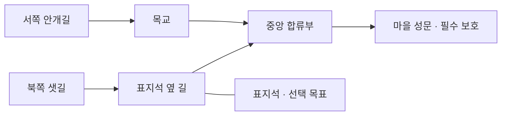

# 모델링·움직임·재미 제작 명세

기준일: 2026-11-06 (Asia/Seoul). 상태: 제작 제안. 이번 문서는 모델·애니메이션·스테이지 구현 완료를 뜻하지 않는다. 수치와 프레임 수는 첫 검증용 후보다. 주요 인물의 이름과 정사는 확정하지 않는다.

## 현재 기반과 이번 목표

확인 기준은 원격 main의 `2931bbc`다. 기존 전투는 900×600 SVG 전장이며, 영웅·용병·펫 이동과 공격 준비·타격·회복, 투사체, 넉백이 있다. Blender 모델을 투명 WebP로 렌더링해 전투에 연결하는 경로와 별도의 Three.js 모델 작업실도 있다. 브론은 관절별 강체 모델과 공격 클립을 사용한다. 모든 영웅에 스킨 리그나 연속 보행 클립이 구현된 상태는 아니다.

이번 목표는 **적의 의도를 읽고 → 위치나 배치를 바꾸고 → 바꾼 결과를 보고 → 다음 전투에 다른 조합을 시도하는 경험**이다. 모델의 장식 수보다 작은 화면에서의 역할 구분과 타격 시점의 일치를 먼저 검증한다.

기존 [모델 제작 과정](../arcana-asset-pipeline.md)과 [모션 검토](../arcana-motion-review.md)를 따른다. 전투는 현재 2.5D 경로를 유지하고 GLB는 제작·검토에 사용한다. 실제 전투의 완전한 3D 전환은 별도 성능·카메라 검증 이후 판단한다.

## 1. 첫 제작 묶음

| 대상 | 모델에서 반드시 읽혀야 하는 부분 | 우선 동작 | 플레이 목적 |
| --- | --- | --- | --- |
| 기존 브론 | 낮고 넓은 몸, 망치와 방패의 방향 | 걷기·정지·망치 공격 연결 | 기존 구현에서 발 기준과 이동 전환 검증 |
| 산성 창수 후보 | 긴 창, 짧은 망토, 벌린 다리 | 전진·찌르기·방어 전환 | 전방을 지키는 역할 식별 |
| 안개 사냥개 | 낮은 어깨, 긴 도약 자세 | 달리기·웅크리기·도약·착지 | 빠른 적의 진입 예고 |
| 이끼멧돼지 | 앞쪽에 몰린 체중, 엄니 | 땅 긁기·직선 돌진·감속 | 회피 후 반격하는 기회 |
| 길을 접는 파수꾼 | 장승 얼굴, 지도, 표지판 지팡이 | 예고·내려치기·회복 | 경로 변화의 원인 식별 |
| 표지석·등불·교량 | 켜짐/꺼짐, 안전한 통로와 외곽 | 점등·충전·위험 예고 | 장식과 조작 대상 구분 |

첫 검증은 브론과 사냥개, 표지석부터 시작한다. 창수·멧돼지·보스는 같은 규격을 검증한 뒤 추가한다. 이미 있는 여섯 영웅을 새 후보로 일괄 교체하지 않는다.

펫·몬스터·수인은 자동 진화 관계로 설정하지 않는다. 펫은 작은 몸과 동행 장구, 몬스터는 공격 자세와 무게 중심, 수인은 손·도구·직업으로 역할을 구분한다. 크기와 색만 바꾼 동일 모델로 처리하지 않는다. 수인은 동물 머리·발·꼬리라는 기존 시안의 특징을 유지한다.

## 2. 모델과 렌더 납품 기준

- 원본 `.blend`, 검토용 `.glb`, 투명 렌더, 전투용 WebP, 메타데이터를 한 버전으로 묶는다. 스킨 리그와 강체 관절 중 어떤 방식을 사용했는지 기록한다.
- Blender Z-up → GLB Y-up, 바닥 중심 원점 규칙을 유지한다. 무기·손·발·이펙트 발사 지점을 명시한다. 무기 피벗과 실제 피해 판정은 별개다.
- 기존 브론의 640×640 캔버스와 발 기준 `(320,550)`을 비교 기준으로 사용한다. 새 체형이 이 기준을 벗어나면 공통 배율·발 위치를 메타데이터에 명시하고, 포즈마다 개별 확대하지 않는다.
- 손잡이·창대·망치 끝이 최대 자세에서도 잘리지 않아야 한다. 투명 여백과 바닥 그림자는 실제 전투 배치에서 확인한다.
- 정사영 카메라·조명·노출을 고정해 대기와 공격의 몸 크기, 색, 그림자가 튀지 않게 한다. 기존 카메라 값을 재사용하며 별도 각도를 임의로 정하지 않는다.
- 첫 보행은 좌우 방향부터 검증한다. 방패 손·문양이 바뀌어 문제가 생기는 캐릭터는 별도 방향 렌더를 납품한다. 8방향 제작은 확대 화면에서 효과를 확인한 뒤 결정한다.
- 작은 화면에서는 얼굴 장식보다 무기, 어깨, 등, 자세를 보존한다. 실제 전장 표시 크기와 320/390px 화면에서 실루엣을 비교한다.
- 메시 수·재질 수·이미지 용량·알파 경계·해시·원본 버전을 기록한다. 폴리곤 예산은 측정 후 정하며 현재 성능 한계를 추정치로 단정하지 않는다.
- 포즈 세트 전체가 준비돼야 교체한다. 일부 이미지 로딩 실패 시 기존 세트로 일관되게 대체한다.

## 3. 움직임 규칙

| 상황 | 화면 동작 | 게임 규칙과의 연결 |
| --- | --- | --- |
| 이동 시작 | 발이 나가고 몸이 조금 기울어짐 | 실제 위치 변화부터 보행 시작; 대기 중 제자리 걷기 금지 |
| 연속 보행 | 6~8포즈 후보, 발 접지 반복 | 이동 거리를 기준으로 보행 주기 진행; 속도·둔화에 맞춰 조절 |
| 이동 종료 | 마지막 발을 짚고 대기로 복귀 | 시각적 정리만 적용; 목표 위치를 지나치지 않음 |
| 방향 전환 | 몸과 무기가 같은 방향을 향함 | 짧은 거리에서 좌우 반전이 반복되지 않게 방향 안정화 |
| 공격 | 준비 → 타격/발사 → 회복 | 엔진의 `hitAt`·투사체 명중을 따라감; 그림 프레임이 추가 피해를 만들지 않음 |
| 피격 | 짧은 몸 반응, 해당 위치의 효과 | 장식용 흔들림과 실제 넉백 좌표 분리; 피격이 자동으로 공격 취소를 뜻하지 않음 |
| 처치 | 자세 무너짐 후 잔상 정리 | 사망 즉시 타깃·충돌에서 제외; 잔상은 장식이며 보상 재지급 없음 |
| 펫 이동 | 주인 뒤를 따르다 목표에 접근 | 멀어진 펫은 복귀 우선; 반복 목표 변경으로 좌우 왕복하지 않게 함 |

새 보행 상태는 기존 전투 상태와 분리한다. 예: 대기·이동·공격·대시의 시각 우선순위를 정하고, 공격 중 이동 허용 여부는 엔진 규칙을 따른다. 이동 명령이 공격을 취소하는 신규 규칙을 도입한다면 별도 밸런스 변경으로 다룬다.

새 지형에는 이동 가능 영역과 교량 연결을 별도 데이터로 둔다. 도달할 수 없는 목적지는 가까운 유효 지점과 이동 경로를 표시한다. 영웅·용병·펫 모두 같은 통행 규칙을 따르고, 대시가 강·절벽을 통과하지 않도록 경로를 검사한다. 단순한 화면 경계 제한만으로 이 규칙이 구현된 것으로 보지 않는다. 표지석의 체력·피격·파괴와 몬스터의 목표 선택도 신규 구현 항목이다.

멧돼지 후보 타이밍은 준비 1.2초 → 표시한 직선으로 돌진 → 감속·회복 1.0초다. 돌진 거리·속도는 경로 길이에 맞춰 검증한다. 준비 마지막 시점에 방향을 고정하고 이후 플레이어를 추적하지 않는다. 돌진 중 반복 충돌로 한 대상에 다중 피해를 주지 않는다. 사냥개는 웅크리는 자세와 착지 위치 표시로 도약을 구분한다.

모든 진행은 시뮬레이션 시간을 사용한다. 일시정지에서는 보행·예고·투사체·보스 동작이 멈추고, 배속에서는 판정과 연출이 함께 빨라진다. 프레임 저하로 타격 순간을 건너뛰어도 판정은 한 번만 수행한다. 이동 감소 설정은 화면 흔들림·잔상을 줄이며 위험 범위와 공격 예고는 유지한다.

## 4. 안개재 체험 스테이지: 길을 밝히는 수비

새 지역·사건의 가칭이다. 기존 8스테이지의 저장·해금 순서를 바꾸기 전에 독립 연습 스테이지로 검증한다. 4~7분 전투를 목표로 하며 실제 소요 시간은 아직 측정하지 않았다.

S형 900×600, 두 접근로와 중앙 합류부, 6개 배치 지점, 필수 보호 대상인 마을 성문 1개, 선택 목표인 표지석 1개를 사용한다. 표지석은 경로를 차단하지 않는다. 강·절벽은 실제 통행 금지 구역으로 표시하며, 장식 배경만 보고 충돌을 추측하게 하지 않는다.

| 웨이브 | 보여줄 규칙 | 플레이어의 판단 | 실패해도 배울 정보 |
| --- | --- | --- | --- |
| 1 | 서쪽 일반 적, 점등된 표지석 | 타워 사거리와 영웅 자리 익히기 | 적이 빠져나간 경로와 성문 피해 표시 |
| 2 | 북쪽 사냥개 진입, 사전 경고 | 영웅을 보내거나 북쪽에 투자 | 진입 방향·이동 시간과 놓친 적 종류 |
| 3 | 멧돼지 돌진, 표지석 충전 완료 | 결계를 지금 쓰거나 최종전에 보존 | 돌진 예고와 타격 위치를 결과에 기록 |
| 4 | 파수꾼 등장, 한 번의 길 변화 | 새 경로 대응과 회복 중 집중 공격 | 길 변경 전후와 유효했던 방어 위치 |

웨이브는 전멸/이탈 정산 뒤 다음 단계로 진행한다. 준비 중 자동 시작은 기본값으로 두지 않는다. 4~7분 목표에 준비·전술 일시정지 시간을 합산해 조급함을 유도하지 않는다.

### 표지석 장치

표지석이 살아 있는 상태로 2웨이브를 마치면 전투당 한 번의 결계 사용권을 준다. 경로 한 곳을 선택하면 5초 동안 25% 둔화를 주는 것이 첫 후보다. 한 번 사용하면 소모되며, 적을 오래 남겨 추가 충전할 수 없다. 표지석 파괴 시 미사용 충전도 소멸한다. 최종 보스의 경로 변경 예고와 동시에 새로운 조작 안내를 띄우지 않는다.

선택 목표 실패는 전투 실패로 연결하지 않는다. 기본 포탑·영웅만으로도 클리어 가능한지 검증하고, 표지석은 동선과 자원 배분을 바꾸는 추가 목표로 둔다. 결과 보상은 최초 달성만 별도 지급한다.

### 길을 접는 파수꾼

새 길을 12~15초 먼저 표시하고 기존 길과 연결해 보여 준다. 실제 경고 시간은 영웅의 대응 지점 이동 시간 + 판단 여유 이상이어야 한다. 정적 범위 공격과 경로 변경을 다른 문양으로 구분한다.

첫 버전에서는 경로 변경 뒤 생성되는 적만 새 길로 보낸다. 이미 이동 중인 적은 기존 길을 끝까지 사용하고 타워는 이동·파괴하지 않는다. 연결이 끊기거나 길 위 적이 순간 이동하는 구현을 피한다. 내려치기 후 2초 동안 다음 행동을 멈춰 집중 공격할 시간을 준다. 추가 피해 배율은 초기 검증에서 넣지 않는다.

보스 사망은 남은 적의 즉시 삭제를 뜻하지 않는다. 4웨이브 정산 완료와 성문 생존을 함께 만족해야 승리한다. 같은 시뮬레이션 단계에서 성문 파괴와 마지막 적 처치가 겹치면 보호 실패가 우선한다.

## 5. 재미를 만드는 선택과 회복 가능성

| 재미 요소 | 구체적인 선택 | 반드시 확인할 점 |
| --- | --- | --- |
| 배치 | 전방에서 빨리 정리 / 합류부에서 두 길을 방어 | 두 전략 모두 완료 가능하고 손해의 원인이 보이는가 |
| 영웅 조작 | 북쪽 지원 / 중앙에서 정예 대응 | 이동한 결과가 1웨이브 안에 드러나는가 |
| 조합 | 둔화로 포격 명중 보조 / 빠른 단일 공격으로 도약 적 처리 | 특정 영웅만 필수 해법이 되지 않는가 |
| 장치 사용 | 3웨이브 위기 해소 / 최종전에 보존 | 아끼다 실패한 이유와 일찍 쓴 이점이 보이는가 |
| 발견 | 표지석과 오래된 안내문을 연결해 사건 추론 | 단서를 읽지 않아도 전투 가능하고 정답 퀴즈를 요구하지 않는가 |
| 성장 | 구한 길잡이가 마을의 길·등불을 정비 | 성장 전후가 외형과 새 대화로 확인되는가 |

난이도는 적 체력만 늘리지 않는다. 이야기 난도는 긴 예고와 순차 압박, 기본은 두 경로의 간헐적 동시 압박, 정예는 같은 규칙의 조합과 투자 제약을 사용한다. 필수 정보의 표시를 없애거나 보이지 않는 즉사 공격을 추가하지 않는다. 기존 `relaxed/standard/veteran`과 실제 수치 연결은 후속 구현에서 정의한다.

실패 결과에는 원인 하나와 다음 실험 하나를 제시한다. 예: “북쪽 사냥개 3마리가 성문에 도달했습니다. 다음에는 2웨이브 전에 북쪽 단일 공격 타워를 시험해 보세요.” 실제 전투 기록이 없으면 이 문구를 추정해 표시하지 않는다. 자동 추천이 플레이를 대신하지 않도록 다른 선택도 유지한다.

## 6. 제작 순서와 검증 관문

1. **회색 모형 전투:** 새 아트 없이 두 경로·표지석·길 변경을 구현한다. 전방/중앙 두 배치 전략, 선택 목표 실패 뒤 완주 가능 여부를 확인한다.
2. **움직임 한 세트:** 브론 보행과 사냥개 예고를 제작하고 실제 전장 크기에서 발 위치·공격 시점·방향 전환을 비교한다.
3. **아트 연결:** 배경·표지석·보스를 적용한다. 경고선은 장식·그림자·큰 이펙트보다 잘 읽혀야 한다.
4. **사용자 플레이:** 초심자 5명에게 설명 없이 첫 경고·경로 변경을 보여 주고, 대응 이유와 실패 원인을 말하게 한다. 인원은 발견용 소규모 검증이며 통계적 재미 입증이 아니다.
5. **확장 판단:** S에서 동선 선택이 통하면 M 두 전선 방어로 확장한다. 판단이 안 보이면 맵이나 적 종류를 늘리기 전에 경고·배치부터 수정한다.

첫 수용 기준 후보: 5명 중 4명이 두 번째 시도까지 공격 예고와 안전한 대응 위치를 설명할 수 있음, 전방/중앙 전략 각각 기본 난도 완주 기록 확보, 표지석을 잃어도 완주 가능. 목표를 충족하기 전 재미가 검증됐다고 보고하지 않는다.

기능 검증은 일시정지·1/2배속에서 판정 동일성, 돌진 대상별 1회 피해, 사망 잔상 비타깃화, 프레임 누락 중 타격 1회, 길 변경 전후 적의 경로 보존, 성문 파괴와 승리의 우선순위, 보상 중복 방지를 포함한다. 자동 검증과 별도로 실제 모바일에서 프레임 시간·입력 실수·화면 밖 경고 대응을 측정한다.

2026-11-06 첫 구현: 브론의 별도 보행 Blender 원본과 8개 전투용 렌더를 추가했고, 영웅·용병·펫의 이동 거리 기반 표현과 방향 안정화를 연결했다. 제작 방법은 [모델 제작 과정](../arcana-asset-pipeline.md)을 따른다. 안개재·표지석·신규 적·큰 맵·사용자 재미 검증은 아직 기획 단계다. 다리 모델은 강체 부품 기반이며 스킨 리그·지형별 발 접지까지 완료했다는 뜻은 아니다.
