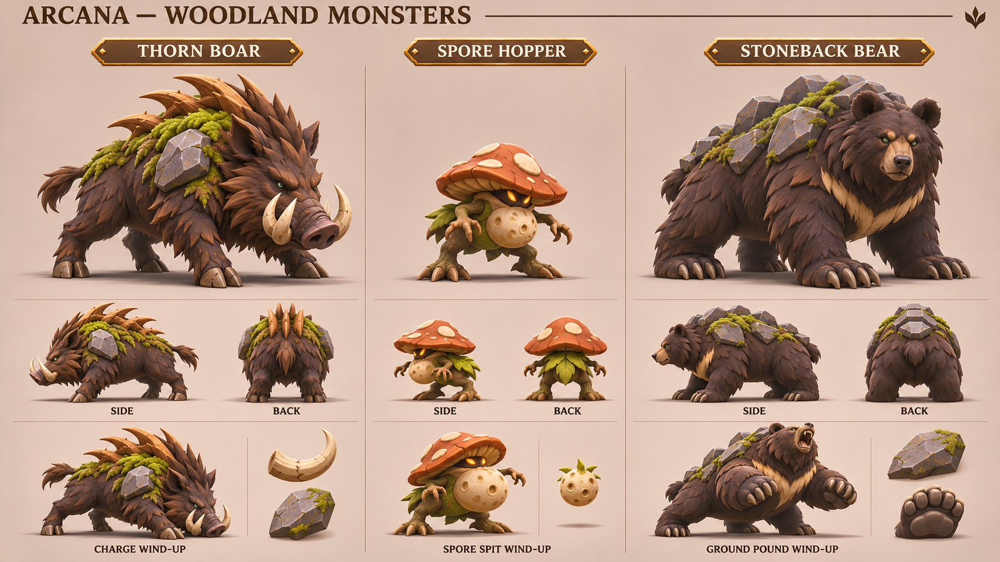
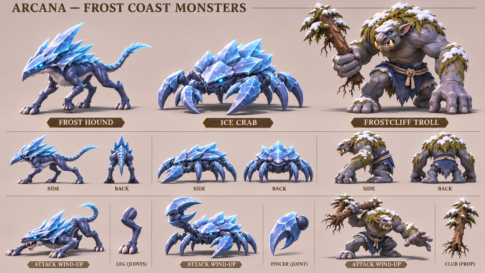
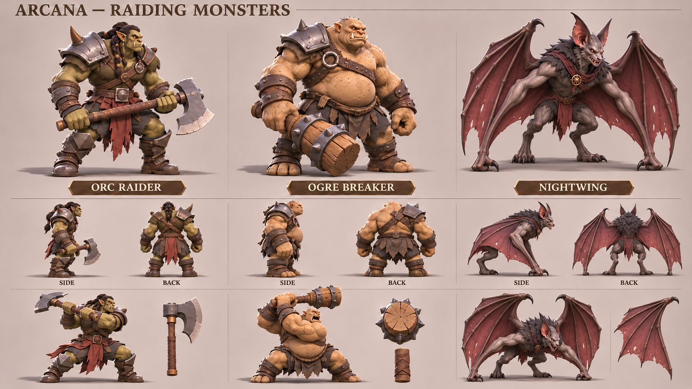
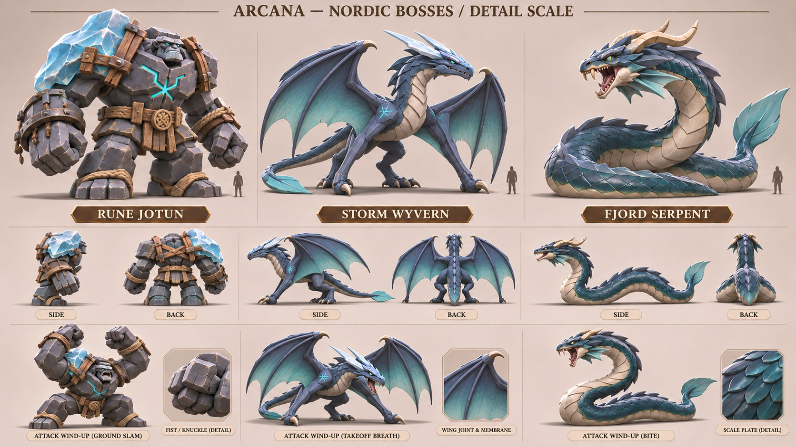

# 몬스터 12종 제작 참고 시트

2026-11-12. 기준 커밋 `7b0634eac43277dcda9f421507b4ea3e6933f7d2`. 기존 짐승·극지·서양 판타지 컨셉을 직접 참조해 9종을 재구성/확장하고, 북유럽 대형 보스 3종을 제안했다. 작은 포자 생물, 사족 야수, 다족 갑각류, 무장 이족, 날개 괴수, 거인, 바다뱀으로 실루엣과 이동·공격 역할을 나눈다. 모든 이름과 역할은 제작 후보이며 게임 데이터에 추가한 적이 아니다.

## 숲 몬스터

| 후보 | 외곽 형태 | 동작/전투 역할 제안 |
| --- | --- | --- |
| 가시 멧돼지 | 앞쪽 어깨 쐐기, 엄니, 갈라진 발굽, 굵은 나무 가시 | 머리를 낮춘 뒤 직선 돌진; 제동 구간 필요 |
| 포자 도약체 | 작은 버섯 갓, 두 뿌리 다리, 부풀어 오른 포자 주머니 | 무리 접근·짧은 도약·포자 발사; 부풀음으로 예고 |
| 바위등 곰 | 넓은 어깨와 발바닥, 등 위 큰 판석 | 느린 압박·앞발 내리찍기; 하중 이동으로 예고 |

기존 `moss-boar.png`, `stoneback-bear.png`와 녹음 컨셉을 직접 참조했다. 포자 도약체는 녹음의 버섯 표현을 활용한 새 소형 적 제안이다. 기존 게임의 늑대·멧돼지 모델이나 ID를 교체하지 않았다.

## 서리 해안 몬스터

| 후보 | 외곽 형태 | 동작/전투 역할 제안 |
| --- | --- | --- |
| 서리 사냥개 | 좁은 허리, 긴 네 다리, 뒤로 뻗은 얼음 판 | 빠른 추격·낮은 도약 물기 |
| 얼음 게 | 낮고 넓은 갑각, 두 집게, 다수의 보행 다리 | 측면 접근·집게 공격; 한 집게를 들어 예고 |
| 설암 트롤 | 굽은 등, 긴 팔, 짧은 하체, 소나무 곤봉 | 긴 범위의 느린 휘두르기; 어깨 뒤로 곤봉을 당김 |

`polar-monsters.png`의 게·사냥꾼과 기존 전투 트롤을 참조하고 북유럽의 남색·암석·눈 표현을 연결했다. 게의 작은 그림은 다리가 겹치므로 실제 메시에서 집게 2개와 보행 다리 8개의 수·접합을 확정한다. 트롤 후면에는 곤봉이 생략되어 장비를 별도 결합해야 한다.

## 약탈대 몬스터

| 후보 | 외곽 형태 | 동작/전투 역할 제안 |
| --- | --- | --- |
| 오크 돌격병 | 각진 턱, 역삼각 어깨, 긴 도끼 | 짧은 돌입·큰 도끼 베기 |
| 오우거 파쇄병 | 큰 원통형 배, 무거운 팔, 철띠 목제 곤봉 | 느린 전진·강한 내려찍기 |
| 밤날개 괴수 | 긴 귀, 잿빛 박쥐 얼굴, 붉은 날개막 | 이륙·공중 접근·내려찍는 급습 |

기존 오크·오우거·흡혈귀 역할 시트의 가운데 전투형을 직접 참조했다. 동행형과 영입형을 적으로 단정하지 않으며 특정 적대 약탈대의 외형 후보로 사용한다.

밤날개 첫 결과는 일반 팔과 날개가 따로 생겼다. 1회 보정해 별도 일반 팔을 제거하고 날개 앞다리 2개와 뒷다리 2개의 구조로 정리했다. 위 그림이 선택본이며 `drafts/`의 첫 결과는 모델링 기준이 아니다. 날개 손목·긴 손가락·막의 실제 접합은 메시와 리그에서 확정한다.

## 북유럽 보스

| 후보 | 외곽 형태 | 동작/전투 역할 제안 |
| --- | --- | --- |
| 룬석 거인 | 큰 화강암 덩어리, 비대칭 빙하 어깨, 두 주먹 | 두 주먹 준비→지면 충격; 판석 관절과 발 지지 |
| 폭풍 와이번 | 좁은 몸, 날개 앞다리, 강한 뒷다리, 긴 꼬리 | 지상 이륙→비행 접근; 착지 예고·위치 설계 필요 |
| 피오르 바다뱀 | 사지 없는 긴 몸, 연속된 배판, 꼬리지느러미 | 해안에서 몸을 세운 뒤 물기; 수상/해안 타격 구간 필요 |

기존 북유럽 마을·전사, 트롤의 하중 표현, 극야 해안의 색과 재질을 참조한 새 보스 제안이다. 특정 신화 인물이나 게임 보스를 그대로 옮기지 않았다. 각 패널은 관찰용 크기로 배치했으며 작은 사람 실루엣은 정성적 규모 참고다. 실제 월드 크기·체력·충돌체는 미정이다.

와이번 첫 결과도 일반 앞다리와 날개가 별도로 붙어 있었다. 1회 보정하여 날개 손목으로 지면을 짚도록 정리했다. 선택본에는 날개 앞다리 2개와 뒷다리 2개를 기준으로 삼는다. 작은 방향별 판석·얼음·꼬리·날개 모양은 단일 모델에서 통일해야 한다.

## 재생성·검증·다음 제작

정확한 초기/보정 프롬프트와 참조 순서는 [generation-prompts.json](../../art-source/defense/concepts/2026-11-12/monster-sheets/generation-prompts.json), 선택본 4장과 보정 전 2장 및 입력 이미지의 SHA-256은 [manifest.json](../../art-source/defense/concepts/2026-11-12/monster-sheets/manifest.json)에 저장했다. 참조 상대 경로를 저장소 루트 기준 절대 경로로 바꾸어 `image_gen.imagegen`에 전달한다. 보정이 있는 시트는 초기 결과를 만든 뒤 그 이미지 하나를 보정 입력으로 사용한다. 고정 시드·모델 버전은 도구에서 제공하지 않아 동일 픽셀 재현은 보장하지 않는다.

실제 도구 호출은 **초기 생성 4회 + 한정 보정 2회 = 6회**, 모두 성공했다. 선택본 4장은 모두 1672×941 가로 PNG이며 직접 시각 검수했다. 보정 전 2장도 출처 추적용으로 보존하고 PNG 무결성·출력/참조 해시·문서 링크를 확인했다. 실제 청구액은 도구에서 노출하지 않아 기입하지 않았다. 생성 원본은 `/workspace/generated_images/`에도 유지한다.

이번 산출물은 **모델링·움직임 설계를 위한 컨셉 이미지**다. .blend·GLB·애니메이션·비행/수상 경로·피해 판정·적 밸런스는 구현하지 않았다. 포자 주머니의 변형과 발사점, 도끼/곤봉의 손 결합, 다족 보행과 날개 리깅은 후속 제작 범위다. 소스 아트 변경으로 게임 테스트·빌드는 재실행하지 않았다. 다음은 소형 포자 도약체나 기존 야수 하나를 골라 실제 모델·보행·공격을 완성하는 단위가 적합하다. 예약 재개·main 병합·배포는 하지 않는다.

관련 자료: [종족과 장비 기획](cast-and-items.md), [바이킹·북유럽 시트](nordic-sheets-2026-11-12.md), [다른 지역 시트](regional-sheets-2026-11-12.md).
