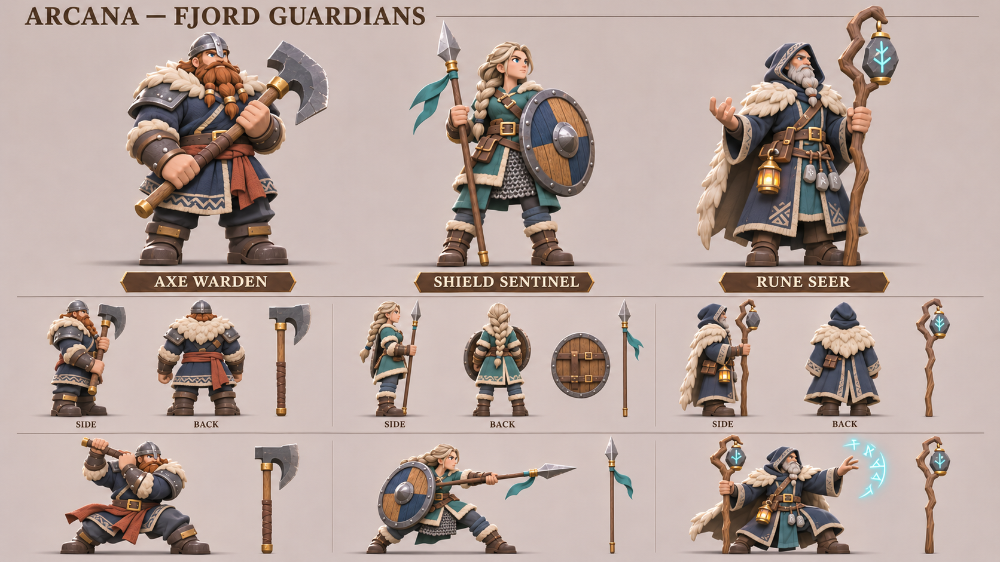
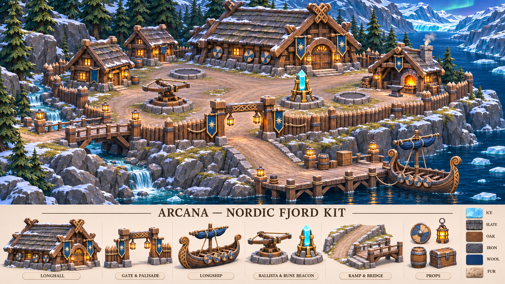

# 바이킹 수호대와 북유럽 피오르 테마

2026-11-12. 기준 커밋 `39062c288ff2f087133957e9821c9988c817a4f9`. 기존 기본 영웅·극야 해안의 표현과 재질을 직접 참조해 북유럽 판타지 캐릭터 및 지역 시트 2장을 제작했다. 역사 재현을 주장하는 자료가 아닌 아르카나의 신규 지역 제안이다.

## 바이킹 수호대

| 제작 후보 | 외형과 장비 | 동작 제작 기준 |
| --- | --- | --- |
| 도끼 전사 — Axe Warden | 넓은 사람 체형, 구리색 땋은 수염, 코가리개 철 투구, 남색 모직·적갈색 허리천, 긴 양손도끼 | 두 손 간격과 도끼 질량, 낮은 무릎 준비, 타격 때 하중 이동 |
| 방패 전사 — Shield Sentinel | 재빛 금발 땋은 머리, 청록 의복·사슬 치마, 원형 목제 방패, 긴 창 | 방패 뒤 끈과 왼팔 고정, 오른손 창 찌르기, 앞발 접지 |
| 룬술사 — Rune Seer | 회색 수염, 남색 두건·모피 어깨, 굽은 목제 지팡이·룬 돌·호박색 등불 | 지팡이 손잡이, 돌 받침과 무게, 망토와 발 간섭 |

큰 3/4 자세, 측면·후면, 공격 핵심 자세와 분리 소품을 담았다. 뿔 달린 투구와 과도한 장식 대신 도끼·원형 방패·창·굽은 지팡이가 먼저 읽히도록 했다. 실제 영웅 ID·스탯·해금에는 추가하지 않았다.

방향별 소형 그림은 무기를 단순화하거나 생략한다. 도끼 날 모양과 자루 길이, 룬 돌 받침도 일부 달라 보이므로 실제 모델 하나에서 정해야 한다. 그림은 정밀 정투영 도면이나 검증된 공격 프레임이 아니다.

## 북유럽 피오르 마을

기존 극야의 회색 석재 요새와 구분해 두꺼운 목조 회관, 비탈 지붕, 원형 방패 장식, 목책, 침엽수와 롱십 항구를 중심으로 구성했다. 기존 남색/청록 천·황동·호박색 등불은 공통 세계관 연결로 유지했다. 항구의 낮은 갑판에서 마을의 높은 뜰까지 넓은 경사로를 잇고, 옆 계곡에는 짧은 목조 교량을 둔다.

하단 모듈은 회관, 문/목책, 롱십, 노포/수정 봉화, 경사/교량, 원형 방패/등불/통/상자다. 봉화는 생성 결과에서 기존 청록 수정탑 계열에 가까우므로 독자적인 판석 룬 기둥은 후속 모델링 선택으로 남긴다. 배의 선체·갑판·용골과 지형 경사·교량 높이는 실제 메시에서 확정해야 한다.

## 출처·검증·인계

캐릭터 시트에는 [기본 영웅 시트](core-theme-sheets-2026-11-12.md)의 배치/표현과 [극야 해안 캐릭터 시트](regional-sheets-2026-11-12.md)의 재질/색을 직접 입력했다. 테마 시트에는 기존 극야 해안 및 녹음 마을 제작 키트를 직접 입력했다. 이 참조들은 스타일·구조 기준이며 새 바이킹 인물을 기존 영웅의 확정 교체안으로 만들지 않는다.

원본 PNG, [정확한 프롬프트와 참조 순서](../../art-source/defense/concepts/2026-11-12/nordic-sheets/generation-prompts.json), [크기·입출력 해시·검수 메타데이터](../../art-source/defense/concepts/2026-11-12/nordic-sheets/manifest.json)를 저장했다. 재생성은 저장소 상대 경로를 절대 경로로 해석한 뒤 기록된 요청을 연결 `image_gen.imagegen` 도구에 전달한다. 도구가 고정 시드와 모델 버전을 제공하지 않아 동일 픽셀 재현은 보장하지 않는다. 생성 원본은 `/workspace/generated_images/`에 유지한다.

실제 생성 호출 2회·성공 2회·재시도 0회. 두 결과를 직접 보고 PNG 무결성·1672×941 가로 크기·참조 및 결과 해시·문서 링크를 확인했다. 실제 청구액은 도구에서 노출하지 않아 임의로 기록하지 않았다.

이번 산출물은 **컨셉 이미지**이며 편집 가능한 .blend·GLB·리그·게임 맵은 추가하지 않았다. 소스 아트 변경이므로 게임 테스트·빌드는 재실행하지 않았다. 다음 실제 제작 단위는 원형 방패와 창을 든 전사 한 명의 장비 결합·공통 비율·접지, 또는 목조 문/경사 모듈의 실시간 3D 검증이다. 예약 재개와 서비스 배포는 하지 않는다.
