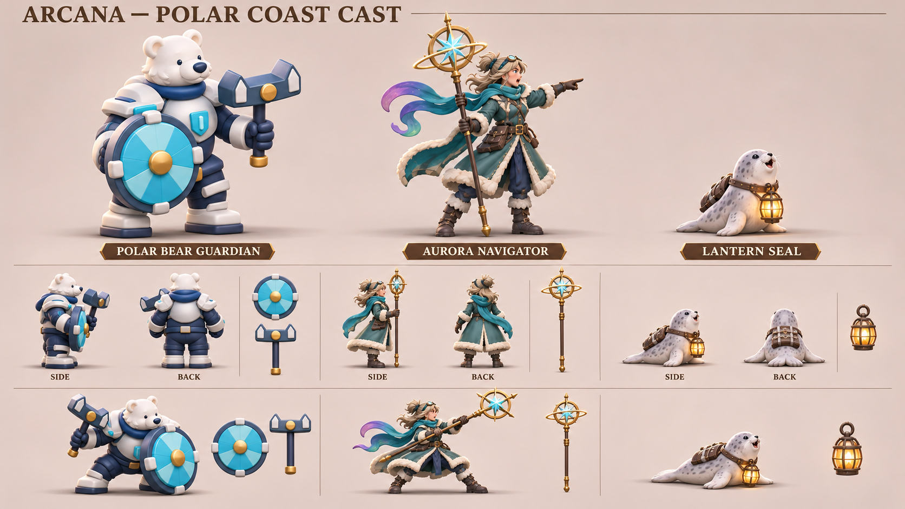
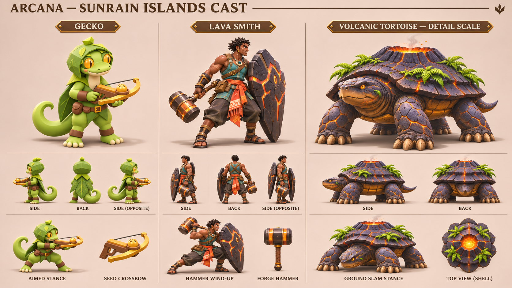
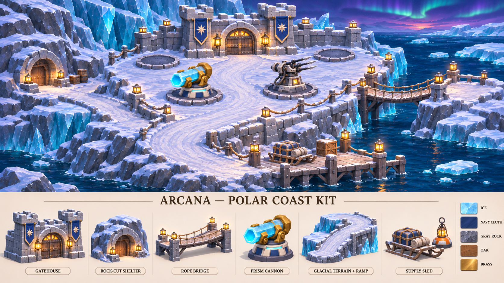
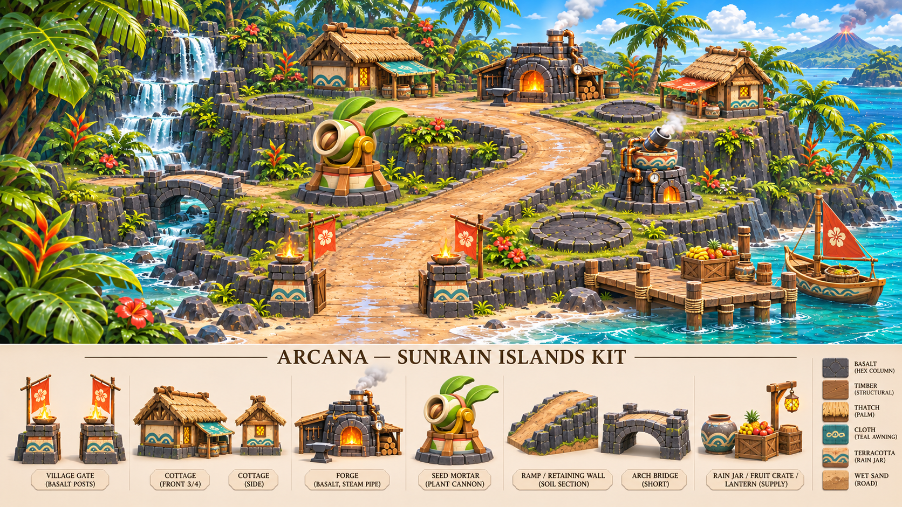

# 기존 자료 기반 극야 해안·태양비 군도 시트

2026-11-12. 기준 커밋 `ad6a6d0369b651d0627d5e297ea5a9039412788b`. 기본 영웅·녹음 테마에 이어 다른 캐릭터와 지역 원본을 직접 보고, 해당 이미지를 OpenAI 이미지 생성 도구에 참조로 전달해 가로 시트 4장을 만들었다. 원본의 역할과 외형을 유지한 제작 참고 자료이며 새 영웅 해금·맵 구현을 뜻하지 않는다.

## 극야 해안 캐릭터

북극곰 수호자는 기존 개별 이미지의 남색 방한복·흰 갑옷·청록 원형 방패·닻 모양 망치를 이어 간다. 오로라 항해술사와 등불 물범은 기존 `polar-night-coast.png` 장면에 있던 인물을 분리해 측면·후면과 핵심 자세를 제안했다. 항해술사의 청록 외투·털 장식·천구의 지팡이, 물범의 얼룩·낮은 몸·등불 하네스를 유지한다.

곰의 방패와 망치 손 방향이 상단 준비 자세와 하단 방어 자세에서 바뀐다. 후면 소형 그림에는 무기가 빠져 있다. 실제 메시의 좌우 규약과 방패 고정부를 기준으로 보정해야 하며, 이 그림을 검증된 리깅 도면으로 사용하지 않는다. 물범은 겹쳐 보이는 지느러미와 하네스 간격을 실제 모델에서 확인한다.

## 태양비 군도 캐릭터

도마뱀 씨앗 궁수는 기존 개별 이미지의 잎 두건·금빛 눈·말린 꼬리·목재/황금색 씨앗 쇠뇌를 유지했다. 용암 대장장이는 `sunrain-islands.png`의 청록 작업복·주황 허리천·큰 현무암 방패·원통형 망치를 분리했다. 화산 거북은 기존 개별 이미지의 낮고 넓은 체형·네 다리·층진 등껍질·중앙 분화구·제한된 고사리 군집을 이어 간다.

거북 패널은 세부 관찰용 축소 그림이며 다른 두 캐릭터와 같은 월드 스케일이 아니다. 쇠뇌의 분리 소품 그림에서는 시위 구조가 단순화돼 있어 씨앗컵·시위·발사점을 실제 모델에서 확정해야 한다. 대장장이와 항해술사는 곰·도마뱀보다 사실적인 비율을 유지하므로 공통 카메라의 블록아웃에서 머리/몸 비율을 조율한다.

## 극야 해안 지형·건축

검푸른 바다·빙하 선반·회색 석재 요새·남색 별 깃발·주황 등불을 유지했다. 낮은 보급 부두에서 높은 성문으로 연결되는 경사, 암반 위 눈 두께, 교량 양끝 지지와 하천 높이가 읽히도록 구성했다. 하단에는 성문, 암벽 쉼터, 밧줄 교량, 육각 프리즘포, 경사 지형, 보급 썰매/부표 등불을 분리했다.

## 태양비 군도 지형·건축

현무암 주상절리·청록 바다·다층 폭포·젖은 모래·초가 지붕·붉은 천·빗물 항아리를 유지했다. 해변 진입로와 높은 마을을 잇는 경사, 짧은 아치 교량, 열린 성문과 포탑 공간을 구성했다. 하단에는 현무암 성문 기둥, 주택, 공방, 씨앗박격포, 경사/옹벽/교량, 보급 소품을 분리했다. 녹음의 석조 성채를 단순히 열대 색으로 바꾸지 않고 기존 군도 건축을 이어 간다.

두 테마 모두 지형 높이·길 폭·문 높이·교량 접속·가림의 목표 이미지다. 실제 플레이 지형이나 충돌·경로 검증 결과는 아니다.

## 출처와 검증

| 시트 | 직접 입력한 기존 자료 |
| --- | --- |
| 극야 캐릭터 | `2026-11-09-followup/polar-bear-refined.png`, `2026-11-06/polar-night-coast.png`, 기본 영웅 시트(배치 기준) |
| 군도 캐릭터 | `2026-11-09-followup/gecko-ranger-refined.png`, `2026-11-06/sunrain-islands.png`, `2026-11-09/volcanic-tortoise.png`, 동료 영웅 시트(배치 기준) |
| 극야 테마 | `2026-11-06/polar-night-coast.png`, `2026-11-09/polar-battlefield.png`, `2026-11-09-followup/polar-prism-tower.png`, 녹음 테마 시트(배치 기준) |
| 군도 테마 | `2026-11-06/sunrain-islands.png`, `2026-11-09/tropical-battlefield.png`, `2026-11-09-followup/tropical-seed-mortar.png`, 녹음 테마 시트(배치 기준) |

위 날짜 경로는 `art-source/defense/concepts/` 기준이다. 기존 지역 기획의 역할 설명은 [지역 확장 기획](concept-expansion-2026-11-06.md), 이전 개별 시안 설명은 [후속 제작 계획](followup-2026-11-09.md)에 있다. 이번 이미지의 배치 기준인 [기본 영웅·녹음 테마](core-theme-sheets-2026-11-12.md) 및 [신규 캐릭터·포탑 시트](asset-sheets-2026-11-12.md)도 보존한다.

정확한 참조 순서와 프롬프트는 [generation-prompts.json](../../art-source/defense/concepts/2026-11-12/regional-sheets/generation-prompts.json), 입력/결과 해시와 제작 주의사항은 [manifest.json](../../art-source/defense/concepts/2026-11-12/regional-sheets/manifest.json)에 저장했다. 저장소 상대 참조 경로를 절대 경로로 바꾸어 연결된 `image_gen.imagegen` 도구에 전달하면 다시 생성할 수 있다. 고정 시드·모델 버전은 노출되지 않아 동일 픽셀 재생성을 보장하지 않는다.

실제 생성 4회·성공 4회·재시도 0회. 모든 결과를 직접 보고 PNG 무결성·1672×941 가로 크기·참조 및 결과 SHA-256·문서 링크를 확인했다. 실제 청구액은 도구에서 제공하지 않아 임의로 기입하지 않았다. 원본은 `/workspace/generated_images/`에 유지하고 저장소에 사본을 보관한다.

이번에는 **참고 이미지와 출처 자료만 추가**했다. 신규 .blend·GLB·리그·전투 동작·게임 맵은 만들지 않았으며 소스 아트 변경으로 게임 테스트·빌드는 재실행하지 않았다. 기존 예약 작업은 재개하지 않는다. 다음 실제 제작 단위는 기존 곰 또는 도마뱀 모델 하나의 장비 접점·공통 비율 보정, 혹은 지역 경사/교량 모듈 하나의 실시간 3D 검증이다.
