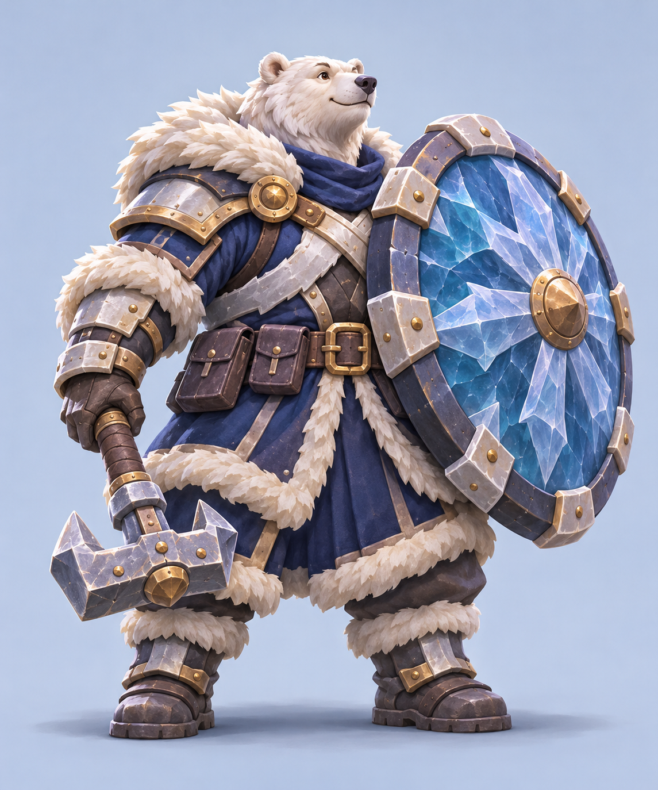
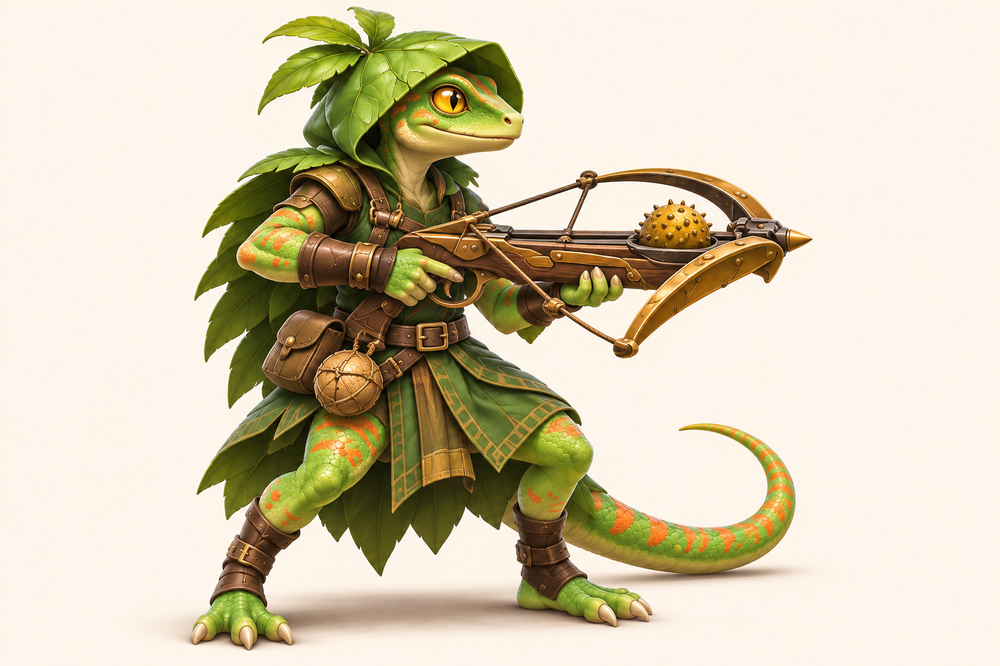
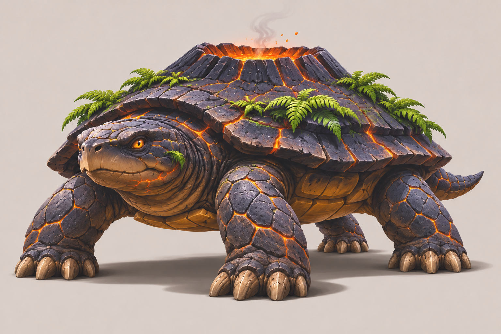
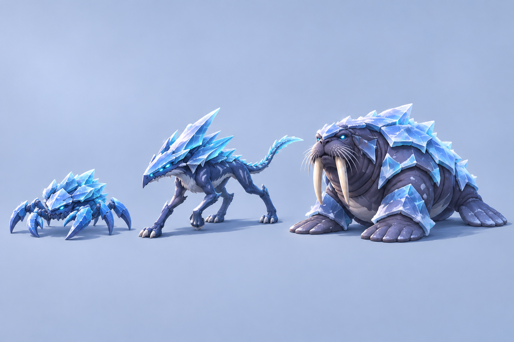
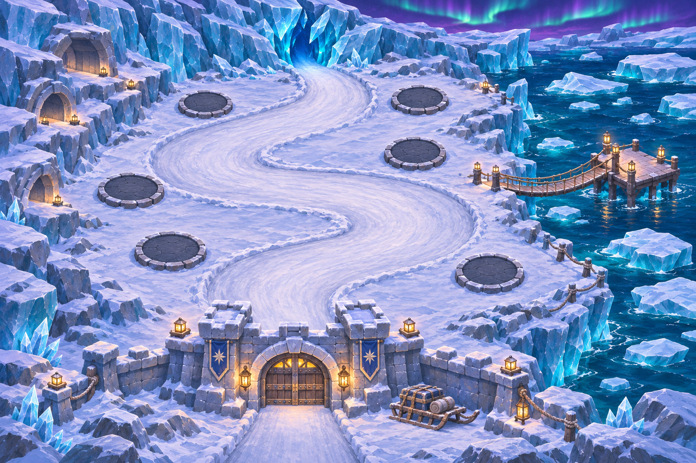
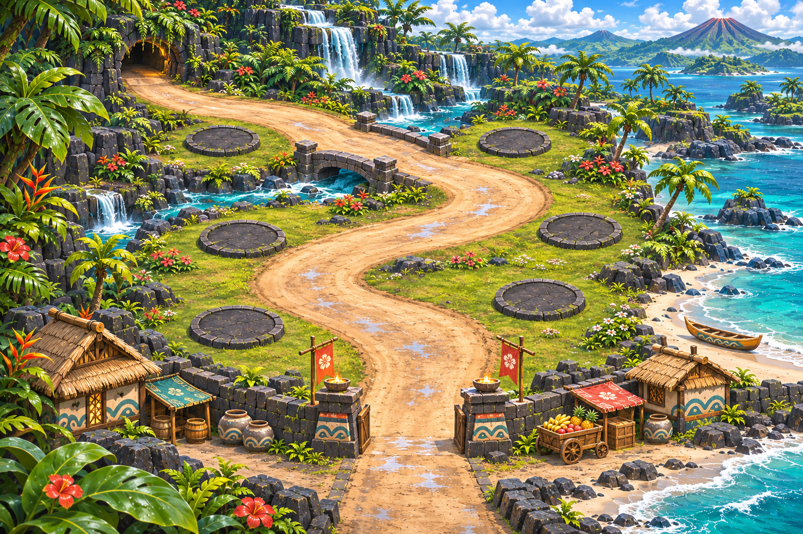

# 캐릭터·보스·몬스터·환경 개별 컨셉

2026-11-09 (Asia/Seoul). [극지 해안과 열대 군도 장면](concept-expansion-2026-11-06.md)을 개별 제작 대상으로 발전시킨 시안이다. 캐릭터 2장, 보스 1장, 일반 몬스터 1장, 환경 2장으로 구성한다.

[기획 색인](README.md) · [원본 목록·해시](../../art-source/defense/concepts/2026-11-09/manifest.json)

배경이 단순한 캐릭터 이미지도 투명 스프라이트나 3D 모델이 아니다. 지역·역할·건설 지점은 시각 설계 제안이며 이번 작업에서 게임 데이터·배포 자산·APK를 변경하지 않는다.

## 북극곰 수호자

둥근 방패와 낮고 넓은 체형으로 방어 역할을 강조한다. 털·판금·얼음의 재질을 나누고 짧은 닻머리 망치로 전경 장면의 정체성을 이어간다. 모델 제작에서는 방패가 몸을 가리는 영역과 손잡이 결합을 별도 측면도에서 확인해야 한다.

## 열대 도마뱀 궁수

잎 후드·금빛 눈·긴 꼬리·씨앗 쇠뇌로 정찰과 원거리 공격 역할을 연결한다. 모델 제작에서는 쇠뇌 장전부와 손 위치, 꼬리의 회전 범위, 지면에 닿는 발가락을 먼저 정리한다.

## 화산등 거북왕

낮고 넓은 현무암 몸체와 분화구 형태의 등껍질이 핵심이다. 화산·생물 결합은 판타지 설정이며 과학적 생물 묘사가 아니다. 초기 생성에서 다리가 5개였던 오류를 이미지 편집으로 교정했고, 갤러리에는 머리 1개·다리 4개·꼬리 1개가 보이는 교정본을 보존한다. 먼쪽 뒷다리 상부 부착부는 몸통에 가려져 있으므로 정면·측면·후면과 관절 구조를 확정한 뒤 몸 낮추기, 공격 준비, 타격, 피격 자세로 연결한다.

## 극지 일반 몬스터

작고 낮은 얼음 게, 가늘고 높은 서리 사냥꾼, 육중한 빙갑 바다코끼리로 같은 청색 계열에서도 실루엣을 구분한다. 이 이미지는 같은 바닥 위의 비교 구도이며 개별 애니메이션 프레임으로 사용할 수 없다. 게의 뒤쪽 다리가 겹쳐 전체 보행다리 수를 확인하기 어렵다. 바다코끼리의 앞지느러미 끝은 발가락처럼 갈라져 보이며 후방 지느러미는 한쪽만 명료하므로 모델 설계 시 정리한다.

## 극지 해안 전장

빙하·유빙·바다·오로라를 유지하면서 인물 없이 이동 경로와 빈 건설 공간을 살핀다. 원형 빈 패드 6곳과 빙하 입구에서 전경 성문까지 이어지는 굽은 길이 보인다. 뒤쪽 길과 주변 눈의 명도 대비가 약하고 성벽이 마지막 짧은 길 구간을 가린다. 도로 연속성, 교량 연결, 지상 적과 수상 보스의 경계는 실제 전장 데이터로 옮길 때 다시 검증한다.

## 열대 군도 전장

폭포·우림·현무암·라군을 배경으로 밝은 길과 어두운 건설 공간을 구분한다. 빈 패드 6곳과 숲 입구→현무암 다리→굽은 모랫길→열린 성문의 연결을 확인했다. 후경 패드는 원근상 작고 주변 식생·폭포 디테일이 많다. 거대한 잎과 전경 장식은 게임 카메라에서 적·길·타워를 가리지 않도록 정리한다. 지형 삽화를 그대로 충돌·경로 데이터로 취급하지 않는다.

## 적용 전 확인

- 영웅·몬스터의 작은 화면 실루엣, 무기 결합, 좌우 방향과 발 접지를 실제 게임 카메라에서 검증한다.
- 보스의 전신 구조와 공격 판정 크기를 먼저 정하고, 장식과 파티클은 마지막에 더한다.
- 환경의 건설 지점 수·길 폭·교량 연결은 그림을 참고해 별도로 설계한다. 그림에 보이는 원판의 수가 확정된 게임 규칙을 뜻하지 않는다.
- 이번 검증은 이미지 무결성·해시·문서 링크·시각 검토이며, 리깅·게임 내 성능·모바일 조작 검증은 포함하지 않는다.
