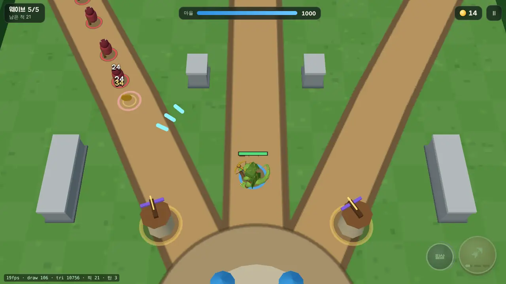
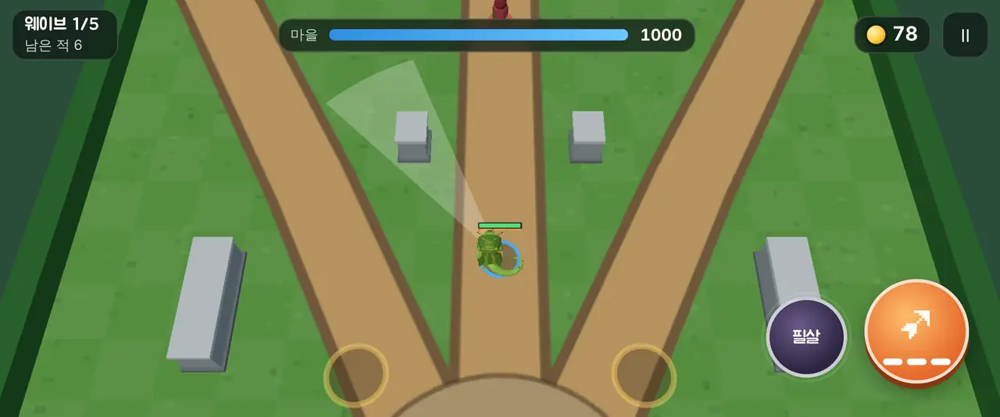

# 00회차: 환경·엔진 결정·시제품 v0

| 항목 | 값 |
| --- | --- |
| 시각 | 2026-11-09 23:40 KST |
| 기준 | `b175a9f` (main과 같은 지점에서 시작) |
| 브랜치 | `claude/confident-knuth-qc16ui` |
| 레인 | 설정 회차 (환경 + 엔진 조사 + 첫 플레이 가능 버전) |
| 상태 | **완료** |

## 한 일

1. **개발 환경 확인**
   - Node 22.23.4, npm 10.9.9 확인. `npm ci` 성공.
   - 기존 테스트 170/170 통과.
   - 브라우저는 Playwright Chromium(사전 설치, 소프트웨어 렌더링)을 쓴다.
   - Blender는 이 컨테이너에 없다.
   - LLM·이미지 생성 API 키는 환경 변수에 없다(GitHub 토큰과 클라우드 자격 증명만 있음).
2. **엔진·프레임워크 조사**: [engine-research-2026-11.md](../engine-research-2026-11.md)
   - TS 결정적 시뮬레이션과 Three.js 조합을 채택했다.
   - C#·Java는 보류하고, 재검토 조건을 명시했다.
3. **시제품 v0** (`rush.html`, `src/rush/`)
   - 영웅 직접 조작: 탄 3칸, 자동·직접 조준, 필살기.
   - 적 4종(보스 경고 내려찍기 포함), 3갈래 길과 엄폐 벽.
   - 골드를 줍고 궁수탑 4곳을 Lv3까지 건설·강화.
   - 5웨이브, 결과 화면, 자동 시연.
4. **검증 도구**: `npm run test:rush`(규칙·밸런스), `npm run smoke:rush`(Playwright 데스크톱·모바일 가로 터치).

## 수용 기준과 결과

| 기준 | 결과 |
| --- | --- |
| 같은 시드·입력이면 같은 판 | 통과 (`rushHash` 비교) |
| 아무것도 안 함, 영웅만, 탑만 → 패배 / 영웅+탑 → 2~4분 안에 승리 | 통과. 시드 1~6 모두 영웅+탑 승리, 약 142~147초 |
| 터치: 왼쪽 끌기 이동, 공격 탭은 자동 조준, 끌면 조준 | 통과 (Pixel 7 가로 863×360, CDP 터치 이벤트) |
| PC: WASD 이동(0.0867 m/틱 = 5.2 m/s), E 건설, 클릭 사격 | 통과 |
| 페이지 오류 없음 | 통과. 사용자 제스처 전 AudioContext 경고만 있고, 의도된 동작이다 |
| 전체 테스트·타입 검사·빌드 | `npm test` 180/180, `tsc` 통과, `npm run build` 통과(rush 번들 41.6 KB) |

### 밸런스 표 (자동 봇, 시드 1~3)

| 방식 | 결과 | 도달 웨이브 |
| --- | --- | --- |
| 아무것도 안 함 | 패배 (약 70초) | 1 |
| 영웅만 | 패배 | 4~5 |
| 탑만 | 패배 | 3~4 |
| 영웅+탑, 필살기 없음 | 승리, 마을 695~861 | 5 |
| 영웅+탑+필살기 | 승리, 마을 964~1000 | 5 |

봇은 조준이 완벽해서 사람보다 강하다. 사람 기준 난이도는 미확인이다.

## 화면

| 데스크톱 5웨이브 | 모바일 가로 직접 조준 |
| --- | --- |
|  |  |

검토하면서 고친 것:
- 탑 지붕이 커서 전장을 가렸다 → 위가 열린 망루와 회전 쇠뇌로 바꿨다.
- 시야각이 넓어 가까운 물체가 부풀어 보였다 → FOV를 42에서 32로 줄이고 카메라를 멀리 뺐다.
- 영웅 GLB 방향은 동·북 근접 렌더로 확인했다.

## 한계

- FPS는 소프트웨어 렌더링 값이라 의미 없다. 드로콜은 장면당 약 100이다(5웨이브 기준, 개수).
- 판 사이 성장(킹덤 메타)이 없다. 적은 단순 도형이다.

## 다음

- **next_lane: 킹덤 메타.** 순환 순서 대신 참고작 대비 가장 큰 공백을 먼저 메운다.
- 백로그 상위 3개:
  1. 마을 화면 v0 (자원, 영구 강화, 저장)
  2. 덤불·부서지는 엄폐물
  3. 두 번째 영웅(브론)
