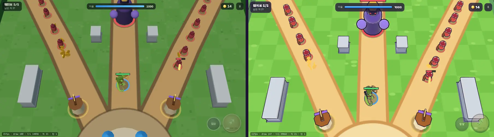
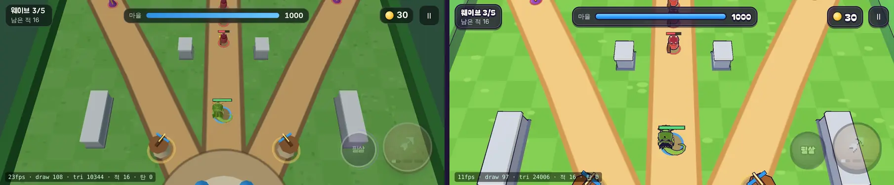
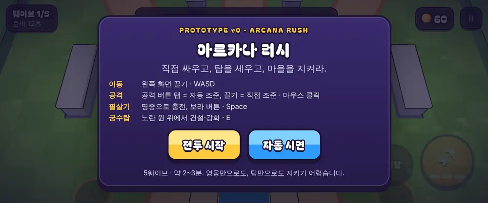

# 01회차 — 렌더 톤 1차 (브롤스타즈풍 원칙)

| 항목 | 값 |
| --- | --- |
| 시각 | 2026-11-10 00:36~00:50 KST |
| 기준 | `eea7c7d` |
| 레인 | 렌더 톤·모델. **사용자 지시로 순서를 바꿈**(원래 next_lane은 킹덤 메타) |
| 상태 | **완료** |

## 사용자 결정 (2026-11-10)

> 디자인·그래픽·렌더 톤은 브롤스타즈, 플레이는 킹샷(마을 성장, PvE)

- [art-direction.md](../art-direction.md)를 새로 만들었다: 원칙 8개, 색 토큰, 모바일 비용 규칙.
- [loop.md](../loop.md)를 고쳤다:
  - 레인은 킹덤 메타가 1순위가 되도록 바꿨다.
  - 백로그를 다시 정렬하고, 실시간 PvP(Colyseus)는 뺐다.
  - 실기기 게이트를 백로그에 추가했다.
- [엔진 조사](../engine-research-2026-11.md)에 방향 확정 뒤 판단을 추가했다: TypeScript + Capacitor 유지, Colyseus는 보류.

## 범위와 수용 기준

**범위**: 규칙은 바꾸지 않는다. 화면 톤만 원칙 1~8에 맞춘다.
- 툰 셰이딩, 림 라이트, 잉크 외곽선
- 부품을 하나로 굽기
- 섬 지형과 팔레트
- 굵은 UI 글꼴
- 휴대폰 카메라

| 기준 | 결과 |
| --- | --- |
| 같은 시드·틱 전후 비교(`?freeze=`) | 웨이브3(3409틱), 보스전(7729틱), 데스크톱·모바일 가로를 촬영 |
| 외곽선을 넣고도 드로콜이 늘지 않음 | 웨이브3 108 → **101**, 보스전 180 → **147**. 삼각형은 1.0만 → 2.5만, 1.5만 → 4.0만 |
| 모바일 가로(863×360)에서 영웅·적을 읽을 수 있음 | 짧은 화면은 카메라를 20% 당기고 시야를 앞으로 3.5 m 옮겨, 다가오는 적이 상단 HUD에 가리지 않게 했다 |
| 규칙 불변 | 설계 기둥·결정성 테스트 그대로 통과 |
| 규칙 코어가 엔진에 의존하지 않음(약속했던 검사) | 새 테스트 통과: `sim.ts`·`data.ts`·`bot.ts`는 규칙 모듈만 import하고, `Math.random`·DOM·시계를 쓰지 않는다 |

## 바꾼 것

- `src/rush/look.ts`(신규)
  - 팔레트 `PAL`
  - `toon()`: 명암 3단계와 프레넬 림
  - `outlineMaterial()` / `hullGeometry()`: 뒷면 외곽선. 법선을 평균내 모서리가 갈라지지 않는다
  - `bake()`: 여러 도형을 정점 색 지오메트리 하나로
  - `toonify()`: GLB 재질 변환
- `src/rush/render.ts`
  - 적 4종을 다시 디자인했다: 큰 머리와 눈, 고유 실루엣. 종류별로 한 번 구워서 공유한다.
  - 탑은 레벨별로 굽고 외곽선을 넣었다.
  - 성벽·울타리·마을을 각각 메시 하나로 합쳤다.
  - 물 위의 섬 지형, 잔디 체크 타일, 모래 길을 새로 그렸다.
  - 피격 반짝임은 머티리얼 교체로 바꿨다.
- **버그 수정**: 적이 생길 때마다 지오메트리를 새로 만들고 해제하지 않던 누수를 없앴다. 지오메트리는 종류별로 공유하고, 체력바 지오메트리도 공유한다.
- `src/rush/rush.css`: Bagel Fat One(저장소 포함, OFL)과 잉크 외곽선 글자, 아래가 두툼한 버튼(주 행동 노랑, 보조 파랑), 남색 패널.
- `src/rush/main.ts`: `?freeze=N` 옵션.

## 화면 (같은 시드·틱)

보스전 1280×720. 왼쪽이 전, 오른쪽이 후.

모바일 가로 863×360, 웨이브3. 왼쪽이 전, 오른쪽이 후.

## 검증

- `npm run test:rush` 11/11, `npm test` 181/181, `tsc` 통과, `npm run build` 통과(rush 번들 45.0 KB)
- `npm run smoke:rush` 10/10. 데스크톱, 모바일 가로 터치, 페이지 오류 없음.
- FPS는 소프트웨어 렌더링 값이라 근거로 쓰지 않았다.

## 한계

- 영웅 GLB는 작은 부품마다 외곽선이 붙어 몸 안쪽 선이 조금 번잡하다. 정식 모델은 부품 수를 줄여야 한다.
- 적은 아직 도형을 구운 임시 모델이다. 애니메이션은 걷기 흔들림과 준비 자세 찌그러짐뿐이다.

## 다음

- **next_lane: 킹덤 메타.** 백로그 1번 ‘마을 화면 v0’.
- 백로그 상위 3개:
  1. 마을 화면 v0(자원, 영구 강화, 저장)
  2. 스테이지 진행 1~10
  3. 성 레벨 제한 규칙
