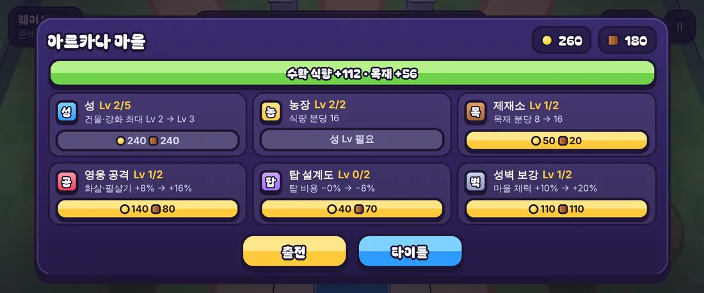
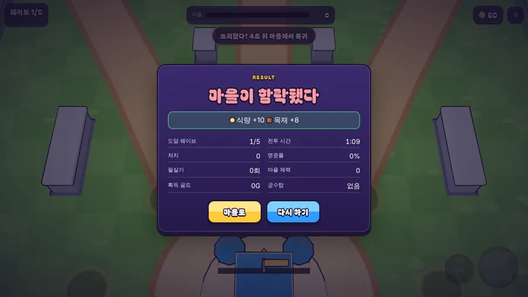

# 02회차: 킹덤 메타, 마을 화면 v0

| 항목 | 값 |
| --- | --- |
| 시각 | 2026-11-10 00:49~01:00 KST (예약 회차) |
| 기준 | `402c957` |
| 레인 | 킹덤 메타 (백로그 1번) |
| 상태 | **완료** |

## 범위

판과 판 사이에 마을이 자라는 최소 고리를 만든다. 킹샷 원칙을 따른다: 성이 중심이고, 자원 건물이 시간에 따라 생산하며, 강화가 다음 전투를 바꾼다.

**가설**: 판이 끝날 때마다 쓸 곳이 생기면 “한 판 더” 동기가 생긴다. 주관적 가설이며 사람 검증이 필요하다.

## 구현

- **`src/rush/kingdom.ts`**: 순수 규칙. 시계 대신 `now`를 인자로 받는다.
  - **성 Lv 1~5.** 농장·제재소·영구 강화 3종의 최대 단계가 성 Lv까지다. 성이 다음 목표를 정한다.
  - **생산.** 농장은 식량, 제재소는 목재를 Lv당 분당 8씩 만든다. 앱을 꺼 둔 동안에도 쌓이고, 창고는 120분치까지다.
    - 수확은 **정수 분 단위**로만 한다. 남은 몇십 초는 계속 쌓이고, 같은 생산을 두 번 세지 않는다.
    - 시계가 뒤로 가면 생산 0이고, 이후 생산은 막히지 않는다.
  - **영구 강화**: 영웅 공격 +8%/단계(화살·필살기), 탑 비용 −8%/단계(최저 −40%), 마을 체력 +10%/단계.
  - **전투 보상**:
    - 식량 = 10 + 15×방어한 웨이브 수 (+40 승리 시)
    - 목재 = 8 + 12×방어한 웨이브 수 (+30 승리 시)
    - 전투 id마다 1회만 지급하며, 최근 20개를 기억한다.
  - **저장 형식 검증.** 범위를 벗어났거나, 형식이 깨졌거나, 다른 버전인 저장은 새 마을로 대체한다. 미래 시각은 지금으로 당긴다.
- **`src/rush/sim.ts`**: `createRush(seed, mods)`. 보정값이 모두 1이면 기존과 같다. 설계 기둥과 결정성 테스트가 그대로 통과한다.
- **`src/rush/town.ts`** + 화면
  - 흐름: 타이틀 → **마을** → 출전 → 결과(보상 표시) → 마을.
  - 마을 화면: 자원, 수확 버튼(대기량 표시), 건물·강화 카드 6장(“현재 → 다음” 미리보기와 비용), 출전 버튼.
  - 휴대폰 가로(높이 360px)에서도 출전 버튼이 화면 안에 고정된다.
  - 이모지 대신 글자 배지 아이콘을 쓴다(기기 글꼴 의존 없음).
- **저장 키** `arcana-rush:kingdom:v1`. 기존 아르카나 저장은 건드리지 않았다.
- 자동 시연은 보정값과 보상 없이 기본 게임만 보여 준다.

## 수용 기준과 결과

| 기준 | 결과 |
| --- | --- |
| 생산·상한·시계 역행·수확, 성 Lv 제한, 비용, 보상 1회, 저장 왕복과 복구 테스트 | `kingdom.test.ts` 6개 통과 |
| 보정값이 실제 판에 반영 | 통과. 마을 체력 ×1.3, 탑 비용 −24%, 화살 피해 ×1.24 확인 |
| 기본 보정값에서 설계 기둥·결정성 유지 | 통과 |
| 규칙 코어가 엔진에 의존하지 않음 | 통과. 검사 범위에 `kingdom.ts`를 추가했다 |
| 브라우저: 마을 → 강화 → 새로고침 뒤 유지 → 출전 시 보정 적용 → 결과 보상 → 전투 기록 1회 | `smoke:rush`에 단계를 추가해 통과(전체 16/16) |
| 전체 검증 | `test:rush` 17/17, `npm test` 187/187, `tsc`·`build` 통과(rush 번들 51.9 KB) |

## 화면

휴대폰 가로 863×360 마을 화면(창고에 7분치 생산이 쌓인 상태):

결과 화면 보상(1웨이브 패배 시 참여 보상):

## 한계와 메모

- 마을은 아직 **카드 목록**이다. 킹샷처럼 3D 마을에서 건물을 눌러 올리고, 성장 단계마다 건물 모습이 바뀌는 화면은 다음 단계다.
- 수치(비용·생산·보상)는 첫 추정치다. 승리 1회(식량 125·목재 98)에 생산 약 15분이 더해지면 강화 1~2개를 살 수 있게 맞췄다. 사람 플레이 전에는 미검증이다.
- 보정값이 붙으면 같은 시드라도 결과가 달라진다. 결정성은 같은 보정값끼리만 보장한다(의도된 동작).

## 다음

- **next_lane: PvE 콘텐츠.** 백로그 2번 ‘스테이지 진행 1~10’.
- 백로그 상위 3개:
  1. 스테이지 진행: 난이도 곡선, 별 1~3개, 10스테이지는 강화 없이 패배
  2. 성 레벨 규칙 v1과 3D 마을 화면
  3. 영웅 성장과 두 번째 영웅
