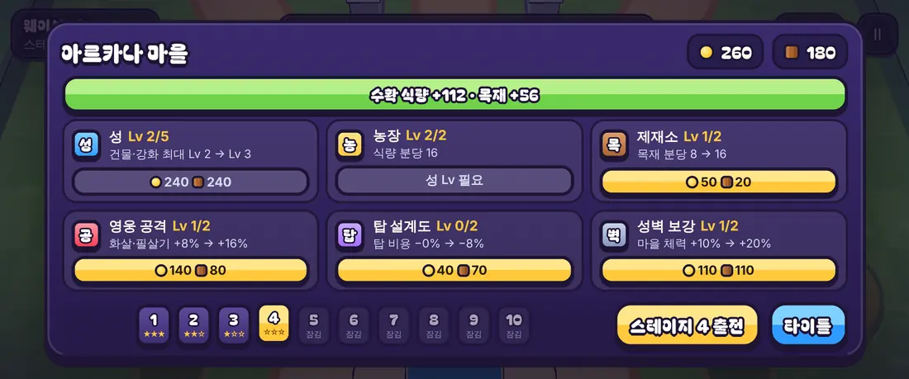
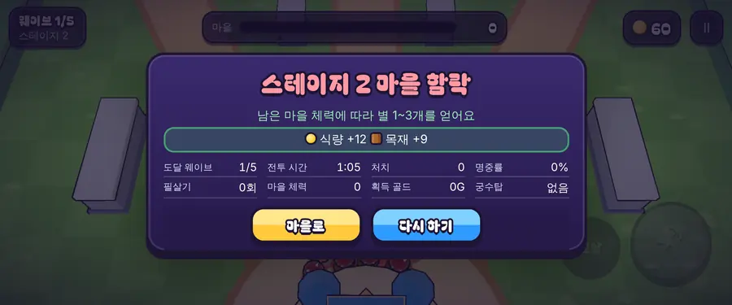

# 03회차: PvE 콘텐츠, 스테이지 진행 1~10

| 항목 | 값 |
| --- | --- |
| 시각 | 2026-11-10 01:42~02:00 KST (예약 회차) |
| 기준 | `cb265f5` |
| 레인 | PvE 콘텐츠 (백로그 2번) |
| 상태 | **완료** |

## 범위

마을을 키울 이유를 만든다. 스테이지가 오를수록 적이 강해지고, 높은 스테이지는 마을 강화 없이는 깰 수 없다.

**가설**: 막히는 스테이지가 마을 강화의 목표가 되어 “마을 → 전투” 고리가 의미를 갖는다. 사람 검증 전까지는 가설이다.

## 구현

- **`src/rush/stages.ts`** (순수)
  - 스테이지 1은 기본 게임과 같다. 스테이지 10은 적 체력 +110%, 적 수 +70%, 적 피해 +50%이며 단계마다 선형으로 오른다.
  - 보상은 단계마다 +15%다.
  - 별은 승리 시 남은 마을 체력으로 정한다: 80% 이상 3개, 40% 이상 2개, 그 밖은 1개. 패배는 0개.
  - 새로 얻은 별마다 한 번 보너스를 준다.
- **`src/rush/sim.ts`**: `createRush(seed, mods, difficulty)`. 적 수 배율은 보스에는 적용하지 않는다.
- **`src/rush/kingdom.ts`**
  - 스테이지별 최고 별을 기록한다. n−1에서 별을 얻으면 n이 열린다.
  - `settleBattle()`: 스테이지 배율 보상과 새 별 보너스를 같은 판에 한 번만 준다. 기록은 내려가지 않는다.
  - 별 기록이 없는 이전 저장도 다른 진행을 유지한 채 읽는다.
- **화면**
  - 마을에 스테이지 칩 10개를 넣었다(별, 잠김 표시, 기본 선택은 가장 먼 스테이지). 출전 버튼에 선택한 스테이지 번호가 나온다.
  - HUD에 스테이지를 표시한다. 결과 화면에 별, 새 별, 다음 스테이지 열림을 표시한다.
  - 휴대폰 가로에서는 칩과 버튼을 한 줄에 놓는다. 결과 화면은 통계를 4열로 압축하고 버튼을 아래에 고정한다.

## 고친 버그 (곡선 조정 중 발견)

- **한 번에 하나만 나오는 적 묶음이 2마리로 늘면 웨이브가 끝나지 않았다.** 2웨이브의 거한처럼 등장 간격이 0인 묶음이다. 두 번째가 영원히 나오지 않아 게임이 멈췄다.
  - 간격 0 묶음의 추가분은 1.5초 간격으로 나오게 고쳤다.
  - 회귀 테스트: 스테이지 10개 × 강화 없음·최대 강화 모두 끝까지 끝나는지 확인한다.
- **`.actions button` 범용 스타일이 스테이지 칩까지 132px 파란 버튼으로 만들었다.** 직계 자식 버튼에만 적용되도록 범위를 좁혔다.
- **휴대폰 가로(높이 360px)에서 결과 화면의 버튼이 화면 밖으로 밀렸다.** 02회차부터 있던 문제다. 위 압축과 고정으로 고쳤다.

## 곡선 측정 (자동 봇, 시드 1~3 중 승리 수와 승리 시 평균 남은 마을 체력)

| 마을 강화 | 1 | 2 | 3 | 4 | 5 | 6 | 7 | 8 | 9 | 10 |
| --- | --- | --- | --- | --- | --- | --- | --- | --- | --- | --- |
| 없음 | 3(99%) | 3(98%) | 3(65%) | 3(71%) | 3(36%) | 3(15%) | 0 | 0 | 0 | 0 |
| 강화 2단계 | 3 | 3 | 3 | 3 | 3 | 3(39%) | 2 | 0 | 0 | 0 |
| 강화 3단계 | 3 | 3 | 3 | 3 | 3 | 3 | 3 | 3(23%) | 2 | 1 |
| 최대(성 5) | 3 | 3 | 3 | 3 | 3 | 3 | 3 | 3(76%) | 3(55%) | 3(24%) |

봇은 조준이 완벽해서 사람보다 강하다. 사람에게는 이보다 일찍 벽이 올 것으로 예상하며, 이는 미검증이다.

## 수용 기준과 결과

| 기준 | 결과 |
| --- | --- |
| 강화 없이 스테이지 1~3 승리, 스테이지 10 패배 | 통과 (시드 1·2, `stages.test.ts`) |
| 최대 강화 시 스테이지 10 승리 | 통과 (시드 1·2) |
| 별 규칙, 잠금 해제, 새 별 보상 1회, 기록 유지, 이전 저장 호환 | 통과 |
| 모든 스테이지가 끝남(멈춤 없음) | 통과 (10단계 × 2조건) |
| 기본 난이도에서 설계 기둥·결정성 유지 | 통과 |
| 브라우저: 스테이지 선택 → 출전 → HUD 스테이지 → 결과, 휴대폰 가로 버튼 화면 안 | 통과 (데스크톱·Pixel 7 가로). 스모크에 ‘새 마을의 스테이지 2 잠김’과 ‘출전 버튼 스테이지 표시’를 추가했다 |
| 전체 | `test:rush` 23/23, `npm test` 193/193, `tsc`·`build` 통과(rush 번들 54.5 KB), `smoke:rush` 18/18 |

## 화면 (휴대폰 가로 863×360)

## 한계

- **승리 결과 화면의 별 표시는 브라우저에서 보지 못했다.** 사람 대신 이겨 줄 수단(플레이 모드 자동 전투)이 없어서다. 별 계산과 정산은 테스트로 확인했다.
- 마을 화면 뒤 HUD가 직전 판 상태를 흐리게 보여 준다(기능 영향 없음).
- 스테이지마다 지형·적 구성이 같고, 배율만 다르다. 지역 테마는 렌더 톤 레인 후보다.

## 다음

- **next_lane: 전투 손맛.** 순환상 PvE 다음이다. 백로그 6번 히트스톱, 또는 덤불 은신.
- 백로그 상위 3개:
  1. 히트스톱(보스 처치·필살기 착탄)
  2. 3D 마을 화면과 성 규칙 v1
  3. 영웅 성장과 두 번째 영웅
