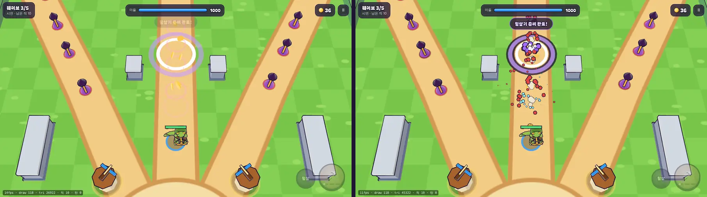
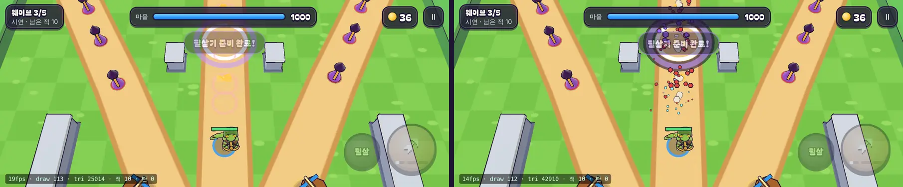
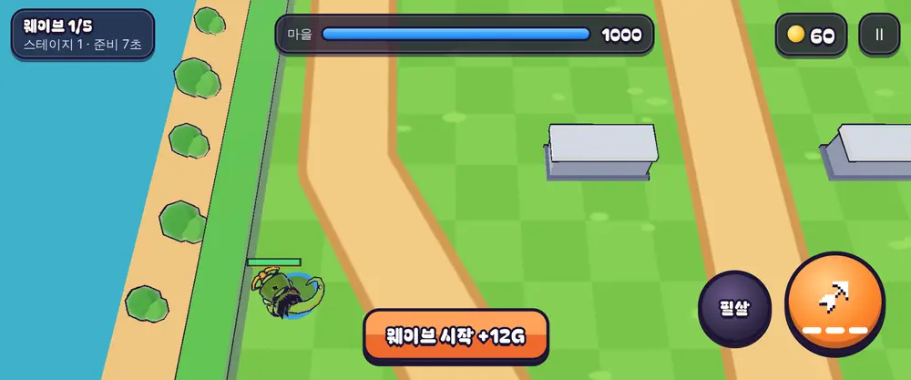

# 05회차 — 렌더 톤 2차: 이펙트 문법과 섬 가장자리

| 항목 | 값 |
| --- | --- |
| 시각 | 2026-11-10 03:42~03:53 KST (예약 회차) |
| 기준 | `c416130` |
| 레인 | 렌더 톤·모델 (백로그 5번) |
| 상태 | **완료** |

## 범위

[아트 기준](../art-direction.md) 원칙 1·4·7의 “이펙트 문법”을 만든다. 지금 효과는 모두 얇은 고리 하나라 맞힘·처치·필살기가 비슷해 보인다.

- **`src/rush/fx.ts`**: 단색 조각 파티클을 잉크 외곽선과 함께 인스턴스 메시 2개로 그린다(드로콜 고정 +2).
  - 조각(중력·회전), 연기(떠오르며 커졌다 작아짐), 반짝임 3종.
- **사건별 문법**

  | 사건 | 효과 |
  | --- | --- |
  | 영웅 화살 명중 | 청록 조각 |
  | 탑 명중 | 노랑 조각 |
  | 처치 | 적 색 조각 + 연기 |
  | 필살기 | 외곽선 충격파 + 보라 조각 |
  | 보스 내려찍기 | 먼지 |
  | 사격 | 총구 연기 |
  | 코인 | 금 반짝임 |
  | 건설 | 먼지 |

- **섬 가장자리**: 울타리 바깥 모래에 덤불·바위·나무 상자를 장식으로 굽는다(메시 1개). **플레이 영역 안에는 두지 않는다.** 단단해 보이는 것은 단단해야 한다는 가독성 원칙을 지키기 위해서다.
- **디버그**: `?freeze=N`에서는 효과도 멈춘다. 같은 틱의 전후 비교를 위해서다.
- 덤불 은신이나 부서지는 상자 같은 **규칙**은 이번 범위가 아니다. 전투 손맛 레인 후보다.

## 수용 기준과 결과

| 기준 | 결과 |
| --- | --- |
| 같은 시드·틱 전후 비교 | 필살기 착탄 4틱 뒤(3629), 보스 처치(8710), 데스크톱·모바일 가로를 촬영. 효과도 멈추는 `?freeze`로 같은 순간을 비교했다 |
| 드로콜 | 필살기 순간 118 → **118**, 보스 처치 103 → 106, 모바일 113 → 112. 맞힐 때마다 생기던 고리 메시를 인스턴스 파티클로 바꿔 늘지 않았다 |
| 삼각형 수 | 2.7만 → 4.5만(필살기 순간), 2.0만 → 3.5만(보스 처치). 장식 덤불(구 8×6 분할)과 외곽선이 대부분이다. 성능 주장은 하지 않는다 |
| 동작 줄이기 | 같은 틱 파티클 116 → **72**. 히트스톱은 04회차대로 멈추지 않는다 |
| 규칙 불변 | `sim.ts` 미수정, `test:rush` 28/28 |
| 전체 | `npm test` 198/198, `tsc`·`build` 통과(rush 번들 60.1 KB), `smoke:rush` 19/19 |

## 검토하며 고친 것

- 1차 연기 효과는 크고 하얗고 외곽선이 두꺼워 **바위처럼 보였고 적을 가렸다**.
  - 크기를 약 45% 줄였다.
  - 수명을 0.38~0.6초로 줄이고, 커졌다 바로 줄어드는 곡선으로 바꿨다.
  - 외곽선을 종류별로 나눴다: 조각 1.35, 연기 1.1, 반짝임 1.25.
  - 위 비교 화면은 고친 뒤 상태다.

## 화면 (같은 시드·틱. 왼쪽 전 / 오른쪽 후)

필살기 착탄 직후 1280×720:

모바일 가로 863×360:

섬 가장자리 장식(영웅을 왼쪽 끝으로 이동):

## 한계

- 파티클 방향은 무작위(`Math.random`)라 같은 틱이라도 실행마다 조금 다르다. 화면에만 쓰고 규칙에는 쓰지 않는다.
- 장식은 영웅이 가장자리에 갈 때만 보인다. 기본 시야에서는 거의 안 보인다.
- 타격감·가독성 판단은 사람 플레이가 필요하다.

## 다음

- **next_lane: 성능·모바일** (순환: 렌더 톤 다음). 백로그 7번 인스턴싱. 이번에 삼각형이 늘었으니 적·코인·탄·장식 비용을 함께 본다.
- 백로그 상위 3개:
  1. 인스턴싱과 삼각형 예산
  2. 3D 마을 화면과 성 규칙 v1
  3. 영웅 성장과 두 번째 영웅
