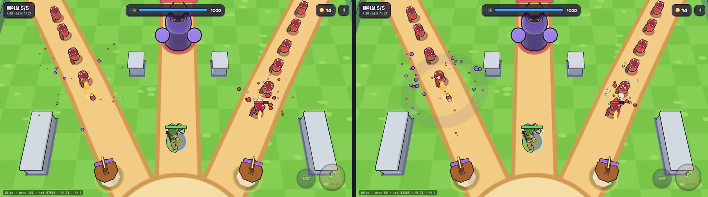
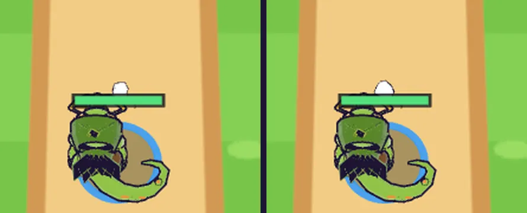

# 06회차: 성능·모바일, 인스턴싱과 영웅 굽기

| 항목 | 값 |
| --- | --- |
| 시각 | 2026-11-10 04:42~04:53 KST (예약 회차) |
| 기준 | `f0cd426` |
| 레인 | 성능·모바일 (백로그 7번) |
| 상태 | **완료** |

## 측정한 출발점

같은 시드, 같은 틱, 1280×720 기준이다.

| 장면 | 드로콜 | 삼각형 |
| --- | ---: | ---: |
| 웨이브3 (3409) | 107 | 4.2만 |
| 보스전 (7729) | **151** | 5.8만 |
| 적·탑이 없는 장면 | 64 | — |

드로콜이 많은 이유는 두 가지다.
- **영웅 GLB**: 부품 24개 + 부품별 외곽선 24개.
- **적**: 1마리마다 그림자, 고리, 본체, 외곽선, (다쳤을 때) 체력바 2.

## 범위

- **영웅 GLB 굽기**: 부품을 애니메이션 노드별로 합친다(몸·쇠뇌팔·머리·꼬리·고정). 텍스처가 없으므로 재질 색을 정점 색으로 옮긴다. 외곽선도 묶음마다 1개다. 48개 → 10개가 목표다.
- **인스턴싱**: 적 본체·외곽선(종류별), 피격 반짝임, 그림자, 적 고리, 체력바, 탄(종류별), 코인을 `InstancedMesh`로 묶는다. 적 수와 관계없이 드로콜이 고정된다.
- 규칙은 바꾸지 않는다.

## 구현

- **영웅 GLB 굽기** (`render.ts` `buildHero`)
  - 애니메이션 트랙이 움직이는 노드(몸·쇠뇌팔·머리·꼬리)와 고정 부분, 5묶음으로 부품을 합쳤다. 재질 색은 정점 색으로 옮겼다(`look.ts` `bakeMatrices`).
  - 다른 노드를 자식으로 가진 부품은 떼지 않고, 보이지 않는 재질로만 바꿔 자식 노드를 지켰다.
- **인스턴싱** (`batch.ts`)
  - 묶음 목록:
    - 적 본체·외곽선·피격 반짝임: 각각 종류별 4개
    - 그림자, 적 고리, 체력바 바탕·채움
    - 탄 4종(영웅·탑·적·필살기), 코인
  - 매 프레임 시뮬 상태로 다시 채운다. 비어 있으면 숨겨 드로콜이 0이다.
  - `InstancedMesh`는 개체별로 컬링하지 않는다. 그래서 개체마다 카메라 절두체 구 검사를 해 화면 밖 개체를 넣지 않는다.
- 적 생성·제거 때 Group과 Mesh를 만들고 지우는 일이 없어졌다(GC 부담 감소). 성능 주장은 하지 않는다.
- 진단용 `__rush.info().heroAnim` 추가.

## 수용 기준과 결과

| 기준 | 결과 |
| --- | --- |
| 보스전(7729) 드로콜 60 이하 | **151 → 56** |
| 웨이브3(3409) 드로콜 | 107 → **51**. 모바일 가로 101 → 49 |
| 삼각형 | 웨이브3 4.2만 → 4.5만, 보스전 5.8만 → 6.2만. 여유 있게 잡은 컬링 구와 무작위 파티클 수(102 → 115) 차이 |
| 같은 틱 화면 비교 | 적·외곽선·체력바·보스·영웅 동일(아래). 영웅 확대 비교도 색·외곽선 동일 |
| 영웅 사격 동작 | 스모크에서 클릭 사격 뒤 1.5초 안에 클립 재생 확인. 대체 조건 없이 다시 실행 |
| 전체 | `test:rush` 28/28, `npm test` 198/198, `tsc`·`build` 통과(rush 번들 62.4 KB), `smoke:rush` 20/20 |

## 화면 (보스전 7729틱. 왼쪽 전 / 오른쪽 후)

영웅 확대(왼쪽 개별 부품 48 드로콜, 오른쪽 구운 묶음 10 드로콜):

## 한계

- 드로콜·삼각형은 개수일 뿐이다. 실기기 프레임 시간은 측정하지 않았다(백로그 9번 실기기 게이트).
- 효과는 실시간으로 나이를 먹어서, 같은 틱이라도 효과가 남은 정도는 실행마다 다르다.
- 피격 반짝임은 흰색 묶음으로 바꿔 그린다. 반짝임 중에는 정점 색이 사라진다(이전과 같음).

## 다음

- **next_lane: 엔진 스파이크** (순환: 성능·모바일 다음). 후보는 백로그 10번 WebGPURenderer A/B. 지금 드로콜이 낮아졌으니 비교하기 좋다.
- 백로그 상위 3개:
  1. WebGPURenderer A/B
  2. 3D 마을 화면과 성 규칙 v1
  3. 영웅 성장과 두 번째 영웅
