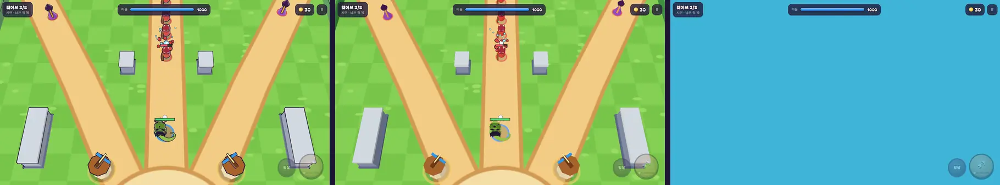
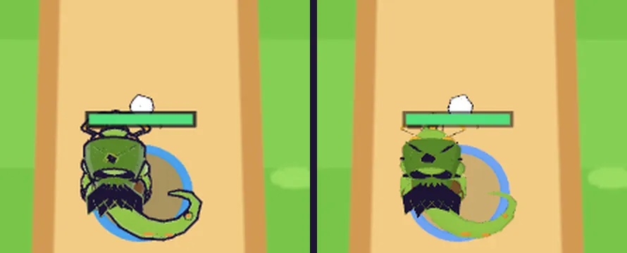

# 07회차: 엔진 스파이크, Three.js WebGPURenderer A/B

| 항목 | 값 |
| --- | --- |
| 시각 | 2026-11-10 05:42~05:48 KST (예약 회차) |
| 기준 | `9ae655d` |
| 레인 | 엔진 스파이크 (백로그 10번) |
| 상태 | **완료** (결론: WebGLRenderer 유지) |

## 질문

지금 렌더러(WebGLRenderer)를 Three.js의 WebGPURenderer로 바꿀 수 있는가? 바꾸면 무엇이 깨지고, 무엇을 얻는가?

## 범위 (시간 제한 실험, 기본 경로 불변)

- `?renderer=webgpu`일 때만 `three/webgpu`를 **지연 로딩**해 WebGPURenderer로 그린다. `&forcewebgl`을 붙이면 같은 렌더러를 WebGL2 백엔드로 강제한다.
- 기본(파라미터 없음)은 지금과 같다. 제품 번들에 WebGPU 코드가 들어가지 않는지 빌드 결과로 확인한다.
- 같은 시드·틱(3409)에서 측정한다:
  - 첫 프레임 시각
  - 백엔드 종류(WebGPU / WebGL2)
  - 드로콜·삼각형
  - 페이지 오류·경고
  - 화면

**예상(확인 전 가설)**
- 툰 림 라이트와 잉크 외곽선은 `onBeforeCompile`로 GLSL을 고쳐 쓴다. 노드 재질을 쓰는 WebGPURenderer에서는 이 경로가 무시돼, 외곽선이 깨질 것이다.

## 측정 (시드 3 자동 시연, 3409틱 고정, 1280×720, 컨테이너 Chromium·SwiftShader)

| 경로 | 백엔드 | 렌더러 초기화 | 첫 프레임 | 3409틱 도달 | 드로콜 / 삼각형 | 오류·경고 |
| --- | --- | ---: | ---: | ---: | --- | --- |
| 기본 WebGLRenderer | WebGL2 | — | 622ms | 16.6초 | 51 / 4.5만 | 없음 |
| WebGPURenderer (기본 플래그) | **WebGL2로 자동 대체** | 320ms | 774ms | **33.7초** | 52 / 4.5만 | “No available adapters”, WebGL2 대체 경고 |
| WebGPURenderer + `--enable-unsafe-webgpu` 등 | WebGPU | 293ms | 1481ms | 10.9초 | **0 / 0** | **장치 손실**(WebGPU Device Lost), 화면 공백 |
| WebGPURenderer + `forceWebGL` | WebGL2 | 311ms | 767ms | 34.8초 | 52 / 4.6만 | 없음 |

- “3409틱 도달”은 8배속 시연이 고정 틱까지 가는 데 걸린 실제 시간이다. 프레임이 느릴수록 길어지므로, 같은 장면의 프레임 비용을 대략 비교할 수 있다. 소프트웨어 렌더링 값이라 기기 성능이 아니다. 그래도 WebGPURenderer의 WebGL2 백엔드가 이 환경에서 프레임당 약 2배 무거웠다.
- 실제 WebGPU 백엔드는 이 컨테이너(SwiftShader)에서 장치 손실로 아무것도 그리지 못했다. **실제 WebGPU 성능은 이 환경에서 판단할 수 없다.**

## 화면

왼쪽부터 기본 WebGL, WebGPURenderer(WebGL2 대체), WebGPURenderer(실제 WebGPU, 장치 손실):

영웅 확대(왼쪽 기본, 오른쪽 WebGPURenderer). **잉크 외곽선이 사라졌다.** 성벽·적도 같다. 영웅 자세 차이는 촬영 순간 사격 동작이 재생 중이었기 때문이다.

## 확인한 것

1. **가설 확인.** 외곽선(뒷면 법선 밀어내기)과 림 라이트는 `onBeforeCompile`로 GLSL을 고친다. WebGPURenderer의 노드 재질은 이를 무시한다. 외곽선 메시는 원래 크기 뒷면으로 그려져 본체에 가려 보이지 않는다.
2. **번들 문제.** `three/webgpu`를 동적 import로 떼어도, 지금 `vite.config.ts`의 `manualChunks`가 three 파일을 모두 `three-renderer` 청크로 모은다. 그래서 **기본 경로의 공유 청크가 358KB → 958KB(gzip 87 → 256KB)** 로 커졌다. 아르카나 본편과 공유하는 설정이라 루프 범위에서 고치지 않았다.
3. **자동 대체는 잘 된다.** WebGPU가 없으면 WebGL2 백엔드로 그대로 돈다(오류 없음). 다만 이 환경에서는 더 무거웠다.

## 결론과 다시 볼 조건

- **WebGLRenderer를 유지한다.** 이번 실험 코드는 제품에서 되돌렸다.
  - 재현용 패치: [07-webgpu-spike.patch](07-webgpu-spike.patch)
  - 측정 스크립트: `tools/rush-webgpu-ab.cjs`
  - 기본 번들은 이전과 같다(`three-renderer` 358.31KB, `rush` 62.36KB).
- **옮기려면 필요한 일** (추정 1~2회차):
  1. `look.ts`를 TSL로 다시 쓴다.
     - 외곽선: `MeshBasicNodeMaterial`의 `positionNode = positionLocal + normalLocal × 두께`, 뒷면.
     - 림: `MeshToonNodeMaterial`에 프레넬 항.
     - 파티클·인스턴스 묶음은 그대로 쓸 수 있다.
  2. `vite.config.ts`의 `manualChunks`에서 `three.webgpu`를 별도 청크로 뺀다. **사용자 확인이 필요한 공유 설정**이다.
  3. 실기기(안드로이드 Chrome, iOS Safari 26)에서 WebGPU 백엔드 실측.
- **다시 볼 조건**:
  - 실기기 게이트에서 WebGL 프레임 예산이 모자랄 때.
  - 컴퓨트 셰이더(대량 파티클·군중)가 필요할 때.

## 검증

- 실험 코드를 되돌린 뒤 기본 경로 결과: `test:rush` 28/28, `tsc` 통과, `build` 통과(번들 크기 이전과 같음), `smoke:rush` 20/20.

## 다음

- **next_lane: 킹덤 메타** (순환: 엔진 스파이크 다음, 한 바퀴). 백로그 3번 3D 마을 화면과 성 규칙 v1.
- 백로그 상위 3개:
  1. 3D 마을 화면
  2. 영웅 성장과 두 번째 영웅
  3. 실기기 게이트(사용자 기기 필요)
