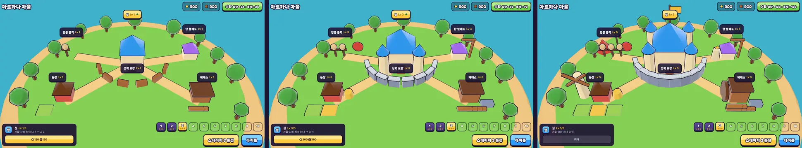
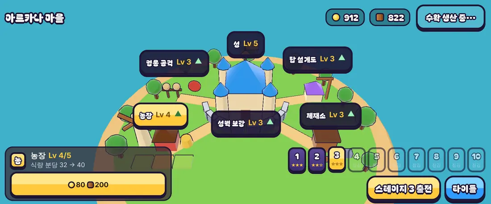

# 08회차: 킹덤 메타, 3D 마을 화면

| 항목 | 값 |
| --- | --- |
| 시각 | 2026-11-10 06:42~06:50 KST (예약 회차) |
| 기준 | `5fe1c75` |
| 레인 | 킹덤 메타 (백로그 3번) |
| 상태 | **완료** |

## 범위

마을 화면을 카드 목록에서 **3D 마을**로 바꾼다. 원칙은 킹샷과 같다: 마을을 보고 건물을 눌러 올리며, 레벨이 오르면 건물 모습이 커진다. 렌더 톤은 브롤스타즈풍 원칙([아트 기준](../art-direction.md))을 따른다.

- **`src/rush/townScene.ts`**: 전투와 다른 별도 3D 장면(섬 마을)이다.
  - 건물: 성·농장·제재소·훈련장(영웅 공격)·공방(탑 설계도)·성벽(마을 체력).
  - 레벨에 따라 **3단계 모습**: Lv 1 / Lv 2~3 / Lv 4~5. 강화 0단계는 공터 표지판.
  - 굽기와 외곽선은 기존 `look.ts` 규칙을 쓴다.
- **화면**
  - 3D 마을이 배경이다. 건물마다 이름·Lv 표지(탭 대상 44px 이상, 올릴 수 있으면 ▲ 표시)를 둔다.
  - 표지를 누르면 그 건물의 강화 카드 하나만 아래에 뜬다.
  - 자원·수확·스테이지 선택·출전은 그대로 쓴다.
- **강화 피드백**: 강화한 건물이 커졌다 돌아오는 연출.
- **규칙 불변**: `kingdom.ts`를 바꾸지 않는다. 대기 시간(건설 타이머)은 **넣지 않는다**. 시제품 단계에서는 ‘결정은 많게, 기다림은 없게’로 두고, 타이머는 수익화 설계와 함께 다시 본다.

**가설**: 숫자 목록보다 자라는 마을이 눈에 보이면 강화 동기가 커진다(주관적, 사람 검증 필요).

## 구현

- **`src/rush/townScene.ts`**: 전투와 렌더러를 공유하는 별도 장면이다.
  - 섬, 길, 나무가 있다.
  - 건물 6종은 단계마다 부품을 구워 외곽선과 함께 캐시한다.
  - 단계별 모습:

    | 건물 | Lv 1 | Lv 2~3 | Lv 4~5 |
    | --- | --- | --- | --- |
    | 성 | 본관 | 탑 2 | 탑 4, 금장식, 깃발 |
    | 농장 | 헛간, 밭 1 | 밭 2~3, 건초 | 풍차 |
    | 제재소 | 작업장, 통나무 | 돌 받침 | 물레바퀴 |
    | 훈련장 | 허수아비 | 허수아비 추가, 과녁 | 천막 |
    | 공방 | 작업장 | 기중기 | 탑 모형 |
    | 성벽 | 나무 울타리 6칸 | 돌벽 8칸 | 높은 돌벽 10칸 |

  - 강화 0단계(아직 안 지은 강화)는 표지판이다. 성벽만 0단계에 비어 있다.
- **화면**: 마을 화면은 3D 섬이 배경이다.
  - 건물마다 이름·Lv 표지가 있고, 올릴 수 있으면 ▲가 뜬다. 표지를 누르면 아래에 그 건물 카드 하나만 뜬다.
  - 자원·수확은 위쪽, 스테이지 선택·출전은 오른쪽 아래에 있다. 마을에서는 전투 HUD를 숨긴다.
- **강화 연출**: 건물이 0.45초 동안 늘었다 줄어든다.
- 휴대폰 가로(짧은 화면)는 카메라를 18% 빼고 섬을 아래로 내려 상단 바와 표지가 겹치지 않게 했다.
- **설계 결정**: 건설 대기 시간은 넣지 않았다. 시제품 단계는 ‘결정은 많게, 기다림은 없게’로 간다. 타이머는 수익화 설계와 함께 다시 본다.

## 수용 기준과 결과

| 기준 | 결과 |
| --- | --- |
| 건물 6종이 레벨 1·3·5에서 다르게 보임 | 통과 (아래 같은 카메라 비교) |
| 표지 탭 → 카드 → 강화 → Lv·모습 갱신 | 통과 (데스크톱·Pixel 7 가로 모두 농장 Lv 3 → 4) |
| 탭 대상 44px 이상, 화면 밖으로 나간 표지·버튼 없음 | 통과 (표지·출전·수확·강화 버튼·스테이지 칩 최소 44px) |
| 스모크 갱신 | ‘표지 탭 → 카드 표시’ 검사 추가, 강화·새로고침 유지 통과 |
| 전체 | `test:rush` 28/28, `npm test` 198/198, `tsc`·`build` 통과(rush 번들 69.5 KB, 공유 three 청크 그대로), `smoke:rush` 21/21 |

## 화면

같은 카메라, 마을 Lv 1 / 3 / 5 (1280×720):

휴대폰 가로 863×360(농장을 Lv 4로 올린 직후):

## 검토하며 고친 것

- **성벽 위치 오류:** 성벽 고리의 중심이 원점이라 성 안쪽에 겹쳤다. 성을 중심으로 앞쪽 반원에 놓이게 고쳤다.
- **휴대폰 가로 표지 겹침:** 위쪽 표지가 자원 칩과 겹쳤다. 카메라를 빼고 섬을 내렸다.
- **성벽 표지가 성문을 가림:** 성벽 앞쪽 아래로 옮겼다.
- **내 검증 스크립트 오류:** 최대 레벨 마을에서 강화 버튼을 누르려 했다(비활성). 성 Lv 5·농장 Lv 3 마을로 고쳐 다시 확인했다.

## 한계

- 건물을 직접 탭하는 3D 선택(레이캐스트)은 없다. 표지가 탭 대상이다.
- 표지가 휴대폰에서 건물에 비해 크다(44px 기준 때문). 다음에 아이콘형 표지를 검토한다.
- 사람 대상 재미 검증은 아직이다.

## 다음

- **next_lane: PvE 콘텐츠** (순환). 백로그 4번 영웅 성장과 두 번째 영웅(브론).
- 백로그 상위 3개:
  1. 영웅 성장과 두 번째 영웅
  2. 탑 분기(화염·냉기)
  3. 실기기 게이트(사용자 기기 필요)
