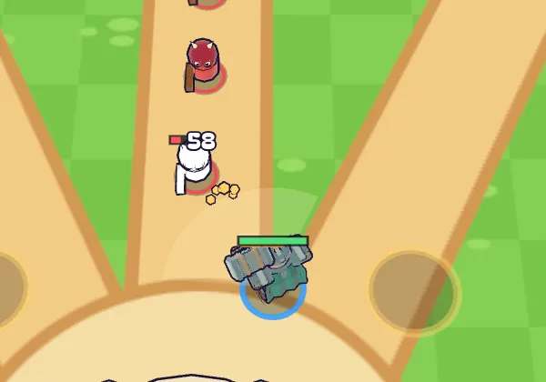
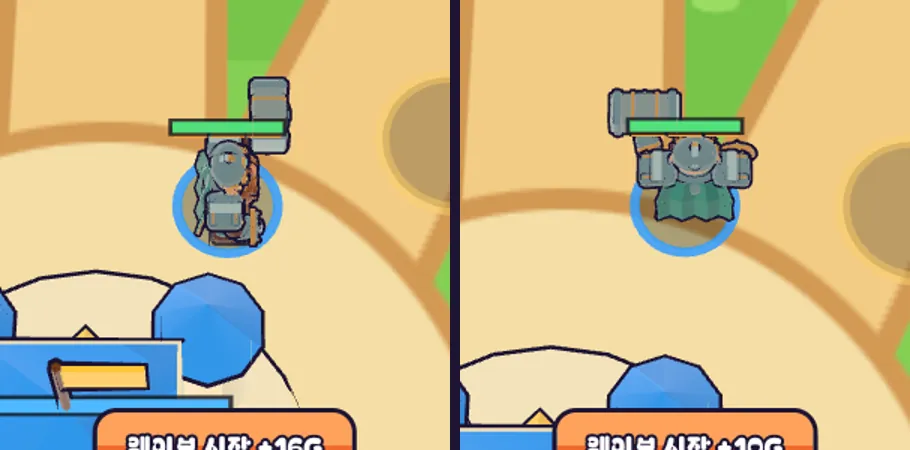
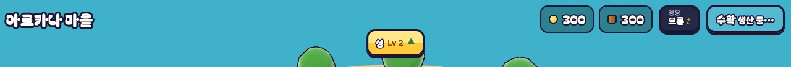

# 09회차: PvE 콘텐츠, 두 번째 영웅 브론과 영웅 선택

| 항목 | 값 |
| --- | --- |
| 시각 | 2026-11-10 07:42~07:51 KST (예약 회차) |
| 기준 | `07bbb7f` |
| 레인 | PvE 콘텐츠 (백로그 4번 중 절반) |
| 상태 | **완료** (영웅 레벨 성장은 다음으로 넘김) |

## 범위

백로그 4번은 ‘영웅 성장 + 두 번째 영웅’이다. 이번 회차는 **두 번째 영웅과 선택**까지만 한다. 영웅 레벨·별 성장은 다음 PvE 회차로 넘긴다(범위 제한).

- **브론(드워프 GLB, 근접 망치)**: 원거리 궁수와 판단이 달라야 한다.
  - 공격: 앞쪽 부채꼴 즉시 타격. 사거리 2.6m, 좌우 55°, 1회 46 피해, 넉백.
  - 체력 680(궁수 420), 이동 4.8(궁수 5.2).
  - 필살기: 제자리 내려찍기. 반경 4m, 120 피해, 큰 넉백. 조준 없이 자기 주변.
- **해금**: 스테이지 2 별 1개 이상이면 마을에 합류한다. 킹샷식 ‘진행 보상으로 영웅 합류’ 원칙이다.
- **선택**: 마을 상단 영웅 버튼. 저장에 `hero`를 추가하며, 이전 저장은 궁수로 읽는다.
- **규칙 코드**: 영웅 값을 `HEROES` 표로 뺀다. 기본(궁수) 결과는 그대로다(설계 기둥·결정성 테스트).

**가설**: 근접 영웅은 ‘앞으로 나가 막기 vs 탑 근처 지키기’라는 다른 판단을 만든다(주관적, 사람 검증 필요).

## 구현

- **`data.ts`**: 영웅 값을 `HEROES` 표(궁수·브론)로 옮겼다. 기존 `HERO`는 궁수를 가리킨다.
- **`sim.ts`**
  - 모든 영웅 수치를 `heroDef(s)`로 읽는다.
  - 브론의 부채꼴 즉시 타격: 닿아 있는 적은 각도와 무관하게 맞는다. 넉백 포함.
  - 제자리 내려찍기와 `swing` 사건을 추가했다.
  - `createRush(seed, mods, diff, hero)`.
- **`bot.ts`**: 근접 영웅은 다가가 치되, 위협이 성문 기준점에서 8m를 넘으면 돌아온다(줄 묶기). 필살기는 주변 적이 3마리 이상일 때만 쓴다.
- **`kingdom.ts`**
  - `hero` 저장. 스테이지 2 별이 있어야 브론을 고를 수 있다.
  - 이전 저장이나 조작된 저장은 궁수로 읽는다.
- **화면**
  - 영웅별 GLB를 처음 쓸 때 불러온다. 06회차 굽기를 그대로 써서, 드워프 부품 48개를 움직이는 노드 5개 단위로 묶었다.
  - 조준 미리보기: 궁수는 길고 좁게, 브론은 짧고 넓게. 필살기는 자기 주변 원으로 보여 준다.
  - 휘두르기 효과(부채꼴 섬광, 금빛 조각, 작은 흔들림)와 베기 효과음.
  - 마을 상단에 영웅 버튼. 잠겨 있으면 합류 조건을 안내한다.

## 조정 기록

1차 수치에서는 브론이 약했다.
- 결과: 스테이지 2 시드 하나 패배, 5~6 전패.
- 원인: 근접 봇이 멀리 쫓아가 포위됐다.

조정한 값:

| 항목 | 1차 | 조정 |
| --- | --- | --- |
| 체력 | 680 | 800 |
| 피해 | 46 | 58 |
| 재장전 | 1.0초 | 0.85초 |
| 사거리 | 2.6m | 2.8m |
| 필살기 충전 | 10회 | 8회 |

봇에는 줄 묶기(8m)를 넣었다.

## 결과: 역할 차이 (봇, 강화 없음, 시드 1~3)

| 지표 | 궁수 | 브론 |
| --- | --- | --- |
| 스테이지 1~6 승리 수 (남은 마을 체력 %) | 3·3·3·3·3·3 (99·98·65·71·36·15) | 3·3·3·3·3·3 (95·91·79·74·37·46) |
| 스테이지 7~10 | 강화 없음 전패, 최대 강화 전승 | 같음 |
| 스테이지 3 영웅이 받은 피해 | 831 | **2,012** |
| 스테이지 3 영웅 명중 횟수 | 200 | 128 (1회 피해가 큼) |
| 마을로부터 평균 거리 | 7.3m | **9.4m** (앞에서 막음) |

## 수용 기준과 결과

| 기준 | 결과 |
| --- | --- |
| 브론 봇 스테이지 1~3 승리, 궁수 테스트 유지 | 통과(시드 1·2 테스트로 고정). 스테이지 10은 강화 없이 패배, 최대 강화로 승리 |
| 역할 차이가 수치로 보임 | 위 표 |
| 부채꼴(앞 명중·뒤 안전·사거리 밖), 내려찍기, 해금·선택·저장 호환 | 통과(테스트 3개 추가) |
| 화면 | 브론 방향(북쪽을 보면 등의 망토가 보임), 휘두르기 효과, 마을 영웅 버튼 확인. 스모크에 ‘새 마을에서 브론 잠김’ 추가 |
| 전체 | `test:rush` 31/31, `npm test` 201/201, `tsc`·`build` 통과(rush 번들 73.6 KB), `smoke:rush` 22/22 |

## 화면

브론 방향(왼쪽 동쪽, 오른쪽 북쪽):

## 한계

- 영웅 레벨·별 성장은 아직이다(다음 PvE 회차).
- 브론 모델은 처음 출전할 때 1.3MB를 불러온다. 그동안은 임시 몸체가 보인다.
- ‘다른 판단을 만드는가’는 사람 플레이로 확인해야 한다. 봇 수치는 역할 차이만 보여 준다.

## 다음

- **next_lane: 전투 손맛** (순환). 후보는 덤불(은신)과 부서지는 나무 상자.
- 백로그 상위 3개:
  1. 덤불·부서지는 상자 규칙
  2. 영웅 레벨 성장(백로그 4번 나머지)
  3. 탑 분기(화염·냉기)
