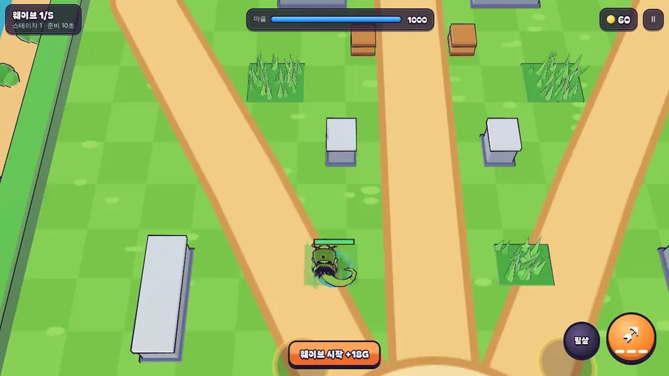
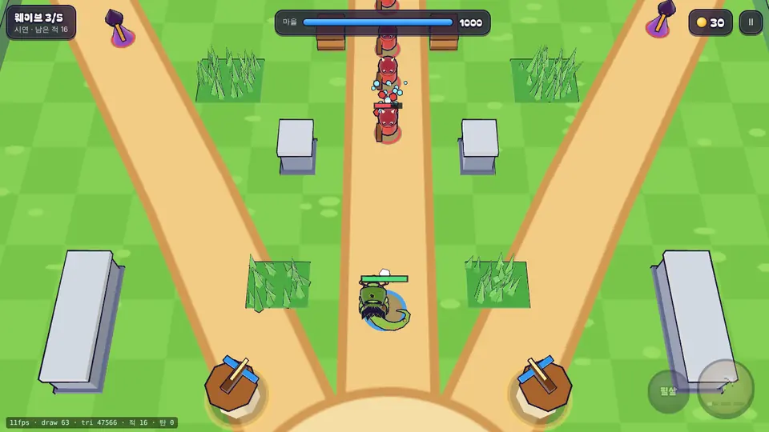

# 10회차: 전투 손맛, 덤불 은신과 부서지는 나무 상자

| 항목 | 값 |
| --- | --- |
| 시각 | 2026-11-10 08:44~08:51 KST (예약 회차) |
| 기준 | `2b9bc49` |
| 레인 | 전투 손맛 (백로그 11번) |
| 상태 | **완료** |

## 범위

브롤스타즈식 지형 판단(숨기·엄폐)을 원칙만 가져온다. 단단해 보이는 것은 단단하게, 숨을 곳은 숨을 곳답게 만든다.

- **덤불 4곳**: 지나갈 수 있다.
  - 영웅이 덤불 안에 있으면 숨는다. 1.8m 안까지 다가온 적만 영웅을 보고 쫓는다.
  - 공격하거나 필살기를 쓰면 1초 동안 드러난다.
  - 투척병도 숨은 영웅을 겨누지 못하고 마을을 노린다.
- **나무 상자 4개**: 길 옆 엄폐물이다.
  - 이동과 직사탄을 막고, 맞으면 부서진다(체력 120). 부서지면 골드 4.
  - 영웅·적의 직사탄, 브론의 휘두르기, 필살기가 모두 부순다. 탑의 유도탄은 상자를 무시한다.
- **위치 원칙**: 적의 길(레인)은 막지 않는다(적이 끼면 웨이브가 끝나지 않을 수 있음, 03회차 교훈).
- **화면**
  - 덤불: 키 큰 풀 블록. 영웅이 안에 있으면 반투명.
  - 상자: 구운 메시와 외곽선. 맞으면 흔들리고, 부서지면 나무 조각이 튄다.

**가설**: 숨기와 엄폐가 ‘어디에 서서 싸울까’라는 위치 판단을 만든다(주관적, 사람 검증 필요).

## 구현

- **`data.ts`**: `BUSHES`(덤불 4곳), `BUSH`(드러남 거리 1.8m, 공격 후 노출 1초), `CRATES`(상자 4개), `CRATE`(크기 1m, 체력 120, 골드 4).
  - 위치는 레인과 겹치지 않게 골랐다.
- **`sim.ts`**
  - `heroHidden(s)`: 영웅이 덤불 안에 있고 노출 시간이 지났으면 숨은 상태다. 숨은 영웅은 1.8m 안의 적만 쫓는다. 투척병·보스도 같은 규칙을 따른다.
  - 사격·휘두르기·필살기는 `exposedUntil`을 1초 뒤로 늦춘다.
  - 상자는 영웅·적의 이동을 막는다(`confine`에 상자 포함). 직사탄은 상자에 맞으면 사라지고 피해를 준다.
  - 브론의 부채꼴과 필살기도 상자를 부순다. 부서지면 `crateBreak` 사건, 골드 4.
  - 결정성 해시에 상자 상태를 넣었다.
- **화면**
  - 덤불: 얇은 바닥에 잎 날을 촘촘히 세운 키 큰 풀. 영웅이 들어간 덤불만 반투명해진다(외곽선 숨김).
  - 상자: 구운 나무 상자와 외곽선. 맞으면 흔들리고 나무 조각, 부서지면 조각과 먼지.

## 검토하며 고친 것

- **덤불이 단단해 보였다.** 1차 덤불(높은 초록 상자 + 원뿔)은 지나갈 수 있는데도 울타리처럼 보였다. ‘단단해 보이는 것은 단단해야 한다’ 원칙에 어긋나, 얇은 바닥과 잎 날 모양으로 바꿨다.
- **덤불 4개가 한꺼번에 반투명해졌다.** 재질을 공유했기 때문이다. 덤불마다 메시를 나눴다(드로콜 +6).
- **내 테스트 가정 오류:** 상자 옆에 선 영웅이 떨어진 코인을 바로 주웠다. ‘떨어졌거나 이미 주웠음’으로 고쳤다.

## 수용 기준과 결과

| 기준 | 결과 |
| --- | --- |
| 덤불: 1.8m 밖 적은 안 쫓음, 공격하면 1초 드러남, 바로 옆 적은 찾아냄 | 통과(테스트) |
| 상자: 이동을 막고, 맞으면 부서지고 골드, 부서진 뒤 지나갈 수 있음 | 통과(테스트) |
| 설계 기둥·스테이지 곡선(멈춤 없음 포함)·브론 진행 테스트 유지 | 통과(기존 테스트 31개 변경 없이) |
| 화면: 숨은 영웅, 덤불 모양, 전투 속 상자 | 아래 화면. 드로콜은 시연 3409틱 기준 57 → 63 |
| 전체 | `test:rush` 33/33, `npm test` 203/203, `tsc`·`build` 통과(rush 번들 76.7 KB), `smoke:rush` 22/22 |

상자가 탄을 막아 전투 결과가 바뀐다. 그래서 이번에는 같은 틱 전후 비교를 하지 않았다(같은 장면이 나오지 않음).

## 화면

덤불에 숨은 영웅(그 덤불만 반투명):

전투 중 덤불과 상자(시연 3409틱):

## 한계

- 봇은 덤불을 일부러 쓰지 않는다. 숨기의 가치는 사람 플레이로만 확인할 수 있다.
- 상자 부서짐 효과는 테스트(사건)로 확인했고, 화면으로는 보지 못했다.
- 덤불 안에서 적이 영웅을 놓쳐도 이미 쏜 탄은 계속 날아간다(의도된 단순화).

## 다음

- **next_lane: 렌더 톤·모델** (순환). 후보는 적 실루엣 GLB(백로그 9번) 또는 아이콘형 마을 표지.
- 백로그 상위 3개:
  1. 적 4종 정식 모델(실루엣)
  2. 영웅 레벨 성장
  3. 탑 분기(화염·냉기)
