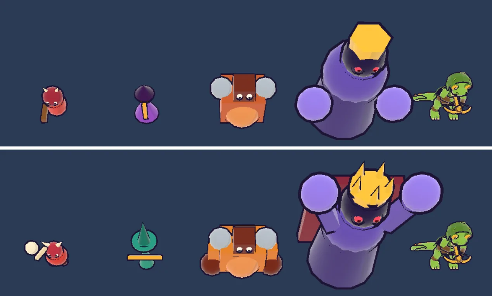
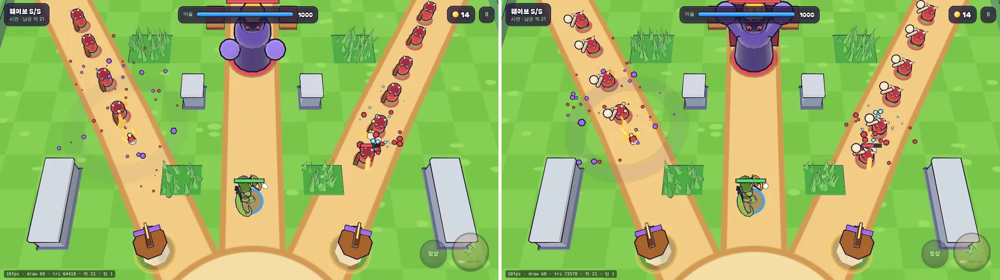

# 11회차: 렌더 톤·모델, 적 4종 실루엣

| 항목 | 값 |
| --- | --- |
| 시각 | 2026-11-10 09:42 ~ 10:00 KST (예약 회차) |
| 기준 | `8ee2405` |
| 레인 | 렌더 톤·모델 ([아트 기준](../art-direction.md) 렌더 톤 백로그 3번 ‘영웅·적 정식 모델’ 중 적 실루엣) |
| 상태 | **완료** (수용 기준 4개 중 1개는 부분 충족, 아래 참고) |
| 다음 레인 | 성능·모바일 |

## 범위

[아트 기준](../art-direction.md) 원칙 2는 ‘작은 화면에서도 실루엣만으로 구분’이다. 지금 적 4종은 크기와 색이 비슷해 휴대폰에서 섞여 보인다는 의심이 있다.

- **측정 도구**: `?sheet=1`은 적 4종과 영웅 둘을 단색 배경 위에 한 줄로 세운 모델 시트다(지형·고리·그림자 없음). 휴대폰 가로(863×360)로 찍어 실루엣을 비교한다.
- **지표**
  - 종류 쌍마다 실루엣 IoU(바닥 중앙 정렬, 크기 그대로). 낮을수록 잘 구분된다.
  - 외곽 상자의 너비:높이 비율과 화면 높이(px).
- **다시 디자인**: 역할을 실루엣 비율로 나눈다.

  | 적 | 실루엣 |
  | --- | --- |
  | 돌격병 | 작고 둥근 몸, 높이 든 큰 몽둥이 |
  | 투척병 | 키 크고 가는 몸, 넓은 모자챙, 가로로 긴 활 |
  | 거한 | 넓고 낮은 몸, 거대한 팔과 어깨판 |
  | 보스 | 큰 몸, 뾰족한 왕관과 어깨 가시, 망토 |

- 규칙·충돌 반경은 바꾸지 않는다. 이 컨테이너에는 Blender가 없어 GLB를 새로 만들지 않고, 구운 절차형 모델(`render.ts` `enemyKit`)을 다시 디자인한다.

## 수용 기준

- [x] 모델 시트 전후 화면과 지표표(IoU, 비율, 높이)
- [ ] **부분 충족**: 모든 쌍의 IoU가 전보다 낮아지고, 가장 높은 쌍이 0.6 미만(첫 목표치, 주관적 기준)
  - 가장 높은 쌍: 0.37 → 0.25. 0.6 미만이므로 충족했다.
  - 6쌍 중 3쌍은 0.01~0.04 올랐다. 거한·보스의 팔을 키워 면적이 커졌기 때문이다(아래 해석).
- [x] 전투 화면(같은 시드·틱) 전후 비교, 드로콜 변화 없음(인스턴싱 유지)
- [x] `test:rush`, `tsc`, `build`, `smoke:rush` 통과

## 바꾼 것

| 적 | 전 | 후 |
| --- | --- | --- |
| 돌격병 | 빨간 몸, 뿔, 갈색 몽둥이를 아래로 듦 | 더 작고 둥근 몸. **뼈 몽둥이를 머리 위로** 치켜듦. 뼈는 밝은 크림색이라 몸의 빨강이 주색으로 남는다 |
| 투척병 | **보라** 고깔 망토(보스와 같은 색 계열) | **청록** 가는 망토, 넓은 모자챙과 높은 뾰족 모자, 몸 앞을 가로지르는 활(정면에서 T자), 화살통 |
| 거한 | 주황 상자 몸, 어깨판 | 호박색 상자 몸, 양옆으로 내린 **굵은 팔과 큰 주먹**(가로로 넓고 낮게) |
| 보스 | 보라 원통 몸, 육각 왕관, 몸 옆 큰 주먹 | **두 팔을 머리 위로** 든 Y자, 다섯 가시 금관, 등 뒤 진홍 망토 |

- 처치 조각 색(`KILL_COLOR`)도 투척병 청록, 거한 호박색으로 맞췄다.
- **모델 시트** `?sheet=1`: 적 4종과 영웅을 카메라 쪽으로 세우고 고리·그림자·체력바·HUD를 숨긴다. 시뮬레이션은 돌지 않는다.
- 범위에 적은 ‘어깨 가시’는 넣지 않았다. 팔을 든 Y자와 가시 왕관만으로 거한과 갈렸다.

## 측정

휴대폰 가로(Pixel 7 가로, 863×360 CSS px, DPR 2.625) 스크린샷이다. 높이·너비는 스크린샷 px 단위다. IoU는 바닥 중앙을 맞추고 크기 그대로 겹친 값이다. ‘모양 IoU’는 같은 높이로 맞춘(비율 유지) 값으로, 이번에 보조 지표로 추가했다. 색상(hue)은 채도·명도 0.35 이상인 픽셀의 중앙값이다.

| 적 | 높이 전→후 | 너비 전→후 | 너비:높이 전→후 | 주색 hue 전→후 |
| --- | --- | --- | --- | --- |
| 돌격병 | 100 → 70 | 72 → 114 | 0.72 → 1.63 | 351 → 352 (빨강) |
| 투척병 | 102 → 122 | 66 → 96 | 0.65 → 0.79 | 278 → 165 (보라 → 청록) |
| 거한 | 146 → 142 | 174 → 216 | 1.19 → 1.52 | 16 → 25 (주황 → 호박) |
| 보스 | 306 → 334 | 460 → 380 | 1.50 → 1.14 | 255 → 256 (보라) |

| 쌍 | IoU 전 → 후 | 모양 IoU 전 → 후 |
| --- | --- | --- |
| 돌격병–투척병 | **0.37 → 0.22** | 0.28 → 0.13 |
| 돌격병–거한 | 0.13 → 0.17 | 0.33 → 0.21 |
| 돌격병–보스 | 0.04 → 0.03 | 0.27 → 0.18 |
| 투척병–거한 | 0.26 → 0.25 | 0.33 → 0.29 |
| 투척병–보스 | 0.03 → 0.05 | 0.25 → 0.36 |
| 거한–보스 | 0.16 → 0.17 | 0.42 → 0.53 |
| **최댓값** | **0.37 → 0.25** | 0.42 → 0.53 |
| 가장 가까운 두 색의 hue 차 | 23 (투척병–보스) → **33** (돌격병–거한) | |

**해석 (정직하게)**
- 크기 그대로 잰 IoU는 한쪽이 다른 쪽 안에 들어가면 사실상 **면적 비율**이 된다. 거한·보스에 팔을 붙여 면적이 커지자 작은 적과의 IoU가 조금 올랐다. 모양이 비슷해서 오른 것은 아니다.
- 모양 IoU의 최댓값은 거한–보스에서 0.42 → 0.53으로 올랐다. 둘 다 ‘넓은 몸 + 양쪽 둥근 덩어리’이기 때문이다. 그래도 0.6 미만이다. 화면에서는 팔의 높이(거한은 아래, 보스는 머리 위)와 크기(보스가 2.3배 높음)로 구분된다.
- 처음 의심한 혼동은 모양보다 **색**이었다. 전에는 투척병과 보스가 둘 다 보라였다(hue 차 23). 지금은 넷이 빨강·청록·호박·보라로 갈린다.
- 다음에 실루엣을 잴 때는 크기 그대로의 IoU 대신 **모양 IoU와 hue 차**를 기준으로 삼는다.

## 전투 화면 비교 (같은 시드·틱)

`?demo=1&seed=3&speed=8&freeze=N&debug=1`. 적 모양은 시뮬레이션에 영향이 없다(같은 틱에 같은 적 16·21마리).

| 장면 | 드로콜 전 → 후 | 삼각형 전 → 후 |
| --- | --- | --- |
| 웨이브3, 1280×720 (틱 3409) | 63 → 63 | 47,526 → 51,870 |
| 보스전, 1280×720 (틱 7729) | 68 → 68 | 64,418 → 73,570 |
| 웨이브3, 휴대폰 가로 (틱 3409) | 61 → 61 | 42,970 → 46,010 |

- 드로콜은 그대로다. 종류별 인스턴스 묶음 구조를 바꾸지 않았다.
- 삼각형은 +3천~+9천이다. 돌격병 뼈 몽둥이 끝 구, 보스 주먹·팔이 늘었다. 성능 주장은 하지 않는다(소프트웨어 렌더링).
- 전투 화면에서 돌격병 줄은 머리 위 흰 뼈 몽둥이로 한눈에 보인다. 보스는 팔을 든 Y자로 화면 위쪽에서도 읽힌다.

## 검증

- `npm run test:rush`: 33개 통과. 규칙은 바뀌지 않았다.
- `npx tsc --noEmit`: 통과.
- `npm run build`: 통과.
- `npm run smoke:rush`: 22/22 통과.
- 모델 시트와 전투 스크린샷을 직접 열어 확인했다.

## 다음

- **다음 레인: 성능·모바일.** 실기기 게이트(백로그 9)는 사용자 기기가 필요하다. 그 전에 컨테이너에서 할 수 있는 **저사양 품질 단계**를 고른다. 지형 외곽선, 그림자, 파티클을 줄이는 단계를 만들고, 드로콜·삼각형 수를 보고한다. 이번 회차로 보스전 삼각형이 7.4만이 되었다.
- 백로그 상위 3개
  1. (성능·모바일) 저사양 품질 단계, 그리고 사용자 기기로 실기기 게이트
  2. (PvE 콘텐츠) 영웅 성장: 레벨·별, 스테이지 조각 보상, 뽑기 없음
  3. (PvE 콘텐츠) 탑 Lv2 분기: 화염·냉기
