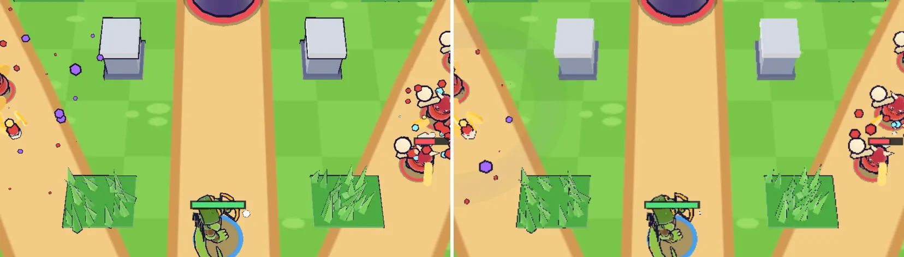
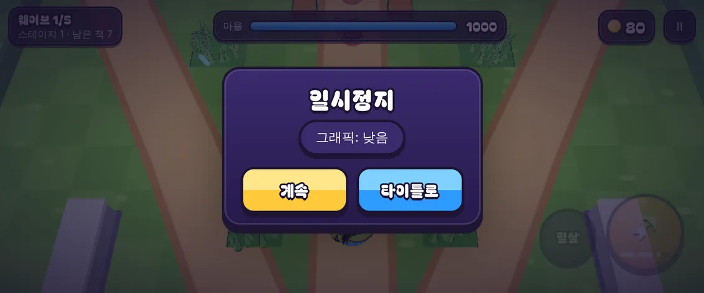

# 12회차: 성능·모바일, 저사양 품질 단계

| 항목 | 값 |
| --- | --- |
| 시각 | 2026-11-10 10:41 ~ 10:52 KST (예약 회차) |
| 기준 | `109dd3e` |
| 레인 | 성능·모바일 (백로그 9a) |
| 상태 | **완료** |
| 다음 레인 | 엔진 스파이크 |

## 범위

실기기 게이트(백로그 9)는 사용자 기기가 있어야 한다. 그 전에 이 컨테이너에서 할 수 있는 일을 한다. 보급형 휴대폰을 위해 **그래픽 품질을 두 단계(높음·낮음)**로 나누고, 기본값은 **자동**으로 둔다.

- **낮음 단계에서 줄이는 것** (캐릭터·탑·마을·상자의 외곽선과 팀 색은 그대로 둔다. 읽기 쉬움이 먼저다)
  - 렌더 해상도 배율 상한: 2 → 1.25 (휴대폰 화소 수가 가장 큰 비용이다)
  - 지형 외곽선 끄기: 성벽, 울타리, 덤불([아트 기준](../art-direction.md) 다음 단계 5번)
  - 섬 가장자리 장식 숨기기(울타리 밖, 순수 장식)
  - 파티클 수 절반
- **자동**: 높음으로 시작한다. 전투 중 3초 평균이 40fps 아래면 낮음으로 한 번 내리고 알린다. 처음 2초와 0.25초 넘는 멈춤(탭 전환 등)은 세지 않는다. 판정 로직은 순수 함수로 두고 테스트한다.
- **선택**: 일시정지 화면의 ‘그래픽: 자동/높음/낮음’ 버튼. 저장 키는 `arcana-rush:quality:v1`(마을 저장과 분리). `?quality=high|low`는 그 판만 고정한다(전후 비교용).
- 규칙(sim)은 바꾸지 않는다.

## 가설

휴대폰 가로(DPR 2.625)에서 낮음은 렌더 화소를 약 2.6배 줄이고, 지형 외곽선과 장식으로 드로콜과 삼각형도 줄인다. 전투에서 읽어야 할 것(적·탄·팀 색·벽 경계)은 그대로 읽힌다.

## 수용 기준

- [x] 같은 시드·틱(웨이브3, 보스전; 데스크톱과 휴대폰 가로)에서 높음·낮음의 드로콜, 삼각형, 렌더 버퍼 화소 수 표
- [x] 낮음 화면에서 벽 경계·적·탄·팀 색이 읽히는지 스크린샷으로 직접 확인
- [x] 자동 판정 테스트: 느린 프레임이면 내려가고, 빠르거나 시작 직후·긴 멈춤이면 내려가지 않음
- [x] 일시정지 버튼으로 바꾼 설정이 새로고침 뒤에도 유지(스모크)
- [x] `test:rush`, `tsc`, `build`, `smoke:rush` 통과

## 바꾼 것

- **`src/rush/quality.ts`(새 파일, 순수)**: 두 단계 사양(`QUALITY`), 자동 판정(`createFrameWatch`, `watchFrame`), 설정 순환·검증·결정 함수.
- **`render.ts`**
  - `setQuality(q)`로 렌더 배율을 바꾸고, 지형 외곽선과 섬 가장자리 장식을 켜고 끈다.
  - 파티클 밀도는 ‘동작 줄이기’ 설정과 곱한다.
  - `info()`에 품질 단계, 배율, 렌더 버퍼 크기를 더했다.
- **`main.ts`**
  - 저장된 설정을 읽고, 전투 프레임 시간을 자동 판정에 넣는다. 내려가면 한 번 알림을 띄운다.
  - 일시정지 화면 버튼은 자동 → 높음 → 낮음 순으로 바뀐다. 자동일 때는 지금 단계를 괄호로 보여 준다(예: ‘그래픽: 자동(낮음)’).
- **`rush.html`, `rush.css`**: 일시정지 카드의 설정 버튼.
- **스모크 3개 추가**(22 → 25)
  - 자동 품질이 프레임 속도를 따른다.
  - 버튼으로 낮음을 고르면 렌더 버퍼가 줄어든다.
  - 고른 설정이 새로고침 뒤에도 유지된다.
- **테스트 3개 추가**(`quality.test.ts`). `package.json`의 `test:rush`와 `test` 목록에 넣었다. 02~04회차와 같은 방식이다.
- 마을 화면은 같은 렌더러를 쓰므로 렌더 배율만 따라간다. 마을 장식과 외곽선은 그대로다.
- 자동으로 낮춘 결정은 그 세션에만 유지한다. 한 번 버벅였다고 계속 낮음으로 고정하지 않으려는 것이다. 매번 처음 몇 초는 높음으로 그린다는 비용이 있다. 실기기 측정 뒤 다시 정한다.

## 측정 (같은 시드·틱, 높음 → 낮음)

`?demo=1&seed=3&speed=8&freeze=N&debug=1&quality=high|low`. 데스크톱은 1280×720(DPR 1), 휴대폰은 Pixel 7 가로(863×360 CSS px, DPR 2.625)다.

| 장면 | 드로콜 | 삼각형 | 렌더 버퍼 (화소 수) | 파티클 |
| --- | --- | --- | --- | --- |
| 웨이브3, 데스크톱 (틱 3409) | 63 → 59 | 51,630 → 36,670 (−29%) | 1280×720 그대로 | 35 → 18 |
| 보스전, 데스크톱 (틱 7729) | 68 → 62 | 73,490 → 56,722 (−23%) | 1280×720 그대로 | 113 → 54 |
| 웨이브3, 휴대폰 가로 (틱 3409) | 61 → 57 | 45,890 → 31,010 (−32%) | 1726×720 → 1078×450 (124만 → 49만, −61%) | 34 → 19 |
| 보스전, 휴대폰 가로 (틱 7729) | 64 → 62 | 66,718 → 50,406 (−24%) | 1726×720 → 1078×450 (−61%) | 109 → 55 |

- 데스크톱은 DPR이 1이라 배율 상한이 의미가 없다. 휴대폰에서는 렌더 화소가 2.56배 줄어든다.
- 드로콜은 화면에 보이는 지형만큼(2~6개) 준다. 삼각형은 덤불 잎과 섬 장식의 외곽선, 장식 본체가 빠져 23~32% 준다.
- **성능 주장은 하지 않는다.** 컨테이너 브라우저는 소프트웨어 렌더링이다. 디버그 줄의 FPS 숫자는 근거로 쓰지 않는다. 실제 효과는 실기기 게이트(백로그 9)에서 잰다.

**직접 확인**
- 낮음에서 성벽은 외곽선 없이도 밝은 윗면과 어두운 옆면으로 경계가 읽힌다. 덤불도 잎 모양으로 구분된다.
- 적·영웅·탑은 외곽선과 팀 색 고리를 그대로 가진다.
- 해상도가 낮아 가장자리가 조금 흐려진다. HUD 글자는 DOM이라 영향이 없다.

## 검증

- `npm run test:rush`: 36개 통과(33 + 품질 3). 설계 기둥 테스트 포함.
- `npm test`: 206개 통과(`package.json` 목록을 바꿨으므로 전체 실행).
- `npx tsc --noEmit`: 통과.
- `npm run build`: 통과.
- `npm run smoke:rush`: 25/25 통과.
  - 휴대폰 에뮬레이션은 30fps로 측정됐고, 자동 판정이 낮음으로 내려갔다.
  - 일시정지 버튼으로 낮음을 고르자 버퍼 너비가 1726 → 1078로 줄었다.
- 높음·낮음 전투 화면과 일시정지 화면을 직접 열어 확인했다.

## 다음

- **다음 레인: 엔진 스파이크.** [조사 문서](../engine-research-2026-11.md)의 ‘시험’ 항목 중 남은 것 하나를 시간 제한으로 확인한다. 남은 것은 PixiJS 8 / Phaser 4(2.5D 스프라이트 경로), Babylon.js 9, ECS(Koota·bitECS)다. 후보는 ECS로 적이 많은 장면의 시뮬레이션 비용(스텝당 시간이 아니라 할당·코드 크기 같은 개수)을 비교하는 것이다.
- 백로그 상위 3개
  1. (성능·모바일) **실기기 게이트**(사용자 기기 필요). 이제 일시정지에서 높음·낮음을 바꿔 두 단계를 같은 기기에서 비교할 수 있다.
  2. (PvE 콘텐츠) 영웅 성장: 레벨·별, 스테이지 조각 보상, 뽑기 없음
  3. (PvE 콘텐츠) 탑 Lv2 분기: 화염·냉기
