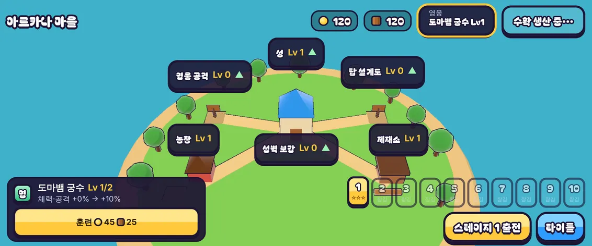

# 14회차: 킹덤 메타, 영웅 훈련(레벨)

| 항목 | 값 |
| --- | --- |
| 시각 | 2026-11-10 12:41 ~ 12:53 KST (예약 회차) |
| 기준 | `946cf65` |
| 레인 | 킹덤 메타 (백로그 4번 남은 것: 영웅 성장) |
| 상태 | **완료** |
| 다음 레인 | PvE 콘텐츠 |

## 범위

킹샷식 성장의 한 축은 영웅을 키우는 것이다. 지금은 마을 강화(영웅 공격 등)가 모든 영웅에게 똑같이 붙는다. **영웅마다 레벨**을 두어, 자주 쓰는 영웅에게 자원을 쓰는 선택을 만든다. 뽑기는 없다.

- **규칙(`kingdom.ts`, 순수)**
  - 영웅마다 레벨 1부터 시작한다. 최대 레벨은 **성 Lv × 2**(성 5 → 영웅 10)로, 성이 다른 건물을 제한하는 규칙과 같다.
  - 훈련 비용은 현재 레벨 l에서 식량 45·l, 목재 25·l다. 마을 강화와 같은 자원을 놓고 경쟁한다.
  - 효과는 레벨당 체력 +10%, 공격 +10%다(처음 +7%·+5%는 봇 기준 차이가 작아 올렸다. 아래 측정). **출전하는 영웅의 레벨만** 적용한다. 공격은 ‘영웅 공격’ 강화와 곱한다.
  - 잠긴 영웅은 훈련할 수 없다. 예전 저장은 두 영웅 모두 Lv1로 읽는다.
- **시뮬레이션(`sim.ts`)**: `RushMods`에 `heroHp`(체력 배율)를 더한다. 시작·부활·회복·체력바가 모두 배율이 적용된 최대 체력을 쓴다. 기본값 1이면 지금과 결과가 같다.
- **마을 화면**: 영웅 버튼을 누르면 영웅을 바꾸고 **영웅 카드**(레벨, 효과 지금 → 다음, 훈련 버튼)를 연다. 버튼에 레벨을 표시한다.

## 가설

봇 기준으로, 강화 없이 지는 높은 스테이지 가운데 영웅 레벨만 올려서 이길 수 있는 스테이지가 생긴다. 그래도 스테이지 10은 마을 강화 없이 영웅 레벨만으로는 이기지 못한다. 마을 강화도 계속 필요해야 한다.

## 수용 기준

- [x] 규칙 테스트: 상한(성 Lv × 2), 비용, 수확 후 지불, 잠긴 영웅 불가, 출전 영웅만 적용, 예전 저장 호환
- [x] 밸런스 테스트: 두 영웅 모두, 어떤 스테이지에서 Lv1은 지고 Lv10은 이긴다(시드 여러 개). 스테이지 10은 영웅 Lv10만으로는 진다
  - 시드마다 결과가 들쭉날쭉해서(아래) **합계 기준**으로 바꿨다: 스테이지 7·8, 시드 1~6에서 Lv10 승리 수가 Lv1보다 3 이상 많다.
- [x] 기본 배율(1)에서 기존 테스트·설계 기둥 그대로 통과
- [x] 마을 화면 영웅 카드 스크린샷(데스크톱·휴대폰 가로) 직접 확인, 스모크에 훈련 확인 추가
- [x] `test:rush`, `tsc`, `build`, `smoke:rush` 통과

## 측정 (봇 `guardBot`, 마을 강화 없음)

**1차(체력 +7%, 공격 +5%/레벨)**: 차이가 작고, 시드마다 거꾸로 가기도 했다.
- 궁수 스테이지 6에서 Lv1은 시드 1~4를 모두 이겼는데, Lv4는 그중 3개를 졌다.
- 스테이지 6~9, 시드 1~6(24판) 승리 수
  - 궁수: Lv1 4, Lv5 5, Lv10 10
  - 브론: Lv1 10, Lv5 13, Lv10 11

**성장 폭 비교** (같은 24판, 그리고 스테이지 10 시드 1~4)

| 레벨당 체력·공격 | 궁수 Lv1 / 5 / 10 | 브론 Lv1 / 5 / 10 | 스테이지 10 (Lv10) |
| --- | --- | --- | --- |
| +7% · +5% | 4 / 5 / 10 | 10 / 13 / 11 | 두 영웅 0/4 |
| +8% · +8% | 4 / 6 / 11 | 10 / 9 / 12 | 두 영웅 0/4 |
| **+10% · +10% (채택)** | 4 / 10 / 16 | 10 / 10 / 14 | 두 영웅 0/4 |

**채택값의 스테이지별 승리** (시드 1~6, 1 = 승리)

| 영웅 | 스테이지 6 | 7 | 8 | 9 |
| --- | --- | --- | --- | --- |
| 궁수 Lv1 | 111100 | 000000 | 000000 | 000000 |
| 궁수 Lv10 | 111111 | 111101 | 110001 | 100100 |
| 브론 Lv1 | 111111 | 001011 | 000010 | 000000 |
| 브론 Lv10 | 111111 | 101111 | 010101 | 000000 |

**해석**
- 궁수는 레벨 효과가 뚜렷하다. 브론은 작다. 봇이 브론을 마을 앞 8m 안에 묶어 두므로 체력·공격이 올라도 막는 범위가 그대로다. 사람 플레이에서는 다를 수 있다.
- 영웅 Lv10만으로는 스테이지 10을 이기지 못한다. 마을 강화도 계속 필요하다.
- 비용 합계(Lv1 → 10)는 식량 2,025, 목재 1,125다. 강화 하나를 Lv5까지 올리는 비용(예: 영웅 공격 식량 1,050, 목재 600)의 약 2배인 장기 투자다. 사람 플레이로는 아직 검증하지 않았다.

## 바꾼 것

- **`kingdom.ts`**
  - 저장 형식에 `heroLv`(영웅별 레벨)를 더했다.
  - 함수: `heroMaxLevel`(성 Lv × 2), `heroGrowth`, `trainCost`(식량 45·l, 목재 25·l), `canTrain`, `train`(수확 먼저, 잠긴 영웅 불가).
  - `kingdomMods`는 출전 영웅의 레벨로 `damage`(영웅 공격 강화와 곱함)와 `heroHp`를 정한다.
  - 예전 저장은 Lv1로 읽고, 성 상한을 넘는 값은 깎는다.
- **`sim.ts`**: `RushMods.heroHp`, `heroMaxHp(s)`. 시작·부활·회복이 이 값을 쓴다. 기본값 1이면 결과가 같다(기존 테스트 그대로 통과).
- **`render.ts`**: 영웅 체력바가 배율이 적용된 최대 체력을 쓴다.
- **마을 화면(`town.ts`, `rush.css`)**
  - 영웅 버튼에 레벨을 표시하고, 훈련할 수 있으면 금색 테두리를 두른다.
  - 버튼을 처음 누르면 영웅 카드(레벨/상한, 효과 지금 → 다음, 훈련 비용)가 열리고, 이어 누르면 영웅을 바꾼다.
- **테스트 4개 추가**(36 → 40): 훈련 규칙, 출전 영웅에만 적용, 예전 저장·조작 저장, 밸런스(합계 기준).
- **스모크 2개 추가**(25 → 27): 영웅 카드 열기, 훈련 후 Lv2. 전투 시작 확인에 `heroHp`도 넣었다.

## 검증

- `npm run test:rush`: 40개 통과(설계 기둥 포함).
- `npx tsc --noEmit`: 통과.
- `npm run build`: 통과.
- `npm run smoke:rush`: 27/27 통과.
- 영웅 카드는 데스크톱·휴대폰 가로 스크린샷을 직접 열어 확인했다. 휴대폰에서 효과 문구가 잘려 ‘체력·공격 +0% → +10%’로 줄였다.

## 다음

- **다음 레인: PvE 콘텐츠.** 후보는 탑 Lv2 분기(화염 범위·냉기 둔화)다. 영웅 성장의 남은 조각인 ‘스테이지 조각 보상’(높은 별에 영웅 훈련 재료)은 사람 플레이로 비용을 본 뒤 정한다.
- 백로그 상위 3개
  1. (PvE 콘텐츠) 탑 Lv2 분기: 화염·냉기, 마을 대장간과 연결
  2. (성능·모바일) 밀어내기 거리 제곱 거르기(9b, 결과 동일 확인됨). 실기기 게이트는 사용자 기기 필요
  3. (킹덤 메타) 마을 표지 아이콘형, 영웅 조각 보상
