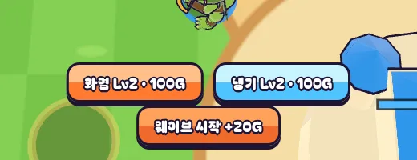
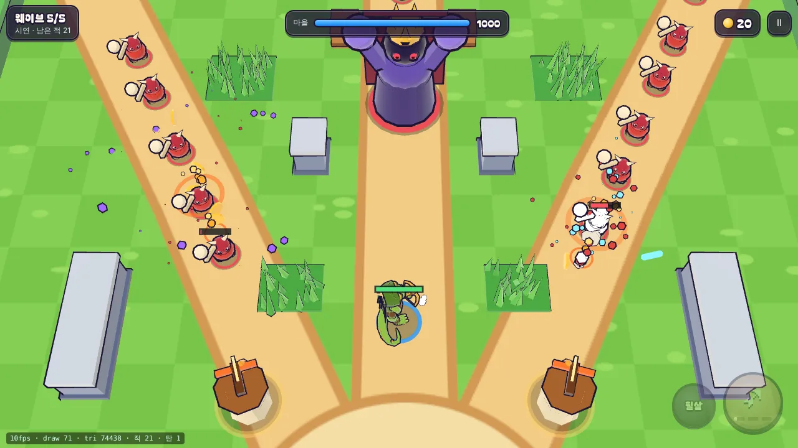

# 15회차: PvE 콘텐츠, 탑 Lv2 분기(화염·냉기)

| 항목 | 값 |
| --- | --- |
| 시각 | 2026-11-10 13:47 ~ 13:59 KST (예약 회차) |
| 기준 | `a783de5` |
| 레인 | PvE 콘텐츠 (백로그 8번) |
| 상태 | **완료** |
| 다음 레인 | 전투 손맛 |

## 범위

지금은 탑을 올리는 데 판단할 것이 없다. 숫자만 커진다. Lv1 탑을 Lv2로 올릴 때 **화염**과 **냉기** 중 하나를 고르게 해서, 어느 길목에 무엇을 둘지 판단을 만든다. Lv3은 고른 분기의 강화다.

- **화염**: 공격력 ×0.85. 맞은 자리 1.3m 안의 다른 적에게 30% 피해(뭉친 적에 강함).
- **냉기**: 공격력 ×0.8. 맞은 적의 이동 속도를 1초 동안 65%로 줄인다. 보스는 85%까지만 줄어든다(넉백 저항과 같은 결).
- 값은 세 번 고쳤다(아래 측정). 다른 테스트를 깨지 않는 값을 찾았다.
- **조작**
  - 터치: Lv1 탑 앞에서는 건설 버튼이 둘(화염·냉기)로 나뉜다.
  - 키보드: E는 화염, R은 냉기다(Lv1 → 2 때만 다르다. F는 이미 사격 키다).
  - 명령 `build`는 `true` 또는 `'fire' | 'frost'`다. 분기를 고르지 않은 `true`는 화염으로 처리한다.
- **봇**: 탑 위치마다 분기를 정해 둔다. 설계 기둥 테스트가 그대로 통과해야 한다.
- **표현**
  - 분기마다 탑 머리 색과 탄 색을 다르게 한다(화염 주황, 냉기 하늘색).
  - 화염 폭발은 주황 고리와 조각으로, 느려진 적은 발밑 하늘색 고리로 보인다.
  - 드로콜은 분기 탄·고리가 있을 때만 늘어난다(인스턴싱 유지).
- 마을 대장간과의 연결은 이번 범위에서 뺀다(다음 킹덤 메타 후보).

## 가설

같은 시드에서 화염만 쓴 판은 탑 처치가 많아지고, 냉기만 쓴 판은 적이 마을에 닿기까지 더 오래 걸린다. 그래서 두 분기의 역할이 수치로 갈린다.

## 수용 기준

- [x] 규칙 테스트
  - 화염 탄이 주변 적에게 범위 피해를 준다.
  - 냉기 탄이 이동을 늦추고, 보스는 덜 늦춘다.
  - 분기는 Lv1 → 2에서 정해지고 Lv3에서도 유지된다.
- [x] 역할 차이 테스트(봇, 여러 시드): ~~화염은 탑 피해 합계가~~ 화염은 착탄당 맞힌 적 수가 1보다 크고, 냉기만 적을 늦춘다
  - 탑 피해 합계는 적 체력 총량에 묶여 있어 역할을 가르지 못했다(시드 3에서 화염 3,075 < 냉기 3,268). 그래서 지표를 바꿨다.
- [x] 설계 기둥·스테이지 테스트 통과
- [x] 전투 화면에서 두 분기 탑과 효과를 스크린샷으로 직접 확인. 스모크에 분기 건설 확인 추가
- [x] `test:rush`, `tsc`, `build`, `smoke:rush` 통과

## 값 맞추기 (봇 `guardBot`, 탑 분기는 안쪽 두 곳 화염·바깥 두 곳 냉기)

| 값 | 탑만 (스테이지 1, 시드 1~4) | 영웅+탑 | 강화 최대 스테이지 10 | 영웅 Lv10만 스테이지 10 | 결과 |
| --- | --- | --- | --- | --- | --- |
| 분기 없음(기준) | 4판 모두 짐 | 이김 143~146초 | 시드 1·2 이김 | 4판 모두 짐 | — |
| 화염 ×0.85·1.6m·60%, 냉기 ×0.7·50%·1.4초 | 시드 2 **이김** | 이김 | — | — | 설계 기둥 깨짐 |
| 화염 ×0.8·1.4m·40%, 냉기 ×0.65·60%·1.2초 | 4판 모두 짐 | 이김 | 시드 2 **짐** | — | 스테이지 테스트 깨짐 |
| 화염 ×0.9·1.3m·30%, 냉기 ×0.85·65%·1초 | 4판 모두 짐 | 이김 | 4판 모두 이김 | 궁수 시드 4 **이김** | 영웅 훈련 테스트 깨짐 |
| **화염 ×0.85·1.3m·30%, 냉기 ×0.8·65%·1초 (채택)** | 4판 모두 짐 | 이김 | 궁수·브론 시드 1·2 이김 | 궁수·브론 4판 모두 짐 | 모두 통과 |

- 세 번째 줄(화염 ×0.8)의 실패는 분기 배치(어느 탑에 화염·냉기를 둘지)를 바꿔도 같았다. 원인은 높은 체력의 적에게 단일 피해 감소(×0.65~0.8)가 더 크게 작용한 것이다.

**역할 (채택값, 스테이지 1, 모든 분기를 한쪽으로)**

| 시드 | 화염: 착탄 / 맞힌 적 (착탄당) | 냉기: 적이 느려진 시간 합계 |
| --- | --- | --- |
| 1 | 68 / 134 (1.97) | 22.7초 |
| 2 | 75 / 148 (1.97) | 27.5초 |
| 3 | 65 / 122 (1.88) | 25.2초 |

세 시드 모두 두 분기 판이 이겼고, 끝난 시간(145~148초)과 마을 체력도 비슷했다. 분기는 강해지는 선택이 아니라 **성격이 다른 선택**이다. 어느 쪽이 사람에게 재미있는지는 사람 플레이로 확인해야 한다.

## 바꾼 것

- **`data.ts`**: `TowerBranch`, `TOWER_BRANCH`(위 채택값).
- **`sim.ts`**
  - 탑에 `branch`를 더했다. Lv1 → 2 때 명령 `build`의 값(`'fire' | 'frost'`, `true`는 화염)으로 정한다.
  - 탄은 분기를 싣고 다닌다. 착탄하면 `towerHit`이 화염 범위 피해 또는 냉기 둔화를 건다.
  - 적에 `slowT`를 더했다. 이벤트 `splash`·`chill`을 추가했고, `rushHash`에 분기를 넣었다.
- **`bot.ts`**: 안쪽 두 탑은 화염, 바깥 두 탑은 냉기를 고른다.
- **조작·HUD**
  - Lv1 탑 앞에서 건설 버튼이 화염(주황)·냉기(하늘색) 둘로 나뉜다.
  - 키보드: E는 화염, R은 냉기다(F는 이미 사격 키). 알림은 ‘화염탑 Lv2’처럼 나온다.
- **렌더**
  - Lv2+ 탑은 분기 색 띠와 표식(불꽃 원뿔 / 얼음 결정)을 단다. 탄 색도 분기를 따른다.
  - 화염 착탄은 주황 고리와 조각, 냉기 착탄은 흰 반짝임이다. 느려진 적은 발밑에 하늘색 고리가 생긴다.
  - 분기 탄 2묶음과 냉기 고리 1묶음을 추가했다. 화면에 있을 때만 그리므로 드로콜이 최대 3 늘어난다(보스전 데스크톱 68 → 71, 같은 틱이지만 규칙이 바뀌어 장면은 전과 다르다).
- **테스트 2개 추가**(40 → 42): 분기 규칙(선택·유지·범위 피해·둔화·보스 덜 느려짐), 역할 차이.
- **스모크 2개 추가**(27 → 29): Lv1 탑에서 두 버튼, R로 냉기 Lv2.

## 검증

- `npm run test:rush`: 42개 통과(설계 기둥, 스테이지, 영웅 훈련 포함).
- `npx tsc --noEmit`: 통과.
- `npm run build`: 통과.
- `npm run smoke:rush`: 29/29 통과.
- 분기 버튼과 보스전 화면을 직접 열어 확인했다. 바깥 냉기탑은 이 프레임에서 화면 아래 밖에 있다.

## 다음

- **다음 레인: 전투 손맛.** 후보는 느려진 적의 몸 색 변화(인스턴스 색), 또는 냉기 버튼 글자 대비 보강이다. 하늘색 바탕에 흰 글자가 다소 약하다.
- 백로그 상위 3개
  1. (킹덤 메타) 마을 대장간: 분기 탑 강화(화염 범위·냉기 시간)와 연결
  2. (성능·모바일) 밀어내기 거리 제곱 거르기(9b). 실기기 게이트는 사용자 기기 필요
  3. (킹덤 메타) 마을 표지 아이콘형, 영웅 조각 보상
